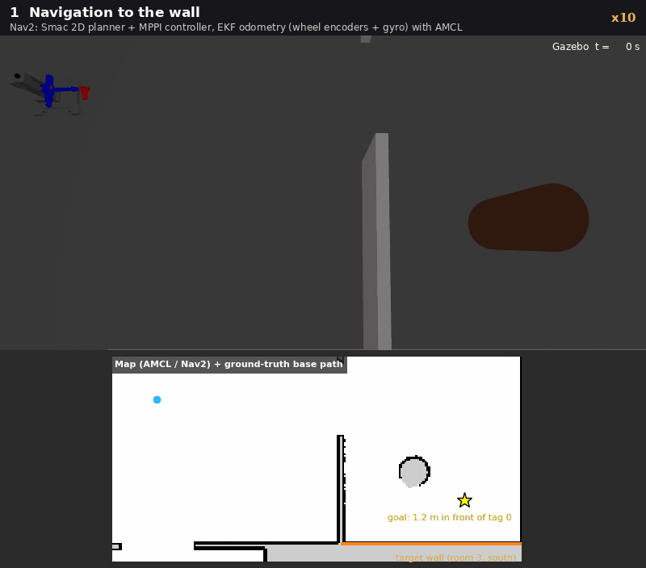
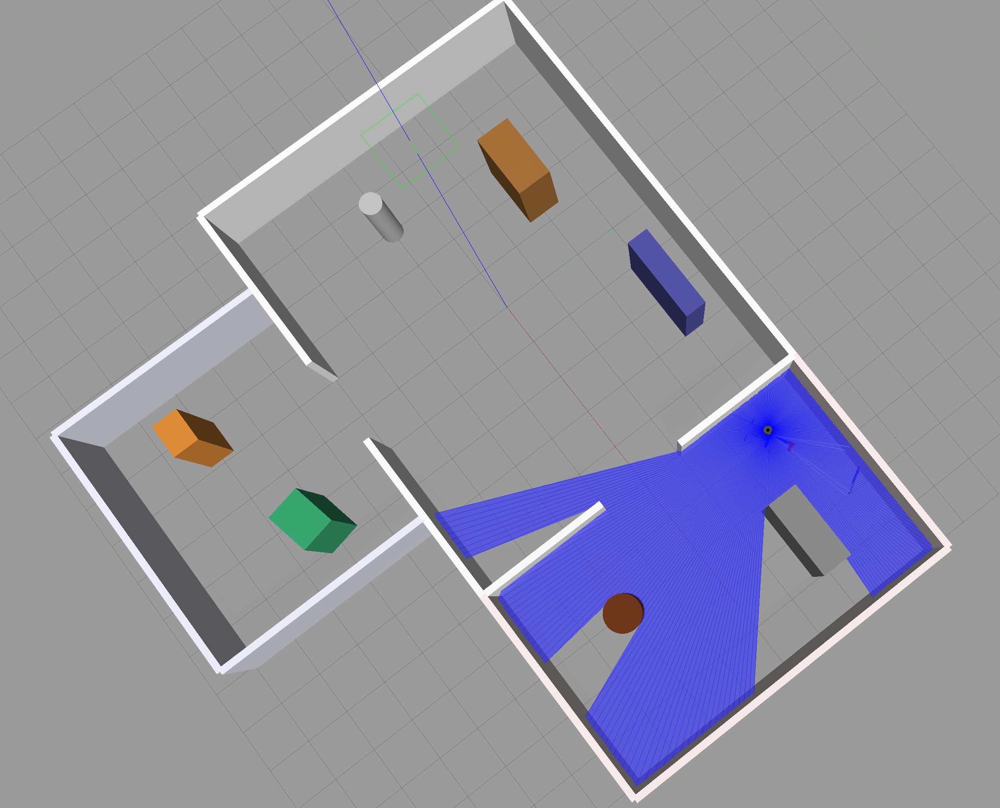
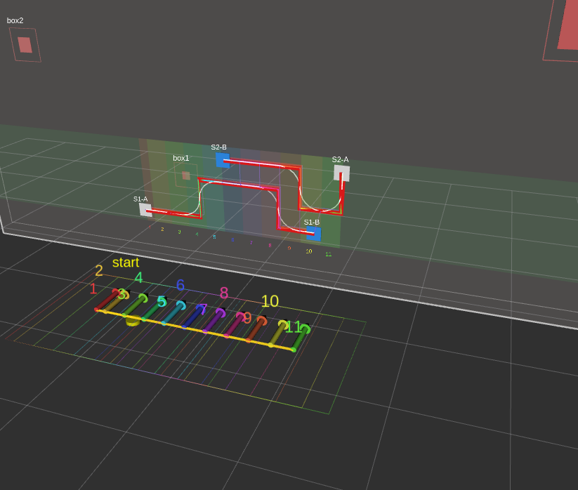
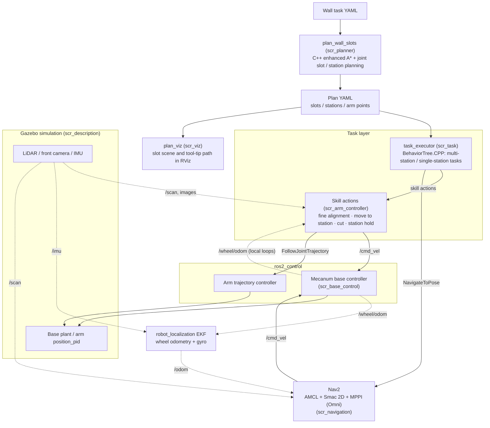
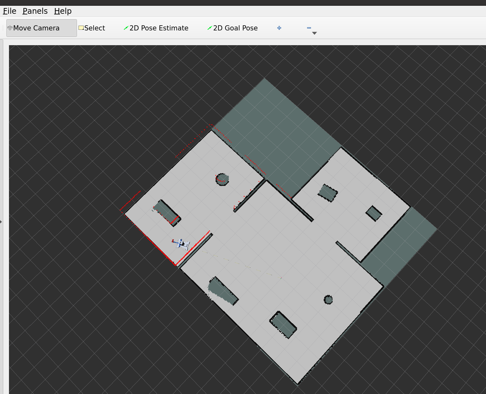
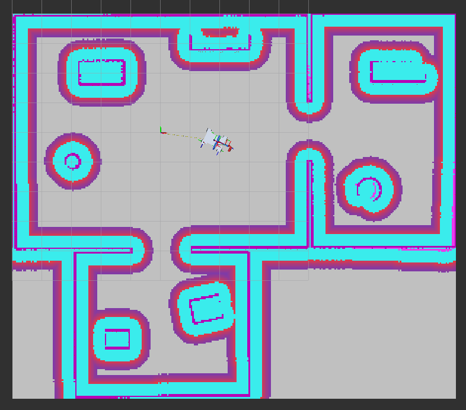
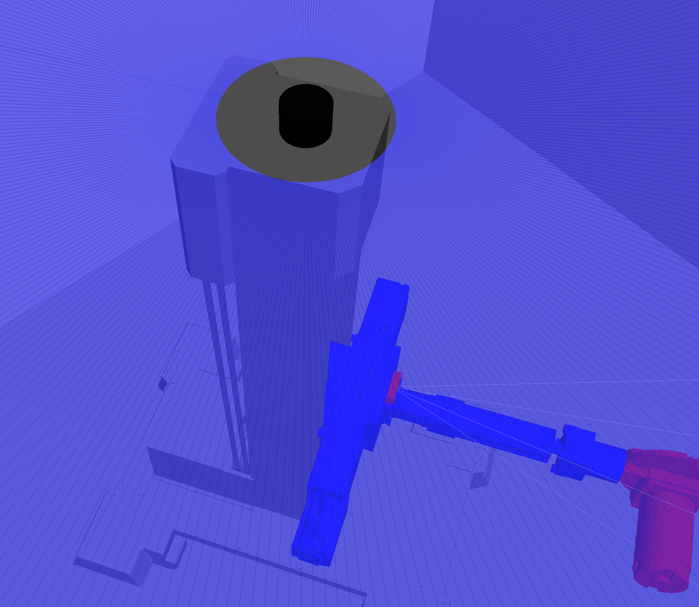
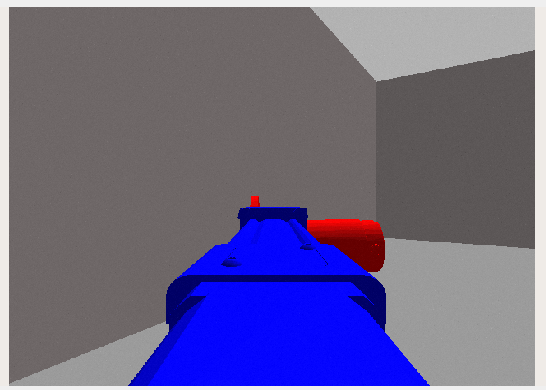

# Indoor Wall Slot-Cutting Robot

English | [简体中文](README.md)

[](https://github.com/Aemeath-BonVoage/indoor-wall-slot-cutting-robot-path-planning/actions/workflows/ci.yml)

**A ROS 2 simulation of an indoor wall slot-cutting robot (SCR)**: a mecanum omnidirectional base carrying a Cartesian 4-DoF arm. The system covers SLAM mapping, Nav2 navigation (Smac + MPPI), fine alignment with an AprilTag + LiDAR EKF, slot planning under construction slotting rules with task-level station optimisation, and multi-station cutting sequenced by a behaviour tree with the base held in place at each station.

> The detailed reports are written in Chinese. English readers can start from the [technical overview](docs/OVERVIEW.en.md), the [abstract of the technical report](docs/report/abstract_en.md) and the [figure gallery](docs/FIGURES.md), whose figures carry English labels and which ends with an English–Chinese glossary.

<p align="center"></p>
<p align="center"><sub>A complete multi-station slot-cutting run (dry cut) in Gazebo: Nav2 navigation to the wall → AprilTag + LiDAR fine alignment → 11 stations, each with a strafe, a station hold and a cut. The lower panel is the wall elevation: planned slots (white) and the Gazebo ground-truth tool-tip path (orange). <a href="docs/experiments/demo/slot_demo.mp4">MP4</a> · <a href="docs/experiments/demo/README.md">how it was recorded</a> (Chinese)</sub></p>

<table>
<tr>
<td width="50%"></td>
<td width="50%"></td>
</tr>
<tr>
<td align="center">Gazebo world</td>
<td align="center">Slot plan in RViz: slots, stations and arm reach windows</td>
</tr>
</table>

## Key results

All numbers come from Gazebo simulation (simulation configuration v2, evaluated against ground truth) or from offline experiments; each report states how its statistics were computed. The linked reports are in Chinese.

| Topic | Result | Report |
|---|---|---|
| Fine alignment | AprilTag + LiDAR EKF + saturated control law: alignment error 4.2 → 0.53 ± 0.21 mm (n = 8, paired); it stays at 0.5–0.8 mm under cool light, intermittent occlusion and odometry drift; a taught zero offset reduces the effect of a 1° camera mounting error from about 10 mm to 1.0 mm; Lyapunov and sampled-data stability analyses are given | [Design and analysis](docs/experiments/fine_alignment/README.md), [comparison experiments](docs/experiments/alignment_robustness/README.md) |
| Slot planning | A direction-aware enhanced A\* in C++ treats the slotting rules as hard constraints and remains optimal; it outputs no violating route on 140 random walls, where the first-version planner violates the rules on 106 | [Planning and rules](docs/experiments/cpp_planner/README.md) |
| Multi-station execution | Two slots and 11 stations completed in every run. After the fine-alignment upgrade, with the estimated marker position as the wall origin, the constant lateral offset of each run fell from +0.65–1.26 mm to −0.18–+0.24 mm, the maximum tool-tip path error was 0.9 mm and the total time fell from 250 s to 233 s. When the encoder model was given slip and noise, the along-wall error grew with distance from the marker to 25 mm; with AprilTags placed every 0.6 m and the lateral odometry scale estimated online in the EKF, the maximum along-wall error fell from 24.7 mm to 1.5 mm | [Multi-station execution](docs/experiments/slot_execution/README.md), [along-wall accuracy](docs/experiments/along_wall_accuracy/README.md) |
| Station optimisation | DP partition + optimal sweep order: total time in Gazebo 283 s → 250 s (−11.8 %) | [Multi-station execution](docs/experiments/slot_execution/README.md) |
| Task-level joint planning | Slot routes and stations optimised together: on 400 random residential walls it is never slower than planning the two in sequence, and on partition walls it saves a further 3.5 % of predicted execution time (95 % CI [3.0, 3.9] %, Wilcoxon p < 1e-10, time model calibrated on the current execution path); lower-bound certificates prove 92 % of the walls optimal. **Confirmed in Gazebo**: the example task takes 228 s with the joint plan and 246 s with rule-based routes, a saving of 7.3 % (6.6 % predicted; held-out error of the time model ≤ 0.7 %). These figures are for point-to-point arm motion; with continuous arm trajectories an extra segment costs 2.0 s instead of 8.1 s, the saving on partition walls shrinks to 1.2 % (95 % CI [1.0, 1.3] %), and the example task takes 160 s against 165 s | [Joint planning](docs/experiments/task_planning/README.md), [Gazebo validation](docs/experiments/plan_validation/README.md) |
| Continuous arm trajectories | The arm points of a station are executed as one trajectory: cutting segments run at the feed rate, non-cutting moves at per-axis limits, each with an S-curve profile and an exact stop at every corner. In Gazebo the 11 stations take 160 s instead of 228 s (−30 %), non-cutting arm motion falls from 122 s to 37 s and the mean tool-tip path error is unchanged (0.18–0.20 mm); the time model gains a cut-length term (`traj_v1`, held-out error ≤ 1.0 s) | [Continuous arm trajectories](docs/experiments/arm_trajectory/README.md) |
| Cutting force and station hold | A cutting-force model based on specific cutting energy gives the wrench on the base, and a whole wall was executed in Gazebo with that force applied (brick, 11 stations). The existing proportional hold fails: the tool tip is pushed 81–85 mm along horizontal cuts and only 40 % of the slot length is covered. A disturbance observer holds 8.3–9.0 mm, and 5.0–6.2 mm with 70 % feedforward (1.2 mm RMS, n = 4) at 100 % coverage; this is about twice the offline prediction and short of 1 mm. Step responses of the plant model agree with Gazebo within 6 % in 12 of 14 tests. The feed limit is set by wheel–floor friction, not spindle power: 5.5 mm/s in brick (μ = 0.3, safety factor 1.5). Most force values are assumptions | [Cutting force and hold](docs/experiments/cutting_force/README.md) |
| Planning gain under a force-limited feed | The time model was recalibrated at 5.5 mm/s (`cut_brick_v1`, held-out error ≤ 0.7 %): the 11 stations of the example wall take 979 s instead of 160 s for the dry cut, and an arm point costs 5.1 s instead of 0.5 s. On 400 random walls the predicted saving of joint planning on partition walls is 22.6 s (2.3 %, 95 % CI [2.0, 2.6] %), against 2.3 s (1.2 %) under the dry-cut model; the relative gain of merging stations falls from 10 % to 3.3 % | [Cutting force and hold, section 11](docs/experiments/cutting_force/README.md#11-进给速度的依据与规划收益) |
| Room-level planning and alternatives (offline) | On the 106 walls where joint planning finds no plan, the conflict always lies in one pair of slots. Without relaxing any slotting rule, changing the task (another feed point, or routing through the floor) gives a compliant plan on 102 of them, with no violation found by an independent checker. The visiting order and sweep direction over several walls are solved exactly by dynamic programming over subsets: on 200 random rooms it is 1.4 % faster than a fixed order (95 % CI [1.3, 1.6] %), and work on the walls accounts for 81 % of predicted time, so the order leaves little to gain. Not executed in Gazebo | [Room-level planning](docs/experiments/room_planning/README.md) |
| Execution-layer issues | Occasional 10–15 s stall before arrival: the behaviour tree waits 20 ms of simulation time for a goal acknowledgement while `/clock` advances in 0.1 s steps, so an acknowledgement was wrongly timed out and recovery started (5 of 198 navigations in the logs); the timeout is now 1000 ms. EKF bias at slow motion: the odometry twist was the instantaneous velocity of the publishing cycle; publishing the mean since the last message reduced the EKF-minus-wheel pose difference from −2.5 … +6.5 mm to within 0.02 mm. The ~2.7 s pause while cutting was traced to late action responses (tied to the DDS heartbeat period) and is not fixed; the Nav2 start-up failure did not recur in 30 cold starts. Disturbance-observer hold on the dry-cut task (4 paired runs): +0.3 % time, maximum path error −0.45 mm | [Execution-layer issues](docs/experiments/execution_issues/README.md) |
| Online marker-map estimation (offline) | Marker positions along the wall become states of the wall EKF, estimated together with the base position and the strafe scale: with a placement error of σ = 5 mm the mean of the maximum along-wall error over 11 stations falls from 4.79 mm (nominal map) to 1.16 mm and no longer grows with placement error (simulation, n = 100 per cell); replayed on recorded data the map recovers from a ±5 mm wrong prior to within 0.9 mm. Off by default and not yet run in Gazebo | [Marker-map estimation](docs/experiments/tag_map_estimation/README.md) |
| System layer | Tasks are sequenced by BehaviorTree.CPP over 6 skill actions (with retries and re-alignment); Nav2 uses Smac 2D + MPPI: 18 / 18 goals reached (NavFn + DWB: 15 / 18), minimum clearance 183 mm (5 mm), controller CPU 9.7 % (45.5 %); the base runs under ros2_control | [System-layer modernisation](docs/experiments/system_modernization/README.md) |
| Localisation fusion | Encoder error model + gyro + robot_localization EKF: odometry drift over a 129 m route 1.4–1.6 % → 0.14–0.26 % | [System-layer modernisation](docs/experiments/system_modernization/README.md#44-定位漂移) |
| Simulation fidelity | The two-layer root cause of distorted base rotation was found and fixed; the ratio of actual to commanded yaw rate went from 18–37 % to 0.99–1.01 | [Project evolution](docs/EVOLUTION.md#4-仿真保真度底盘漂移与旋转失真) |
| Method comparison | About 12,500 offline trials: pure IBVS is almost unobservable in yaw for this configuration (Jacobian condition number 314), so PBVS is kept | [Visual-servoing comparison](docs/experiments/ibvs_vs_pbvs/README.md) |

The [technical overview](docs/OVERVIEW.en.md) explains the problem, method and lessons behind each row in English.

## Architecture



Solid lines are commands and data; dashed lines are sensor feedback.

Single-station tasks and multi-station slot cutting are both actions of the behaviour-tree executor, whose tree nodes call Nav2 and the skill actions. Nav2 brings the base to the wall. An EKF fuses AprilTag detections with a LiDAR wall fit, and a saturated control law parks the base in front of the marker; the marker position estimated by the EKF becomes the origin of the wall coordinates. The robot then visits the stations one by one: it strafes, holds the base, corrects the arm points by the residual error measured by the sensors, and cuts. Gazebo walls are rigid bodies, so the simulation uses a dry cut: the tool tip stops at a fixed gap in front of the wall and only the path is verified.

| Package | Contents |
|---|---|
| [`scr_bringup`](src/scr_bringup/README.md) | One launch file for simulation + Nav2 + RViz, with headless and accelerated modes |
| [`scr_description`](src/scr_description/README.md) | URDF, Gazebo worlds, controller configuration, omnidirectional base kinematics node, force-based planar motion plugin `scr_planar_move` |
| [`scr_navigation`](src/scr_navigation/README.md) | SLAM Toolbox and Nav2 configuration, maps, navigation goal scripts |
| [`scr_arm_controller`](src/scr_arm_controller/README.md) | Arm kinematics, fine alignment (AprilTag + LiDAR EKF), station hold, skill action server, alignment experiment tools |
| [`scr_task`](src/scr_task/README.md) | BehaviorTree.CPP task executor: behaviour trees for multi-station and single-station tasks |
| [`scr_interfaces`](src/scr_interfaces/README.md) | Action and message definitions for tasks and skills |
| [`scr_base_control`](src/scr_base_control/README.md) | ros2_control mecanum base controller, encoder error model, simulated hardware interface for Gazebo |
| [`scr_planner`](src/scr_planner/README.md) | C++ slot planner, slotting rules, station partition and order optimisation, execution recorder |
| [`scr_viz`](src/scr_viz/README.md) | Slot visualisation in RViz, wall fixtures in Gazebo, demo recording |
| [`path_planning`](src/path_planning/README.md) | First-version planner (Python prototype): standard / improved / enhanced A\* comparison |

The package READMEs are in Chinese.

<table>
<tr>
<td></td>
<td></td>
</tr>
<tr>
<td align="center">Map and navigation in RViz</td>
<td align="center">Nav2 layered costmap</td>
</tr>
<tr>
<td></td>
<td></td>
</tr>
<tr>
<td align="center">Cartesian arm</td>
<td align="center">Front camera view</td>
</tr>
</table>

## Quick start

Requirements: Ubuntu 22.04, ROS 2 Humble, Gazebo 11.

```bash
git clone https://github.com/Aemeath-BonVoage/indoor-wall-slot-cutting-robot-path-planning.git ~/colcon_ws
cd ~/colcon_ws
rosdep install --from-paths src --ignore-src -r -y
colcon build --symlink-install
source install/setup.bash
```

Start the simulation and navigation (Nav2 is ready after about 20–30 s):

```bash
ros2 launch scr_bringup sim_nav.launch.py                         # with the Gazebo window and RViz
ros2 launch scr_bringup sim_nav.launch.py gui:=false rviz:=false  # headless
```

Single-station task (navigate → fine alignment → scan → cut):

```bash
ros2 run scr_arm_controller navigation_cutting_task task_at_target.yaml
```

Multi-station slot cutting (offline planning → station-by-station execution, dry cut) and visualisation:

```bash
python3 src/scr_planner/scripts/plan_wall_slots.py src/scr_planner/config/wall_task_room3_south.yaml /tmp/plan.yaml
ros2 run scr_arm_controller navigation_cutting_task /tmp/plan.yaml --dry-run-gap=0.01
ros2 launch scr_viz plan_viz.launch.py plan_file:=/tmp/plan.yaml use_sim_time:=true
```

Tests:

```bash
colcon test && colcon test-result --verbose
```

With Docker instead of a local ROS 2 installation (the image contains the built workspace; the headless service starts the simulation, Nav2 and the task layer):

```bash
docker compose -f docker/docker-compose.yml build
docker compose -f docker/docker-compose.yml up -d sim
docker compose -f docker/docker-compose.yml exec sim bash   # then run the task commands above
```

Mapping, navigation, task file formats, visualisation, Docker usage and troubleshooting are covered in the [user guide](docs/USER_GUIDE.md) (Chinese; Docker is section 11).

## Documentation

In English:

- [Technical overview](docs/OVERVIEW.en.md): problem, method, key result and lessons for each part of the project
- [Abstract of the technical report](docs/report/abstract_en.md)
- [Figure gallery](docs/FIGURES.md): thumbnails of all data figures; the figures have English labels, the captions are in Chinese, and the page ends with an English–Chinese glossary

In Chinese:

- [Technical report](docs/report/README.md) ([PDF](docs/report/report.pdf)): the complete account of the system, methods and experiments
- [Project evolution](docs/EVOLUTION.md): goals, problems found, diagnosis and improvements at each stage
- [User guide](docs/USER_GUIDE.md): installation, launch, mapping, navigation, task execution, visualisation, Docker, troubleshooting
- [Roadmap](docs/ROADMAP.md): work in progress and planned
- Experiment reports:
  - [Fine alignment, design and control analysis: AprilTag + LiDAR EKF](docs/experiments/fine_alignment/README.md)
  - [Alignment robustness comparison](docs/experiments/alignment_robustness/README.md)
  - [Wall slot planning: enhanced A\* in C++ and the slotting rules](docs/experiments/cpp_planner/README.md)
  - [Multi-station execution and station order optimisation](docs/experiments/slot_execution/README.md)
  - [System-layer modernisation: behaviour trees, Nav2 MPPI / Smac, localisation fusion, ros2_control](docs/experiments/system_modernization/README.md)
  - [Along-wall accuracy over many stations: multi-marker map and online strafe-scale estimation](docs/experiments/along_wall_accuracy/README.md)
  - [Online marker-map estimation: removing the dependence on marker placement accuracy (offline)](docs/experiments/tag_map_estimation/README.md)
  - [Execution-layer issues: navigation stall, cutting pause, start-up failure, slow-motion EKF](docs/experiments/execution_issues/README.md)
  - [Plan validation: time-model recalibration and Gazebo execution of the joint plan](docs/experiments/plan_validation/README.md)
  - [Continuous arm trajectories: separate feed and rapid limits, cut-length term in the time model](docs/experiments/arm_trajectory/README.md)
  - [Cutting-force disturbance and station hold: force model, platform feasibility, controller comparison, Gazebo validation, feed limit](docs/experiments/cutting_force/README.md)
  - [Task-level joint planning: slot routes + stations](docs/experiments/task_planning/README.md)
  - [Room-level planning and alternatives for walls without a compliant plan](docs/experiments/room_planning/README.md)
  - [Visual-servoing comparison: PBVS / IBVS / 2.5D hybrid](docs/experiments/ibvs_vs_pbvs/README.md)
  - [Visualisation and demo](docs/experiments/demo/README.md)

## About

The project started as an undergraduate graduation project on autonomous path planning for a robot that cuts conduit slots in indoor walls, and has been developed continuously since: ground-truth evaluation and reproducible experiments were added, fine alignment was rebuilt on visual servoing and state estimation, simulation-fidelity problems were corrected, and slot planning was extended into a complete pipeline that satisfies the slotting rules and is optimised and executed jointly over multiple stations.

Released under the [MIT licence](LICENSE).
