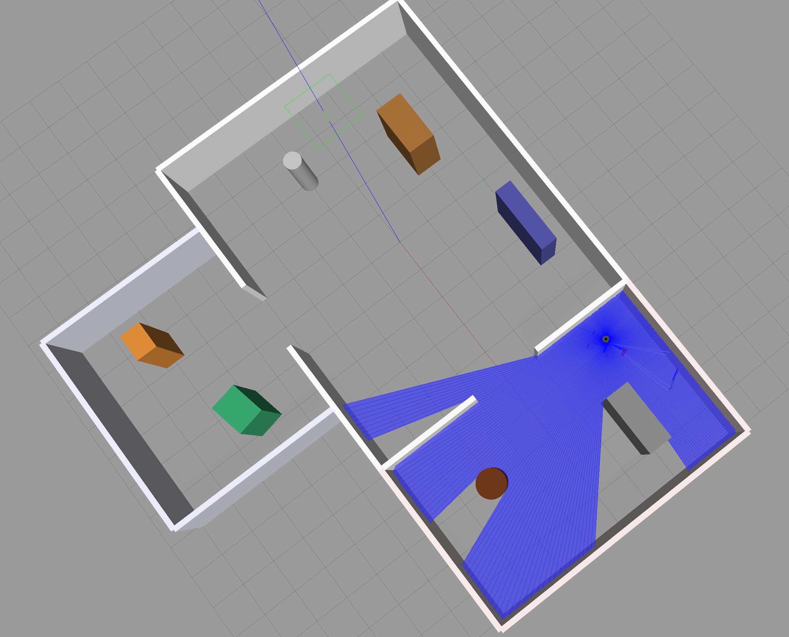
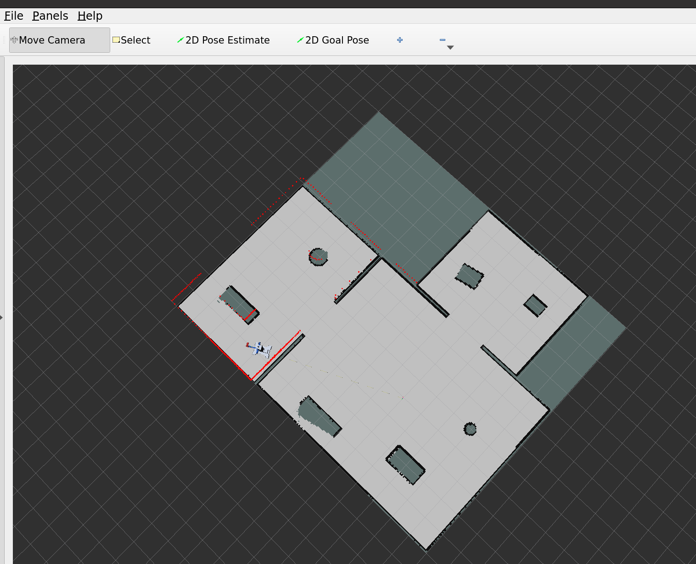
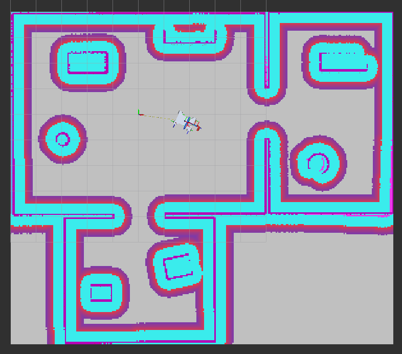
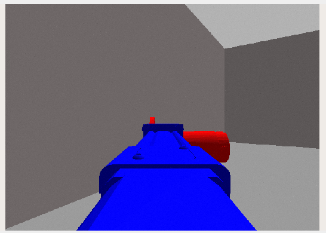
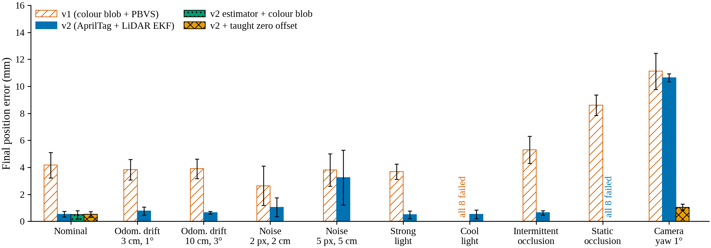
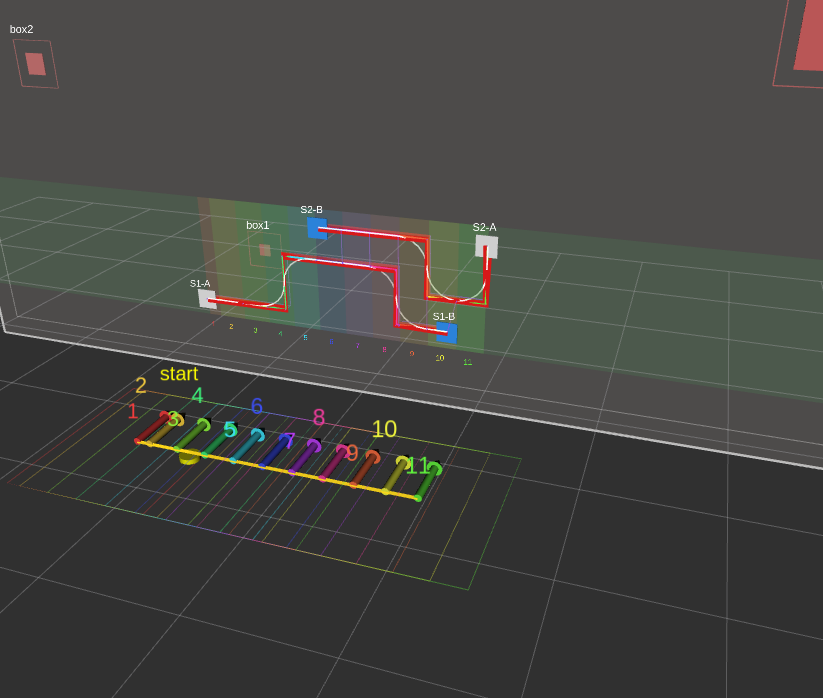
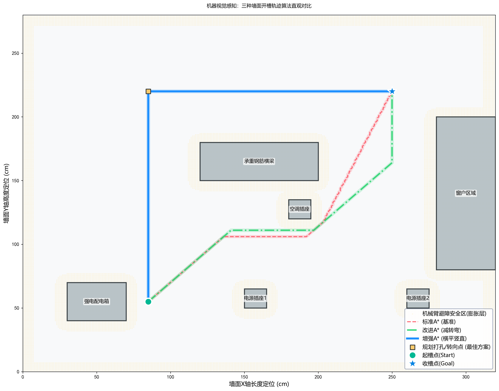

# Indoor Wall Slot-Cutting Robot — Path Planning

[](https://github.com/Aemeath-BonVoage/indoor-wall-slot-cutting-robot-path-planning/actions/workflows/ci.yml)

**面向室内墙体线槽开槽任务的机器人自主路径规划设计**

一个基于 **ROS 2 Humble** 的室内墙面开槽机器人（SCR, *Slot Cutting Robot*）仿真系统：麦克纳姆轮全向底盘 + 直角坐标式 4 自由度机械臂，覆盖 **SLAM 建图 → Nav2 自主导航 → 视觉伺服对位 → 横平竖直开槽轨迹规划 → 机械臂执行** 的完整作业链路。



---

## ✨ 主要功能

| 模块 | 内容 |
|---|---|
| 🛞 **全向底盘** | 麦克纳姆轮逆运动学控制器，`/cmd_vel` → 四轮速度，支持横移/斜移/原地旋转 |
| 🦾 **机械臂** | 3 移动 + 1 旋转的直角坐标机械臂，闭式正/逆运动学，YAML 声明式轨迹任务 |
| 🗺️ **SLAM 建图** | SLAM Toolbox 异步建图，2D 激光雷达 |
| 🧭 **自主导航** | Nav2（AMCL 定位 + DWB 局部规划 + 行为树恢复） |
| 🎯 **视觉伺服** | 相机 + 激光融合 PBVS：激光拟合墙面、相机检测标记并与墙面求交得三维位置，闭环驱动全向底盘对位；仿真真值误差约 2 mm |
| 📐 **开槽规划** | C++ 方向感知增强 A\*，施工规范（承重墙禁横槽、导管弯曲半径、留距）作为硬约束；按机械臂工作空间划分停靠站并优化访问顺序 |
| 🔁 **多站执行** | 离线规划 → 逐站导航 / 视觉对位 / 定点保持 → 残差补偿 → 机械臂只走横 / 竖直线切割 |
| 👁️ **可视化** | RViz 显示墙面障碍、规范边距、槽线、停靠站与刀尖实际轨迹；墙面插座 / 配电箱等实体运行时生成 |

<table>
<tr>
<td></td>
<td></td>
</tr>
<tr>
<td align="center">RViz 中的地图与导航</td>
<td align="center">Nav2 多层代价地图</td>
</tr>
<tr>
<td></td>
<td></td>
</tr>
<tr>
<td align="center">直角坐标机械臂</td>
<td align="center">前视相机视角</td>
</tr>
</table>

---

## 🎯 视觉伺服对位鲁棒性

相机 + 激光融合 PBVS 与“里程计 + 已知标记坐标”基线的对比（每条件 8 次随机起点，Gazebo 真值评估）：



无扰动时视觉伺服 2.0 mm、里程计基线 4.0 mm；里程计漂移 3 / 10 cm 时基线误差升至 29 / 84 mm、刀具离墙间隙被压缩到个位毫米，视觉伺服保持 1.9–2.7 mm、间隙 ≥ 20 mm。接近墙面时机械臂缩回，并有按制动距离限速的激光防碰撞守护（开启时 64 次试验零碰墙）。详见 [实验报告](docs/experiments/alignment_robustness/README.md)。

---

## 📐 墙面开槽：规划 → 多站执行

**规划（`scr_planner`，C++）**：方向感知增强 A\* 一步走一整段横 / 竖直线，状态为 `(x, y, 上一段方向)`，转弯数可证最优；施工规范作为硬约束——承重墙禁开横槽（GB 50203）、导管弯曲半径（GB 50303）、横槽限长、梁柱 / 门窗留距。140 面随机墙上，第一版规划器 Python 规划器在非承重墙上 100/100 违反规范，C++ 版 0 违规，规划耗时中位数 100 → 35 ms（[报告](docs/experiments/cpp_planner/README.md)）。

**执行**：机械臂在墙面内沿墙方向只能覆盖约 14 cm（竖直 55 cm），一条槽要分多个停靠站完成。规划器按工作空间划分停靠站并优化访问顺序（DP），执行时视觉对位确定墙面原点 → 逐站横移 → 定点保持 → 用激光 / 里程计测得的残余误差补偿机械臂点 → 切割。



示例任务（2 条槽共 2.76 m，Gazebo 空切，每种方案跑 2 次，全部站点完成）：

| | 基线（每条槽单独分站，16 站） | **优化（DP 划分 + 顺序，11 站）** |
|---|---|---|
| 总耗时（仿真） | 283.4 s | **249.9 s（−11.8 %）** |
| 刀尖轨迹误差 p95 / max（真值） | 1.2–2.1 / 1.8–2.7 mm | 0.4–1.0 / 1.2–1.3 mm |
| 切割期间底盘漂移 | ≤ 0.32 mm | ≤ 0.31 mm |

100 面随机墙离线对比平均节省 12.5 %。详见 [多站执行报告](docs/experiments/slot_execution/README.md)、[可视化与演示](docs/experiments/demo/README.md)。

### 视觉伺服方法对比：PBVS / IBVS / 2.5D 混合

离线运动学仿真中约 1.25 万次试验对比了三种视觉伺服方式。5 cm 标记在 0.55 m 处只有约 35 px，纯 IBVS 的偏航几乎不可观（雅可比条件数 314，1 px 角点噪声 → 8.7° 偏航标准差），2 px 噪声下 0/100 次收敛；PBVS 借助激光拟合墙面（0.23°）在所有噪声档 100/100 收敛。因此系统保留 PBVS，IBVS 作为对照实现保留（[报告](docs/experiments/ibvs_vs_pbvs/README.md)）。

### 第一版规划器规划器（参考实现）

`src/path_planning` 保留毕设中的纯 Python 标准 / 改进 / 增强 A\* 对比（正交方向约束 + 曼哈顿启发 + 转向惩罚 + 路径平滑）：



| 指标（3.2 × 2.8 m 墙面） | 标准 A\* | 改进 A\* | 增强 A\* |
|---|---|---|---|
| 转向次数 | 95 | 3 | 1 |
| 横平竖直比例 | 50.7 % | 50.7 % | 100 % |

---

## 📁 项目结构

```
.
├── src/
│   ├── scr_bringup/         # 一键启动（仿真 + 导航 + RViz，支持轻量模式）
│   ├── scr_description/      # URDF/网格模型、Gazebo 世界、控制器配置、麦轮控制器
│   ├── scr_navigation/       # SLAM Toolbox / Nav2 配置、地图、RViz 配置
│   ├── scr_arm_controller/   # 笛卡尔运动学、YAML 轨迹任务、标记扫描、导航+切割总流程
│   ├── scr_planner/          # C++ 方向感知增强 A* + 施工规范约束的墙面开槽规划、停靠站划分与顺序优化
│   ├── scr_viz/              # RViz 开槽可视化、Gazebo 墙面实体、演示录制工具
│   └── path_planning/        # 标准/改进/增强 A* 实现与对比实验（第一版规划器纯 Python 参考实现）
├── docker/                   # Docker 环境（osrf/ros:humble-desktop-full）
├── docs/experiments/         # 各实验报告与原始数据
├── docs/images/              # README 图片
└── *.md                      # 操作文档与专题指南
```

---

## 🚀 快速开始

### 环境

- Ubuntu 22.04 + ROS 2 Humble
- Gazebo 11（`ros-humble-gazebo-ros-pkgs`）
- Nav2、SLAM Toolbox、ros2_control

```bash
sudo apt install ros-humble-navigation2 ros-humble-nav2-bringup ros-humble-slam-toolbox \
  ros-humble-gazebo-ros-pkgs ros-humble-ros2-control ros-humble-ros2-controllers \
  ros-humble-gazebo-ros2-control ros-humble-xacro ros-humble-teleop-twist-keyboard \
  ros-humble-robot-localization ros-humble-cv-bridge
```

### 编译

```bash
git clone git@github.com:Aemeath-BonVoage/indoor-wall-slot-cutting-robot-path-planning.git ~/colcon_ws
cd ~/colcon_ws
# 也可以用 rosdep 一键安装依赖（首次需 sudo rosdep init && rosdep update）
rosdep install --from-paths src --ignore-src -r -y
colcon build --symlink-install
source install/setup.bash
```

### 一键启动（推荐）

```bash
ros2 launch scr_bringup sim_nav.launch.py                        # Gazebo + Nav2 + RViz
ros2 launch scr_bringup sim_nav.launch.py gui:=false             # 不开 Gazebo 窗口
ros2 launch scr_bringup sim_nav.launch.py gui:=false rviz:=false # 纯后台，最省内存
ros2 launch scr_description gazebo.launch.py gui:=false rtf:=2.5  # 批量实验：只启动仿真，约 2.3 倍速

# 导航就绪后（约 20–30 s）发送目标点
ros2 run scr_navigation send_goal.py 1.5 0.0 0.0
```

> 实测（4 核 / 4 GB 虚拟机，纯后台模式）：仿真实时率 ≈ 1.0，仿真 + 完整 Nav2 额外占用约 400 MB 内存；完整“导航 → 对位 → 扫描 → 切割”任务约 100 s。

### 分步运行

```bash
# 1. 启动 Gazebo 仿真（gui:=false 可关闭窗口）
ros2 launch scr_description gazebo.launch.py

# 2a. SLAM 建图（键盘遥控建图后保存）
ros2 launch scr_navigation slam.launch.py
ros2 run teleop_twist_keyboard teleop_twist_keyboard
ros2 run nav2_map_server map_saver_cli -f src/scr_navigation/maps/my_map

# 2b. 或直接使用已有地图进行导航
ros2 launch scr_navigation navigation.launch.py

# 3. 完整任务：导航 → 扫描标记 → 精确对位 → 开槽
ros2 run scr_arm_controller navigation_cutting_task task_at_target.yaml
```

多站开槽（先离线规划，再整体执行；Gazebo 中用空切）：

```bash
python3 src/scr_planner/scripts/plan_wall_slots.py src/scr_planner/config/wall_task_room3_south.yaml plan.yaml
ros2 run scr_arm_controller navigation_cutting_task plan.yaml --dry-run-gap=0.01
ros2 launch scr_viz plan_viz.launch.py                  # RViz 中查看规划与刀尖轨迹
```

只运行机械臂开槽：

```bash
ros2 run scr_arm_controller custom_cutting wall_cutting.yaml
```

### 路径规划对比实验（无需 ROS）

```bash
pip install numpy matplotlib pillow
cd src/path_planning
python3 improved_astar.py        # 底盘层：基于 SLAM 地图的三算法对比
python3 wall_cutting_planner.py  # 墙面层：开槽轨迹三算法对比
```

更多细节见 [操作文档.md](操作文档.md)、[NAVIGATION_CUTTING_GUIDE.md](NAVIGATION_CUTTING_GUIDE.md)、[MARKER_SCANNING_GUIDE.md](MARKER_SCANNING_GUIDE.md)。

---

## 🤖 机器人参数

| 项目 | 参数 |
|---|---|
| 底盘 | 麦克纳姆轮，轮径 100 mm，轮距 593.16 × 493.80 mm |
| 机械臂工作空间 | X 0.517–0.582 m，Y −0.060–0.080 m，Z 0.157–0.707 m（相对 `base_link`，TF 实测） |
| 关节 | joint1 Z 升降 / joint2 Y 横移 / joint3 X 伸缩 / joint4 末端旋转 ±90° |
| 传感器 | 2D 激光雷达、前视 RGB 相机 |

---

## 🗺️ Roadmap

完整路线见 [docs/ROADMAP.md](docs/ROADMAP.md)。接下来：

- [ ] 对位结束时用测得的残余误差修正墙面参考原点；视觉零偏示教（相机安装误差）
- [ ] Gazebo 中录制完整多站开槽演示（墙面实体 + 刀尖轨迹）
- [ ] 随机场景生成器与数百场景批量基准；与 Theta\* / JPS 等基线对比
- [ ] 迁移到 Gazebo Harmonic（ros_gz）

---

## 📄 关于

本项目为本科毕业设计《面向室内墙体线槽开槽任务的机器人自主路径规划设计》的配套代码。
