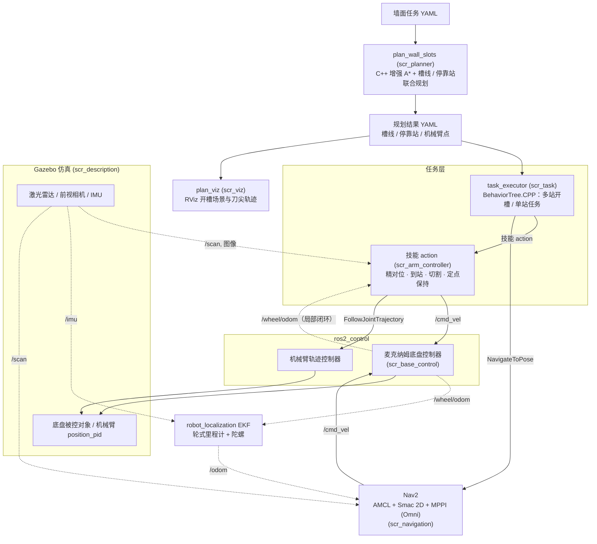
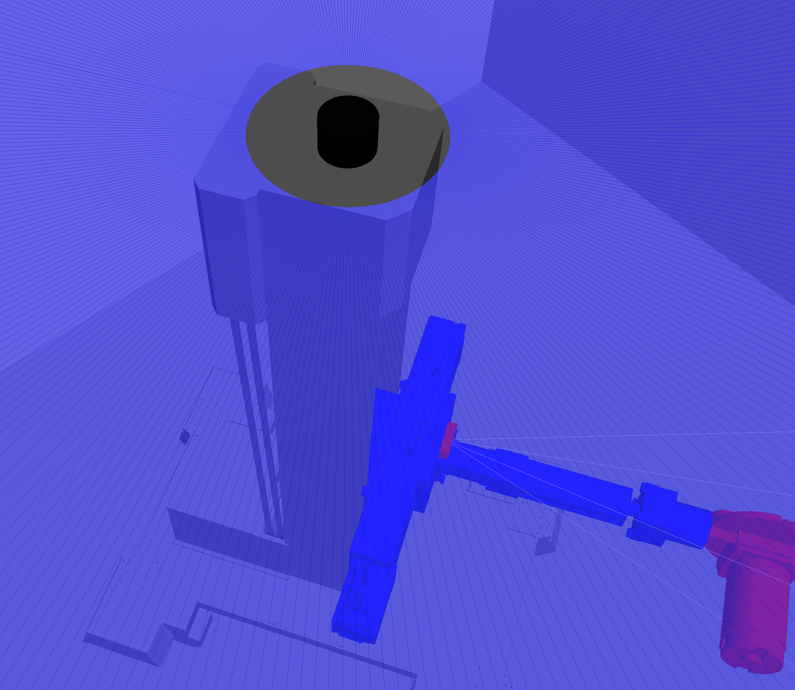

# Indoor Wall Slot-Cutting Robot

[](https://github.com/Aemeath-BonVoage/indoor-wall-slot-cutting-robot-path-planning/actions/workflows/ci.yml)

**室内墙面开槽机器人（SCR, Slot Cutting Robot）的 ROS 2 仿真系统**：麦克纳姆轮全向底盘 + 直角坐标式 4 自由度机械臂，覆盖 SLAM 建图、Nav2 导航（Smac + MPPI）、AprilTag + 激光 EKF 精对位、满足施工规范的开槽规划与任务级停靠站优化，以及由行为树编排、带定点保持的多站切割执行。

<!-- 多站开槽演示 GIF 录制后放在此处 -->

<table>
<tr>
<td width="50%"></td>
<td width="50%"></td>
</tr>
<tr>
<td align="center">Gazebo 仿真场景</td>
<td align="center">RViz 中的开槽规划：槽线、停靠站与机械臂可达窗口</td>
</tr>
</table>

## 主要结果

以下数据均来自 Gazebo 仿真（仿真配置 v2，真值评估）或离线实验，统计口径见各报告。

| 方向 | 结果 | 报告 |
|---|---|---|
| 精对位 | AprilTag + 激光 EKF + 饱和控制律：对位误差 4.2 → 0.53 ± 0.21 mm（n = 8，配对）；冷光、间歇遮挡、里程计漂移下保持 0.5–0.8 mm；示教零位把 1° 相机安装误差的影响从约 10 mm 降到 1.0 mm；给出李雅普诺夫与离散采样稳定性分析 | [设计与分析](docs/experiments/fine_alignment/README.md)、[对比实验](docs/experiments/alignment_robustness/README.md) |
| 开槽规划 | C++ 方向感知增强 A\* 把施工规范作为硬约束并保持最优；140 面随机墙上 0 条违规路线，第一版规划器在 106 面上违规 | [规划与规范](docs/experiments/cpp_planner/README.md) |
| 多站执行 | 两条槽 11 个停靠站全部完成；精对位升级并以标记估计位置为墙面原点后，每次运行的常值横向偏差 +0.65–1.26 → −0.18–+0.24 mm，刀尖轨迹误差最大 0.9 mm，总耗时 250 → 233 s。以上为理想里程计；换成含打滑与噪声的编码器模型后，沿墙误差随离标记的距离累积到 25 mm，是当前的主要问题 | [多站执行](docs/experiments/slot_execution/README.md)、[系统层](docs/experiments/system_modernization/README.md#45-真实里程计下的精对位与多站执行) |
| 停靠站优化 | 动态规划划分 + 最优扫掠顺序，Gazebo 中总耗时 283 s → 250 s（−11.8 %） | [多站执行](docs/experiments/slot_execution/README.md) |
| 任务级联合规划 | 槽线走向与停靠站联合优化：400 面随机住宅墙上从不比分步方法慢，非承重墙预测执行时间再省 3.8 %（95 % CI [3.3, 4.3] %，Wilcoxon p < 1e-10，按精对位第二版重新标定的时间模型），下界证书证明 92 % 的墙已达最优 | [联合规划](docs/experiments/task_planning/README.md) |
| 系统层 | 任务改由 BehaviorTree.CPP 编排 6 个技能 action（含重试与重新对位）；Nav2 换用 Smac 2D + MPPI：到达 18 / 18（NavFn + DWB 15 / 18），最小离障间隙 183 mm（5 mm），控制器 CPU 9.7 %（45.5 %）；底盘接入 ros2_control | [系统层现代化](docs/experiments/system_modernization/README.md) |
| 定位融合 | 编码器误差模型 + 陀螺 + robot_localization EKF：129 m 路线上里程计漂移 1.4–1.6 % → 0.14–0.26 % | [系统层现代化](docs/experiments/system_modernization/README.md#44-定位漂移) |
| 仿真保真度 | 定位并修复底盘旋转失真的两层根因，转速比 18–37 % → 0.99–1.01 | [项目演进](docs/EVOLUTION.md#4-仿真保真度底盘漂移与旋转失真) |
| 方法对比 | 约 1.25 万次离线试验：纯 IBVS 在本构型下偏航几乎不可观（雅可比条件数 314），保留 PBVS | [视觉伺服对比](docs/experiments/ibvs_vs_pbvs/README.md) |

## 系统结构



实线为指令与数据流，虚线为传感器反馈。

单站任务和多站开槽都是行为树执行器上的 action，树中节点调用 Nav2 与各个技能 action：Nav2 把底盘送到墙前，AprilTag 与激光墙面拟合经 EKF 融合，饱和控制律把底盘对位到定位标记正前方（EKF 估计的标记位置作为墙面坐标原点），然后逐站横移、定点保持、按传感器测得的残余误差修正机械臂点并切割。Gazebo 的墙是刚体，仿真中采用空切：刀尖停在墙前固定间隙处，只验证轨迹。

| 包 | 内容 |
|---|---|
| [`scr_bringup`](src/scr_bringup/README.md) | 一键启动仿真 + Nav2 + RViz，支持无界面和加速模式 |
| [`scr_description`](src/scr_description/README.md) | URDF、Gazebo 世界、控制器配置、全向底盘运动学节点、力控平面运动插件 `scr_planar_move` |
| [`scr_navigation`](src/scr_navigation/README.md) | SLAM Toolbox 与 Nav2 配置、地图、导航目标脚本 |
| [`scr_arm_controller`](src/scr_arm_controller/README.md) | 机械臂运动学、精对位（AprilTag + 激光 EKF）、定点保持、技能 action 服务器、对位实验工具 |
| [`scr_task`](src/scr_task/README.md) | BehaviorTree.CPP 任务执行器：多站开槽与单站任务的行为树 |
| [`scr_interfaces`](src/scr_interfaces/README.md) | 任务与技能的 action / 消息定义 |
| [`scr_base_control`](src/scr_base_control/README.md) | ros2_control 麦克纳姆底盘控制器、编码器误差模型、Gazebo 仿真硬件接口 |
| [`scr_planner`](src/scr_planner/README.md) | C++ 开槽规划器、施工规范、停靠站划分与顺序优化、执行实验记录 |
| [`scr_viz`](src/scr_viz/README.md) | RViz 开槽可视化、Gazebo 墙面实体、演示录制 |
| [`path_planning`](src/path_planning/README.md) | 第一版规划器（Python 原型）：标准 / 改进 / 增强 A\* 对比 |

<table>
<tr>
<td></td>
<td></td>
</tr>
<tr>
<td align="center">RViz 中的地图与导航</td>
<td align="center">Nav2 多层代价地图</td>
</tr>
<tr>
<td></td>
<td></td>
</tr>
<tr>
<td align="center">直角坐标机械臂</td>
<td align="center">前视相机视角</td>
</tr>
</table>

## 快速开始

环境：Ubuntu 22.04、ROS 2 Humble、Gazebo 11。

```bash
git clone https://github.com/Aemeath-BonVoage/indoor-wall-slot-cutting-robot-path-planning.git ~/colcon_ws
cd ~/colcon_ws
rosdep install --from-paths src --ignore-src -r -y
colcon build --symlink-install
source install/setup.bash
```

启动仿真与导航（约 20–30 s 后 Nav2 就绪）：

```bash
ros2 launch scr_bringup sim_nav.launch.py                         # 带 Gazebo 窗口与 RViz
ros2 launch scr_bringup sim_nav.launch.py gui:=false rviz:=false  # 纯后台
```

单站任务（导航 → 精对位 → 扫描 → 切割）：

```bash
ros2 run scr_arm_controller navigation_cutting_task task_at_target.yaml
```

多站开槽（离线规划 → 逐站执行，空切）与可视化：

```bash
python3 src/scr_planner/scripts/plan_wall_slots.py src/scr_planner/config/wall_task_room3_south.yaml /tmp/plan.yaml
ros2 run scr_arm_controller navigation_cutting_task /tmp/plan.yaml --dry-run-gap=0.01
ros2 launch scr_viz plan_viz.launch.py plan_file:=/tmp/plan.yaml use_sim_time:=true
```

测试：

```bash
colcon test && colcon test-result --verbose
```

建图、导航、任务文件格式、可视化和故障排查见 [使用指南](docs/USER_GUIDE.md)。

## 项目演进与文档

- [技术报告](docs/report/README.md)（[PDF](docs/report/report.pdf)，[English abstract](docs/report/abstract_en.md)）：系统、方法与实验的完整汇总
- [项目演进](docs/EVOLUTION.md)：各阶段的目标、发现的问题、诊断过程与改进
- [使用指南](docs/USER_GUIDE.md)：安装、启动、建图、导航、任务执行、可视化、故障排查
- [路线图](docs/ROADMAP.md)：进行中与计划中的工作
- 实验报告：
  - [精对位设计与控制分析：AprilTag + 激光 EKF](docs/experiments/fine_alignment/README.md)
  - [对位鲁棒性对比](docs/experiments/alignment_robustness/README.md)
  - [墙面开槽规划：C++ 增强 A\* 与施工规范](docs/experiments/cpp_planner/README.md)
  - [多站执行与停靠站顺序优化](docs/experiments/slot_execution/README.md)
  - [系统层现代化：行为树、Nav2 MPPI / Smac、定位融合、ros2_control](docs/experiments/system_modernization/README.md)
  - [任务级联合规划：槽线走向 + 停靠站](docs/experiments/task_planning/README.md)
  - [视觉伺服方法对比：PBVS / IBVS / 2.5D 混合](docs/experiments/ibvs_vs_pbvs/README.md)
  - [可视化与演示](docs/experiments/demo/README.md)

## 关于

本项目起源于本科毕业设计《面向室内墙体线槽开槽任务的机器人自主路径规划设计》，在此基础上持续迭代：补充真值评估与可复现实验，引入视觉伺服与状态估计的精对位，修正仿真保真度问题，并把开槽规划扩展为满足施工规范、在多个停靠站上联合优化并执行的完整流程。
