# 图集

本页按项目顺序（精对位 → 规划 → 执行 → 系统 → 验证）汇总全部数据图。每张图下给出说明（画了什么、坐标轴、怎么读）与要点，点击缩略图看原图，“PDF” 为同名矢量图。图中术语的中英对照见文末 [术语表](#术语表)。

**读图约定**（所有图一致，详见 [`figstyle`](figstyle/README.md)）：

| 颜色与线型 | 含义 |
|---|---|
| 朱红、虚线、白底斜线柱、空心方块 | v1、第一版、基线、规则路线、仅轮式里程计、NavFn + DWB |
| 蓝、实线、实心柱、实心圆点 | v2、当前版本、联合规划、视觉（AprilTag + 激光 EKF）、Smac 2D + MPPI |
| 绿、橙、紫、天蓝（点划线、点线等） | 依次出现的其他变体或备选方法 |
| 灰 | 中性参照（逐槽划分、标定数据、被排除的运行） |
| 黑点线 | 目标值、容差、真值、下界 |

面板标签 (a)、(b)… 写在各面板左上角；误差棒的含义（标准差或分位数）在各图说明中注明。

## 目录

- [一、精对位](#一精对位)
- [二、规划](#二规划)
- [三、执行](#三执行)
- [四、系统](#四系统)
- [五、验证](#五验证)
- [术语表](#术语表)
- [图的生成](#图的生成)

## 一、精对位

### 1.1 第一版：里程计对位与视觉 PBVS（存档）

<a href="experiments/alignment_robustness/v1_baseline/robustness.png">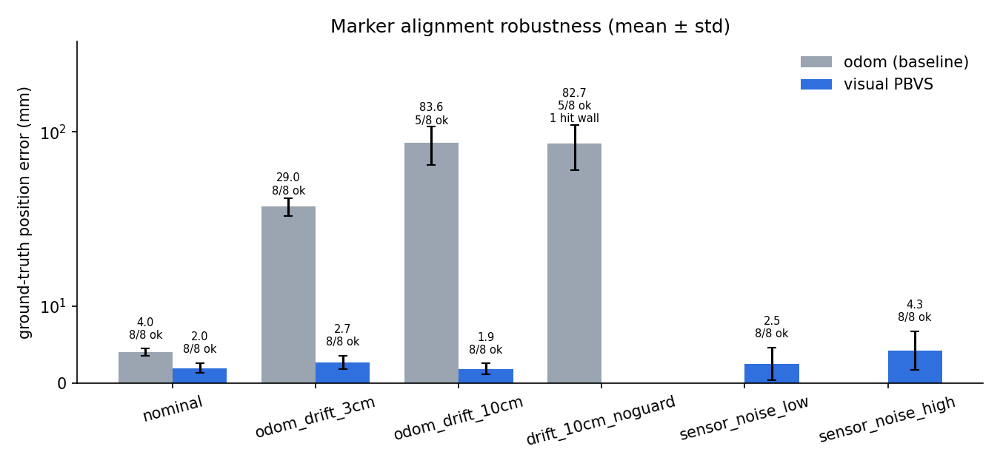</a>

- 报告：[对位鲁棒性实验（第一版，存档）](experiments/alignment_robustness/v1_baseline/README.md) · [PDF](experiments/alignment_robustness/v1_baseline/robustness.pdf)
- 说明：横轴为测试条件（名义、里程计漂移、关闭防碰撞守护、传感器噪声），纵轴为对位结束时的真值位置误差（对数刻度，均值 ± 标准差，每格 8 次）。朱红斜线柱只用里程计，蓝色实心柱为视觉 PBVS；柱上方的 “5/8” 为成功次数，“hit” 为碰墙次数。
- 要点：只用里程计时误差随漂移增大（3 cm 漂移下约 29 mm，10 cm 漂移下约 84 mm 且 3 次失败）；视觉 PBVS 在各条件下保持在 1.9–4.3 mm，这是引入视觉精对位的出发点。

### 1.2 精对位控制律：离散闭环极点

<a href="experiments/fine_alignment/fig_poles.png">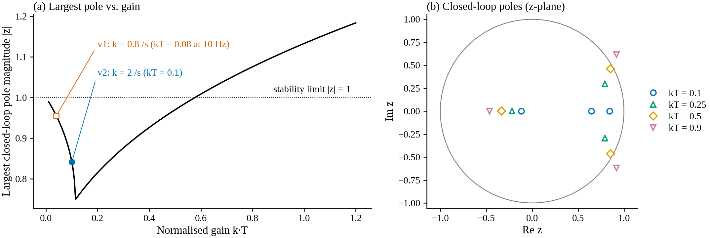</a>

- 报告：[精对位设计与控制分析](experiments/fine_alignment/README.md) · [PDF](experiments/fine_alignment/fig_poles.pdf)
- 说明：(a) 横轴为归一化增益 k·T（T 为控制周期），纵轴为最大闭环极点模 |z|，黑点线 |z| = 1 为稳定边界；(b) 几个 k·T 下的极点在 z 平面中的位置，单位圆内为稳定。模型含 50 ms 速度环滞后与一拍计算延迟。
- 要点：本版取 k = 2 /s（k·T = 0.1），最大极点模 0.84，离稳定边界（k·T ≈ 0.58）有充足裕度；增益再大，复极点向单位圆靠近、响应振荡。

### 1.3 精对位离线仿真：蒙特卡洛

<a href="experiments/fine_alignment/fig_sim_mc.png">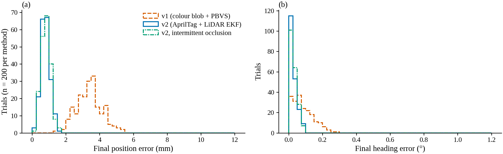</a>

- 报告：[精对位设计与控制分析 §3](experiments/fine_alignment/README.md) · [PDF](experiments/fine_alignment/fig_sim_mc.pdf)
- 说明：同一组 200 个随机起点上，最终位置误差 (a) 与最终朝向误差 (b) 的直方图。朱红虚线为第一版，蓝实线为本版，绿点划线为本版在间歇遮挡下；分布越靠左、越窄越好。
- 要点：位置误差均值由 3.4 mm 降到 0.80 mm；间歇遮挡下为 0.82 mm，几乎不受影响。

### 1.4 精对位离线仿真：单次时间响应

<a href="experiments/fine_alignment/fig_sim_response.png">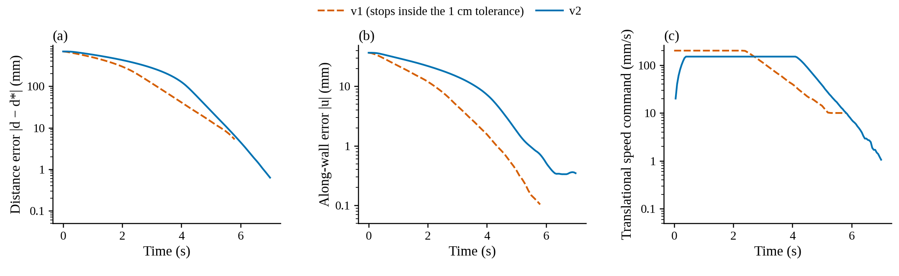</a>

- 报告：[精对位设计与控制分析 §3](experiments/fine_alignment/README.md) · [PDF](experiments/fine_alignment/fig_sim_response.pdf)
- 说明：同一起点的一次仿真。横轴为时间，纵轴（对数刻度）分别为离墙误差 (a)、沿墙误差 (b) 与平移速度指令 (c)。
- 要点：第一版进入 1 cm 容差即停车，误差停在毫米级；本版继续收敛，直到满足“容差内且静止”的判据。

### 1.5 对位鲁棒性：第一版 vs 本版（Gazebo）

<a href="experiments/alignment_robustness/robustness.png">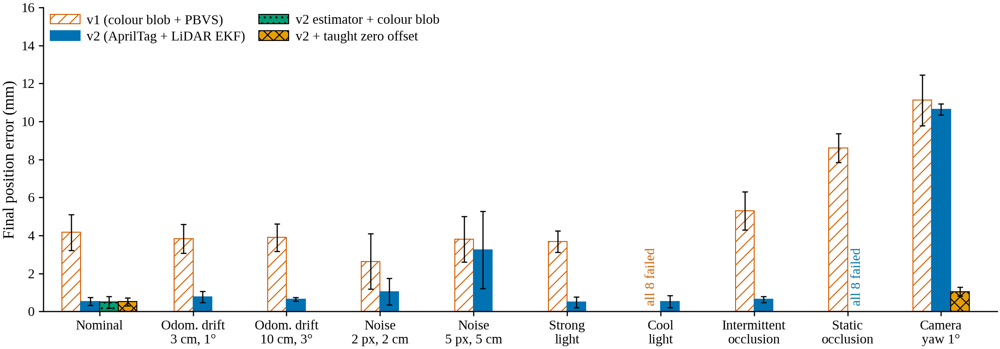</a>

- 报告：[对位鲁棒性对比](experiments/alignment_robustness/README.md) · [PDF](experiments/alignment_robustness/robustness.pdf)
- 说明：横轴为 10 种测试条件，纵轴为最终真值位置误差（均值 ± 标准差，n = 8 / 格，同一组起点配对）。朱红斜线柱为第一版（色块 + PBVS），蓝色实心柱为本版（AprilTag + 激光 EKF），绿、橙纹理柱为本版换用色块、本版加示教零位；竖排 “all 8 failed” 表示 8 次全部失败。
- 要点：名义条件下 4.2 ± 0.9 → 0.53 ± 0.21 mm；漂移、强光、冷光、间歇遮挡下本版保持 0.5–0.8 mm。第一版在冷光下 8 次全部丢失色块；本版在全程遮挡下 8 次都不运动并报告失败。相机 1° 安装偏角带来约 10 mm 偏差，示教零位后降到 1.0 mm。

### 1.6 本版的估计时间历程

<a href="experiments/alignment_robustness/traces.png">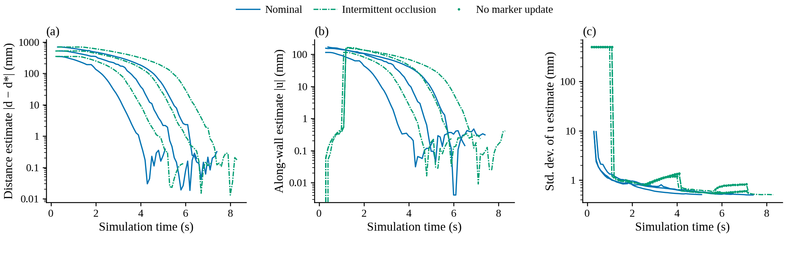</a>

- 报告：[对位鲁棒性对比 · 估计过程](experiments/alignment_robustness/README.md) · [PDF](experiments/alignment_robustness/traces.pdf)
- 说明：名义条件（蓝实线）与间歇遮挡（绿点划线）各 3 次试验。横轴为仿真时间，纵轴为对数刻度：(a) 离墙距离估计与目标之差，(b) 沿墙位置估计，(c) 沿墙位置估计的标准差；(c) 中的点表示该周期没有标记更新。
- 要点：遮挡期间标准差随运动增长到约 1.4 mm，标记重新出现后立即回落；估计在遮挡前后连续，控制环不停顿。

### 1.7 各次运行的单独汇总

<table>
<tr>
<td width="33%"><a href="experiments/alignment_robustness/run_camera_yaw/robustness.png">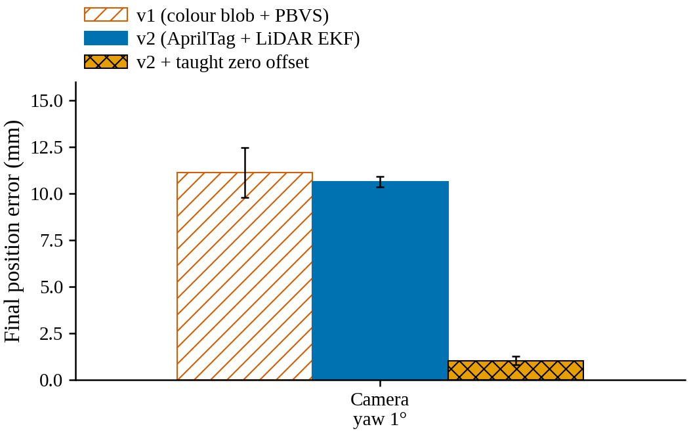</a></td>
<td width="33%"><a href="experiments/alignment_robustness/run_nominal_teach30s/robustness.png">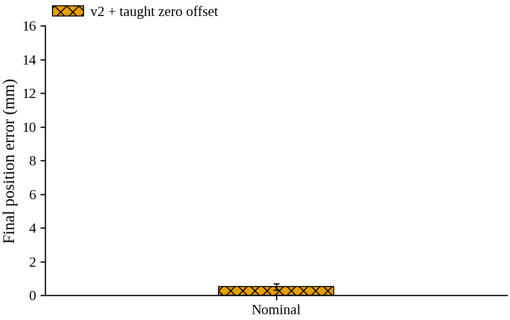</a></td>
<td width="33%"><a href="experiments/alignment_robustness/run_occlusion_static_v2/robustness.png">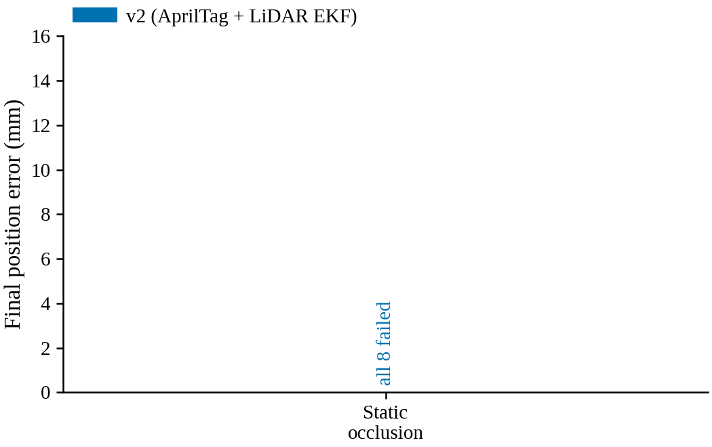</a></td>
</tr>
</table>

- 报告：[对位鲁棒性对比](experiments/alignment_robustness/README.md) · PDF：[相机偏角](experiments/alignment_robustness/run_camera_yaw/robustness.pdf)、[30 s 示教](experiments/alignment_robustness/run_nominal_teach30s/robustness.pdf)、[全程遮挡](experiments/alignment_robustness/run_occlusion_static_v2/robustness.pdf)
- 说明：1.5 的汇总图由几次运行合并而成，这三张是其中单独运行的结果，画法与 1.5 相同：左为相机 1° 偏角下的三种流水线，中为 30 s 示教零位的名义条件，右为全程遮挡下的本版（8 次全部失败，只有文字标注）。
- 要点：与 1.5 中对应的格一致，便于逐次核对原始数据。

### 1.8 视觉伺服方法对比：主对比

<a href="experiments/ibvs_vs_pbvs/fig_main.png">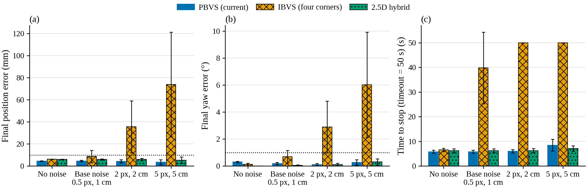</a>

- 报告：[视觉伺服方法对比 · E1](experiments/ibvs_vs_pbvs/README.md) · [PDF](experiments/ibvs_vs_pbvs/fig_main.pdf)
- 说明：100 个同分布起点，停止模式。横轴为四种噪声条件，纵轴分别为停止时的位置误差 (a)、偏航误差 (b) 与停止时间 (c)，均值 ± 标准差；黑点线为 1 cm / 1° 停止容差。蓝为 PBVS（现有），橙为 IBVS（四角点），绿为 2.5D 混合。
- 要点：PBVS 与混合方案在各噪声档基本都收敛；IBVS 在基准噪声下只有 25 / 100 次满足停止判据，停止时间也最长。

### 1.9 视觉伺服方法对比：可观性

<a href="experiments/ibvs_vs_pbvs/fig_observability.png">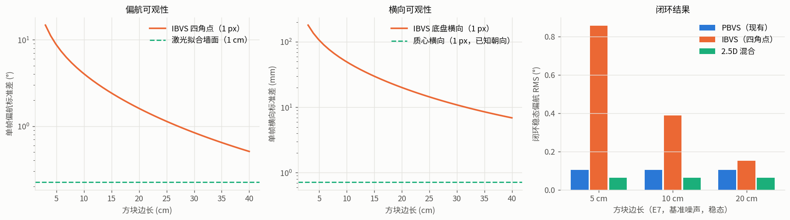</a>

- 报告：[视觉伺服方法对比 · 可观性](experiments/ibvs_vs_pbvs/README.md) · [PDF](experiments/ibvs_vs_pbvs/fig_observability.pdf)
- 说明：(a)(b) 横轴为标记边长，纵轴为单帧测量的标准差（对数刻度）：橙线为 IBVS 四角点（每 1 px 角点噪声），绿点划线为激光拟合墙面 (a) 或已知朝向时的质心横向 (b)。(c) 闭环稳态偏航误差（均方根），按标记边长分组。
- 要点：5 cm 标记下 IBVS 的特征雅可比条件数为 314，单帧偏航标准差 8.7°，约为激光拟合墙面（0.23°）的 40 倍；纯 IBVS 的偏航几乎不可观，这是保留 PBVS 的主要原因。

### 1.10 视觉伺服方法对比：噪声扫描

<a href="experiments/ibvs_vs_pbvs/fig_noise.png">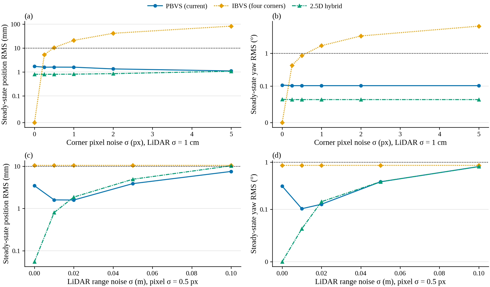</a>

- 报告：[视觉伺服方法对比 · E2](experiments/ibvs_vs_pbvs/README.md) · [PDF](experiments/ibvs_vs_pbvs/fig_noise.pdf)
- 说明：稳态模式（不停止，取 30 s 末 5 s 的真值均方根，50 个起点）。上排横轴为角点像素噪声，下排为激光测距噪声；左列为位置误差，右列为偏航误差（纵轴对称对数刻度），黑点线为 1 cm / 1° 容差。
- 要点：像素噪声几乎不影响 PBVS 与混合方案（5 px 时约 1 mm），IBVS 随像素噪声线性恶化；激光测距噪声是 PBVS 与混合方案的主要误差源。

### 1.11 视觉伺服方法对比：标定误差敏感性

<a href="experiments/ibvs_vs_pbvs/fig_calibration.png">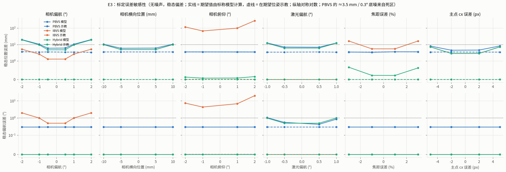</a>

- 报告：[视觉伺服方法对比 · E3](experiments/ibvs_vs_pbvs/README.md) · [PDF](experiments/ibvs_vs_pbvs/fig_calibration.pdf)
- 说明：无噪声，稳态偏差。每列一种标定误差（横轴为误差大小），上排为位置误差、下排为偏航误差（对称对数刻度）。实线的期望位姿由标称模型计算，虚线为在期望位姿示教。
- 要点：IBVS “对标定不敏感”只在示教后成立；按标称模型时，相机俯仰误差会使 IBVS 收敛到偏几十到上百毫米的位姿。PBVS 约 3.5 mm / 0.3° 的底噪来自死区。

### 1.12 视觉伺服方法对比：大范围起点的轨迹

<a href="experiments/ibvs_vs_pbvs/fig_trajectories.png">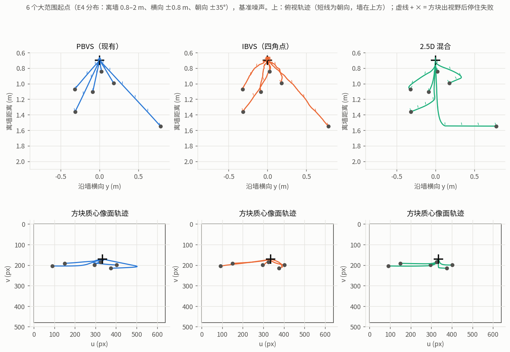</a>

- 报告：[视觉伺服方法对比 · E4](experiments/ibvs_vs_pbvs/README.md) · [PDF](experiments/ibvs_vs_pbvs/fig_trajectories.pdf)
- 说明：6 个大范围起点（离墙 0.8–2 m、横向 ±0.8 m、朝向 ±35°，基准噪声）。上排为俯视轨迹（墙在上方，短线为朝向，十字为目标位姿），下排为标记质心在图像中的轨迹（方框为画面边界）。
- 要点：三种方法都没有让标记离开视野；PBVS 的路线最直，IBVS 与混合方案的路线更弯曲。

## 二、规划

### 2.1 第一版规划器（Python 原型）：墙面开槽轨迹

<a href="../src/path_planning/wall_cutting_comparison.png">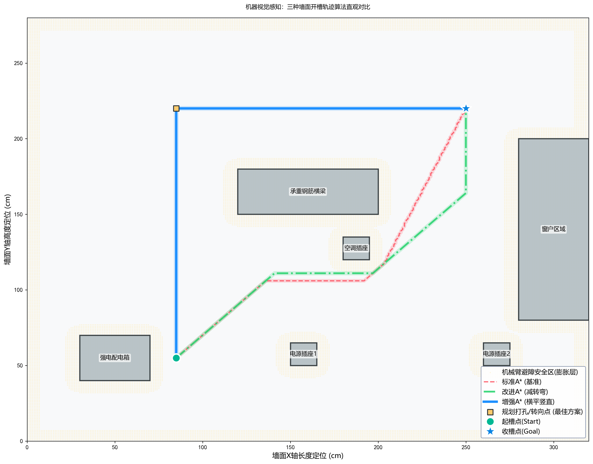</a>

- 报告：[第一版规划器](../src/path_planning/README.md) · [PDF](../src/path_planning/wall_cutting_comparison.pdf)
- 说明：3.2 × 2.8 m 墙面（单位 cm）。灰色点线为标准 A\*，橙色点线为带转向惩罚的改进 A\*，蓝实线为横平竖直约束的增强 A\*（白方块为转弯点）；深灰框为障碍，浅灰为 8 cm 安全边距。
- 要点：增强 A\* 只有 1 个转弯、100 % 横平竖直；标准 A\* 有 95 个转弯，近一半为斜向移动。

### 2.2 第一版规划器：墙面开槽指标

<a href="../src/path_planning/wall_cutting_metrics.png">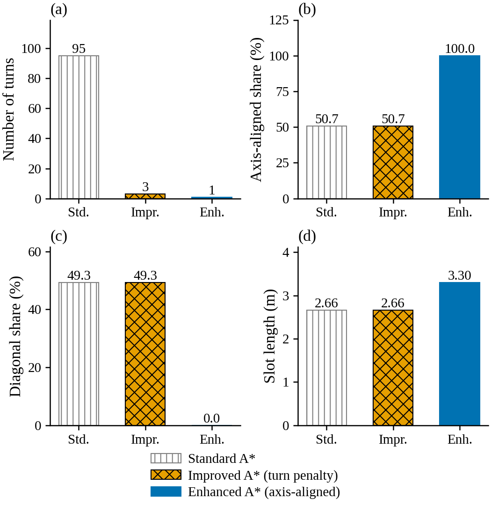</a>

- 报告：[第一版规划器](../src/path_planning/README.md) · [PDF](../src/path_planning/wall_cutting_metrics.pdf)
- 说明：2.1 中三条轨迹的转弯数 (a)、横平竖直比例 (b)、斜向比例 (c) 与切割总长 (d)。
- 要点：转弯 95 / 3 / 1，横平竖直比例 50.7 / 50.7 / 100 %；增强 A\* 的代价是槽线更长（3.30 m 对 2.66 m）。

### 2.3 第一版规划器：SLAM 地图上的路径

<a href="../src/path_planning/path_comparison.png">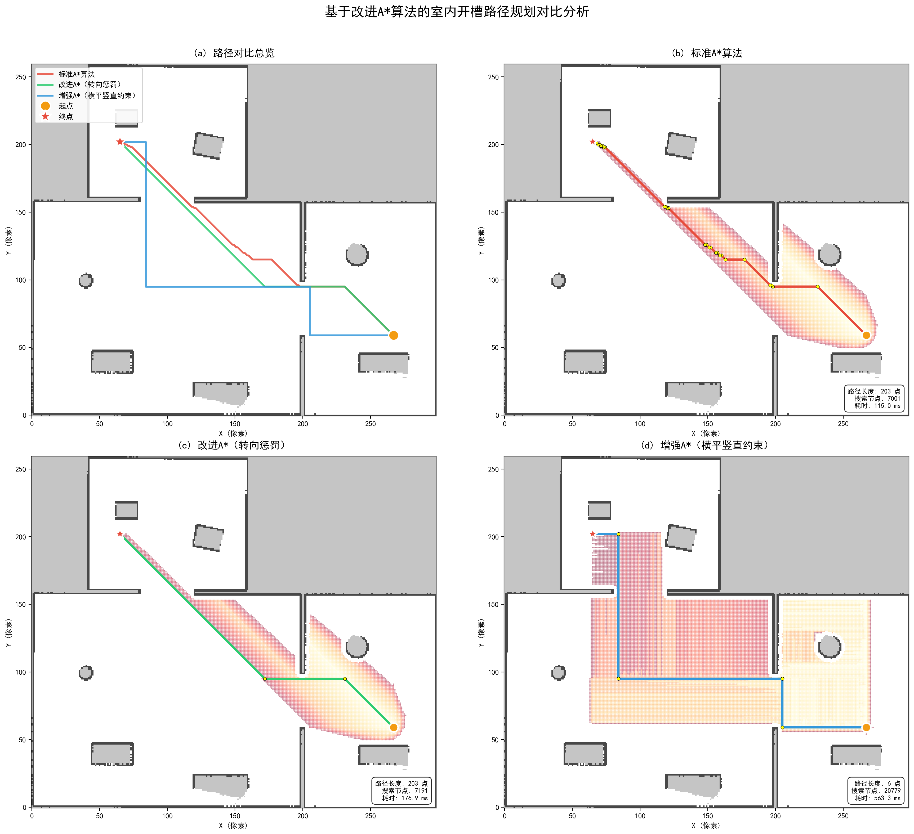</a>

- 报告：[第一版规划器](../src/path_planning/README.md) · [PDF](../src/path_planning/path_comparison.pdf)
- 说明：同一张 SLAM 地图（格宽 0.05 m）上同一对起终点。(a) 三条路径叠加；(b)–(d) 各算法的路径，橙色散点为搜索中扩展过的节点（颜色由浅到深表示扩展顺序），白方块为转弯点。
- 要点：增强 A\* 的路径横平竖直，但扩展节点数约为标准 A\* 的 3 倍（20779 对 7001）。

### 2.4 第一版规划器：SLAM 地图上的指标

<a href="../src/path_planning/metrics_comparison.png">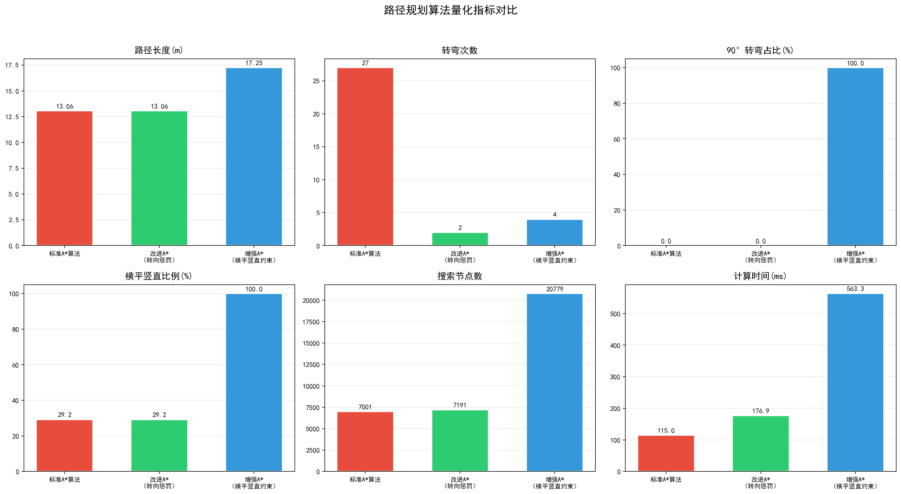</a>

- 报告：[第一版规划器](../src/path_planning/README.md) · [PDF](../src/path_planning/metrics_comparison.pdf)
- 说明：2.3 中三条路径的路径长度、转弯数、直角转弯占比、横平竖直比例与扩展节点数。计算耗时随机器变化，图中不再给出；原始运行中三种算法分别为 115.0 / 176.9 / 563.3 ms，重新运行时脚本在终端打印当次耗时。
- 要点：路径长 13.06 / 13.06 / 17.25 m，转弯 27 / 2 / 4；增强 A\* 的转弯全部为直角。

### 2.5 C++ 开槽规划器与施工规范

<a href="experiments/cpp_planner/wall_comparison.png">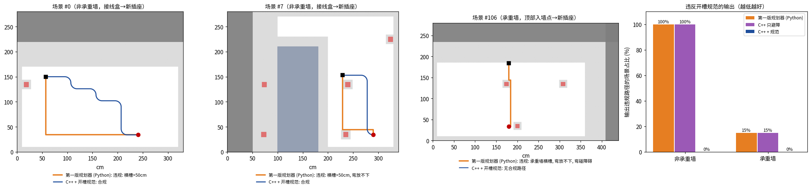</a>

- 报告：[墙面开槽规划：C++ 增强 A\* 与施工规范](experiments/cpp_planner/README.md) · [PDF](experiments/cpp_planner/wall_comparison.pdf)
- 说明：(a)–(c) 三个典型场景（墙面坐标，cm）：朱红虚线为第一版规划器，蓝实线为带规范的 C++ 规划器（弯处画出半径 12 cm 的弯管），浅灰为障碍及其规范边距，每幅下方注明是否合规及违反的条款。(d) 各方法输出违规路线的场景占比（非承重墙 100 个，承重墙 40 个场景）。
- 要点：C++ 规划器在 140 面墙上 0 条违规路线；第一版规划器在 106 面墙上违规（横槽超长、弯放不下、承重墙开横槽）。承重墙上 6 例无合规路线，规划器明确报告而不是勉强绕行。

### 2.6 任务级联合规划：示例墙

<a href="experiments/task_planning/fig_example.png">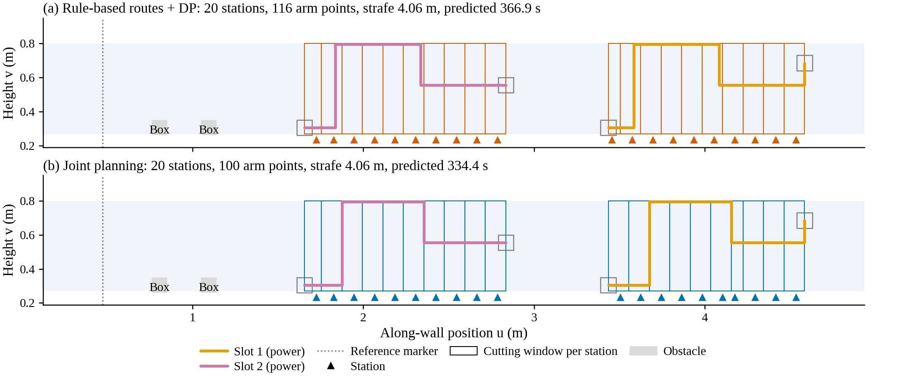</a>

- 报告：[任务级联合规划](experiments/task_planning/README.md) · [PDF](experiments/task_planning/fig_example.pdf)；其他时间模型下的同一面墙：[`align_v2`](experiments/task_planning/align_v2/fig_example.png)、[`align_v3`](experiments/task_planning/align_v3/fig_example.png)
- 说明：一面随机非承重墙（种子 1121，两条强电槽）。(a) 先选线后 DP 划分（规则路线），(b) 联合规划；横轴为沿墙位置，纵轴为离地高度，浅蓝带为机械臂可切高度，竖框为各站切割窗口，三角为站位，点线为定位标记。
- 要点：两者停靠站数与横移相同，联合规划把拐点挪到窗口边界，机械臂点 116 → 100，预测时间 366.9 → 334.4 s（−8.9 %，`align_v1`；`align_v2` 下 335.6 → 302.8 s，`align_v3` 下 371.3 → 338.8 s）。

### 2.7 任务级联合规划：400 面随机墙

<a href="experiments/task_planning/fig_results.png">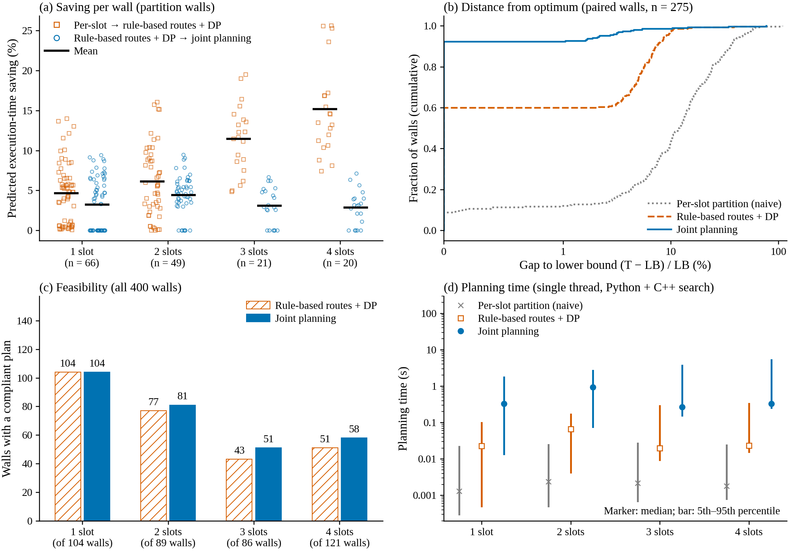</a>

- 报告：[任务级联合规划](experiments/task_planning/README.md) · [PDF](experiments/task_planning/fig_results.pdf)；其他时间模型：[`align_v2`](experiments/task_planning/align_v2/fig_results.png)、[`align_v3`](experiments/task_planning/align_v3/fig_results.png)
- 说明：(a) 非承重墙上每面墙的预测时间节省（按槽数分组，黑横线为均值）；(b) 与下界差距的累积分布，0 处的阶跃高度即被证明最优的比例；(c) 得到合规方案的墙数；(d) 规划耗时（点为中位数，竖线为 5–95 分位）。灰为逐槽划分，朱红为规则路线 + DP，蓝为联合规划。
- 要点：联合规划从不比规则路线慢，非承重墙上平均再省 3.5 %（95 % CI [3.1, 4.0] %，n = 156），相对逐槽划分共省 11.9 %；92 % 的墙被下界证明最优。代价是规划耗时中位数由 25 ms 增加到 0.40 s。

### 2.8 无合规方案的墙：诊断与替代方案

<a href="experiments/room_planning/fig_fallback.png">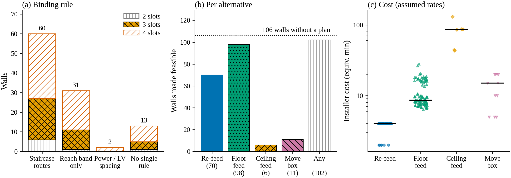</a>

- 报告：[房间级规划与替代方案](experiments/room_planning/README.md#a4-结果) · [PDF](experiments/room_planning/fig_fallback.pdf)；示例墙：[PNG](experiments/room_planning/fig_fallback_example.png) · [PDF](experiments/room_planning/fig_fallback_example.pdf)
- 说明：106 面联合规划无解的墙。(a) 约束性规则的归类，按槽数堆叠；(b) 各级替代方案各自能解出的墙数，Any 为至少一级可行；(c) 各级排序第一的方案的代价（对数轴，单价为假设）。
- 要点：不放松规范，102 面得到合规方案：70 面换引线点，32 面改走地面；走顶棚与移动线盒从未成为首选。

### 2.9 房间级规划：示例房间

<a href="experiments/room_planning/fig_room_example.png">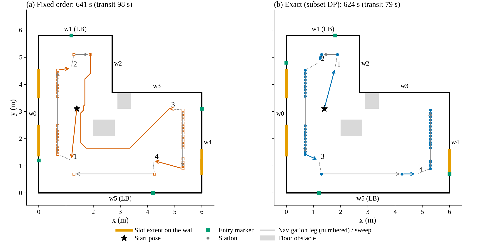</a>

- 报告：[房间级规划与替代方案](experiments/room_planning/README.md) · [PDF](experiments/room_planning/fig_room_example.pdf)；转场时间模型：[PNG](experiments/room_planning/fig_transit_model.png) · [PDF](experiments/room_planning/fig_transit_model.pdf)
- 说明：一个随机 L 形房间（4 面墙有任务）的俯视图。(a) 按列出顺序、一律从左到右；(b) 子集动态规划的最优顺序与方向。橙色粗线为槽线的沿墙范围，绿色方块为入口定位标记，带编号的折线为各段导航。
- 要点：墙上的作业相同，转场由 98 s 降到 79 s。

### 2.10 房间级规划：200 个随机房间

<a href="experiments/room_planning/fig_room_results.png">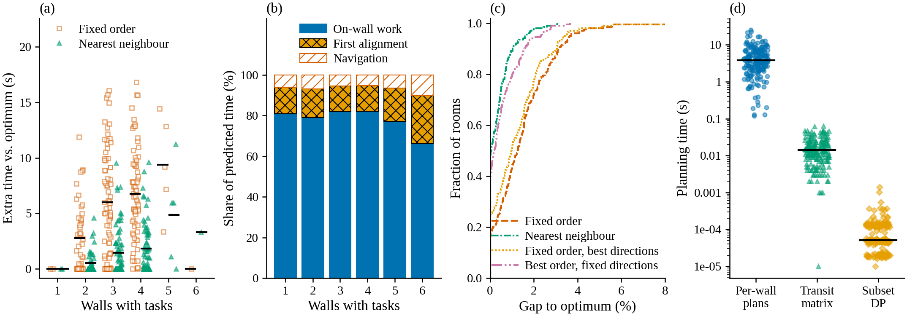</a>

- 报告：[房间级规划与替代方案](experiments/room_planning/README.md#b-部分200-个随机房间) · [PDF](experiments/room_planning/fig_room_results.pdf)
- 说明：(a) 固定顺序与最近邻比最优方案多用的时间，按有任务的墙数分组；(b) 最优方案预测时间的构成；(c) 各方法与最优的差距的累积分布；(d) 规划耗时的三个部分（对数轴）。
- 要点：比固定顺序快 1.44 %，比最近邻快 0.36 %；墙上作业占 81 %，首次精对位占 13 %，导航占 6 %。访问顺序的优化空间有限。

## 三、执行

### 3.1 两条槽的多站执行

<a href="experiments/slot_execution/execution.png">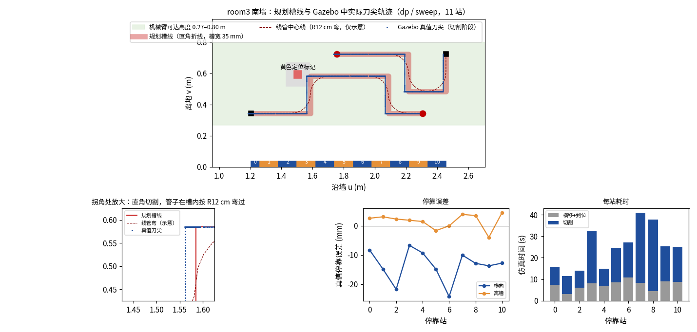</a>

- 报告：[多站执行与停靠站顺序优化](experiments/slot_execution/README.md)
- 说明：room3 南墙两条槽按优化方案执行。上图为墙面立面：浅红粗线为规划槽线，蓝点为切割阶段的真值刀尖，虚线为线管中心线（示意），底部色块为各停靠站的窗口；下排为拐角放大、每站停靠误差与每站耗时。这张图的刀尖轨迹原始数据未随仓库提交，图中文字仍为中文，是生成时的版本。
- 要点：11 个停靠站全部到位、切完，刀尖轨迹贴合直角槽线。

### 3.2 停靠站划分与顺序优化

<a href="experiments/slot_execution/station_order.png">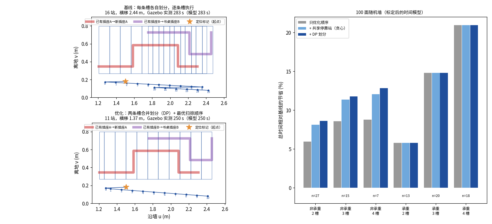</a>

- 报告：[多站执行与停靠站顺序优化](experiments/slot_execution/README.md) · [PDF](experiments/slot_execution/station_order.pdf)
- 说明：(a) 基线（每条槽各自划分、逐条执行）与 (b) 优化方案（合并 DP 划分 + 扫掠顺序）：粗线为两条槽，蓝框为各站切割窗口，下方折线为从参考标记（星形）出发的停靠站顺序，数字为站序号；右上角为横移距离、Gazebo 实测与模型预测。(c) 100 面随机墙上三种优化相对基线的总时间节省。
- 要点：示例任务 16 站 → 11 站，Gazebo 实测 283.1 → 249.8 s（−11.8 %），模型预测 283.3 / 250.0 s。

### 3.3 沿墙误差随停靠站位置的变化

<a href="experiments/along_wall_accuracy/fig_error_vs_distance.png">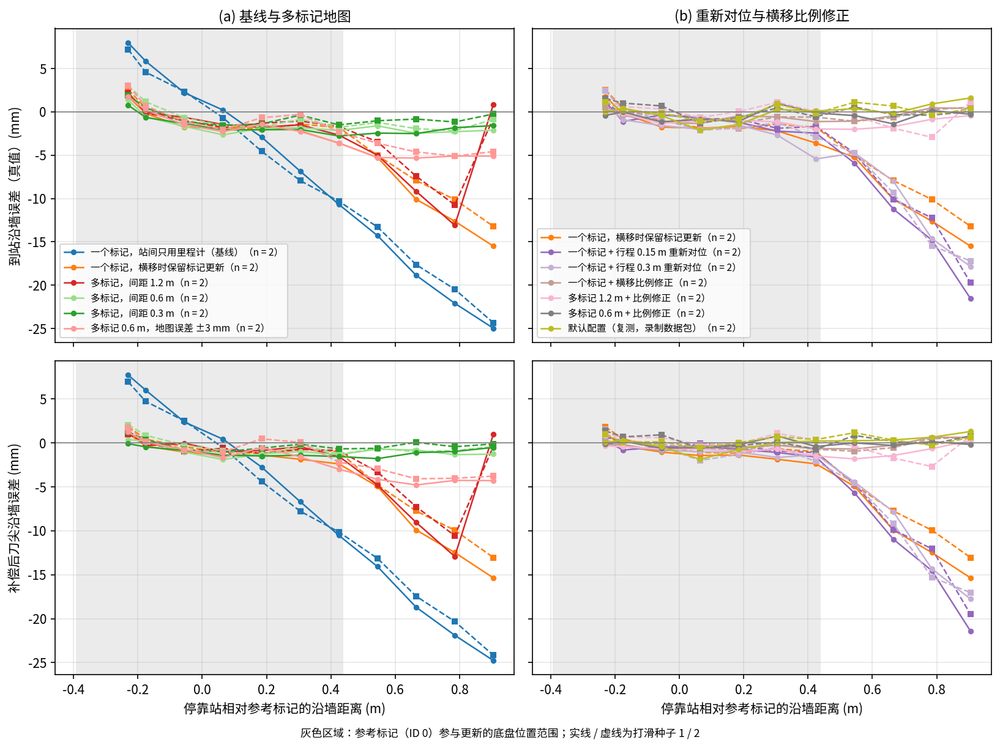</a>

- 报告：[多站沿墙精度](experiments/along_wall_accuracy/README.md) · [PDF](experiments/along_wall_accuracy/fig_error_vs_distance.pdf)
- 说明：横轴为停靠站离参考标记的沿墙距离，上排为到站沿墙误差（真值），下排为补偿后的刀尖沿墙误差。颜色区分方法组（朱红 基线、绿 多标记、橙 重新对位、蓝 比例修正、黑 默认配置），标记形状区分组内配置，实线 / 虚线为两个打滑种子，灰色区域为参考标记可见的范围。
- 要点：只用里程计时误差随距离线性增长，最远站约 −25 mm；按行程回到标记重新对位不能消除这一趋势。每站都能看到标记（多标记间距 0.3 / 0.6 m）或在线估计横移比例时，最大误差降到 1.3–2.8 mm；二者组合为 1.5 mm，已设为默认配置（复测 1.6–2.1 mm）。

### 3.4 精度与耗时

<a href="experiments/along_wall_accuracy/fig_accuracy_time.png">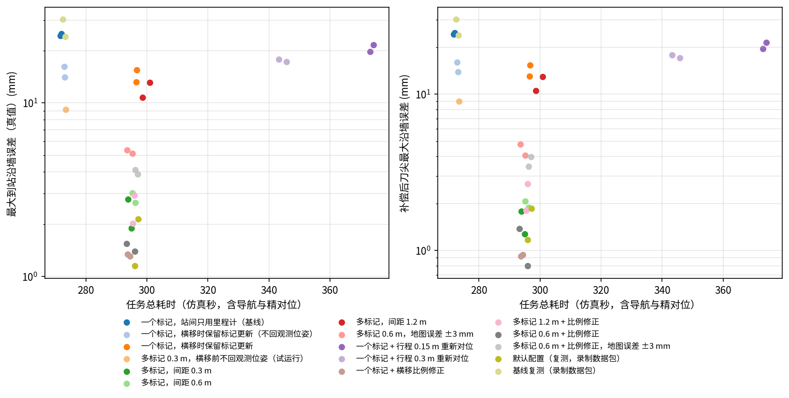</a>

- 报告：[多站沿墙精度](experiments/along_wall_accuracy/README.md) · [PDF](experiments/along_wall_accuracy/fig_accuracy_time.pdf)
- 说明：每个点为一次运行，横轴为任务总耗时（含导航与精对位），纵轴为最大到站沿墙误差 (a) 与补偿后刀尖最大沿墙误差 (b)（对数刻度）；颜色与标记同 3.3。越靠左下越好。
- 要点：重新对位多花 50–100 s，最大误差仍有 18–21 mm；多标记或比例估计的总耗时约 295 s（比只用里程计多约 23 s，来自站间回到观测位姿），最大误差降到 1.3–2.8 mm。

### 3.5 横移比例的在线估计

<a href="experiments/along_wall_accuracy/fig_scale.png">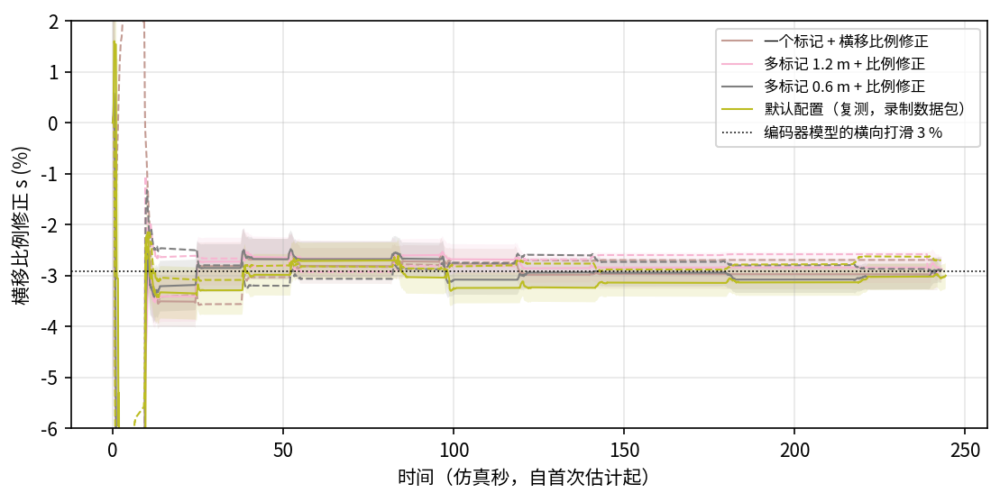</a>

- 报告：[多站沿墙精度 §4.4](experiments/along_wall_accuracy/README.md) · [PDF](experiments/along_wall_accuracy/fig_scale.pdf)
- 说明：横轴为自首次估计起的时间，纵轴为 EKF 估计的横移比例修正 s（实线 / 虚线为两个种子，阴影为 ±1σ）；黑点线为编码器模型横向打滑 3 % 对应的真值 −2.9 %。
- 要点：一个标记时 s 在前几站横移中收敛到 −2.98 % / −2.69 %，与真值相符；离开全部标记的视野后估计不再变化。

### 3.6 沿墙位置估计误差

<a href="experiments/along_wall_accuracy/fig_estimate_error.png">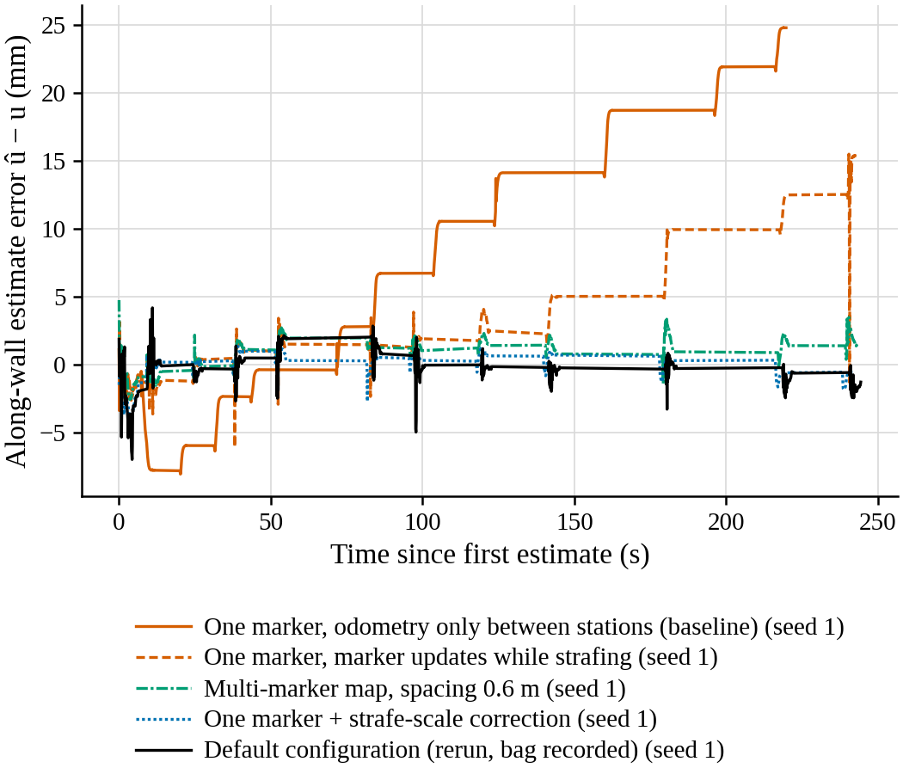</a>

- 报告：[多站沿墙精度](experiments/along_wall_accuracy/README.md) · [PDF](experiments/along_wall_accuracy/fig_estimate_error.pdf)
- 说明：横轴为时间，纵轴为 EKF 沿墙位置估计减去真值（种子 1）。
- 要点：基线每次横移后阶跃增大；多标记或比例修正时到站后保持在 ±2 mm 以内，横移中的尖峰来自运动中测量与里程计的时间对齐误差。

### 3.7 机械臂连续轨迹：各站耗时的分解

<a href="experiments/arm_trajectory/fig_time.png">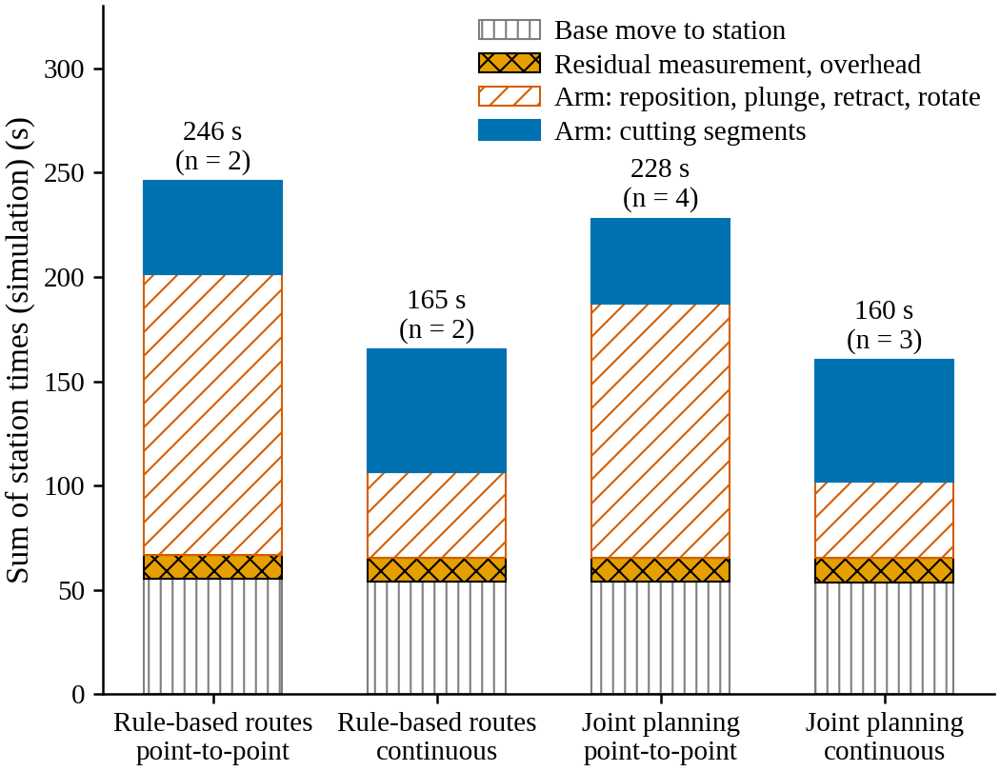</a>

- 报告：[机械臂连续轨迹 §5.1](experiments/arm_trajectory/README.md) · [PDF](experiments/arm_trajectory/fig_time.pdf)
- 说明：四根柱为规则路线与联合规划各自在逐点执行、连续轨迹下的各站耗时之和（Gazebo，仿真时间；各次运行的平均，n 为运行数）。竖线纹为底盘横移到站，交叉纹为到站残差测量等固定开销，斜线为机械臂不切割的运动（换位、下刀、退刀、转刀），实心为切割段。
- 要点：连续轨迹把 11 个停靠站的耗时由 228 s 降到 160 s（联合规划，−30 %）、246 s 降到 165 s（规则路线，−33 %）；节省全部来自不切割的运动（122 s → 37 s），切割段因改用恒定进给 0.05 m/s 反而变长。

### 3.8 机械臂连续轨迹：同一停靠站的关节速度

<a href="experiments/arm_trajectory/fig_profile.png">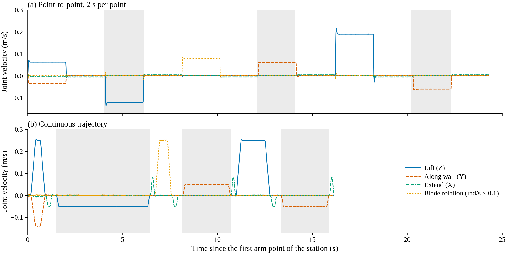</a>

- 报告：[机械臂连续轨迹 §5.1](experiments/arm_trajectory/README.md) · [PDF](experiments/arm_trajectory/fig_profile.pdf)
- 说明：联合规划第 9 站（12 个机械臂点）的四个关节速度，横轴为该站第一个机械臂点开始后的时间，灰色底为切割段；刀片转速按 0.1 倍画出。(a) 逐点执行，(b) 连续轨迹。
- 要点：逐点执行每段固定 2 s、速度在起止点阶跃，切割速度随段长变化；连续轨迹的切割段保持进给速度，下刀、退刀、转刀与换位压缩成短促的加减速，全站 24.3 s → 16.2 s。

### 3.9 机械臂连续轨迹：参数扫描

<a href="experiments/arm_trajectory/fig_tradeoff.png">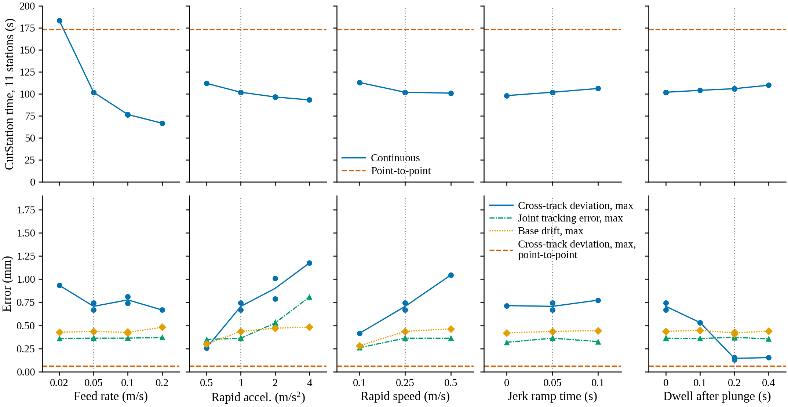</a>

- 报告：[机械臂连续轨迹 §5.3](experiments/arm_trajectory/README.md) · [PDF](experiments/arm_trajectory/fig_tradeoff.pdf)
- 说明：五列依次改变进给、加速度、空行程速度、加加速度的上升时间、下刀后等待时间（灰色竖点线为默认值）。上排为 11 个停靠站的 `CutStation` 耗时之和，朱红虚线为逐点执行；下排为切割段内横向偏差最大值（蓝）、直线轴关节跟踪误差最大值（绿）、机械臂运动期间底盘漂移最大值（橙），朱红虚线为逐点执行的横向偏差最大值。每个标记一次运行（多数配置 1 次，个别 2–3 次），连线为均值。
- 要点：时间主要由进给决定，而进给在仿真中不影响精度；加速度与空行程速度超过默认值后时间收益很小、偏差增大；下刀后等待 0.2 s 把横向偏差最大值从 0.75 mm 压到 0.15 mm 以内。

### 3.10 机械臂连续轨迹：时间模型

<a href="experiments/arm_trajectory/fig_time_model.png">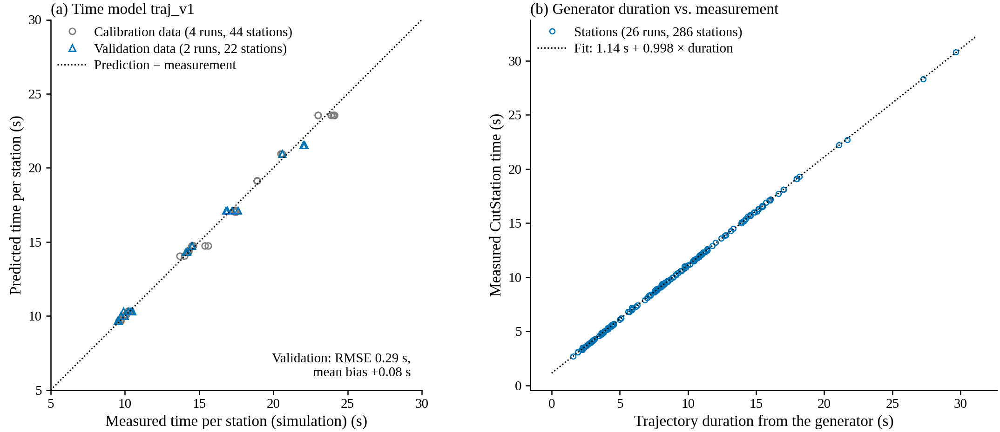</a>

- 报告：[机械臂连续轨迹 §5.4](experiments/arm_trajectory/README.md) · [PDF](experiments/arm_trajectory/fig_time_model.pdf)
- 说明：(a) 时间模型 `traj_v1`（增加“切割长度 / 进给”一项）的预测与实测，每个点为一个停靠站，灰色圆点为标定数据、蓝色三角为验证数据，点线为两者相等；(b) 轨迹生成器给出的名义轨迹时长（横轴）与实测 `CutStation` 耗时（纵轴），点线为拟合直线。
- 要点：对未参与标定的联合规划，各站之和的预测误差 ≤ 1.0 s（0.6 %）；生成器时长与实测相差 0.04 s（RMSE），轨迹时长是确定的。

### 3.11 机械臂连续轨迹：对联合规划结论的影响

<a href="experiments/arm_trajectory/fig_planning.png">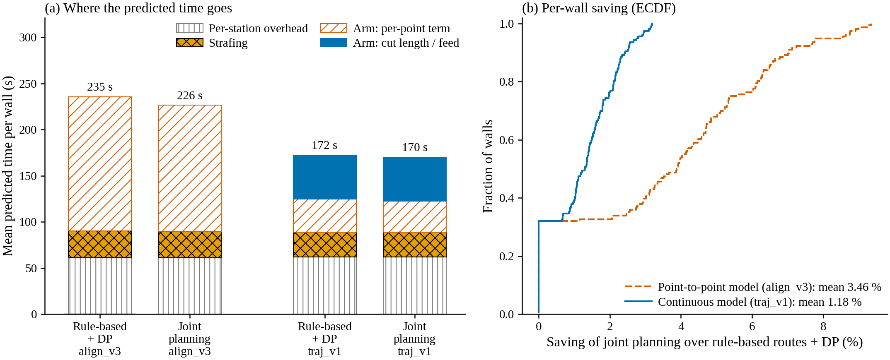</a>

- 报告：[机械臂连续轨迹 §5.5](experiments/arm_trajectory/README.md) · [PDF](experiments/arm_trajectory/fig_planning.pdf)
- 说明：400 面随机墙中的非承重配对墙（n = 156）。(a) 每面墙的平均预测时间按时间模型的四项拆开，左两柱为逐点执行的模型（`align_v3`），右两柱为连续轨迹的模型（`traj_v1`），每组内左为规则路线 + DP、右为联合规划；(b) 联合规划相对规则路线 + DP 的逐墙节省的累积分布，朱红虚线为 `align_v3`，蓝实线为 `traj_v1`。
- 要点：每多一个直线小段的代价从 8.1 s 降到 2.0 s，联合规划的平均节省由 3.46 % 缩小到 1.18 %；变快的墙数（106）不变，没有一面墙变慢。

### 3.12 切割力模型

<a href="experiments/cutting_force/fig_force_model.png">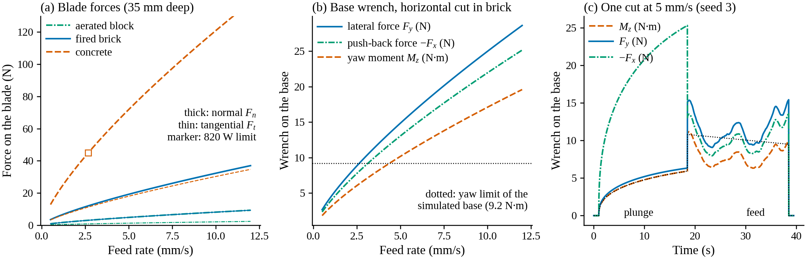</a>

- 报告：[切割力扰动与抗扰定点保持](experiments/cutting_force/README.md#2-切割力模型) · [PDF](experiments/cutting_force/fig_force_model.pdf)
- 说明：(a) 切深 35 mm 时刀片受力随进给速度的变化，粗线为法向力、细线为切向力，三种材料，方块为主轴输出功率 820 W 对应的进给上限；(b) 烧结砖上切横槽时底盘受到的横向力、推离墙面的力与偏航力矩，黑点线为仿真底盘默认的偏航力矩上限；(c) 一刀（先下刀、后进给）的时间历程，含材料不均匀性，黑点线为名义偏航力矩。
- 要点：刀片线速度 73 m/s，820 W 只对应约 11 N 的切向力，作用在机器人上的主要是几十牛的法向力；横槽的进给反力在刀具处产生偏航力矩，烧结砖 5 mm/s 时约 10 N·m。模型数值多数为假设，见报告中的出处表。

### 3.13 平台可行性：所需摩擦与倾覆裕度

<a href="experiments/cutting_force/fig_feasibility.png">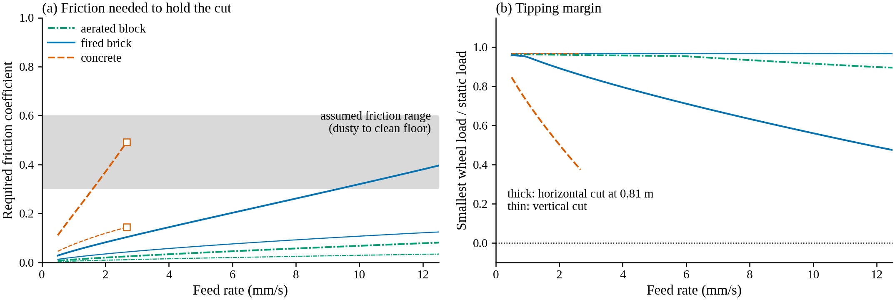</a>

- 报告：[切割力扰动与抗扰定点保持](experiments/cutting_force/README.md#3-平台可行性) · [PDF](experiments/cutting_force/fig_feasibility.pdf)
- 说明：横轴为进给速度，曲线画到主轴功率上限为止。(a) 抱死四个麦克纳姆轮撑住切削力所需的摩擦系数，粗线为横槽（刀具在最高处）、细线为竖槽，灰带为假设的轮地摩擦系数范围；(b) 最小轮压与静态平均轮压之比，降到 0 即倾覆。
- 要点：竖槽在满功率下只需 μ ≈ 0.14；横槽在满功率下需 μ ≈ 0.49、最小轮压只剩 37 %，现有 30.5 kg 的平台需要限制进给或增加支撑。

### 3.14 定点保持控制律：频率响应

<a href="experiments/cutting_force/fig_frequency.png">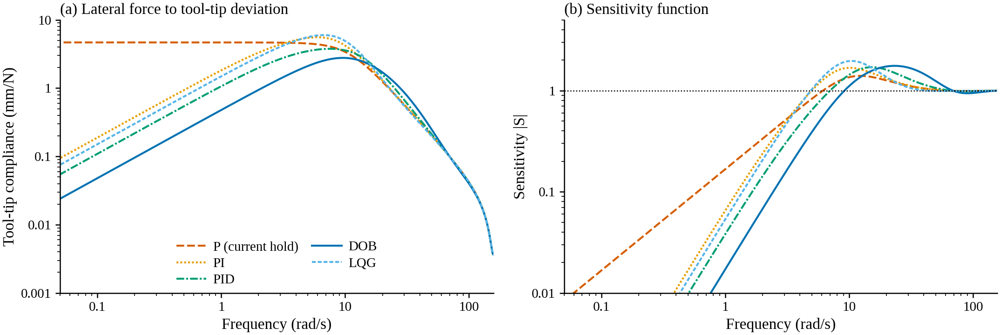</a>

- 报告：[切割力扰动与抗扰定点保持](experiments/cutting_force/README.md#55-离散闭环极点裕度与柔度) · [PDF](experiments/cutting_force/fig_frequency.pdf)
- 说明：偏航轴离散闭环（50 Hz，一拍延迟）。(a) 横向切削力到刀尖沿墙偏移的动态柔度；(b) 灵敏度函数，峰值越高鲁棒性越差。朱红虚线为现有的比例保持，蓝实线为扰动观测器。
- 要点：比例保持在低频有 4.7 mm/N 的静态柔度；带积分作用的控制律把低频柔度降为零，但 5–20 rad/s 附近的峰值仍有 2.8–5.5 mm/N。

### 3.15 定点保持控制律：设计折中与鲁棒性

<a href="experiments/cutting_force/fig_robustness.png">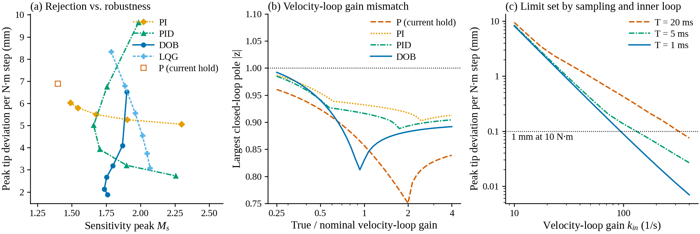</a>

- 报告：[切割力扰动与抗扰定点保持](experiments/cutting_force/README.md#55-离散闭环极点裕度与柔度) · [PDF](experiments/cutting_force/fig_robustness.pdf)
- 说明：(a) 各控制律沿整定参数扫描得到的“灵敏度峰值 – 1 N·m 阶跃力矩下的刀尖峰值”曲线，越靠左下越好；(b) 真实速度环增益偏离标称值时的最大闭环极点模；(c) 同一整定规则下刀尖峰值随速度环增益与控制周期的变化，黑点线为“10 N·m 阶跃下 1 mm”所需的水平。
- 要点：相近的鲁棒性下扰动观测器的瞬态峰值最小；速度环增益在 0.25–4 倍内各控制律都稳定。50 Hz 外环加 20 /s 的速度环最好也有 2.7 mm/(N·m)，瓶颈是速度环增益而不是控制律。

### 3.16 切入方式与时间响应（离线仿真）

<a href="experiments/cutting_force/fig_step_response.png">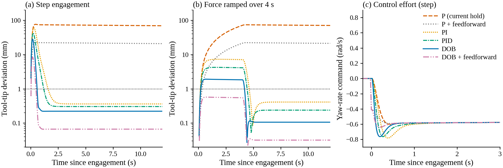</a>

- 报告：[切割力扰动与抗扰定点保持](experiments/cutting_force/README.md#62-力控底盘里程计反馈) · [PDF](experiments/cutting_force/fig_step_response.pdf)
- 说明：烧结砖、横槽、进给 5 mm/s。(a) 阶跃切入与 (b) 切削力在 4 s 内线性增加时的刀尖偏移（对数刻度，黑点线为 1 mm）；(c) 阶跃切入时的偏航角速度指令。
- 要点：比例保持停在约 75 mm 不恢复；扰动观测器在阶跃切入下峰值 32 mm、0.56 s 恢复，斜坡切入下 1.9 mm，加 70 % 的前馈后 0.6 mm。各控制律的稳态指令相同，差别只在建立的快慢。

### 3.17 各工况的刀尖偏移（离线仿真）

<a href="experiments/cutting_force/fig_cases.png">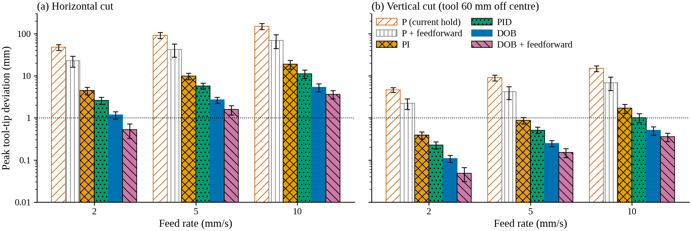</a>

- 报告：[切割力扰动与抗扰定点保持](experiments/cutting_force/README.md#62-力控底盘里程计反馈) · [PDF](experiments/cutting_force/fig_cases.pdf)
- 说明：斜坡切入加材料不均匀性，刀尖偏移峰值（均值 ± 标准差，n = 8，对数刻度）。横轴为进给速度，(a) 横槽，(b) 竖槽；六种控制律，黑点线为 1 mm。
- 要点：横槽 2 mm/s 时比例保持 48 mm，扰动观测器 1.2 mm，加前馈 0.5 mm；竖槽的扰动小一个量级，扰动观测器在 10 mm/s 下仍为 0.5 mm。

### 3.18 限幅与抗积分饱和（离线仿真）

<a href="experiments/cutting_force/fig_saturation.png">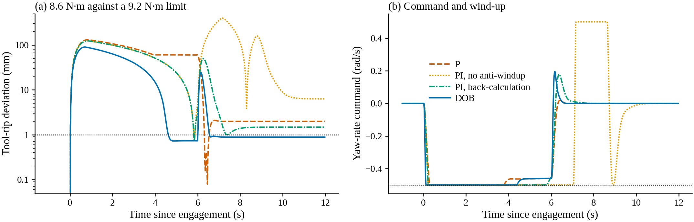</a>

- 报告：[切割力扰动与抗扰定点保持](experiments/cutting_force/README.md#62-力控底盘里程计反馈) · [PDF](experiments/cutting_force/fig_saturation.pdf)
- 说明：8.6 N·m 的偏航力矩对 9.2 N·m 的上限，阶跃切入 6 s 后退刀。(a) 刀尖偏移（对数刻度）；(b) 偏航角速度指令，黑点线为限幅。
- 要点：无抗饱和的 PI 退刀后反冲近 0.4 m，反算式抗饱和降到 50 mm；扰动观测器用限幅后的指令推进估计，退刀后 0.54 s 回到 1 mm 以内。外力超过限幅时任何控制律都无效。

### 3.19 里程计看不到打滑时（离线仿真）

<a href="experiments/cutting_force/fig_slip.png">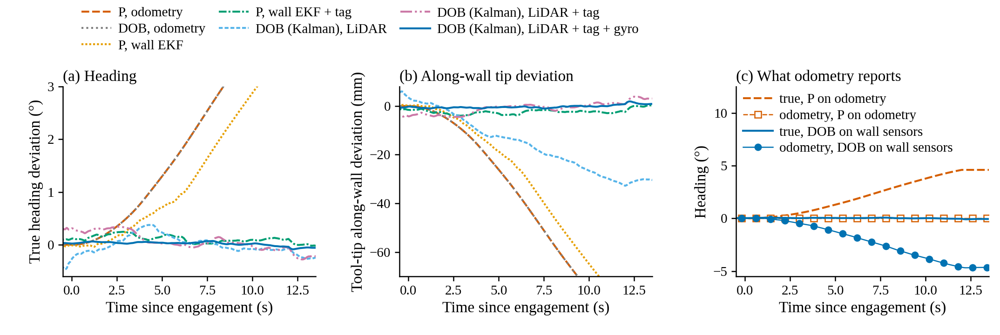</a>

- 报告：[切割力扰动与抗扰定点保持](experiments/cutting_force/README.md#63-里程计看不到打滑时) · [PDF](experiments/cutting_force/fig_slip.pdf)
- 说明：轮地接触底盘上的横槽切割（烧结砖，5 mm/s）。(a) 底盘真实朝向偏差；(b) 刀尖沿墙偏移；(c) 真实朝向与里程计报告的朝向。七种反馈方式：里程计、现有墙面 EKF、卡尔曼形式的扰动观测器，依次加入定位标记与陀螺。
- 要点：只用里程计时底盘真实转过几度而里程计读数为零，任何控制律都不动作；激光能保持朝向与离墙距离，沿墙位置只有定位标记能看到；加入陀螺后刀尖偏移峰值约 2 mm（均方根 0.8 mm）。

### 3.20 Gazebo 阶跃试验与离线模型

<a href="experiments/cutting_force/fig_gazebo_step.png">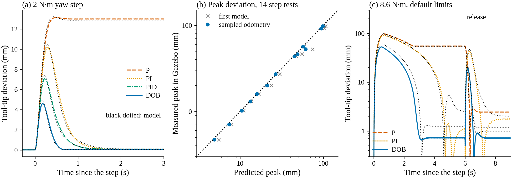</a>

- 报告：[切割力扰动与抗扰定点保持](experiments/cutting_force/README.md#103-阶跃外力稳态与各控制律的瞬态) · [PDF](experiments/cutting_force/fig_gazebo_step.pdf)
- 说明：(a) 2 N·m 偏航力矩阶跃下各控制律的刀尖偏移，彩色线为 Gazebo 真值，黑色细点线为模型；(b) 14 次试验的峰值，预测对实测；(c) 8.6 N·m、默认限幅下的响应（对数刻度）。每个工况 n = 1。
- 要点：修正里程计的积分方式后，12 次试验的峰值误差在 6 % 以内；扰动观测器的峰值约为 PI 的一半，与预测一致。

### 3.21 带切割力的整墙试验

<a href="experiments/cutting_force/fig_gazebo_stations.png">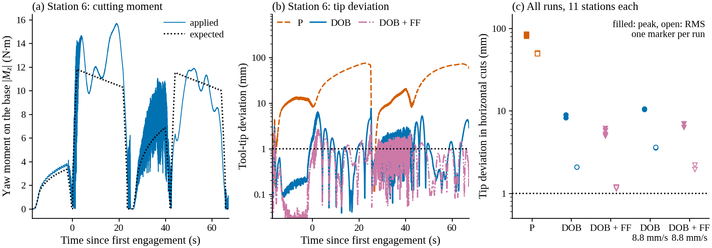</a>

- 报告：[切割力扰动与抗扰定点保持](experiments/cutting_force/README.md#105-带切割力的整面墙) · [PDF](experiments/cutting_force/fig_gazebo_stations.pdf)
- 说明：烧结砖，进给 5.5 mm/s。(a) 一个停靠站上作用在底盘的偏航力矩，实际施加值与名义值；(b) 同一站在三种保持方式下的刀尖偏移（对数刻度，黑点线为 1 mm）；(c) 各配置每次运行的横槽刀尖偏移，实心为峰值，空心为均方根。
- 要点：比例保持 81–85 mm、覆盖率 40 %；扰动观测器 8.3–9.0 mm；加前馈 5.0–6.2 mm（均方根 1.2 mm），约为离线预测的两倍。

### 3.22 进给上限与规划收益

<a href="experiments/cutting_force/fig_feed_limit.png">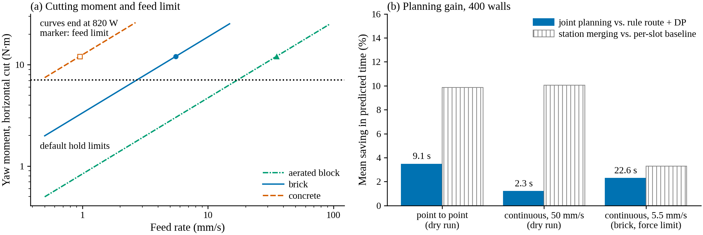</a>

- 报告：[切割力扰动与抗扰定点保持](experiments/cutting_force/README.md#11-进给速度的依据与规划收益) · [PDF](experiments/cutting_force/fig_feed_limit.pdf)；400 面墙的结果图：[PNG](experiments/cutting_force/benchmark/fig_results.png)
- 说明：(a) 横槽的偏航力矩随进给的变化，标记为功率 67 %、μ = 0.3、安全系数 1.5 下的进给上限；(b) 三个时间模型下 400 面随机墙的平均预测时间节省。
- 要点：进给上限由轮地摩擦决定（烧结砖 5.5 mm/s）；在该进给下联合规划的节省为 22.6 s（2.3 %），停靠站合并的相对收益降到 3.3 %。

### 3.23 标记地图在线估计：仿真器检验

<a href="experiments/tag_map_estimation/fig_validation.png">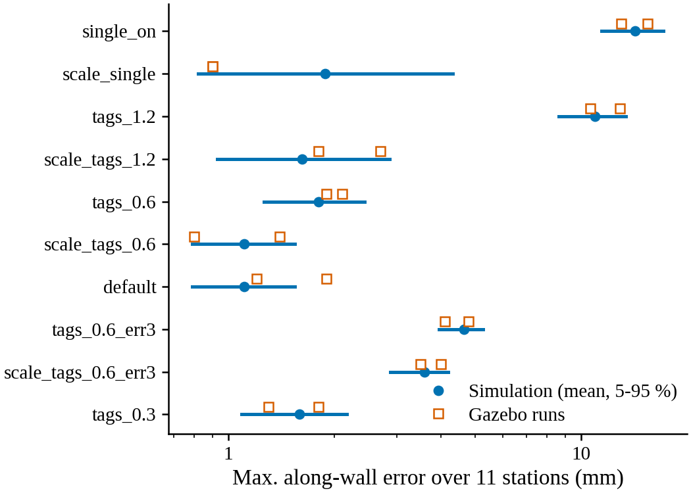</a>

- 报告：[标记地图在线估计](experiments/tag_map_estimation/README.md) · [PDF](experiments/tag_map_estimation/fig_validation.pdf)
- 说明：10 组配置下每次运行 11 站中的最大沿墙误差（对数刻度）：朱红方块为 Gazebo 的两次运行，蓝点与横线为离线仿真 40 次的平均与 5–95 分位。
- 要点：20 次 Gazebo 运行中 19 次落在仿真的 5–95 分位内。

### 3.24 标记地图在线估计：粘贴误差的影响

<a href="experiments/tag_map_estimation/fig_mc_methods.png">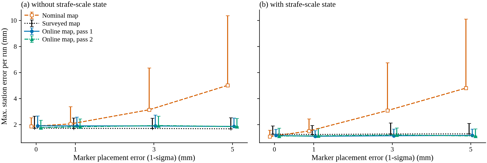</a>

- 报告：[标记地图在线估计](experiments/tag_map_estimation/README.md) · [PDF](experiments/tag_map_estimation/fig_mc_methods.pdf)
- 说明：3 个标记（间距 0.6 m）时，11 站最大沿墙误差的平均与 95 分位随粘贴误差的变化；(a) 不估计横移比例，(b) 估计横移比例。朱红虚线为名义地图，黑点线为实测地图，蓝实线为在线估计。每格 n = 100，离线仿真。
- 要点：名义地图的误差随粘贴误差增长（σ = 5 mm 时 4.79 mm），在线估计保持在 1.1–1.2 mm。

### 3.25 标记地图在线估计：标记数量

<a href="experiments/tag_map_estimation/fig_mc_layouts.png">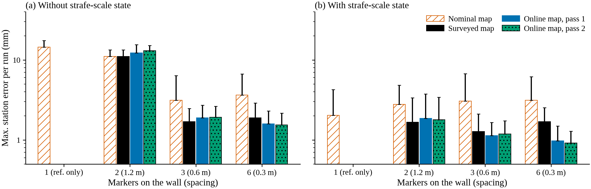</a>

- 报告：[标记地图在线估计](experiments/tag_map_estimation/README.md) · [PDF](experiments/tag_map_estimation/fig_mc_layouts.pdf)
- 说明：粘贴误差 σ = 3 mm 时不同标记布局下每次最大误差的平均与 95 分位（对数刻度）；(a) 不估计横移比例，(b) 估计横移比例。n = 100，离线仿真。
- 要点：2 / 3 / 6 个标记时在线估计为 1.87 / 1.13 / 0.98 mm；两个标记不同框时必须估计横移比例。

### 3.26 标记地图在线估计：录制数据回放

<a href="experiments/tag_map_estimation/fig_replay.png">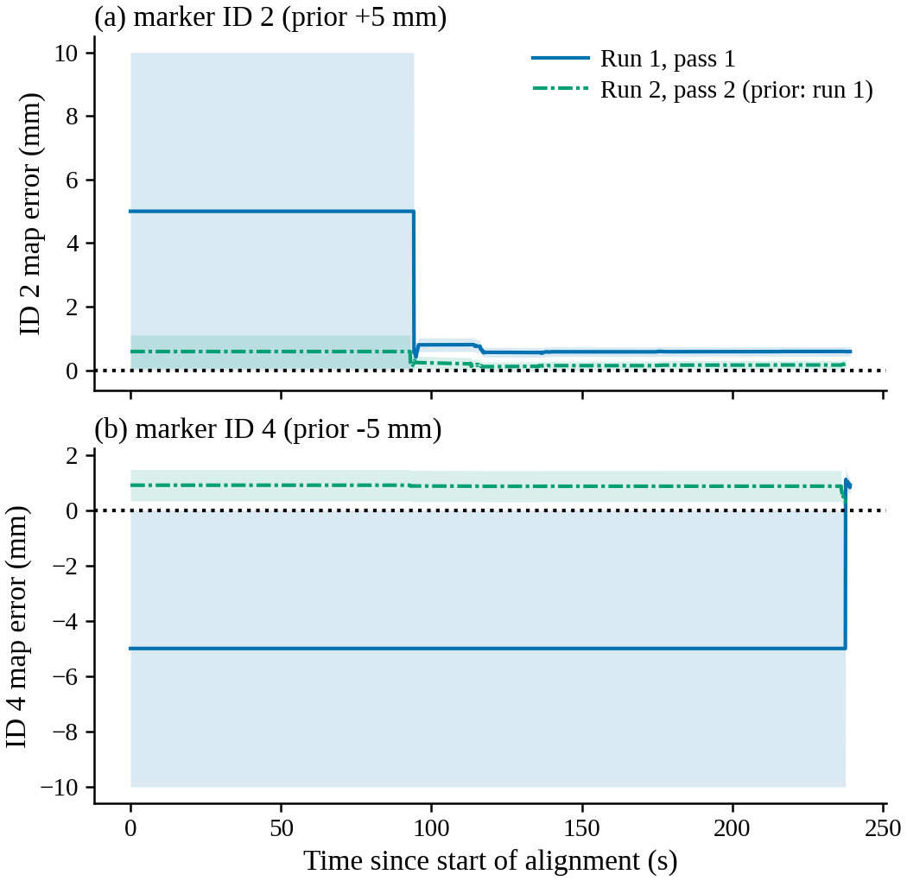</a>

- 报告：[标记地图在线估计](experiments/tag_map_estimation/README.md) · [PDF](experiments/tag_map_estimation/fig_replay.pdf)
- 说明：数据包回放中两个非参考标记的地图估计误差随时间的变化，阴影为 ±1σ；第一遍的先验偏 ±5 mm，第二遍沿用第一遍的结果。
- 要点：地图从 ±5 mm 的错误先验回到 0.9 mm 以内。

### 3.27 不估计横移比例时的同号偏差

- 报告：[标记地图在线估计](experiments/tag_map_estimation/README.md) · [PDF](experiments/tag_map_estimation/fig_bias.pdf)
- 说明：(a) Gazebo 中每站到站时的沿墙估计误差与“离墙距离 × 朝向估计误差”的关系；(b) 仿真中里程计横移比例误差对平均沿墙偏差的影响。
- 要点：偏差来自横移比例误差经朝向估计的泄漏，约 0.24 mm 每 1 %；估计比例后消失。

### 3.28 墙角与门洞边缘的沿墙定位精度

- 报告：[标记地图在线估计](experiments/tag_map_estimation/README.md) · [PDF](experiments/tag_map_estimation/fig_marker_free.pdf)
- 说明：激光对墙角（单帧、静止 30 帧平均）与门洞边缘给出的沿墙定位误差（1σ，对数刻度）随离特征距离的变化。按激光的测距噪声与角分辨率计算，理想墙面。
- 要点：墙角单帧 2.0–3.6 mm，门洞边缘 4–32 mm；墙角只适合作地图原点的锚点。

## 四、系统

### 4.1 软件架构

- 报告：[技术报告 §2](report/README.md) · [PDF](report/fig_architecture.pdf)
- 说明：方框为节点或文件，底色区分层次（离线规划、命令行与记录器、任务层、Nav2 与定位、ros2_control + Gazebo、真值）；实线箭头为指令与数据流，虚线箭头为传感器与里程计反馈，箭头旁为话题或 action 名。
- 要点：Gazebo 真值只进入评估，不进入任何控制或估计环节。

### 4.2 Nav2 导航轨迹

- 报告：[系统层现代化 §4.2](experiments/system_modernization/README.md) · [PDF](experiments/system_modernization/fig_nav_paths.pdf)
- 说明：同一张地图上 3 圈巡回导航的真值轨迹，(a) NavFn + DWB（朱红），(b) Smac 2D + MPPI（蓝）；坐标为地图坐标（m）。
- 要点：DWB 进入东侧房间北部时几乎擦过门洞边缘，且三圈都没有到达 G1；MPPI 三圈全部到达，离障更远。

### 4.3 Nav2 逐目标指标

- 报告：[系统层现代化 §4.2](experiments/system_modernization/README.md) · [PDF](experiments/system_modernization/fig_nav_metrics.pdf)
- 说明：横轴为导航目标点，(a) 用时、(b) 路径长度、(c) 最小离障间隙、(d) 加加速度均方根；柱高为 3 圈均值，误差棒为标准差，缺柱表示没有到达。
- 要点：Smac 2D + MPPI 18 / 18 到达（DWB 15 / 18），最小间隙 183 mm（DWB 5 mm），控制器 CPU 9.7 %（DWB 45.5 %），代价是路径略长。

### 4.4 定位漂移

- 报告：[系统层现代化 §4.4](experiments/system_modernization/README.md) · [PDF](experiments/system_modernization/fig_odom_drift.pdf)
- 说明：两次 129 m 长路线导航（起点对齐）。横轴为行驶距离，纵轴为位置误差 (a) 与航向误差 (b)；朱红虚线为仅轮式里程计，绿点划线为 EKF（轮式 + 陀螺），蓝实线为 AMCL（map 系）。
- 要点：融合陀螺后终点漂移由 1.4–1.6 % 降到 0.14–0.26 %，航向误差由 18–33° 降到 2–3°；AMCL（map 系）的终点误差为 0.04–0.06 m。

### 4.5 导航到达停滞

- 报告：[执行层遗留问题的排查](experiments/execution_issues/README.md) · [PDF](experiments/execution_issues/fig_nav_arrival.pdf)
- 说明：(a) 历史日志中 MPPI 导航“起点 → 墙前”的耗时，按是否出现确认超时分组（n = 95 / 2）；(b) 对照实验每段导航的耗时，四种配置各 24 段；(c) 一次停滞的时间线。
- 要点：确认超时的两次为 42.2 / 51.0 s，其余 23.9–36.5 s；时限改为 1000 ms 后对照中 0 次超时，耗时分布不变。

### 4.6 切割阶段的响应延迟

- 报告：[执行层遗留问题的排查](experiments/execution_issues/README.md) · [PDF](experiments/execution_issues/fig_pause.pdf)
- 说明：每个机械臂轨迹目标的响应延迟（对数刻度），默认 DDS 心跳与 0.1 s 心跳的对比。
- 要点：默认配置下偶发 1.4–3.0 s 的晚到；心跳 0.1 s 时最大 114 ms。

### 4.7 EKF 慢速偏差与 twist 取平均

- 报告：[执行层遗留问题的排查](experiments/execution_issues/README.md) · [PDF](experiments/execution_issues/fig_odom_slow.pdf)
- 说明：(a) 各阶段 EKF 位移减去轮式里程计位姿位移，修正前后（柱为 2 遍的平均）；(b) 此前两次运行中 twist 相对位姿差分速度的偏差。
- 要点：修正前 −2.5 … +6.5 mm，修正后 0.02 mm 以内。

### 4.8 扰动观测器保持的空切对照

- 报告：[执行层遗留问题的排查](experiments/execution_issues/README.md) · [PDF](experiments/execution_issues/fig_dob_dryrun.pdf)
- 说明：默认空切任务中各项指标，每点一次运行：叉为此前的比例保持运行，方块为同版本代码的比例保持，圆点为扰动观测器。
- 要点：耗时 +0.3 %，轨迹误差最大值每对都下降，底盘漂移与偏航峰值更小。

## 五、验证

### 5.1 时间模型：预测与实测

- 报告：[规划验证 §4.1–4.2](experiments/plan_validation/README.md) · [PDF](experiments/plan_validation/fig_time_model.pdf)
- 说明：每个点为一个停靠站，横轴为 Gazebo 实测耗时，纵轴为模型预测，黑点线为两者相等。(a) 此前路径的标定 `align_v2`，(b) 按当前默认执行路径重标定的 `align_v3`；灰色圆点为标定数据，蓝色三角为未参与标定的验证数据，右下角为验证数据的 RMSE 与平均偏差。
- 要点：`align_v2` 在当前路径下系统性低估（验证 RMSE 1.86 s，偏差 −1.77 s）；重标定后 RMSE 0.53 s、偏差 −0.04 s。

### 5.2 联合规划与规则路线：Gazebo 实测

- 报告：[规划验证 §4.3](experiments/plan_validation/README.md) · [PDF](experiments/plan_validation/fig_joint_vs_rule.pdf)
- 说明：(a) 11 个停靠站耗时之和，点为每次运行的实测，黑实线与灰虚线为两种时间模型的预测；(b) 每站耗时，横轴为执行顺序，每条线一次运行。朱红为规则路线（88 个机械臂点），蓝为联合规划（80 点）。
- 要点：联合规划 227.8–228.1 s，规则路线 245.7–246.0 s，实测节省 17.9 s（7.3 %，每种 2 次），预测节省 16.2 s（6.6 %）；差额主要来自规则路线每次运行中一次约 2.7 s 的偶发停顿。

### 5.3 技术报告结果汇总

- 报告：[技术报告](report/README.md) · [PDF](report/fig_summary.pdf)
- 说明：(a) 精对位配对实验（与 1.5 同一数据的子集）；(b) 多站执行每次运行的到站沿墙误差，均值 ± 站间标准差，右列为均值；(c) 两种时间模型在 55 个样本外停靠站上的预测与实测；(d) 真实里程计下各沿墙精度配置的最大到站沿墙误差，每个标记一次运行，右列为两次运行的均值（对数横轴）；(e) 带切割力的整墙试验中各定点保持方式的横槽刀尖偏移，实心为峰值、空心为均方根（对数纵轴）；(f) 逐点执行、连续轨迹、烧结砖限速进给三种时间模型下 400 面随机墙的平均预测节省，误差棒为 95 % 置信区间。
- 要点：同一份 11 站规划上，以标记为墙面原点后每次运行的常值沿墙偏差由 +0.65 / +1.26 mm 降到 −0.18 / +0.24 mm；标记地图加横移比例估计把最大沿墙误差由 24.7 mm 降到 1.5 mm；带力切割时比例保持的横槽偏移 81–85 mm，扰动观测器加前馈 5.0–6.2 mm；联合规划的预测节省随执行方式由 3.5 % 变为 1.2 % 与 2.3 %，停靠站合并的收益在带力切割时降到 3.3 %。

## 术语表

图中英文术语与本项目中文用语的对照（按字母顺序）。

| 英文（图中） | 中文 |
|---|---|
| A/C outlet | 空调插座 |
| all 8 failed | 8 次全部失败 |
| along-wall error | 沿墙误差 |
| along-wall error on arrival / arrival error | 到站沿墙误差 / 到站误差 |
| along-wall estimate | 沿墙位置估计 |
| AMCL (map frame) | AMCL 定位（map 系） |
| anti-windup / back-calculation | 抗积分饱和 / 反算式 |
| AprilTag + LiDAR EKF | AprilTag + 激光 EKF（本版精对位） |
| arm points | 机械臂点（每个切割点一次机械臂动作） |
| arm reach band | 机械臂可达（可切）高度带 |
| arm: cut length / feed | 机械臂：切割长度 / 进给（时间模型的长度项） |
| arm: cutting segments | 机械臂：切割段（沿槽线进给） |
| arm: per-point term | 机械臂：按点数计的时间（时间模型的点数项） |
| arm: reposition, plunge, retract, rotate | 机械臂：换位、下刀、退刀、转刀（不切割的运动） |
| axis-aligned | 横平竖直 |
| base drift | 底盘漂移（机械臂运动期间） |
| base move to station | 底盘横移到站 |
| baseline | 基线 |
| bay window / beam / column / door / pier / window | 飘窗 / 梁 / 柱 / 门 / 窄墙垛 / 窗 |
| behaviour tree | 行为树 |
| bend hits obstacle | 弯管碰到障碍 |
| blade forces (normal / tangential) | 刀片受力（法向 / 切向） |
| blade rotation | 刀片转向（joint4） |
| blocked (obstacle + margin) | 不可开槽区（障碍 + 规范边距） |
| calibration data / validation data | 标定数据 / 验证数据 |
| camera yaw | 相机偏航（安装偏角） |
| closed-loop pole | 闭环极点 |
| colour blob | 色块（第一版定位标记） |
| compliant / violates | 合规 / 违反 |
| conduit centre line | 线管中心线 |
| control effort | 控制量 |
| continuous (trajectory) / point-to-point | 连续轨迹 / 逐点执行 |
| convergence test | 收敛判据 |
| cool light / strong light | 冷白光 / 强白光 |
| corner pixel noise | 角点像素噪声 |
| cross-track deviation | 切割段内横向偏差 |
| CutStation time | `CutStation` 技能耗时 |
| cutting / dry cut | 切割 / 空切 |
| cutting window | 切割窗口（一个停靠站负责的墙面范围） |
| data trunking | 弱电线槽 |
| diagonal slot / diagonal share | 斜槽 / 斜向移动比例 |
| distance from wall / stand-off | 离墙距离 |
| distance travelled | 行驶距离 |
| DOB (disturbance observer) | 扰动观测器 |
| DP partition | 动态规划（DP）划分 |
| dwell after plunge | 下刀后等待 |
| EKF (wheel + gyro) | EKF（轮式里程计 + 陀螺） |
| encoder errors | 编码器误差模型 |
| engagement / step engagement | 切入 / 阶跃切入 |
| enhanced / improved / standard A\* | 增强 / 改进 / 标准 A\* |
| execution order | 执行顺序 |
| expanded nodes | 扩展节点数 |
| feasibility | 可行性 |
| feed rate | 进给速度（刀尖沿槽线的速度） |
| feedforward | 前馈 |
| final position error / final yaw (heading) error | 最终位置误差 / 最终偏航（朝向）误差 |
| fine alignment | 精对位 |
| first-version planner | 第一版规划器（Python 原型） |
| focal-length error / principal point error | 焦距误差 / 主点误差 |
| force-driven plant | 力驱动被控对象 |
| fore-aft offset / lateral offset | 前后偏移 / 横向偏移 |
| four corners | 四角点（标记的四个角） |
| fraction of walls | 墙的比例（累积分布的纵轴） |
| gap to lower bound | 与下界的差距 |
| goal / start | 目标点 / 起点 |
| ground truth | 真值 |
| gyro | 陀螺 |
| heading | 朝向 |
| heading drift / position drift | 航向漂移 / 位置漂移 |
| held-out | 样本外（未参与标定） |
| horizontal cut / vertical cut | 横槽 / 竖槽 |
| horizontal run > 50 cm | 横槽超过 50 cm |
| horizontal slot on load-bearing wall | 承重墙上开横槽 |
| hold (station hold) | 定点保持 |
| hybrid (2.5D) | 2.5D 混合视觉伺服 |
| image u / v | 像面坐标 u / v |
| intermittent occlusion / static occlusion | 间歇遮挡 / 全程遮挡 |
| jerk ramp time | 加加速度上升时间（加速度从 0 升到上限的时间） |
| jerk RMS | 加加速度均方根 |
| joint planning | 联合规划 |
| joint tracking error | 关节跟踪误差（指令 − 实际） |
| junction box / switch / outlet | 接线盒 / 开关 / 插座 |
| lateral force / push-back force | 横向力 / 推离墙面的力 |
| lift (Z) / along wall (Y) / extend (X) | 升降轴 / 沿墙轴 / 伸缩轴 |
| load-bearing wall / partition wall | 承重墙 / 非承重墙 |
| lower bound | 下界 |
| marker / reference marker | 定位标记 / 参考标记 |
| marker in view | 标记在视野内（参与更新） |
| marker side length | 标记边长 |
| mean bias | 平均偏差 |
| min. clearance | 最小离障间隙 |
| multi-marker map | 多标记地图 |
| no marker update | 该周期无标记更新 |
| no room for bend | 弯管放不下（两弯之间的直段过短） |
| nominal / nominal model | 名义条件 / 标称模型 |
| normalised gain k·T | 归一化增益 k·T |
| observability | 可观性 |
| obstacle avoidance only | 只避障 |
| odometry drift | 里程计漂移 |
| origin fold-in | 原点修正（对位残差并入墙面坐标原点） |
| path length | 路径长度 |
| PBVS / IBVS | 基于位置 / 基于图像的视觉伺服 |
| per-slot partition | 逐槽划分 |
| per-station overhead | 每站固定开销 |
| planned slot | 规划槽线 |
| planning time | 规划耗时 |
| plunge / feed | 下刀 / 进给 |
| power panel | 配电箱 |
| predicted / measured | 预测 / 实测 |
| range noise | 激光测距噪声 |
| rapid speed / rapid accel. | 空行程速度 / 加速度 |
| re-alignment | 重新对位 |
| recovery | 恢复（重试） |
| required friction coefficient | 所需摩擦系数 |
| residual compensation | 残差补偿 |
| residual measurement, overhead | 到站残差测量等固定开销 |
| right-angle turns | 直角转弯 |
| RMS / RMSE | 均方根 / 均方根误差 |
| rule-based routes (+ DP) | 规则路线（先按规范代价选线，再 DP 划分停靠站） |
| safety margin | 安全边距 |
| saturated law | 饱和控制律 |
| saving | 节省 |
| scene | 场景（一面随机墙及其任务） |
| sensitivity / sensitivity peak | 灵敏度函数 / 灵敏度峰值 |
| sensor noise | 传感器噪声 |
| simulation time | 仿真时间 |
| single-frame std. dev. | 单帧测量标准差 |
| skill action | 技能 action |
| slip seed | 打滑种子（编码器误差模型的随机种子） |
| slot / slot length | 槽线 / 槽长 |
| slotting rules | 开槽规范 |
| speed command | 速度指令 |
| stability limit | 稳定边界 |
| station / station sequence | 停靠站 / 停靠站顺序 |
| steady-state | 稳态 |
| strafe | 横移 |
| strafe-scale correction | 横移比例修正 |
| strafing | 横移 |
| structural beam | 承重横梁 |
| sweep order | 扫掠顺序 |
| taught at goal / taught zero offset | 在期望位姿示教 / 示教零位 |
| time model (align_v1 / v2 / v3) | 时间模型（三个标定预设） |
| time per station | 每站耗时 |
| tipping margin | 倾覆裕度 |
| tool tip | 刀尖 |
| tool-tip along-wall error | 刀尖沿墙误差 |
| tool-tip compliance | 刀尖柔度（单位切削力引起的刀尖偏移） |
| tool-tip deviation | 刀尖偏移 |
| tool-tip path error | 刀尖轨迹误差 |
| top view | 俯视图 |
| trajectory duration from the generator | 轨迹生成器给出的时长 |
| turn / turn penalty | 转弯 / 转向惩罚 |
| v1 (colour blob + PBVS) | 第一版精对位（色块 + PBVS） |
| v2 (AprilTag + LiDAR EKF) | 本版精对位（AprilTag + 激光 EKF） |
| velocity-loop gain | 速度环增益 |
| wall EKF | 墙面相对 EKF |
| wall entry point / target box | 入墙点 / 目标线盒 |
| wheel load | 轮压 |
| wheel odometry | 轮式里程计 |
| wind-up | 积分累积（饱和） |
| wrench | 力旋量（力与力矩） |
| yaw moment / yaw-rate command | 偏航力矩 / 偏航角速度指令 |
| z-plane | z 平面 |

## 图的生成

所有数据图都可以由仓库中已提交的数据生成（不需要 Gazebo），作图脚本共用 [`figstyle`](figstyle/README.md) 模块：

| 图 | 生成命令（仓库根目录） |
|---|---|
| 1.1、1.5–1.7 | `python3 docs/experiments/alignment_robustness/make_report.py` |
| 1.2–1.4 | `python3 docs/experiments/fine_alignment/analysis.py` |
| 1.8–1.12 | `cd docs/experiments/ibvs_vs_pbvs && python3 run_experiments.py --plot-only` |
| 2.1–2.2 | `cd src/path_planning && python3 wall_cutting_planner.py` |
| 2.3–2.4 | `cd src/path_planning && python3 improved_astar.py` |
| 2.5 | `python3 src/scr_planner/scripts/wall_benchmark.py --plot-only` |
| 2.8–2.10 | `python3 src/scr_planner/scripts/room_planning_report.py`（见 [复现](experiments/room_planning/README.md#复现)） |
| 2.6–2.7 | `python3 src/scr_planner/scripts/task_planning_report.py <data> <out> --time-model=<预设>`（见 [复现](experiments/task_planning/README.md#复现)） |
| 3.2 | `python3 src/scr_planner/scripts/plot_station_order.py <基线运行> <优化运行> <results.csv> <out.png>` |
| 3.3–3.6 | `python3 docs/experiments/along_wall_accuracy/make_report.py` |
| 3.7–3.11 | `python3 docs/experiments/arm_trajectory/make_report.py`（3.8 的数据由 `extract_profile.py` 从数据包导出，已提交；3.11 另需 `benchmark/data/`，见 [复现](experiments/arm_trajectory/README.md#8-复现)） |
| 3.12–3.19 | `python3 docs/experiments/cutting_force/analysis.py` |
| 3.20–3.22 | `python3 docs/experiments/cutting_force/gazebo_analysis.py` |
| 4.1、5.3 | `python3 docs/report/make_figures.py` |
| 3.23–3.28 | `python3 docs/experiments/tag_map_estimation/make_figures.py`（见 [复现](experiments/tag_map_estimation/README.md#11-复现)） |
| 4.5–4.8 | `docs/experiments/execution_issues/` 下的 `analyze_nav.py`、`analyze_pause.py`、`analyze_odom.py`、`analyze_dob.py` |
| 4.2–4.4 | `python3 docs/experiments/system_modernization/make_report.py` |
| 5.1–5.2 | `python3 docs/experiments/plan_validation/make_report.py` |

2.5 与 2.6–2.7 需要先 `colcon build --packages-select scr_planner`（C++ 规划器）。3.1 的原始刀尖轨迹未提交，不能重新生成。
