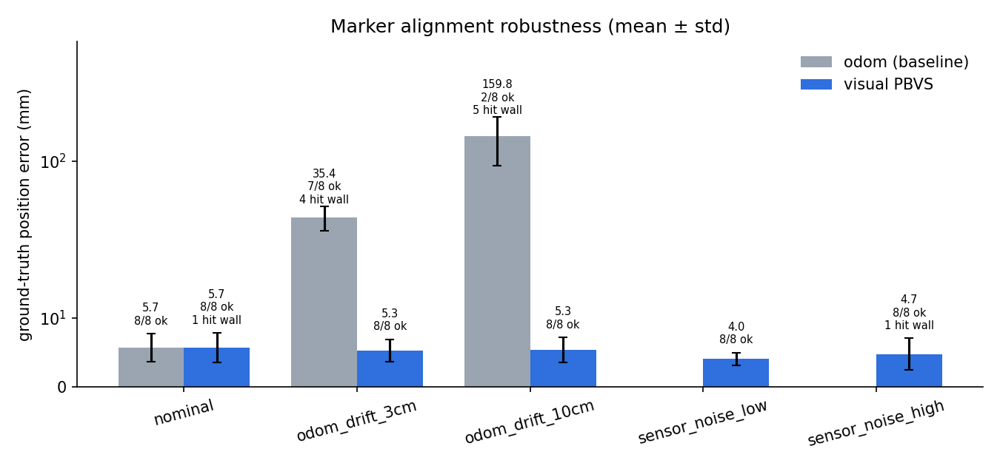

# 对位鲁棒性实验：视觉伺服 vs 里程计

比较两种精确对位方式在里程计漂移与传感器噪声下的表现。

| 模式 | 反馈来源 | 先验知识 |
|---|---|---|
| `odom`（基线） | 里程计位姿 | 方块的世界坐标（写死在代码中） |
| `visual`（PBVS） | 激光拟合墙面 + 相机检测方块 | 无 |



## 方法

- **只运行对位阶段**：每次试验用 `/gazebo/set_entity_state` 把机器人传送到墙前随机起点，再执行 `precise_positioning_to_marker()`，结束后用 Gazebo 真值计算误差。
- **随机起点**：离墙 1.0–1.5 m、横向 ±0.3 m、朝向 ±10°；固定种子（42），所有条件使用**同一组起点**，构成配对比较。
- **里程计漂移**：在控制器读到的里程计位姿上叠加固定偏差，模拟长距离导航后的累积误差。平移方向与航向符号每次试验随机（同样固定种子，两种模式一致）。
- **传感器噪声**：在方块像素坐标与激光测距上叠加高斯噪声（在 Gazebo 自带噪声之外）。
- **收敛判据**：位置 1 cm、角度 1°，连续 5 个周期；50 s 仿真时间内未收敛记为失败。失败试验同样计入误差统计。
- **碰墙判定**：机械臂末端碰撞包围盒前伸至机器人中心前方 0.70 m，最终离墙距离 < 0.695 m 记为碰墙。

| 条件 | 里程计漂移 | 像素噪声 σ | 测距噪声 σ |
|---|---|---|---|
| nominal | — | — | — |
| odom_drift_3cm | 3 cm, 1° | — | — |
| odom_drift_10cm | 10 cm, 3° | — | — |
| sensor_noise_low | — | 2 px | 2 cm |
| sensor_noise_high | — | 5 px | 5 cm |

## 结果（每格 8 次试验）

| 条件 | 模式 | 成功 | 碰墙 | 位置误差 mean ± std (max) | 角度 mean | 耗时 |
|---|---|---|---|---|---|---|
| nominal | odom | 8/8 | 0 | 5.7 ± 2.0 (9.2) mm | 0.69° | 8.3 s |
| nominal | visual | 8/8 | 1 | 5.7 ± 2.1 (9.7) mm | 0.64° | 10.3 s |
| odom_drift_3cm | odom | 7/8 | 4 | 35.4 ± 7.7 (52.0) mm | 0.90° | 13.6 s |
| odom_drift_3cm | visual | 8/8 | 0 | 5.3 ± 1.6 (8.3) mm | 0.65° | 10.6 s |
| odom_drift_10cm | odom | 2/8 | 5 | 159.8 ± 68.1 (249.0) mm | 17.70° | 40.5 s |
| odom_drift_10cm | visual | 8/8 | 0 | 5.3 ± 1.8 (7.8) mm | 0.82° | 10.6 s |
| sensor_noise_low | visual | 8/8 | 0 | 4.0 ± 0.9 (5.8) mm | 0.57° | 10.9 s |
| sensor_noise_high | visual | 8/8 | 1 | 4.7 ± 2.3 (8.7) mm | 0.29° | 13.8 s |

原始数据：[`trials.csv`](trials.csv)（逐次试验）、[`summary.csv`](summary.csv)（汇总）。

## 结论

1. **无扰动时两者精度相当**（均 5.7 mm）。仿真里程计没有误差，基线处于最有利条件。
2. **里程计一旦漂移，odom 模式误差随漂移等量增长**（3 cm → 35 mm，10 cm → 160 mm），并频繁发生刀具碰墙；10 cm 漂移下 8 次只有 2 次收敛。
3. **visual 模式对里程计漂移完全不敏感**（5.3 mm），因为控制环不使用里程计。
4. **visual 模式对所加的传感器噪声不敏感**：2 px / 2 cm 与 5 px / 5 cm 噪声下误差仍在 4–5 mm，耗时略增。墙面拟合使用数十个激光点做总体最小二乘，加上指数平滑，平均掉了大部分噪声。

## 局限与发现

- **零安全余量**：目标离墙距离 0.70 m 恰好等于刀具包围盒前伸量，因此任何朝墙方向的毫米级误差都会被判为“碰墙”（nominal 下 visual 也有 1 次，仅比目标近 6 mm）。这是任务参数的设计缺陷，应留出余量或分离“对位距离”与“切割进给”。
- **碰墙后卡死部分是仿真伪影**：Gazebo 中盒体与墙面接触后底盘无法后退，真实机器人通常能退出；因此 odom 模式的“失败 / 超时”数量偏悲观，但“误差随漂移增长”和“会碰墙”是真实的。
- **漂移模型简化**：用固定偏差代替随路程累积的漂移；未覆盖动态光照、遮挡、标记部分不可见等视觉失效情形。
- **样本量小**：每格 8 次，噪声条件之间的差异（4.0 vs 4.7 vs 5.7 mm）在标准差范围内，不应解读为“噪声越大越准”。

## 复现

```bash
ros2 launch scr_description gazebo.launch.py gui:=false        # 终端 1：只启动仿真（不需要 Nav2）
ros2 run scr_arm_controller alignment_benchmark --trials 8 --out docs/experiments/alignment_robustness
```

单次全部 64 次试验约 25 分钟（4 核 / 4 GB 虚拟机，实时率 ≈ 1.0）。
