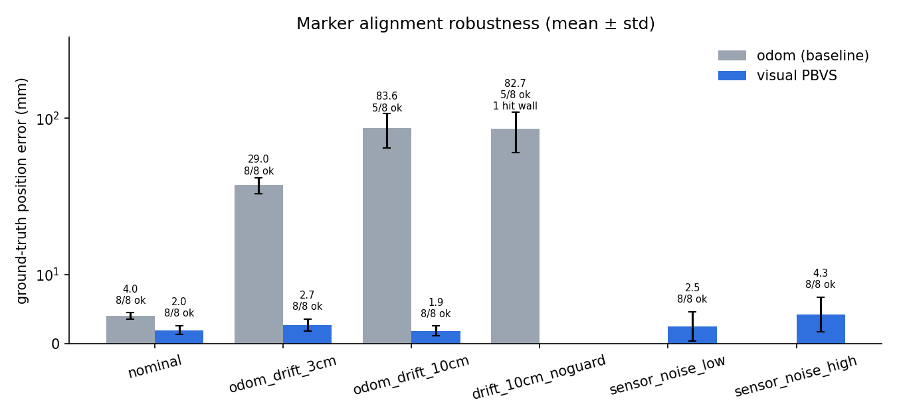

# 对位鲁棒性实验（第一版精对位，存档）

> 本文是第一版精对位（色块 + 激光 PBVS，指数平滑，比例 + 最小速度 + 死区，1 cm / 1° 停止判据）的实验记录，仿真配置 v2，保留原样作为对照。数据与图在本目录（`trials.csv`、`summary.csv`、`robustness.png`）。当前版本（AprilTag + EKF + 饱和控制律）的结果与同条件复测见上一级 [README](../README.md)。
>
> 与复测的口径差异：本文的位置误差在对位结束后约 1 s 取真值（期间底盘零速滑移约 0.6 mm/s 计入误差），目标离墙距离以色块中心（墙前 0.5 mm）为参照，复测改为以墙面为参照。


比较两种精确对位方式在里程计漂移与传感器噪声下的表现，并验证刀具与墙面的安全间隙。

| 模式 | 反馈来源 | 先验知识 |
|---|---|---|
| `odom`（基线） | 里程计位姿 | 方块的世界坐标（写死在代码中） |
| `visual`（PBVS） | 激光拟合墙面 + 相机检测方块 | 无 |



## 方法

- **只运行对位阶段**：每次试验用 `/gazebo/set_entity_state` 把机器人传送到墙前随机起点，再执行 `precise_positioning_to_marker()`，结束后用 Gazebo 真值计算误差。
- **随机起点**：离墙 1.0–1.5 m、横向 ±0.3 m、朝向 ±10°；固定种子（42），所有条件使用**同一组起点**，构成配对比较。
- **里程计漂移**：在控制器读到的里程计位姿上叠加固定偏差，模拟长距离导航后的累积误差。平移方向与航向符号每次试验随机（同样固定种子，两种模式一致）。
- **传感器噪声**：在方块像素坐标与激光测距上叠加高斯噪声（在 Gazebo 自带噪声之外）。
- **收敛判据**：位置 1 cm、角度 1°，连续 5 个周期；50 s 仿真时间内未收敛记为失败。失败试验同样计入误差统计。
- **刀具间隙**：试验结束时“机器人真值离墙距离 − 刀具最前端（按当前机械臂位姿经 TF 计算）”；< 0 记为碰墙。
- **两种模式的共同安全措施**：接近墙面前机械臂伸缩轴完全缩回；激光防碰撞守护（见下文）。`drift_10cm_noguard` 为关闭守护的消融对照。
- **仿真加速**：以 `rtf:=2.5`（实测约 2.2 倍实时）运行。控制器按仿真时钟计时；加速与实时的一致性在上一版仿真配置上用同种子验证过（差异在一个标准差内），本版未重复验证。
- **仿真配置**：机械臂关节力控（`position_pid`）、底盘力控平面运动插件 `scr_planar_move`（见下文“仿真保真度”）。

| 条件 | 里程计漂移 | 像素噪声 σ | 测距噪声 σ | 守护 |
|---|---|---|---|---|
| nominal | — | — | — | 开 |
| odom_drift_3cm | 3 cm, 1° | — | — | 开 |
| odom_drift_10cm | 10 cm, 3° | — | — | 开 |
| drift_10cm_noguard | 10 cm, 3° | — | — | **关** |
| sensor_noise_low | — | 2 px | 2 cm | 开 |
| sensor_noise_high | — | 5 px | 5 cm | 开 |

## 结果（每格 8 次试验，共 72 次）

| 条件 | 模式 | 成功 | 碰墙 | 位置误差 mean ± std (max) | 角度 mean | 最小刀具间隙 | 耗时（仿真） |
|---|---|---|---|---|---|---|---|
| nominal | odom | 8/8 | 0 | 4.0 ± 0.5 (4.7) mm | 0.29° | 27.6 mm | 9.0 s |
| nominal | visual | 8/8 | 0 | 2.0 ± 0.6 (2.8) mm | 0.36° | 25.1 mm | 8.7 s |
| odom_drift_3cm | odom | 8/8 | 0 | 29.0 ± 4.2 (34.2) mm | 1.01° | 4.6 mm | 9.0 s |
| odom_drift_3cm | visual | 8/8 | 0 | 2.7 ± 0.9 (4.2) mm | 0.31° | 25.5 mm | 8.6 s |
| odom_drift_10cm | odom | 5/8 | 0 | 83.6 ± 25.6 (104.1) mm | 3.11° | 1.8 mm | 26.1 s |
| odom_drift_10cm | visual | 8/8 | 0 | 1.9 ± 0.7 (2.7) mm | 0.41° | 23.8 mm | 8.6 s |
| drift_10cm_noguard | odom | 5/8 | 1 | 82.7 ± 29.6 (104.1) mm | 6.07° | -1.9 mm | 26.2 s |
| sensor_noise_low | visual | 8/8 | 0 | 2.5 ± 2.1 (6.2) mm | 0.16° | 24.4 mm | 8.8 s |
| sensor_noise_high | visual | 8/8 | 0 | 4.3 ± 2.5 (9.5) mm | 0.30° | 22.3 mm | 11.8 s |

原始数据：[`trials.csv`](trials.csv)（逐次试验）、[`summary.csv`](summary.csv)（汇总）。

## 结论

1. **无扰动时视觉伺服更准**（2.0 vs 4.0 mm）：两者都在 1 cm 容差内收敛，视觉伺服直接以传感器测得的墙面与方块为参照，不受里程计 → 地图坐标转换误差影响。
2. **里程计一旦漂移，odom 模式误差随漂移等量增长**（3 cm → 29 mm，10 cm → 84 mm），刀具间隙被压缩到个位毫米；10 cm 漂移下 3 次因目标实际过于靠墙、被守护拦下而无法收敛。
3. **visual 模式对里程计漂移完全不敏感**（1.9–2.7 mm），因为控制环不使用里程计；刀具间隙始终 ≥ 20 mm。
4. **visual 模式对所加的传感器噪声较鲁棒**：2 px / 2 cm 噪声下 2.5 mm，5 px / 5 cm 噪声下 4.3 mm（收敛变慢 8.8 → 11.8 s）。
5. **守护开启时 64 次试验零碰墙**（10 cm 漂移下最小间隙 1.8 mm）；关闭守护的对照中出现 1 次真实碰墙（间隙 −1.9 mm）。
6. 感知本身误差约 1–2 mm（方块三维位置与真值对比），与最终对位误差同一量级。

## 感知精度诊断

在 27 个位姿（离墙 0.7 / 0.9 / 1.2 m × 横向 ±0.15 m × 朝向 ±6°）下对比感知与真值：

| 量 | 修正前 | 修正后 |
|---|---|---|
| 检测像素 − 真值投影（u / v） | −0.99 / −1.01 px | −0.02 / −0.01 px |
| 方块横向估计误差 | +2.0 ± 0.9 mm（随距离增大） | −0.01 ± 0.41 mm |
| 激光墙面角误差 | +0.02 ± 0.16° | — |
| 激光墙面距离误差 | −0.35 ± 1.39 mm | — |

原因：`gazebo_ros_camera` 发布的主点为 (W+1)/2、(H+1)/2，而按 OpenCV“整数坐标位于像素中心”的约定应为 (W−1)/2、(H−1)/2，相差 1 px（`visual_servo_ros.py` 中 `principal_point_shift`；真机由相机标定得到内参，此修正置 0）。

## 安全间隙：问题与修复

第一轮实验发现：对位目标离墙 0.70 m，而机械臂在 `joint3 = 0` 时刀具前端恰好位于底盘中心前方 0.696 m——**几乎零余量**。

用 TF 实测末端位置后得到（`x = x0 − joint3`；`cartesian_cutting.py` 中打印的工作空间符号写反了，已修正）：

| joint3 | 刀具前端（距底盘中心） | 0.70 m 对位时离墙间隙 |
|---|---|---|
| +0.020（完全缩回） | 0.676 m | +24 mm |
| 0 | 0.696 m | +4 mm |
| −0.045（完全伸出） | 0.741 m | −41 mm（即切削深度） |

修复（两种模式都生效）：

1. **接近墙面、扫描时机械臂完全缩回，切割时再伸出**——约 24 mm 结构余量。
2. **激光防碰撞守护，按制动距离限速**：允许的向墙速度 = max(0, (间隙 − 5 mm) / 0.5 s)。早先的实现只在间隙已小于 5 mm 时截断速度，10 Hz 控制周期内机器人会以 0.1–0.2 m/s 冲过阈值 1–2 cm。现版本 10 cm 漂移下：开启守护最小间隙 1.8 mm、零碰墙；关闭守护最小 −1.9 mm（碰墙 1 次）。

## 仿真保真度：底盘旋转

早期版本中底盘实际转速只有指令的 18–37 %（空旷处、四种机械臂姿态实测），平移正常。原因有两层：

1. gazebo_ros2_control 的 position 接口每个控制周期把机械臂关节“瞬移”到目标位置，丢掉了机械臂随底盘旋转应有的速度；
2. gazebo_ros_planar_move 给模型所有连杆设置同一个线速度，偏心连杆在旋转时速度不一致，被关节约束抵消（关节越“硬”越明显）。

修复：机械臂改用 `position_pid` 力控（按各关节质量整定 PID，控制频率 1 kHz），轮子改 `velocity_pid`，底盘换成自写的力控平面运动插件 `scr_planar_move`（只在底盘施加力 / 力矩做速度闭环）。修复后转速比 0.99–1.01、平移 0.99–1.01，机械臂跟踪误差 ≤ 0.2 mm / 0.14°；以 0.2 m/s 直冲墙面时在刀具接触处停住，无穿透。

## 局限

- **碰撞后的行为是仿真近似**：真实机器人可能推墙、打滑或损伤刀具。
- **漂移模型简化**：用固定偏差代替随路程累积的漂移；未覆盖动态光照、遮挡、标记部分不可见等视觉失效情形。
- **刀具前伸量来自网格包围盒**（0.1594 m），是保守估计。
- **样本量小**：每格 8 次；条件之间若干毫米的差异在 1 cm 容差带内，不应过度解读。

## 复现

```bash
ros2 launch scr_description gazebo.launch.py gui:=false rtf:=2.5     # 终端 1：只启动仿真（不需要 Nav2）
ros2 run scr_arm_controller alignment_benchmark --trials 8 --out docs/experiments/alignment_robustness   # 当时的版本
```

72 次试验约 13 分钟（4 核 / 4 GB 虚拟机）；`rtf:=1.0` 时约 30 分钟。
