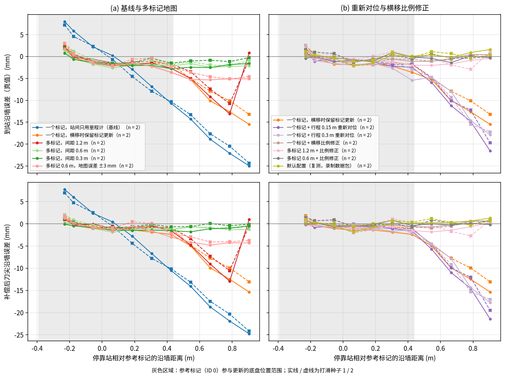
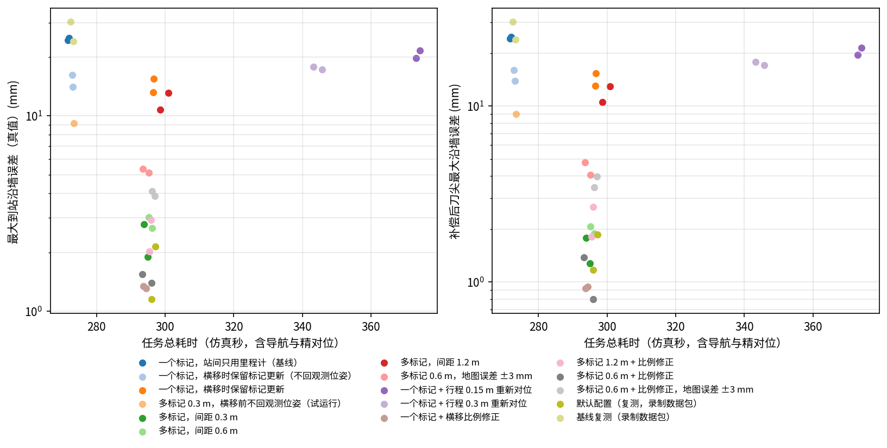
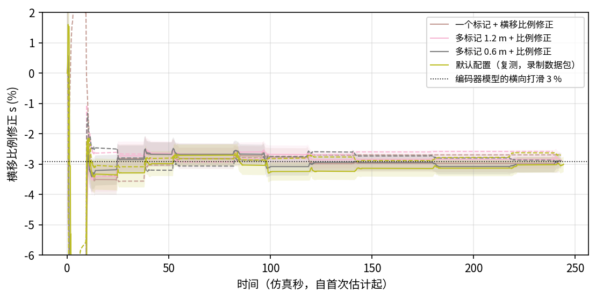
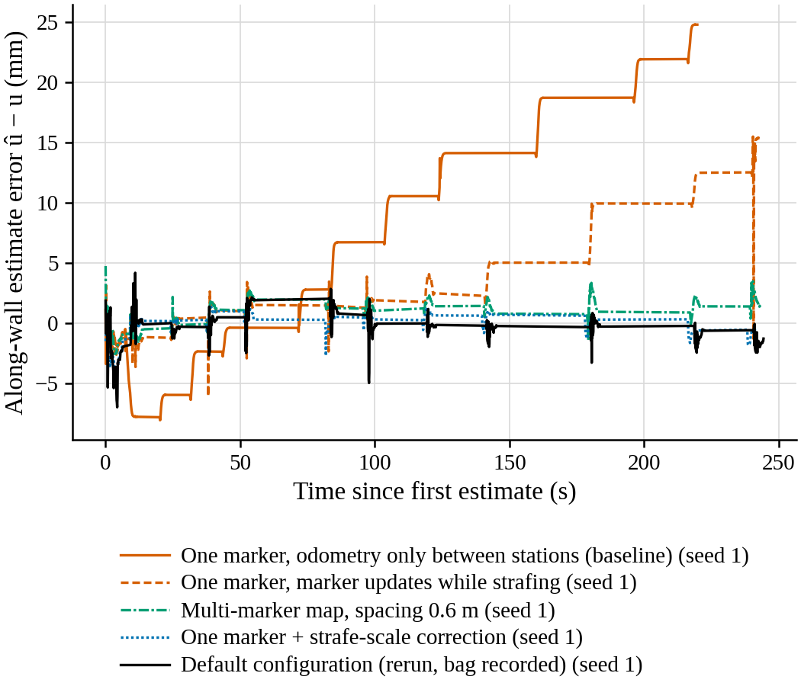
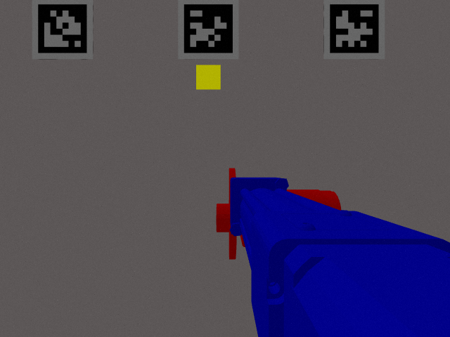

# 多站执行的沿墙精度：多标记地图、按行程重新对位与横移比例在线估计

在真实的里程计误差下，11 站开槽的沿墙误差随离定位标记的距离线性增长到约 25 mm。本报告在 Gazebo 中比较四类做法：多个已知位置的标记、按行程回到标记重新对位、在线估计里程计的横移比例，以及它们的组合。结论是**沿墙位置只有在看到标记时才可观测，站间的外推误差来自固定方向的横移比例误差**；按 0.6 m 间距布置标记并在线估计横移比例后，最大沿墙误差由 24.7 mm 降到 1.5 mm，这一组合已设为默认配置。

| 做法 | 主要结果（11 站规划，每个配置 2 次运行，最大到站沿墙误差的均值；详见第 4 节） |
|---|---|
| 基线：一个标记，站间只用里程计 | 24.7 mm，误差与离标记的距离成正比（趋势 −2.8 %，编码器模型的横向打滑为 3 %）；复测 4 次 24.0–30.3 mm |
| 一个标记，横移时保留标记更新 | 14.4 mm：标记视野内（底盘离标记 −0.39 … +0.44 m）误差在 ±3.6 mm 以内，视野外照样按 3 % 增长；横移前需回到机械臂观测位姿才看得到标记（每站约 +2 s） |
| 多标记地图，间距 0.3 / 0.6 / 1.2 m | 2.3 / 2.8 / 11.9 mm：间距不超过可见窗口（约 0.83 m）时误差不再随距离增长；1.2 m 留下 0.37 m 的无标记区。地图位置误差 ±3 mm 几乎一比一进入结果（5.2 mm） |
| 一个标记 + 按行程重新对位（阈值 0.3 / 0.15 m） | 17.5 / 20.6 mm，耗时 +48 / +77 s：对固定方向的比例误差，回到标记再出发不改变到站点离最后一次标记更新的距离，没有改善 |
| 横移比例在线估计（EKF 第四个状态） | 一个标记即可降到 1.3 mm（比例估计 −2.7 … −3.0 %，σ = 0.3 %）；与 1.2 m 间距标记组合 2.5 mm |
| **推荐（默认）：0.6 m 间距标记 + 横移比例估计** | 1.5 mm（平均 0.7 mm），补偿后刀尖沿墙误差最大 1.1 mm，刀尖轨迹误差 95 分位 0.23 mm，总耗时 295 s（基线 272 s）；以默认参数复测 2 次 1.1 / 2.1 mm，并录制了数据包 |

不依赖人工标记的办法（墙角、门框、BIM 墙面模型配准）只做了分析（5.3 节）：平直墙面对 2D 激光没有沿墙信息，这些特征只能提供稀疏的参照，横移比例估计仍然需要。

## 1. 问题

系统层改造后（[`system_modernization`](../system_modernization/README.md) 4.5 节），里程计带上了编码器误差模型（横向打滑 3 %、转向打滑 2 %、轮径误差与随机打滑）。单站精对位仍在亚毫米级，但 11 站开槽规划中各站的沿墙误差随离定位标记的距离线性增长，最远站 24.8 mm，约为横移距离的 −2.8 %。原因是激光只能观测离墙距离与朝向，站间的沿墙位置只由里程计外推。本报告比较四类恢复沿墙精度的办法，并给出推荐的默认配置：

1. 基线：站间只用里程计；横移时保留标记更新；
2. 墙上布置多个已知位置的标记（标记地图），任一可见标记都更新沿墙位置；
3. 只有一个标记时，按“无标记更新的沿墙行程”触发回到标记重新对位；
4. 在线估计里程计的横移比例，单独使用或与 2、3 组合。

不依赖人工标记的办法（墙角、门框、BIM 墙面模型配准）只做分析，见 5.3 节；标记位置的在线估计、剩余同号偏差的来源与墙角精度的估算见 [标记地图在线估计](../tag_map_estimation/README.md)。

## 2. 方法

### 2.1 误差来源与可观测性

墙面相对状态 `X = (d, u, ψ)`（离墙距离、沿墙位置、朝向偏角，见 [`wall_ekf.py`](../../../src/scr_arm_controller/scr_arm_controller/wall_ekf.py)）由三种测量更新：

| 测量 | 观测量 | 对 `u` 的信息 |
|---|---|---|
| 激光拟合墙面（10 Hz） | `d`、`ψ` | 无：平直墙面沿自身平移不变，各束测距 `r_i = d / cos(θ_i + ψ)` 与 `u` 无关 |
| 定位标记 `i`（30 Hz） | `R(−ψ)·(d, u − u_i)` | 有，但只在标记处于画面内时 |
| 轮式里程计（50 Hz，预测） | 位移增量 | 只有增量，误差随行程累积 |

编码器模型中横向打滑一项使里程计把横移距离高估 3 %（`ω_meas ∝ (1 + 0.03)·v_y`），这是一个方向固定、与横移距离成正比的系统误差。底盘按里程计停在“目标位置”，实际少走约 2.9 %，于是离标记越远的站误差越大。随机打滑（每轮 σ = 2 %、相关时间 0.5 s）在 0.1 m 级的站间横移上只有毫米级以下的贡献。

### 2.2 多标记地图

在同一面墙上布置多个 AprilTag（tag36h11，ID 不同），地图给出每个标记在墙面坐标中的位置 `u_i`（相对参考标记 ID 0，[`tag_map.py`](../../../src/scr_arm_controller/scr_arm_controller/tag_map.py)）：

```yaml
tag_map:
  reference_id: 0            # 墙面坐标原点，精对位以它为目标
  sigma_position: 0.002      # 粘贴位置误差（米，1σ）
  tags:
    - {id: 0, u: 0.0, v: 0.70}
    - {id: 2, u: 0.6, v: 0.70}
```

- **测量模型**：标记 `i` 的观测为 `h_i(X) = R(−ψ)·(d, u − u_i)`，与单标记模型只差一个已知平移，雅可比不变。画面中所有地图内标记逐个更新；首次看到标记时由离画面中心最近的一个初始化 `u`。
- **地图误差**：手工粘贴的标记位置有毫米级误差。把它作为测量噪声的一部分：`R_i = R_PnP + σ_map²·h_u h_uᵀ`（`h_u = ∂h_i/∂u`）。否则从一个标记过渡到下一个标记时，几毫米的不一致会被 χ² 门限当作离群值拒收，滤波器在连续拒收 15 帧后重新初始化 `u`，表现为跳变。
- **相机与观测位姿**：相机装在升降滑台上（滑台高度 `joint1` 决定相机高度），水平视场 80°，离墙约 0.55 m 时画面覆盖沿墙约 ±0.46 m。切割位姿下滑台较低，墙上 0.70 m 高的标记落在画面上沿之外（4.6 节）。因此横移前机械臂先回到观测位姿（滑台 −0.15 m、伸缩轴缩回，与精对位相同），参数 `alignment.observe_between_stations`；该动作只在站间使用标记更新时执行，每站约 2 s。
- **世界**：在 room3 南墙上 ID 0 的两侧加了 ID 1–5，间距 0.3 m（`u` = −0.3、0.3、0.6、0.9、1.2 m），同一高度。哪些标记参与定位由地图决定，地图外的 ID 被忽略，因此间距对比在同一个世界中进行（间距 0.3 m：ID 5、0、1、2、3、4；0.6 m：ID 0、2、4；1.2 m：ID 0、4）。

### 2.3 按行程重新对位

行为树（[`slot_plan.xml`](../../../src/scr_task/behavior_trees/slot_plan.xml)）在每站开始前判断：

```
自上次接受标记更新以来的沿墙里程计行程 since_fix  +  到下一站的横移 move_dist  >  realign_distance
```

成立时先横移回参考标记前、重新精对位（复用已有的 `AlignToMarker` 子树，失败时会重新导航），再去该站。`since_fix` 由技能服务器的估计器累计（每次接受标记更新清零），经 `MoveToStation` 的结果写入黑板。阈值是执行器参数 `realign_distance`（0 = 关闭），也可在目标中逐次给出。计划内的重新对位单独记录（`StationRecord.realigned`），不计入恢复次数。

### 2.4 横移比例在线估计

把里程计横移（`base_link` 的 y 方向）的比例修正 `s` 作为 EKF 的第四个状态：

```
Δy' = (1 + s)·Δy_odom
d⁺ = d − (Δx cos ψ − Δy' sin ψ),   u⁺ = u − (Δx sin ψ + Δy' cos ψ),   ψ⁺ = ψ + Δψ
s⁺ = s + w_s,   Var(w_s) = q_s²·|Δy_odom|   （q_s = 0.002 /√m）
∂u⁺/∂s = −Δy_odom cos ψ,   ∂d⁺/∂s = Δy_odom sin ψ
```

先验 `s ~ N(0, 5 %²)`（可填离线标定值）。`s` 是底盘与地面的性质，重新对位时保留，不随墙面原点重置。延迟补偿中的里程计增量也按 `s` 修正。

**可观测性。** 两次位置观测之间的净横移为 `D` 时，`u` 的新息对 `s` 的灵敏度为 `D`；`s` 的信息量随 `D²` 增长。因此：

- 同一个标记在画面内移动（底盘带着标记在视野内横移）就足以估计 `s`：本规划的前 8 站都在 ID 0 的视野内，带标记的净横移约 0.66 m；
- 两个已知间距的标记之间的横移同样提供信息，这是“标记间距标定横移比例”的一般形式，不需要单独的标定流程；
- 往返同一位置（去程、回程误差相互抵消）不提供 `s` 的信息。单元测试 `test_scale_is_not_observable_from_a_round_trip` 验证了这一点：往返 0.8 m 后 σ_s 仍为先验的 80 % 以上。

这也决定了单标记下按行程重新对位的效果（4.3 节）：回到标记再出发，误差仍按 `s·(u − u_标记)` 增长，重新对位只消除了随行程累积的随机部分。

## 3. 实验设置

| 项目 | 设置 |
|---|---|
| 仿真 | Gazebo Classic 11.10，`room.world`（加 ID 1–5 标记），物理步长 1 ms，`rtf` 1，无界面；`ROS_DOMAIN_ID = 47` |
| 仿真配置 | 仿真配置 v2 的机械臂 + `base_control:=ros2_control`、`plant:=force`，编码器误差模型开，robot_localization EKF 融合陀螺（`sim_nav.launch.py` 默认）；技能的局部闭环用 `/wheel/odom` |
| 任务 | 同一份 11 站规划 [`slot_execution/runs/dp/slot_plan.yaml`](../slot_execution/runs/dp/slot_plan.yaml)：停靠站相对参考标记 −0.23 m 至 +0.905 m，单调向右；空切间隙 10 mm，到站残差补偿开 |
| 变量 | 只改技能服务器的精对位参数（标记地图、横移时的标记更新、观测位姿、横移比例估计）与行为树的重新对位阈值，见 [`run_experiment.py`](run_experiment.py) 的配置表；每次运行的参数文件保存在 `runs/<配置>_s<种子>/alignment_params.yaml` |
| 样本量与种子 | 每个主要配置 2 次运行：编码器打滑过程的随机种子 1、2（`odom_seed`），各配置使用同一组种子；附加配置 1–2 次 |
| 真值 | `/gazebo/link_states`（底盘、刀具连杆），只用于评估 |
| 指标 | **到站沿墙误差**：到站并进入定点保持 0.3 s 后底盘真值相对停靠站目标的沿墙偏差（与早期报告口径相同）；**补偿后刀尖沿墙误差**：到站真值误差 − 补偿所用的传感器残差，即刀尖在墙上实际偏离规划位置的沿墙分量（槽线多为水平段，刀尖轨迹误差对沿墙偏移不敏感，所以单独列出）；**趋势**：到站误差对停靠站离标记距离的最小二乘斜率（%）；**刀尖轨迹误差**：切割阶段刀尖到规划槽线的距离（平均 / 95 分位 / 最大）；**总耗时**：发出任务到完成的仿真时间（含导航、精对位与重新对位）；恢复次数；计划内重新对位次数 |
| 估计记录 | 技能服务器每个估计周期发布 `/task_skills/wall_estimate`（`scr_interfaces/WallEstimate`），记录器写入 `ekf_trace.csv`，并附同一时刻的真值 |

## 4. 结果

全部配置的汇总（均值，括号内为两次运行的范围；由 [`make_report.py`](make_report.py) 生成，逐次数据见 [`runs_summary.csv`](runs_summary.csv)，逐站数据见 [`stations_all.csv`](stations_all.csv)）：

| 配置 | n | 到站沿墙误差 平均 / 最大 (mm) | 趋势 (%) | 补偿后刀尖沿墙误差 最大 (mm) | 刀尖轨迹误差 平均 / 95 分位 / 最大 (mm) | 覆盖率 | 总耗时 (s) | 恢复 / 重新对位 |
|---|---|---|---|---|---|---|---|---|
| `single_off` 一个标记，站间只用里程计（基线） | 2 | 10.5（10.3 … 10.6） / 24.7（24.3 … 25.0） | −2.82（−2.92 … −2.71） | 24.5（24.2 … 24.8） | 3.43 / 17.70 / 24.47 | 71.4 % | 272 | 0 / 0 |
| `single_on_noobs` 一个标记，横移时保留标记更新（不回观测位姿） | 2 | 5.1（4.7 … 5.4） / 15.1（14.1 … 16.2） | −1.10（−1.17 … −1.04） | 14.9（13.9 … 16.0） | 1.80 / 7.61 / 15.18 | 64.6 % | 273 | 0 / 0 |
| `single_on` 一个标记，横移时保留标记更新 | 2 | 4.7（4.3 … 5.1） / 14.4（13.2 … 15.5） | −1.23（−1.32 … −1.15） | 14.2（13.0 … 15.4） | 1.65 / 9.01 / 13.42 | 73.2 % | 297 | 0 / 0 |
| `tags_0.3_noobs` 多标记 0.3 m，横移前不回观测位姿（试运行） | 1 | 2.8 / 9.2 | 0.00 | 9.0 | 0.64 / 3.15 / 9.28 | 90.8 % | 273 | 0 / 0 |
| `tags_0.3` 多标记，间距 0.3 m | 2 | 1.4（1.1 … 1.8） / 2.3（1.9 … 2.8） | −0.14（−0.16 … −0.11） | 1.5（1.3 … 1.8） | 0.18 / 0.25 / 0.92 | 99.7 % | 294（294 … 295） | 0 / 0 |
| `tags_0.6` 多标记，间距 0.6 m | 2 | 1.7（1.6 … 1.9） / 2.8（2.7 … 3.0） | −0.23（−0.27 … −0.19） | 2.0（1.9 … 2.1） | 0.23 / 0.38 / 1.27 | 99.8 % | 296（295 … 296） | 0 / 0 |
| `tags_1.2` 多标记，间距 1.2 m | 2 | 3.2（2.9 … 3.5） / 11.9（10.7 … 13.1） | −0.66（−0.71 … −0.61） | 11.7（10.6 … 12.9） | 1.02 / 7.96 / 8.64 | 81.7 % | 300（299 … 301） | 0 / 0 |
| `tags_0.6_err3` 多标记 0.6 m，地图误差 ±3 mm | 2 | 2.8（2.6 … 3.1） / 5.2（5.1 … 5.3） | −0.58（−0.59 … −0.58） | 4.4（4.1 … 4.8） | 0.66 / 3.35 / 3.75 | 73.7 % | 294（294 … 295） | 0 / 0 |
| `realign_0.15` 一个标记 + 行程 0.15 m 重新对位 | 2 | 5.3（5.0 … 5.7） / 20.6（19.7 … 21.5） | −1.56（−1.66 … −1.46） | 20.5（19.5 … 21.4） | 1.93 / 9.14 / 20.10 | 72.5 % | 374（373 … 374） | 0 / 4 |
| `realign_0.3` 一个标记 + 行程 0.3 m 重新对位 | 2 | 5.4（5.3 … 5.5） / 17.5（17.2 … 17.9） | −1.44（−1.50 … −1.38） | 17.4（17.0 … 17.8） | 1.68 / 7.83 / 17.31 | 72.8 % | 344（343 … 346） | 0 / 2 |
| `scale_single` 一个标记 + 横移比例修正 | 2 | 0.7（0.6 … 0.7） / 1.3 | 0.03（0.00 … 0.05） | 0.9 | 0.27 / 0.74 / 1.76 | 97.6 % | 294（294 … 294） | 0 / 0 |
| `scale_tags_1.2` 多标记 1.2 m + 比例修正 | 2 | 1.0（0.9 … 1.1） / 2.5（2.0 … 2.9） | −0.11（−0.16 … −0.06） | 2.2（1.8 … 2.7） | 0.33 / 1.28 / 2.06 | 96.0 % | 296 | 0 / 0 |
| `scale_tags_0.6` 多标记 0.6 m + 比例修正 | 2 | 0.7（0.6 … 0.7） / 1.5（1.4 … 1.5） | −0.04（−0.09 … 0.02） | 1.1（0.8 … 1.4） | 0.18 / 0.23 / 0.99 | 99.6 % | 295（293 … 296） | 0 / 0 |
| `scale_tags_0.6_err3` 多标记 0.6 m + 比例修正，地图误差 ±3 mm | 2 | 1.5 / 4.0（3.9 … 4.1） | −0.29（−0.30 … −0.29） | 3.7（3.5 … 4.0） | 0.49 / 2.91 / 3.29 | 84.2 % | 297（296 … 297） | 0 / 0 |
| `default` 默认配置（复测，录制数据包） | 2 | 0.7（0.6 … 0.7） / 1.6（1.1 … 2.1） | 0.08（0.01 … 0.14） | 1.5（1.2 … 1.9） | 0.20 / 0.23 / 0.96 | 99.6 % | 297（296 … 297） | 0 / 0 |
| `single_off_bag` 基线复测（录制数据包） | 2 | 11.5（9.8 … 13.3） / 27.1（24.0 … 30.3） | −3.00（−3.27 … −2.73） | 27.0（23.8 … 30.1） | 3.82 / 19.15 / 26.63 | 68.3 % | 273（272 … 273） | 0 / 0 |



*图 1：到站沿墙误差（上排）与补偿后刀尖沿墙误差（下排）随停靠站离参考标记距离（横轴）的变化；左列为基线与多标记地图，右列为重新对位与横移比例修正。颜色区分方法组（朱红 基线、绿 多标记、橙 重新对位、蓝 比例修正、黑 默认配置），标记形状区分组内配置；每个配置 2 次运行，实线 / 虚线为打滑种子 1 / 2，灰色区域为参考标记参与更新时底盘所在的范围。*



*图 2：每次运行的最大到站沿墙误差（左）与补偿后刀尖最大沿墙误差（右，纵轴对数刻度）对任务总耗时（横轴，含导航与精对位）的分布；越靠左下越好，颜色与标记的含义同图 1。*

### 4.1 基线复现

**站间只用里程计时，沿墙误差随离标记的距离线性增长，与系统层改造报告一致。** `single_off` 两次运行最远站 −25.0 / −24.3 mm（前次 −24.8 mm），趋势 −2.82 %（−2.92 … −2.71 %），离标记左侧的 S0 为 +7–8 mm（向左横移同样停得偏近）。录制数据包时的两次复测为 −24.0 / −30.3 mm（4.5 节），随机打滑使斜率在约 ±0.3 % 内变化，量级由横向打滑这一系统项决定。补偿后刀尖误差与到站误差相同：传感器测到的到站残差在 ±0.4 mm 以内，没有可补偿的信息。

横移时保留标记更新（`single_on_noobs`，与前次 `slot_ekf_tag` 相同）最远站 15.1 mm（前次 14.4 mm）。标记只在前 4 站被接受：切割位姿下滑台较低，标记落在画面上沿之外（4.6 节）。横移前回到观测位姿（`single_on`）后，前 8 站的横移中都用上了标记（底盘离标记 +0.44 m 以内时），S0–S5 误差在 ±2.6 mm 以内，S6 起靠近并离开视野边缘，误差照样按 3 % 增长，最远站仍为 14.4 mm（13.2 … 15.5 mm）。观测位姿每站多约 2.1 s（到站耗时 2.8 → 4.9 s），11 站共约 +24 s。

### 4.2 多标记地图

**每个停靠站都能看到至少一个标记时，沿墙误差不再随距离增长，最大 2–3 mm；间距超过相机的可见范围后，间隙中的站回到里程计外推。**

- 工作距离（离墙 0.70 m、观测位姿）下，标记被接受时底盘相对该标记的位置为 −0.39 … +0.44 m（全部运行的统计），即约 0.83 m 宽的窗口；右侧略窄（相机偏左 2 cm，机械臂在右侧）。
- 间距 0.3 m（`tags_0.3`，每站 2–4 个标记）与 0.6 m（`tags_0.6`，每站 1–2 个）结果相当：最大到站误差 2.3 / 2.8 mm，趋势 −0.14 / −0.23 %，刀尖轨迹误差 95 分位 0.25 / 0.38 mm，覆盖率 99.7 / 99.8 %。0.3 m 多出的标记没有带来可区分的改善。
- 间距 1.2 m（`tags_1.2`，ID 0、4）：底盘在 +0.44 … +0.81 m 之间看不到任何标记（ID 0 已出左侧窗口，ID 4 尚未进入右侧窗口），S8、S9 误差 −9 … −13 mm；S10 看到 ID 4 后回到 +1 mm。
- 地图误差（`tags_0.6_err3`：ID 2 记录值偏 +3 mm、ID 4 偏 −3 mm）：依赖 ID 2 的 S6–S9 刀尖误差 −3 … −4.8 mm，比无地图误差时大约 3 mm，即粘贴误差几乎一比一地进入结果；S10 同时看到 ID 2 与 ID 4，两者的误差部分抵消。计入 σ_map = 2 mm 后，从 ID 0 过渡到 ID 2 时没有出现拒收与重新初始化。

### 4.3 按行程重新对位

**只有一个标记时，按行程回到标记重新对位不能消除与距离成正比的误差，只增加耗时。**

`realign_0.3`（阈值 0.3 m，横移时保留标记更新）在 S9、S10 前各回到标记重新对位一次（触发位置与 2.3 节的推导一致：S8 到站时无标记行程 0.23 m，加上 0.12 m 的下一段横移超过阈值），每次约 +23 s，总耗时 344 s（`single_on` 297 s）。S9、S10 的误差为 −14.6 / −17.9 mm 与 −15.5 / −17.2 mm，不小于不重新对位时（−12.6 / −15.5、−10.1 / −13.2 mm）：重新对位后底盘从标记出发，一次横移 0.8–0.9 m 到站，标记仍在 +0.43 m 处离开视野，之后的 0.35–0.47 m 照样按 3 % 外推。重新对位只重置了随机部分；长距离连续横移中最后一次标记更新时估计已偏 2.6–2.8 mm（运动中的标记更新受时间对齐误差影响），所以误差反而略大。

阈值 0.15 m（`realign_0.15`）触发 4 次：S0 前一次（精对位后到 S0 的 0.23 m 横移本身就超过阈值，这次重新对位没有意义）与 S8–S10 前各一次；总耗时 374 s（+77 s），最远站 −21.5 / −19.7 mm。阈值越小，从标记出发的长距离连续横移越多，误差反而越大。

这一结果与 2.4 节的可观测性分析一致：对固定方向的比例误差，误差取决于“离最后一次标记更新的净横移”，与对位次数无关。按行程重新对位在两种情况下仍有价值：往返式的规划（随机部分随行程累积而系统部分相互抵消），以及与横移比例估计组合时作为比例突变的保护。行为树中保留该功能，默认关闭（`realign_distance: 0.0`）。

### 4.4 横移比例在线估计

**估计横移比例后，一个标记就能把全部 11 站的沿墙误差压到 1.3 mm 以内；与 0.6 m 间距的标记组合时为 1.5 mm 以内，且不依赖比例长期不变。**



*图 3：横移比例修正 `s` 的在线估计随时间的变化（实线 / 虚线为种子 1 / 2，阴影为种子 1 的 ±1σ）。开始几秒为精对位接近阶段（离墙 1.2 m → 0.7 m，横移很少），之后随站间横移收敛；离开全部标记的视野后不再变化。黑色点线为编码器模型横向打滑 3 % 对应的修正 1/1.03 − 1 = −2.9 %。*

- `scale_single`（一个标记）：前 8 站在 ID 0 的视野内横移约 0.66 m，`s` 收敛到 −2.98 % / −2.69 %（σ = 0.31 %），与编码器模型的 −2.9 % 一致（另有四个轮的轮径误差，真值不是严格的 −2.9 %）。之后 S8–S10 离开视野 0.35–0.47 m，按修正后的里程计外推，最大到站误差 1.3 mm，趋势 +0.03 %，刀尖沿墙误差最大 0.9 mm。
- `scale_tags_1.2`：间隙中的 S8、S9 由修正后的里程计外推，最大到站误差 2.5 mm（不估计比例时 11.9 mm）。
- `scale_tags_0.6`：每站都有标记、比例也在估计，最大到站误差 1.5 mm，平均 0.7 mm，刀尖沿墙误差最大 1.1 mm，刀尖轨迹误差 0.18 / 0.23 / 0.99 mm（平均 / 95 分位 / 最大），覆盖率 99.6 %；`s` 收敛到 −2.89 % / −3.00 %（σ = 0.25 %）。
- 地图误差下（`scale_tags_0.6_err3`）：刀尖沿墙误差最大 3.7 mm（不估计比例时 4.4 mm），地图误差仍几乎一比一进入结果；比例估计为 −2.83 % / −3.24 %，第二次运行偏离其余运行（−2.7 … −3.0 %）约 0.3 %，推测是地图误差所致（ID 0 与 ID 2 的记录间距比实际长 3 mm，相当于 0.5 % 的尺度），未单独验证。



*图 4：沿墙位置估计误差 û − u（估计 − 真值，纵轴）随时间的变化（种子 1）。基线每次横移后阶跃增加；保留标记更新时在视野内被拉回，离开视野后再次累积；多标记或比例修正时到站后在 ±2 mm 以内（横移中的尖峰来自运动中标记测量与里程计的时间对齐误差）。*

### 4.5 推荐配置与复测

推荐配置为**多标记地图（间距 0.6 m，ID 0、2、4）+ 横移比例在线估计 + 横移时保留标记更新 + 横移前回观测位姿**，按行程重新对位保持关闭。理由：

- 精度：两次运行最大到站沿墙误差 1.4 / 1.5 mm，与只用一个标记加比例估计（1.3 mm）处在同一水平，明显优于任何不估计比例的配置；
- 稳健：每个停靠站都有可见标记，误差不依赖“横移比例长期不变”；比例估计则在标记被遮挡或间距不均时兜底（`scale_tags_1.2` 的间隙中 2.5 mm，不估计比例时 11.9 mm）；
- 代价：每 0.6 m 一个标记（与相机约 0.83 m 的可见窗口相比留有余量），每站多约 2 s 的观测位姿动作；总耗时 295 s，比基线 272 s 多 8 %。0.3 m 间距多一倍标记，没有可区分的改善。

默认值已改到 [`fine_alignment.yaml`](../../../src/scr_arm_controller/config/fine_alignment.yaml)（`tag_map: tag_map.yaml`、`estimate_scale: true`、`strafe_tag_updates: true`、`observe_between_stations: true`）与技能服务器的参数默认值，标记地图为 [`config/tag_map.yaml`](../../../src/scr_arm_controller/config/tag_map.yaml)；`sim_nav.launch.py` 与 `task.launch.py` 默认加载该参数文件，行为树执行器的 `realign_distance` 默认为 0（关闭）。

**以默认参数复测**（`default`：启动时不覆盖任何参数，同时录制数据包）：两次运行最大到站沿墙误差 2.1 / 1.1 mm（平均 0.7 mm），补偿后刀尖沿墙误差最大 1.9 / 1.2 mm，刀尖轨迹误差 0.20 / 0.23 / 0.96 mm，覆盖率 99.6 %，总耗时 297 s，没有恢复；比例估计 −3.00 % / −2.71 %。与 `scale_tags_0.6` 处在同一水平。

基线也在录制数据包时复测了两次（`single_off_bag`）：最远站 24.0 / 30.3 mm，趋势 −2.73 / −3.27 %。与 `single_off` 合计 4 次运行，最远站 24.0–30.3 mm。同一个打滑种子的两次运行结果不同：打滑过程每个控制周期推进一次，它与横移的对齐取决于运行时序。系统项（3 %）决定误差的量级，随机打滑使每次运行的斜率在约 ±0.3 % 内变化。

### 4.6 排查：站间横移时看不到标记

- 现象：第一次多标记试运行（[`runs/tags_0.3_noobs_s1`](runs/tags_0.3_noobs_s1/)，间距 0.3 m，横移前不调整机械臂）中，S1–S3 的估计报告“未检测到 AprilTag”，S3 到站误差 −9.2 mm，尽管底盘离 ID 0、1、5 都在 0.3 m 以内。
- 定位：在该时刻截取相机图像（下图），标记都在画面最上沿、被截掉一部分；关节状态显示滑台 `joint1` = −0.237 m（上一站最后一个切割点的高度），比精对位的观测高度（−0.15 m）低 9 cm。

  

  *图 5：切割位姿（滑台 −0.237 m）下的相机画面：三个标记（ID 5、0、1）落在画面上沿，下方为机械臂与刀具。*

- 根因：相机装在升降滑台上，切割位姿决定横移时的相机高度。0.70 m 高的标记在相机下降 9 cm 后落到垂直视场（约 ±32°）边缘，四边形不完整，解码失败。
- 方案：横移前机械臂回到观测位姿（`observe_between_stations`，只在站间使用标记时生效），每站约 2.1 s。
- 验证：同一配置每站都接受到 2–4 个标记，最大到站误差 9.2 → 2.3 mm，刀尖轨迹误差 95 分位 3.1 → 0.25 mm（`tags_0.3_noobs` → `tags_0.3`）；单标记对照 `single_on_noobs` / `single_on`：标记被接受的站数 4 → 8。
- 遗留：把标记贴得更低（例如与槽线带同高）可以省去这一动作，但会与槽线、切割中的机械臂冲突；也可以只调整滑台而不缩回伸缩轴，未比较。

### 4.7 排查：剩余 1–2 mm 的沿墙偏差

- 现象：不估计横移比例的多标记配置中，即使每站都看到标记，补偿后刀尖误差仍有 −1 … −2 mm 的同号偏差（`tags_0.6` 最大 2.0 mm），而估计器报告的 σ_u 只有 0.5–0.6 mm。
- 定位 1：标记测量本身基本无偏。到站静止时，测得的标记中心与“真值位姿 + 世界中标记位置”的差，垂直视线方向的分量随方位角在 −0.14 … +0.25 mm 之间，视线方向（深度）偏 −0.9 mm（[`tag_bias.csv`](tag_bias.csv)；深度在协方差中权重很小）。
- 定位 2：沿墙估计偏差与朝向估计偏差同步：`tags_0.6` 中各站 `û − u` 为 +1.0 … +2.1 mm，同时 `ψ̂ − ψ` 为 +0.07 … +0.17°。正对标记时 `u − u_i ≈ z_y + d·ψ`，朝向偏 δψ 使沿墙估计偏 `d·δψ`：0.70 m × 0.1° ≈ 1.2 mm，与观测相符。
- 根因（推测，有对照支持）：不估计横移比例时，横移中里程计的系统误差持续产生同号的标记新息，EKF 通过 `u` 与 `ψ` 的互协方差把其中一部分归到 `ψ`；激光对 `ψ` 的更新（10 Hz、σ 0.26°）较慢，到站后 1 s 的残差测量内没有完全拉回。对照：同样的激光、同样的标记，估计横移比例后（`scale_single`、`scale_tags_0.6`）朝向偏差降到 0.01–0.08°，沿墙偏差降到 1 mm 以内。离线复现另一个可能的贡献：仿真激光的测距按 1 cm 量化，若量化在加噪声之前，墙面拟合的朝向偏差随离墙距离在 ±0.08° 内变化（400 帧平均，标准误差 0.01°）；Gazebo 的量化与加噪顺序未核实，这一项未单独验证。
- 遗留：两个以上标记同时可见时，标记间的相对位置可以直接约束朝向，但当前地图误差 σ_map = 2 mm 在 0.6 m 间距上相当于 0.19° 的朝向不确定度，与激光同量级，所以没有改变结果；地图误差更小时可以把标记的朝向信息用起来。

## 5. 分析

### 5.1 已证实

1. **多站沿墙误差来自里程计的横移比例误差，与距离成正比。** 基线 4 次运行趋势 −2.71 … −3.27 %；估计出的比例修正 −2.7 … −3.0 % 与编码器模型的 3 % 横向打滑相符；估计并补偿这一项后趋势在 −0.16 … +0.14 % 之间（4.1、4.4、4.5 节）。
2. **沿墙位置只有在看到标记时才可观测。** 多标记的效果完全由“每站是否有可见标记”决定：间距 0.3 / 0.6 m 时每站都有，误差不随距离增长；间距 1.2 m 时出现 0.37 m 的无标记区，区内误差与单标记相同（4.2 节）。
3. **单标记下按行程重新对位不能消除比例误差**，只增加耗时（每次约 23 s）；横移比例在 0.66 m 的带标记横移内即可估计到 σ = 0.3 %，从而把视野外 0.47 m 的外推误差压到 1.3 mm 以内（4.3、4.4 节）。
4. **地图误差一比一进入结果**：±3 mm 的记录偏差使依赖该标记的站偏 3 mm 左右（4.2 节）。标记的位置应当在粘贴后测量（例如全站仪或沿墙拉尺），而不是按设计位置记录。
5. **机械臂位姿影响标记的可见性**：横移前回到观测位姿是多标记方案能工作的前提（4.6 节）。

### 5.2 推测（未单独验证）

1. 不估计横移比例时剩余的 1–2 mm 偏差，主要来自横移中系统误差经互协方差泄漏到朝向估计（4.7 节）；没有做“关闭横向打滑、其他不变”的对照运行。
2. `scale_single` 的精度依赖“前几站在标记视野内有足够的净横移”：本规划前 8 站横移 0.66 m 都在 ID 0 的视野内。若规划从远离标记处开始、或比例随地面变化，单标记 + 比例估计的误差会按 `σ_s × 外推距离` 增长（σ_s = 0.3 % 时每米 3 mm）。这是推荐多标记 + 比例估计、而不是只用单标记的原因。

### 5.3 不依赖人工标记的方案（只做分析，未实现）

能修正沿墙位置的测量，必须对 `u` 有非零的雅可比。平直墙面沿自身平移不变：2D 激光的每一束测距 `r_i = d / cos(θ_i + ψ)` 与 `u` 无关，Fisher 信息矩阵中 `u` 对应的行、列全为 0。所以无论激光多精确、扫描多少次，一面没有特征的墙都不提供沿墙信息，这正是站间误差随横移累积的原因（2.1 节）。不依赖人工标记的办法都是在墙上找“打破平移对称”的几何或外观特征：

| 特征 | 观测方式 | 能提供的沿墙精度（本机传感器下的估计） | 适用范围与问题 |
|---|---|---|---|
| 墙角（与相邻墙面的交线） | 激光拟合两条直线求交点 | 交点由两条直线决定，σ 约毫米级（每条线几十个点，测距噪声 10 mm）；但只在墙的两端可见 | 本规划的停靠站离墙角 1.3–2.4 m，墙角在 ±35° 的拟合窗口之外；只能在开始前做一次全局参照，站间仍靠里程计 |
| 门框、窗洞、柱子（深度不连续） | 激光测距的跳变位置 | 受角分辨率限制：本机激光 1°，0.7 m 处相邻两束在墙上相距约 12 mm，单帧边缘定位约 ±6 mm（均匀分布 σ ≈ 3.5 mm），混合像素与边缘的倒角会带来偏差；多帧平均与运动中的连续观测可改善 | 依赖墙面恰好有洞口；施工中的毛坯墙通常有门洞，但位置相对槽线随机 |
| BIM / 施工图的墙面模型配准 | 把激光点云（或深度相机点云）与墙面模型（含洞口、壁柱、已有插座盒）做 ICP / NDT 配准 | 精度由上一行的特征决定，模型本身的施工偏差（常见 ±10 mm 量级）直接成为定位偏差 | 平直区段配准退化：协方差在沿墙方向发散（ICP 的 Hessian 在该方向奇异），需要检测退化并在该区段退回里程计（加比例修正） |
| 墙面上已有的设备（插座盒、开关盒、管线出口） | 相机检测 + 规划文件中的位置 | 与标记同量级（几何清楚的方盒），但需要训练或手写检测器，外观不如 AprilTag 可区分 | 本规划正好以已有插座为端点（`slot_plan.yaml` 中的“已有插座A”），是最有希望的自然特征 |

结论：对本项目的任务（在一面基本平直的墙上连续开槽），不依赖标记的方案都只能提供稀疏的沿墙参照，站间仍要靠里程计外推；因此无论用哪种参照，横移比例在线估计都需要保留。深度相机或 3D 激光不改变这一结论，只是让“能用的特征”多一些（插座盒、墙面上的凹凸）。

## 6. 局限

- **样本量**：每个配置 2 次运行（打滑种子 1、2），附加配置 1–2 次；未做显著性检验。同一种子的两次运行结果也不同（打滑过程每个控制周期推进，与横移的对齐取决于运行时序；基线最远站 24.3 与 30.3 mm），毫米级配置之间同一站上的差异约 1 mm，因此表中 1 mm 左右的配置差异不能区分，结论只用量级差异（毫米级 vs 厘米级）。
- **里程计误差模型是假设的**：横向打滑取 3 %、恒定且与方向无关；真机上横移比例会随地面、负载与速度变化。`s` 的随机游走项（0.2 %/√m）是为这种缓慢变化留的余量，没有用真机数据标定；比例突变（换地面）时需要几十厘米的带标记横移才能重新收敛。
- **被控对象**：力驱动底盘的打滑只体现在编码器读数上，不影响真实运动（[`system_modernization`](../system_modernization/README.md) 6 节）；真机上打滑同时改变运动，但对“编码器读数与真实位移之间的比例”这一估计对象没有影响。
- **标记与相机**：仿真中标记贴图完美平整、光照恒定、相机无畸变；真机上的标记打印尺寸误差、相机内参误差会给标记测量带来与方位角相关的偏差（本实验中 ±0.25 mm，见 4.7 节），需要相机标定与示教偏置。地图误差只做了一组 ±3 mm 的确定性偏差，没有扫描不同量级。
- **规划单调向右**：11 个停靠站从标记左侧单调走到右侧。往返的规划会让单标记下按行程重新对位的效果不同（随机部分会被重置），但系统误差的结论不变。
- **剩余 1–2 mm**：不估计横移比例的配置中，估计带约 0.1° 的朝向偏差，沿墙误差 1–2 mm（4.7 节）；原因的定位依据是对照，未单独做“关闭横向打滑”的运行。
- **未涉及**：标记被遮挡或损坏时的地图更新（SLAM 式的地图在线修正）；多面墙之间的标记地图拼接；不依赖标记的方案只做了分析。


## 7. 复现

机器：4 核 CPU、约 4 GB 内存，无独立显卡；全部运行为无界面 Gazebo、`rtf` 1，每次约 5.5–7 min（墙钟，含启动与结束）。全部配置共 30 次运行（不含试运行），约 3.5 h。

```bash
colcon build --symlink-install
colcon test && colcon test-result --verbose     # 含标记地图、多标记更新、横移比例估计、重新对位触发的单元测试
source install/setup.bash

# 单次运行：启动仿真与任务层 → 执行 11 站规划并记录真值 → 结束全部进程并清理共享内存
python3 docs/experiments/along_wall_accuracy/run_experiment.py --list
python3 docs/experiments/along_wall_accuracy/run_experiment.py scale_tags_0.6 --seed 1

# 全部主要配置（每个配置种子 1、2；已有结果的跳过）
bash docs/experiments/along_wall_accuracy/run_matrix.sh

# 默认配置（不覆盖任何参数）并录制数据包
python3 docs/experiments/along_wall_accuracy/run_experiment.py default --seed 1 \
    --bag ~/scr_bags/along_wall/default_s1

# 汇总表与图
python3 docs/experiments/along_wall_accuracy/make_report.py
```

`run_experiment.py` 用 `ROS_DOMAIN_ID = 47`、`GAZEBO_MASTER_URI = http://localhost:11351` 隔离仿真，按进程组结束本次启动的全部进程，并执行 `fastdds shm clean`。不用脚本时，等价的手动命令为：

```bash
ros2 launch scr_bringup sim_nav.launch.py gui:=false rviz:=false odom_seed:=1 \
    alignment_params:=<参数文件>
ros2 run scr_planner execute_slot_plan.py docs/experiments/slot_execution/runs/dp/slot_plan.yaml \
    <结果目录> --dry-run-gap=0.01 [--realign-distance=0.3]
```

**原始数据**：`runs/<配置>_s<种子>/` 下有 `stations.csv`（逐站：真值到站误差、传感器残差、使用的标记、是否重新对位）、`ekf_trace.csv`（墙面相对状态估计、σ、横移比例、画面中的标记及其测量位置，与同一时刻的真值）、`tool_trace.csv.gz`（刀尖真值轨迹）、`summary.yaml`、`alignment_params.yaml`（本次运行的精对位参数）、`command.txt`、`run.log` 与 `task_layer.log`（技能服务器与行为树执行器的日志）。标记地图在 [`maps/`](maps/)。

**数据包（rosbag2，不在仓库中）**：推荐配置与基线的复测各 2 次，存放在实验机器的 `~/scr_bags/along_wall/{default_s1, default_s2, single_off_s1, single_off_s2}`（sqlite3，每个约 150–180 MiB），供后续作图使用。录制的话题：

| 话题 | 类型 | 频率 | 内容 |
|---|---|---|---|
| `/odom` | `nav_msgs/Odometry` | 10 Hz | robot_localization EKF 输出（导航用） |
| `/wheel/odom` | `nav_msgs/Odometry` | 50 Hz | 轮式里程计（含编码器误差模型；技能的局部闭环用） |
| `/ground_truth/odom` | `nav_msgs/Odometry` | 50 Hz | Gazebo 真值（p3d） |
| `/task_skills/wall_estimate` | `scr_interfaces/WallEstimate` | 估计周期 | 墙面相对状态 (d, u, ψ)、σ、横移比例、无标记行程、画面中的标记 ID 与测量位置 |
| `/task_skills/status` | `scr_interfaces/TaskStatus` | 阶段变化时 | 停靠站序号与阶段 |
| `/task_executor/station_records` | `scr_interfaces/StationRecord` | 每站一次 | 逐站记录 |
| `/cmd_vel` | `geometry_msgs/Twist` | 控制周期 | 底盘速度指令 |
| `/joint_states` | `sensor_msgs/JointState` | 约 1 kHz | 机械臂与轮子关节 |
| `/imu` | `sensor_msgs/Imu` | 100 Hz | 模拟陀螺 |
| `/scan` | `sensor_msgs/LaserScan` | 10 Hz | 2D 激光 |
| `/tf`、`/tf_static`、`/clock` | — | — | 坐标变换与仿真时钟 |

数据包从启动后 20 s 开始录制，覆盖整个任务；相机图像未录制（每秒约 27 MB）。行为树 action 的反馈与状态话题属于隐藏话题，未录制，逐站结果见 `station_records`。

