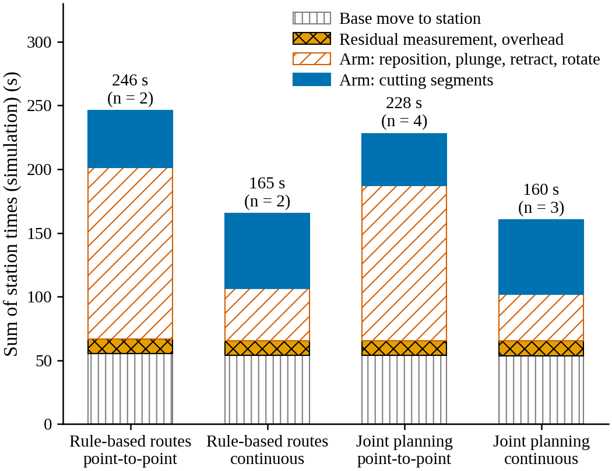
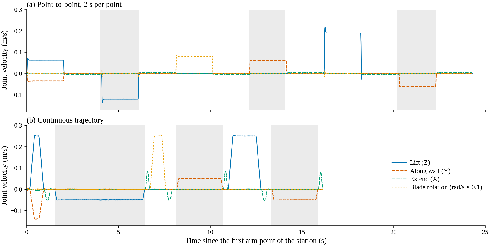
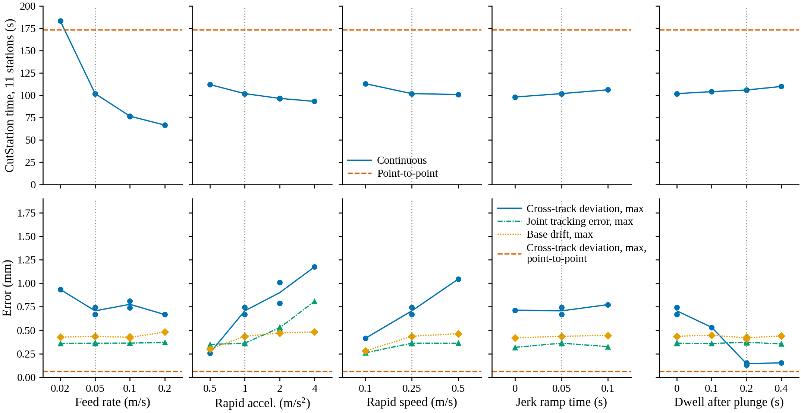
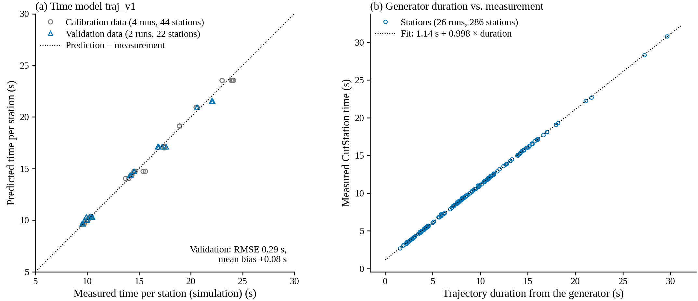
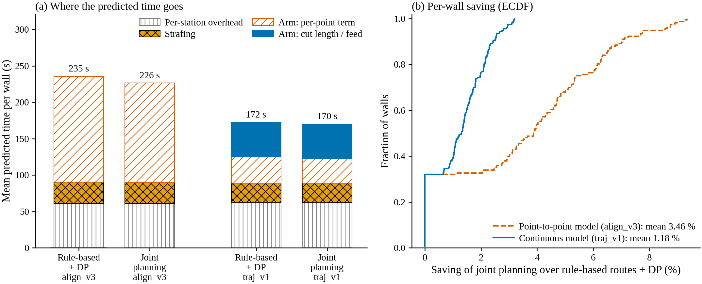

# 机械臂连续轨迹：进给受控的整站切割运动

**结论**：把每个停靠站的机械臂点从“逐点执行、每点固定 2 s”改为一条整站连续轨迹（各段为加加速度受限的 S 曲线，切割段按进给 0.05 m/s，退刀与换位按各轴限值，拐点精确停住）后，room3 南墙示例任务的 11 个停靠站在 Gazebo 中由 227.9 s 降到 160.1 s（**−29.8 %**，联合规划，n = 4 对 3），规则路线由 245.9 s 降到 165.2 s（−32.8 %，n = 2 对 2）。节省全部来自不切割的运动（下刀、退刀、转刀、换位：122 s → 37 s）；切割段本身因为改用恒定进给反而从 41 s 增到 58 s。刀尖轨迹误差平均值不变（0.18–0.20 mm），覆盖率 100 %；切割段内横向偏差最大值由 0.07 mm 增到 0.15 mm，机械臂运动期间的底盘漂移由 0.2 mm 增到 0.4 mm。时间模型增加“切割长度 / 进给”一项后重新标定为预设 `traj_v1`，样本外误差 ≤ 1.0 s（0.6 %）。在新模型下，每多一个直线小段的代价从 8.1 s 降到 2.0 s，**联合规划相对“规则路线 + DP”的预测节省由 3.46 % 缩小到 1.18 %**（400 面随机墙，非承重墙 n = 156）；它的目标函数与下界论证仍然成立，92.7 % 的墙被证明最优。



*图 1：各站耗时之和的分解（Gazebo，仿真时间；柱高为各次运行的平均，n 为运行数）。竖线纹：底盘横移到站；交叉纹：到站残差测量等与机械臂无关的固定开销；斜线：机械臂不切割的运动（换位、下刀、退刀、转刀）；实心：切割段。逐点执行时每个机械臂点固定 2 s；连续轨迹的切割段按进给 0.05 m/s，比逐点执行的平均切割速度（0.069 m/s）慢，所以实心部分变长，其余部分大幅缩短。*

## 1. 问题

多站开槽执行中，机械臂的每个点是一次独立的“点到点”运动，固定 2 s。room3 南墙示例任务的联合规划共 80 个机械臂点，在 Gazebo 中 11 个停靠站耗时 228 s，其中 162 s（71 %）是这 80 次 2 s 的运动（[plan_validation](../plan_validation/README.md)）。此前的规划改进（合并停靠站、联合选线）都在减少“点数”，而每个点为什么要 2 s 没有被问过。本实验回答四个问题：

1. 每点 2 s 花在哪里，机械臂的运动实际受什么限制？
2. 把一个停靠站的全部机械臂点作为一条满足速度 / 加速度 / 加加速度限值的连续轨迹执行，时间能省多少，刀尖轨迹精度和底盘定点保持是否变差？
3. 进给速度、加速度怎样取值？时间与精度的折中是什么形状？
4. 执行方式改变后，时间模型 `t = t_settle + d / v + 点数 × t_point` 是否仍然成立？联合规划的目标函数、下界和“比现有方法快 3.5 %”的结论还成立吗？

## 2. 现状分析

### 2.1 每点 2 s 的去向

逐点执行时，`CutStation` 对每个点调用一次 `/arm_controller/follow_joint_trajectory`，轨迹只有一个点，`time_from_start` 取规划文件的 `motion.duration`（2.0 s）。

- **固定时长**：`joint_trajectory_controller` 在“当前位置 → 目标点”之间按给定时长插值，运动多远都是 2.0 s。控制器的 `goal_time` 为 0、没有位置容差判据，到时即返回结果，**没有额外的到位等待**。
- **动作往返**：结果由控制器按 `action_monitor_rate`（20 Hz）检查后返回，每点平均多 0.03 s。
- **实测**：规划验证实验 5 次运行的 55 个停靠站上，`CutStation` 耗时对点数回归得 `cut_s = 1.02 + 2.029 × 点数`（去掉 1 个偶发停顿的站后截距 0.98 s）。截距是 `CutStation` 开始时的到站残差测量（10 个估计周期 × 0.1 s），与机械臂无关。

所以 2.03 s 中有 2.00 s 是写死的时长。按运动类型拆开联合规划的 80 个点（空切，下刀行程 10.6 mm）：

| 运动 | 次数 | 行程 | 逐点执行的耗时 | 平均速度 |
|---|---|---|---|---|
| 切割段（沿槽线进给） | 20 | 0.05–0.24 m，共 2.76 m | 40 s | 25–120 mm/s，随段长变化 |
| 下刀 | 20 | 10.6 mm | 40 s | 5 mm/s |
| 退刀 | 20 | 10.6 mm | 40 s | 5 mm/s |
| 转刀（刀片 0° ↔ 90°）与站内换位 | 20 | 0–0.38 m 或 90° | 40 s | — |

四分之三的机械臂时间用在不切割的运动上，其中下刀和退刀各用 2 s 走 1 cm。另一方面，切割段的速度由“段长 / 2 s”决定：0.24 m 的竖切以 120 mm/s 走完，0.05 m 的横切只有 25 mm/s。进给速度本应是由刀具和墙体材料决定的工艺参数，逐点执行时它却是规划几何的副产品。

### 2.2 机械臂的运动受什么限制

| 因素 | 现状 | 是否构成限制 |
|---|---|---|
| URDF 关节限值 | 速度 3 m/s（转角 3 rad/s），力 500–1000 N | 否。逐点执行的峰值只有 0.12 m/s；这些数值是占位值，不代表真实驱动能力 |
| 关节位置环（`position_pid`，1 kHz） | 按增益与运动质量估算，三个直线轴的固有频率 51–64 rad/s（8–10 Hz），阻尼比约 1 | 是。加速度 a 下的跟踪误差约 a / ω²，即每 1 m/s² 约 0.25–0.4 mm |
| 指令曲线 | 逐点执行时控制器做线性插值，速度在起止点阶跃（指令加速度无穷大） | 是。速度越高阶跃越大，不能靠缩短时长来提速 |
| 底盘 | 定点保持为 50 Hz 位置比例环；沿墙轴（joint2）运动质量 1.9 kg，运动部分的质心在底盘中心前方约 0.4 m，底盘偏航惯量 0.92 kg·m² | 是。沿墙轴加减速会推动底盘偏航，见 5.2 |
| 刀尖轨迹精度 | 切割是单轴直线运动，沿进给方向的滞后不影响槽线位置，影响精度的是垂直于进给方向的偏离 | 决定了精度该怎么评估 |
| 进给速度 | 工艺参数。仿真为空切，没有切削力，仿真不能给出它的上限 | 需要作为参数给定 |

结论：在仿真里，限制机械臂速度的不是关节限值，而是“加速度 → 跟踪误差与底盘扰动”这条链；进给则是独立于它的工艺参数。因此新的执行方式需要显式的加速度（和加加速度）限值，并把切割进给与空行程速度分开。

## 3. 方法

### 3.1 轨迹结构

规划文件不变：每站仍是一串机械臂点 `(x, y, z, rotation)`，相邻两点之间是一段直线运动。按两端是否处于切深，每段分为四类：

| 类型 | 判据 | 运动轴 | 限值 |
|---|---|---|---|
| 切割 `cut` | 两端都在切深 | 沿墙轴或升降轴，单轴 | 进给 `feed_rate`、`feed_accel` |
| 下刀 `plunge` | 进入切深 | 伸缩轴 | `plunge_rate`、`feed_accel` |
| 退刀 `retract` | 离开切深 | 伸缩轴 | 空行程限值 |
| 空行程 `rapid` | 两端都在退刀位 | 换位（沿墙 + 升降 + 刀片同动）或原地转刀 | 空行程限值 |

几何约束全部保留：切割只沿单轴直线；拐弯处退刀 → 转刀 → 下刀；每个拐点精确停住。拐点不做圆弧过渡，原因是工艺而不是算法：下刀到位后才能进给，刀片在槽内不能转向，槽的端点不能被“抄近路”削掉。所以“连续”指的是整站一条轨迹、中间没有逐点的动作往返和固定时长，而不是拐点处速度不为零。

### 3.2 时间参数化

每段是“静止 → 静止”的直线运动，速度曲线取加加速度受限的七段 S 曲线（加加速 / 匀加速 / 减加速 / 匀速 / 对称的三段减速）。行程 L、速度上限 v、加速度上限 a、加加速度上限 j 下，行程足够长时

```
T = L / v + v / a + a / j
```

行程不够时依次省去匀速段、匀加速段，峰值速度由 L 解出（闭式解，见 `arm_trajectory.rest_to_rest`）。多轴同动的段把各轴限值折算到同一个路径参数上取最紧的一个，各轴同时起停、都不超限。切割与下刀段另加刀尖路径速度的限值（进给）。

### 3.3 与控制器的接口

整站轨迹一次发给 `joint_trajectory_controller`。Humble 的控制器按相邻两点给出的量选择插值次数：只有位置 → 线性，位置 + 速度 → 三次，位置 + 速度 + 加速度 → 五次。S 曲线在每个阶段内加加速度为常数，位置是时间的三次多项式；两端的位置、速度、加速度都吻合的五次多项式唯一，因此**只发各阶段边界上的结点（每段至多 7 个，带位置、速度、加速度），控制器 1 kHz 采样得到的指令就与 S 曲线逐点相同**，不需要把轨迹加密成上千个点。梯形曲线同理（结点只带位置与速度，三次样条在匀加速阶段内精确）。单元测试用同样的样条公式验证了这一点（误差 < 1e-9）。

轨迹的起始时刻写在消息头里（最新控制器状态的时间戳 + 0.15 s），各段的起止时刻因此在仿真时间上是确定的。

### 3.4 方案取舍

| 方案 | 取舍 |
|---|---|
| 控制器自带的样条插值 + 自己算结点（采用） | 每段是单自由度、静止到静止的运动，S 曲线有闭式解；纯 Python、无新依赖，规划侧可以用同一套公式预测时间 |
| Ruckig | 通用的在线加加速度受限轨迹生成，支持任意初末状态与多轴同步。本任务每个拐点都必须停住，用不到它的一般性；Humble 上没有 Python 绑定，需要另写 C++ 节点或引入 pip 依赖。若以后允许空行程拐角过渡（初末速度不为零），它是合适的选择 |
| MoveIt 时间参数化（TOTG / Ruckig 平滑） | 面向关节空间路径的整体时间最优参数化，不区分“切割进给”与“空行程”，也不保证在指定点精确停住；为 4 个解耦的直线轴引入 MoveIt 的配置成本不值得 |
| 逐点执行但按距离设定时长 | 仍是线性插值，速度阶跃随速度增大；每点一次动作往返 |

### 3.5 参数

技能服务器参数 `arm_motion.*`（默认值在 `scr_arm_controller/config/arm_motion.yaml`，每次执行 `CutStation` 时读取）：

| 参数 | 默认值 | 含义与取值依据 |
|---|---|---|
| `mode` | `continuous` | `continuous`：整站一条连续轨迹；`point_to_point`：逐点执行，每点 `motion.duration`（基线） |
| `feed_rate` | 0.05 m/s | 切割进给，工艺参数。仿真不能给出它的上限（见 5.3），默认值是假设：取低于逐点执行平均切割速度（0.069 m/s）的整数值，使对比偏保守。实际应按刀具与墙体材料设定 |
| `plunge_rate` | 0.05 m/s | 下刀切入速度，工艺参数；默认与进给相同 |
| `feed_accel` | 0.5 m/s² | 切割与下刀段的加速度；每个切割段因此多 0.15 s 的加减速开销 |
| `rapid_speed` | 0.25 m/s | 空行程速度。逐点执行时最长的换位已达到 0.19 m/s；再高几乎不省时间（见 5.3） |
| `rapid_accel` | 1.0 m/s² | 空行程加速度。按 2.2 的估算对应约 0.3 mm 的跟踪误差；5.3 的扫描中是时间与精度的拐点 |
| `rapid_accel_lateral` | 0（= `rapid_accel`） | 沿墙轴单独的加速度上限。5.2 中用来验证底盘扰动的来源，默认不启用 |
| `rot_speed` / `rot_accel` | 2.5 rad/s / 12 rad/s² | 刀片转向，90° 用时 0.89 s；低于 URDF 的 3 rad/s |
| `jerk_time` | 0.05 s | 加速度从 0 升到上限的时间（加加速度 = 加速度 / `jerk_time`）；0 = 梯形曲线 |
| `dwell` | 0.2 s | 下刀到位后、开始进给前的等待，让换位引起的底盘偏航衰减（见 5.2） |
| `start_lead` | 0.15 s | 轨迹起始时刻的提前量，须大于 `/clock` 的发布周期（0.1 s） |

`mode: point_to_point` 保留逐点执行作为基线。规划文件格式不变，`motion.duration` 只在逐点执行时使用。底盘定点保持不变：行为树中 `HoldBase` 与 `CutStation` 仍并行。

### 3.6 阶段标注与评估

记录器按技能服务器发布的阶段（`cut` / `move`）给真值刀尖样本分类，只有 `cut` 阶段的样本与规划槽线比较。连续轨迹中各段只有零点几秒，标注的时间精度直接影响评估，为此做了三处改动：

- 技能服务器在轨迹开始时按时间表一次发布之后各段的阶段，每条状态的时间戳是该阶段的生效时刻；
- 记录器用真值里程计的消息头作细粒度时钟（50 Hz；节点时钟跟随 `/clock`，只有 10 Hz），运行结束后按各阶段的生效时刻统一标注刀尖样本，与状态消息的送达延迟无关；
- 覆盖率改按“槽线取样点到相邻刀尖样本连成的折线”的距离计算（`coverage_path`）。刀尖真值 20 Hz 采样，进给 0.1 m/s 时相邻样本相距 5 mm，逐点最近距离会把样本之间的槽线误判为未切。

评估指标除刀尖轨迹误差（切割阶段样本到规划槽线的距离）外，增加**切割段内横向偏差**：每段刀尖轨迹垂直于进给方向的坐标相对该段中位数的偏离。刀尖轨迹误差里含有到站沿墙估计误差，它对一个停靠站是常数（整段竖切偏同一个量，各次运行 1–2 mm），与机械臂怎样运动无关；横向偏差去掉了这个常数，只反映切割过程中机械臂跟踪误差与底盘晃动。

**排查：阶段标注滞后**

- 现象：连续轨迹的第一次试运行覆盖率只有 95.7 %（逐点执行的此前运行为 99.3–99.8 %）。真值轨迹上应有 20 段 `cut` 样本，实际 19 段：第 1 站的切割段没有任何 `cut` 样本，第 3 站的 `cut` 标注晚了约 1.5 s；刀尖实际走完了全部槽线。
- 定位：在技能服务器与记录器两侧记录每次阶段切换的时刻。只启动 Gazebo 与技能服务器时，阶段切换与轨迹时间表相差 < 5 ms；完整系统重复运行也正常。出问题的那次运行期间，同一台机器上正在跑 CPU 密集的单元测试。
- 根因：阶段最初由技能服务器在等待轨迹结果的循环里按时刻逐个发布。进程被抢占时循环停顿，积压的阶段在恢复后一次发出，记录器按到达顺序标注，于是整段切割被标成 `move`。逐点执行时每点 2 s，同样的停顿不易察觉。
- 另一发现：`/joint_states` 实际以控制周期（1 kHz）发布，配置的 50 Hz 没有生效。最初用它作轨迹的时间基准，使技能服务器进程多处理一路 1 kHz 回调；后改用机械臂控制器状态话题（10 Hz）。
- 方案：上述三处改动（按时间表提前发布、记录器按生效时刻标注、覆盖率按折线距离）。
- 验证与再次修正：此后 26 次连续轨迹运行中 25 次覆盖率为 100 %；1 次（`feed_0.10`，种子 2）有一段 9 cm 的横切没有 `cut` 样本，覆盖率 96.9 %。真值轨迹显示刀尖按时走完了这一段，是时间表消息本身晚到了约 2 s（机器负载高），到达时该阶段已经结束。记录器因此改为在运行结束后按事件时间统一重新标注刀尖轨迹：按时间表发布的阶段（状态的 `detail` 为 `scheduled`）取消息里的生效时刻，晚到也不影响；即时状态仍取到达时刻，与逐点执行的标注方式相同。该次运行用新记录器重跑，覆盖率 100 %。标注函数 `slot_execution.label_by_time` 有单元测试。
- 遗留：记录器的细粒度时钟为 50 Hz，标注的时间分辨率约 20 ms；切割段前后分别是下刀和退刀（刀尖在墙面上不动），这一误差不影响刀尖轨迹误差的统计。其余 25 次连续轨迹运行由实时标注得到，没有用新记录器重跑；它们的切割段数与覆盖率都完整。

## 4. 实验设置

| 项目 | 设置 |
|---|---|
| 仿真 | Gazebo Classic，仿真配置 v2（关节 `position_pid` 力控 + 力控底盘），rtf 1，无界面 |
| 执行路径 | 默认：`sim_nav.launch.py` → 行为树任务层；精对位为标记地图 + 激光 EKF + 横移比例估计，横移前回观测位姿；`HoldBase` 与 `CutStation` 并行。与 [plan_validation](../plan_validation/README.md) 相同，只改 `arm_motion.*` |
| 切割 | 空切，刀尖停在墙前 10 mm（下刀行程 10.6 mm）；残差补偿开启 |
| 规划文件 | [`plan_validation/plans/`](../plan_validation/plans/) 的规则路线（11 站、88 点）与联合规划（11 站、80 点），槽长都是 2.76 m；标定另用 [`slot_execution/runs/dp/slot_plan.yaml`](../slot_execution/runs/dp/slot_plan.yaml)（11 站、92 点） |
| 随机性 | 编码器打滑过程的种子 `odom_seed` = 1、2；逐点与连续用同一组种子 |
| 逐点执行（基线） | 联合规划 4 次：规划验证实验的 `joint_s1`、`joint_s2` 与本轮用新记录器重跑的 `p2p_joint_s1`、`p2p_joint_s2`；规则路线 2 次：规划验证实验的 `rule_s1`、`rule_s2` |
| 连续轨迹（默认参数） | 联合规划 3 次（`cont_joint_s1`、`cont_joint_s2`、`dwell_0.2_joint_s1`），规则路线 2 次，92 点规划 2 次 |
| 参数扫描 | 联合规划，种子 1（三个配置另加种子 2）；进给、加速度、空行程速度、加加速度、沿墙轴加速度一次只改一类，都在 `dwell` = 0 下进行（扫描在确定 `dwell` 之前完成）；`dwell` 的扫描在其余参数取默认值下进行 |
| 时间指标 | 各站耗时之和 = 底盘到站 + `CutStation` + 行为树开销；`CutStation` 再按真值样本的阶段拆成切割段、其余机械臂运动、固定开销（到站残差测量 1.0 s / 站等）。底盘到站每次运行有 ±2 s 的波动，比较机械臂参数时用 `CutStation` 之和 |
| 精度指标 | 刀尖轨迹误差、切割段内横向偏差、覆盖率（定义见 3.6）；到站沿墙误差（到位 0.3 s 后的底盘真值）；机械臂运动期间的底盘漂移（每站相对机械臂开始运动时刻的最大位移）；关节跟踪误差（控制器的指令 − 实际，10 Hz 采样，机械臂运动时段） |
| 真值来源 | `/gazebo/link_states`（`link4` 与 `base_link` 位姿，20 Hz） |

## 5. 结果

### 5.1 逐点执行 vs 连续轨迹

**连续轨迹把各站耗时之和缩短 30 %–33 %，精度指标的平均水平不变。** 每格为各次运行的取值（按运行名排序），数据见 [`runs_summary.csv`](runs_summary.csv)：

| 指标 | 规则路线，逐点（n = 2） | 规则路线，连续（n = 2） | 联合规划，逐点（n = 4） | 联合规划，连续（n = 3） |
|---|---|---|---|---|
| 各站耗时之和（s） | 245.7 / 246.0 | 165.1 / 165.3 | 228.1 / 227.8 / 227.7 / 228.1 | 159.9 / 160.0 / 160.3 |
| 其中：底盘到站（s） | 53.7 / 56.7 | 53.9 / 54.1 | 54.2 / 54.0 / 53.5 / 53.9 | 53.4 / 53.4 / 53.7 |
| 其中：`CutStation`（s） | 191.1 / 188.8 | 110.8 / 110.8 | 173.4 / 173.6 / 173.4 / 173.3 | 105.8 / 105.8 / 106.0 |
| 机械臂切割段（s） | 44.8 / 44.6 | 58.6 / 58.6 | 40.9 / 40.9 / 40.6 / 40.8 | 57.7 / 58.2 / 58.2 |
| 机械臂其余运动（s） | 135.8 / 132.9 | 41.5 / 41.4 | 121.8 / 121.8 / 122.0 / 122.0 | 36.4 / 36.9 / 37.1 |
| 刀尖轨迹误差，平均（mm） | 0.18 / 0.18 | 0.15 / 0.19 | 0.19 / 0.19 / 0.19 / 0.18 | 0.19 / 0.20 / 0.18 |
| 刀尖轨迹误差，p95（mm） | 0.22 / 0.24 | 0.23 / 0.29 | 0.23 / 0.29 / 0.22 / 0.29 | 0.26 / 0.41 / 0.30 |
| 刀尖轨迹误差，最大（mm） | 0.64 / 1.10 | 1.54 / 1.83 | 0.99 / 1.50 / 1.19 / 1.36 | 1.36 / 1.58 / 1.69 |
| 切割段内横向偏差，RMS（mm） | 0.007 / 0.008 | 0.011 / 0.017 | 0.007 / 0.015 / 0.007 / 0.016 | 0.019 / 0.015 / 0.013 |
| 切割段内横向偏差，p95（mm） | 0.013 / 0.015 | 0.016 / 0.031 | 0.013 / 0.031 / 0.013 / 0.031 | 0.033 / 0.017 / 0.016 |
| 切割段内横向偏差，最大（mm） | 0.04 / 0.05 | 0.14 / 0.15 | 0.07 / 0.07 / 0.05 / 0.07 | 0.15 / 0.15 / 0.13 |
| 到站沿墙误差，平均（mm） | 0.50 / 0.43 | 0.52 / 0.61 | 0.55 / 0.69 / 0.48 / 0.64 | 0.73 / 0.65 / 0.31 |
| 到站沿墙误差，最大（mm） | 1.51 / 1.28 | 1.27 / 1.07 | 2.00 / 1.27 / 0.85 / 1.26 | 1.87 / 2.11 / 0.79 |
| 机械臂运动期间底盘漂移，各站平均（mm） | 0.19 / 0.20 | 0.37 / 0.40 | 0.19 / 0.19 / 0.19 / 0.19 | 0.37 / 0.37 / 0.37 |
| 机械臂运动期间底盘漂移，最大（mm） | 0.21 / 0.24 | 0.42 / 0.46 | 0.21 / 0.22 / 0.23 / 0.21 | 0.42 / 0.43 / 0.41 |
| 关节跟踪误差，直线轴最大（mm） | — / — | 0.37 / 0.36 | — / — / 0.68 / 0.71 | 0.37 / 0.38 / 0.37 |
| 关节跟踪误差，切割段内最大（mm） | — / — | 0.14 / 0.14 | — / — / 0.68 / 0.71 | 0.14 / 0.14 / 0.14 |
| 覆盖率（折线距离） | 1.000 / 1.000 | 1.000 / 1.000 | 1.000 / 1.000 / 1.000 / 1.000 | 1.000 / 1.000 / 1.000 |

- **时间**：联合规划 227.9 s → 160.1 s（−67.8 s，−29.8 %），规则路线 245.9 s → 165.2 s（−80.7 s，−32.8 %）。`CutStation` 之和分别下降 38.9 % 与 41.7 %。底盘到站的时间不变（53–57 s）。
- **时间去向**：不切割的机械臂运动从 122 s（联合规划）降到 37 s，下降 70 %；切割段从 41 s 增到 58 s，因为连续轨迹按恒定进给 0.05 m/s 切割，而逐点执行的平均切割速度是 0.069 m/s（2.76 m / 40 s）。若把进给取为 0.069 m/s，按 5.3 的拟合式，`CutStation` 之和还会再少约 14 s。
- **重复性**：同一配置各次运行的各站耗时之和相差 ≤ 0.4 s，轨迹时长是确定的。



*图 2：联合规划第 9 站（12 个机械臂点：竖切 → 转刀 → 横切 → 换位 → 横切）的关节速度，由 1 kHz 关节位置差分得到（数据包 `p2p_joint_s1` 与 `cont_joint_s1`）。灰色底为切割段。(a) 逐点执行：每段 2 s，速度在起止点阶跃，切割速度随段长在 0.06–0.12 m/s 之间变化，1 cm 的下刀与退刀也各占 2 s（速度太小，图上几乎看不见）；(b) 连续轨迹：切割段保持 0.05 m/s，下刀、退刀、转刀与换位压缩成短促的加减速，全站 24.3 s → 16.2 s。刀片转速按 0.1 倍画出。*

### 5.2 精度与底盘扰动

- **刀尖轨迹误差**：平均值 0.18–0.20 mm，与逐点执行相同。p95 与最大值（连续 0.23–0.41 mm / 1.36–1.83 mm，逐点 0.22–0.29 mm / 0.64–1.50 mm）由到站沿墙估计误差决定：某一站估计偏了 1–2 mm，该站的竖切整段都偏这么多。到站沿墙误差本身两种方式没有差别（最大 0.8–2.1 mm）。
- **切割段内横向偏差**（去掉每站的常数偏移）：RMS 0.011–0.019 mm 对 0.007–0.016 mm，p95 0.016–0.033 mm 对 0.013–0.031 mm；最大值 0.13–0.15 mm 对 0.04–0.07 mm。连续轨迹的偏差略大，量级在 0.1 mm。
- **关节跟踪误差**：连续轨迹最大 0.37 mm（切割段内 0.14 mm），逐点执行最大 0.68–0.71 mm（n = 2）。逐点执行的速度阶跃使跟踪误差更大，只是它沿进给方向，不反映到横向偏差上。
- **底盘**：机械臂运动期间的底盘漂移各站平均由 0.19 mm 增到 0.37 mm，最大由 0.21–0.24 mm 增到 0.41–0.46 mm；定点保持记录的偏航峰值由 0.15° 增到 0.30°–0.40°。峰值出现在每站第一次换位（沿墙轴以 0.15 m/s 的峰值速度移动 5–7 cm）期间，此时刀具不在切割。
- **覆盖率**：全部运行 100 %（折线距离）。

**排查：竖切起点的横向偏差**

- 现象：`dwell` = 0 时，切割段内横向偏差的最大值为 0.67–0.93 mm（逐点执行 0.07 mm），而 p95 只有 0.03–0.09 mm。
- 定位：按切割段逐段查看。全部 16 段横切的偏差都在 0.05 mm 以内；偏差只出现在 4 段竖切的起点：起始 0.2–0.8 mm，在约 0.25 s（5 个样本）内衰减到零。这些时段底盘的平移只有 0.03–0.07 mm，说明偏离来自底盘偏航（刀尖在底盘中心前方 0.69 m，0.06° 的偏航即 0.75 mm）。
- 根因：竖切之前是一次含沿墙分量的换位。沿墙轴运动部分的动量把底盘推偏，定点保持（偏航比例增益 6 /s，时间常数约 0.17 s）把它拉回；换位结束到切割开始只隔 0.36 s 的下刀，偏航还没有衰减完。逐点执行时这段间隔是 2 s。
- 验证根因：把全部加速度减半，偏差最大值降到 0.26 mm；只把沿墙轴加速度限到 0.25 m/s²（`rapid_accel_lateral`），降到 0.42 mm，底盘漂移最大值由 0.44 mm 降到 0.34 mm；限到 0.5 m/s² 没有变化（0.88 mm），因为换位由转刀决定时长，沿墙轴的加速度本来就低于这个值。
- 方案：下刀到位后等待 `dwell` 再进给。它直接针对“衰减时间不够”，只在每个切割段前加一次等待。
- 验证：`dwell` = 0.2 s 时偏差最大值 0.13–0.15 mm（5 次默认参数的联合规划与规则路线运行），`CutStation` 之和增加 4.1 s（+4 %）。`dwell` 取 0.1 s 与 0.4 s 时为 0.53 mm 与 0.15 mm，耗时 104.0 s 与 109.8 s。
- 遗留：偏航峰值本身（0.4°）没有消除，只是让切割避开它。减小峰值需要限制沿墙轴的加速度或提高定点保持的带宽，属于底盘控制的范围。

### 5.3 参数扫描与默认值

**时间主要由进给决定；加速度、空行程速度超过默认值后时间收益很小而偏差增大；加加速度限制在仿真中没有可见的精度收益。**



*图 3：联合规划上的参数扫描（每点一次运行，有两次运行的配置画出两个点，连线为均值）。上排：11 个停靠站的 `CutStation` 耗时之和，朱红虚线为逐点执行；下排：切割段内横向偏差最大值（蓝）、直线轴关节跟踪误差最大值（绿）、机械臂运动期间底盘漂移最大值（橙），朱红虚线为逐点执行的横向偏差最大值。灰色竖点线为该参数的默认值。前四列在 `dwell` = 0 下扫描，最后一列在其余参数取默认值下扫描。*

| 配置 | 改动 | 运行数 | `CutStation` 之和（s） | 相对默认（s） | 横向偏差 p95 / 最大（mm） | 关节跟踪误差最大（mm） | 底盘漂移最大（mm） |
|---|---|---|---|---|---|---|---|
| `acc_x0.5` | feed_accel = 0.25, rapid_accel = 0.5, rot_accel = 6, dwell = 0 | 1 | 111.9 | +6.0 | 0.018 / 0.26 | 0.35 | 0.30 |
| `acc_x2` | feed_accel = 1, rapid_accel = 2, rot_accel = 24, dwell = 0 | 2 | 96.5 | −9.4 | 0.028 / 1.01 | 0.53 | 0.47 |
| `acc_x4` | feed_accel = 2, rapid_accel = 4, rot_accel = 48, dwell = 0 | 1 | 93.1 | −12.8 | 0.038 / 1.17 | 0.81 | 0.48 |
| `cont` | 默认 | 3 | 105.9 | 0 | 0.022 / 0.15 | 0.37 | 0.43 |
| `dwell_0.0` | dwell = 0 | 2 | 101.8 | −4.1 | 0.029 / 0.75 | 0.36 | 0.44 |
| `dwell_0.1` | dwell = 0.1 | 1 | 104.0 | −1.9 | 0.019 / 0.53 | 0.36 | 0.45 |
| `dwell_0.4` | dwell = 0.4 | 1 | 109.8 | +3.9 | 0.017 / 0.15 | 0.35 | 0.44 |
| `fast` | feed_rate = 0.2, feed_accel = 2, rapid_speed = 0.5, rapid_accel = 4, rot_accel = 48, dwell = 0 | 1 | 51.3 | −54.6 | 0.450 / 1.49 | 1.05 | 0.79 |
| `feed_0.02` | feed_rate = 0.02, dwell = 0 | 1 | 183.3 | +77.4 | 0.032 / 0.93 | 0.36 | 0.43 |
| `feed_0.10` | feed_rate = 0.1, dwell = 0 | 2 | 76.5 | −29.4 | 0.061 / 0.81 | 0.36 | 0.43 |
| `feed_0.20` | feed_rate = 0.2, dwell = 0 | 1 | 66.6 | −39.3 | 0.088 / 0.67 | 0.37 | 0.48 |
| `jerk_0.10` | jerk_time = 0.1, dwell = 0 | 1 | 106.1 | +0.2 | 0.035 / 0.77 | 0.33 | 0.44 |
| `lat_0.25` | rapid_accel_lateral = 0.25, dwell = 0 | 1 | 106.2 | +0.3 | 0.034 / 0.42 | 0.28 | 0.34 |
| `lat_0.5` | rapid_accel_lateral = 0.5, dwell = 0 | 1 | 102.1 | −3.8 | 0.025 / 0.88 | 0.35 | 0.44 |
| `p2p` | 逐点执行 | 4 | 173.4 | +67.6 | 0.022 / 0.07 | 0.70 | 0.23 |
| `rapid_0.10` | rapid_speed = 0.1, dwell = 0 | 1 | 112.9 | +7.0 | 0.020 / 0.41 | 0.26 | 0.28 |
| `rapid_0.50` | rapid_speed = 0.5, dwell = 0 | 1 | 100.8 | −5.1 | 0.036 / 1.05 | 0.36 | 0.46 |
| `trapezoid` | jerk_time = 0, dwell = 0 | 1 | 98.0 | −7.9 | 0.028 / 0.71 | 0.32 | 0.42 |

- **进给**：0.02 / 0.05 / 0.10 / 0.20 m/s 时 `CutStation` 之和为 183.3 / 101.8 / 76.5 / 66.6 s，符合 `44.6 s + 2.76 m / 进给 + 20 × 进给 / 0.5 m/s²`（最后一项是 20 个切割段的加减速开销），四个点的误差都在 0.3 s 以内。横向偏差、底盘漂移与直线轴跟踪误差不随进给变化；随进给增大的只有切割段内沿进给方向的跟踪滞后（0.07 → 0.26 mm），它不影响槽线位置。**仿真中进给没有精度上的上限**，上限来自切削过程，仿真里没有。进给降到约 0.022 m/s 时，连续轨迹才与逐点执行持平；逐点执行的平均切割速度是 0.069 m/s。
- **加速度**（空行程、切割、转刀一起缩放）：×0.5 / ×1 / ×2 / ×4 时耗时 111.9 / 101.8 / 96.5 / 93.1 s，直线轴跟踪误差最大值 0.35 / 0.36 / 0.53 / 0.81 mm，横向偏差最大值 0.26 / 0.75 / 1.01 / 1.17 mm。跟踪误差随加速度增大，与 2.2 的估算（每 1 m/s² 约 0.25–0.4 mm）一致。从 ×1 到 ×4 只省 9 s，误差翻倍，默认取 ×1。
- **空行程速度**：0.10 / 0.25 / 0.50 m/s 时耗时 112.9 / 101.8 / 100.8 s。站内行程最长 0.38 m，多数换位到不了 0.5 m/s；默认 0.25 m/s。
- **加加速度**：梯形（`jerk_time` = 0）/ 0.05 s / 0.10 s 时耗时 98.0 / 101.8 / 106.1 s，三项误差没有可见差别。仿真中的机械臂是刚体加位置环，没有会被加速度阶跃激起的柔性模态。默认保留 0.05 s 的 S 曲线，代价约 4 s；这是对真实机构的保守假设，没有被仿真验证。
- **激进配置**（进给 0.2 m/s、加速度 ×4、空行程 0.5 m/s）：`CutStation` 之和 51.3 s（逐点执行的 30 %），横向偏差 p95 0.45 mm、最大 1.49 mm，跟踪误差最大 1.05 mm，底盘漂移 0.79 mm。精度仍在毫米以内，但已经与到站沿墙误差同量级。

有两次运行的三个配置（`dwell_0.0`、`acc_x2`、`feed_0.10`）两次的 `CutStation` 之和相差 ≤ 0.6 s，横向偏差最大值相差 ≤ 0.22 mm。

默认值的取法：进给与下刀速度按假设取 0.05 m/s；其余取扫描中“再放宽收益很小”的位置，再加 0.2 s 的下刀后等待（0.1 s 不够，0.4 s 没有进一步收益，见 5.2）。

### 5.4 时间模型

**推导。** 连续轨迹下一个停靠站的机械臂时间是各段时长之和。切割段在行程足够长时为 `L / v_feed + v_feed / a + t_j`，其余段与切割长度无关。每个直线小段恒对应 4 个机械臂点（换位或转刀、下刀、切割、退刀，见 `slot_plan.count_points`），所以

```
t_station = t_settle + d / v_strafe + 点数 × t_point + 切割长度 / v_feed
```

其中 `t_point` 是每个小段的非切割时间的四分之一。逐点执行是它在 `v_feed → ∞`、`t_point = 2.03 s` 时的特例，原有预设 `align_v1 / v2 / v3` 不变。按默认限值解析计算（空切）：加减速开销 0.15 s + 下刀 0.36 s + 等待 0.20 s + 退刀 0.26 s + 转刀 0.89 s = 1.86 s，`t_point` ≈ 0.47 s。

**标定。** 用默认参数的 4 次运行（92 点规划与规则路线各 2 次，44 站），按阶段拟合：横移阶段回归、切割阶段对点数回归，`v_feed` 取指令值 0.05 m/s（`calibrate_time_model.py --method=traj --feed=0.05`）：

| 来源 | t_settle | v_strafe | t_point | v_feed | 每站 RMSE | 留一交叉验证 | 样本外（联合规划 2 次，22 站）各站之和误差 |
|---|---|---|---|---|---|---|---|
| **`traj_v1`（`v_feed` 取指令值）** | **4.77 s** | **0.1036 m/s** | **0.501 s** | **0.05 m/s** | **0.31 s** | **0.31 s** | **+1.0 / +0.9 s（0.6 %）** |
| `v_feed` 也拟合 | 4.79 s | 0.1036 m/s | 0.459 s | 0.0470 m/s | 0.30 s | 0.31 s | +1.4 / +1.3 s |
| 不含长度项（`phases-reg`） | 4.49 s | 0.1036 m/s | 1.149 s | — | 1.00 s | 1.02 s | −5.5 / −5.6 s |
| 预设 `align_v3`（对照） | 4.70 s | 0.0971 m/s | 2.030 s | — | 8.38 s | — | +68.2 / +68.1 s |

- 实测的 `t_point`（0.50 s）略大于解析值（0.47 s）：每站第一个点是从观测位姿过来的换位（约 1.0–1.5 s），比一次转刀长。
- `v_feed` 也放开拟合时得到 0.047 m/s，与指令值相差 6 %。点数与切割长度相关，两个系数分不干净；进给是指令值，不需要估计，预设取指令值，换进给时只需改这一项。
- 不含长度项的模型把切割时间摊到点数上，每站 RMSE 是三倍，对点数少、槽线长的联合规划低估 5.5 s。
- `t_settle` 与 `v_strafe` 相对 `align_v3` 的变化（4.70 → 4.77 s，0.0971 → 0.1036 m/s）来自轨迹起始提前量（0.15 s）与横移阶段回归的样本差异（横移距离只有 0.05 / 0.12 / 0.23 m 三档），底盘的横移行为没有改动。



*图 4：(a) 时间模型 `traj_v1` 的预测与实测，每个点为一个停靠站；灰色圆点为标定数据（4 次运行，44 站），蓝色三角为验证数据（联合规划 2 次运行，22 站），点线为两者相等。(b) 轨迹生成器给出的名义轨迹时长与实测 `CutStation` 耗时，含全部连续轨迹运行（参数扫描在内）；点线为拟合直线，截距是到站残差测量（1.0 s）与轨迹起始提前量。*

**样本外验证。**

| 检验 | 结果 |
|---|---|
| 联合规划（未参与标定），各站之和 | 预测 160.9 s，实测 159.9 / 160.0 / 160.3 s（+1.0 / +0.9 / +0.6 s） |
| 规则路线 vs 联合规划的差 | 预测 4.0 s（2.4 %），实测 5.2 s（3.2 %，165.2 s 对 160.0 s，种子配对的 2 + 2 次运行） |
| 生成器时长 vs 实测 `CutStation`（26 次运行，286 站，含参数扫描） | `cut_s = 1.14 s + 0.998 × 时长`，RMSE 0.04 s，最大 0.18 s |
| 可加模型 vs 生成器时长（离线，42 面随机墙的 299 个停靠站） | 每站 RMSE 0.23 s，平均偏差 +0.08 s，最大 0.82 s（[`model_check.py`](model_check.py)） |

轨迹时长本身是确定的（生成器预测到 0.04 s）；时间模型的误差主要来自把“随距离变化的换位时间”折算成固定的 `t_point`。规划器需要这种可加的形式（见 5.5），0.2–0.3 s 的每站误差与逐点执行时的模型（`align_v3`：0.22 s）相当。

### 5.5 规划目标、下界与 400 面墙

**代价的相对大小变了。**

| 多出一个…… | 逐点执行（`align_v3`） | 连续轨迹（`traj_v1`） |
|---|---|---|
| 直线小段（4 个点） | 8.1 s | 2.0 s |
| 停靠站（固定开销 + 横移一个窗宽） | 5.9 s | 5.9 s |
| 1 m 槽线 | 0 | 20 s |

逐点执行时多切一个小段比多停一站还贵，联合规划的收益来自“把拐点挪到停靠站窗口边界上，少截出小段”。连续轨迹下一个停靠站相当于三个小段或 0.3 m 槽线，槽线长度第一次进入目标函数。

**代码中的对应改动**（`slot_plan.py`、`task_plan.py`）：

- `TimeModel` 增加 `v_feed`（逐点预设为无穷大），`predict_time` 按 `点数 × t_point + 切割长度 / v_feed` 计算；
- 停靠站 DP 不变：每一段槽线无论划到哪个窗口都要切一次，长度项对所有划分相同，不改变最优划分；
- 联合规划的窗口格搜索在逐格的轴权重上加 `RES / v_feed`，绕远的路线付出相应的时间；
- 下界：对每条槽单独求 `min(小段数 × 4 t_point + 长度 / v_feed)`。同一条路线同时取到这两项，所以它不小于“最少小段数 + 最短长度”各自的下界之和，对任何合规方案仍成立；停靠站数与横移的两个松弛不涉及机械臂，原样保留。

**400 面墙的离线对比用 `traj_v1` 重跑**（种子 1000–1399，与 [task_planning](../task_planning/README.md) 相同的墙与方法，结果在 [`benchmark/`](benchmark/)；都是模型预测）：

| 指标 | 逐点执行（`align_v3`） | 连续轨迹（`traj_v1`） |
|---|---|---|
| 非承重墙，规则路线 + DP → 联合规划：平均预测时间 | 235.4 → 226.3 s | 172.3 → 170.1 s |
| 平均节省（n = 156） | 9.10 s，**3.46 %**（95 % CI [3.02, 3.91] %） | 2.26 s，**1.18 %**（95 % CI [1.03, 1.33] %） |
| 变快 / 持平 / 变慢 | 106 / 50 / 0 | 106 / 50 / 0 |
| 平均减少的机械臂点 / 停靠站 | 4.41 / 0.03 | 4.51 / 0 |
| 逐槽基线 → 联合规划（全部 275 面配对墙） | 11.69 % | 10.68 % |
| 逐槽基线 → 规则路线 + DP | 9.84 % | 10.06 % |
| 联合规划被下界证明最优 | 92.0 %（253 / 275） | 92.7 %（255 / 275） |
| 联合规划与下界的平均差距 | 0.68 % | 0.50 % |



*图 5：(a) 非承重墙（n = 156）上每面墙的平均预测时间按时间模型的四项拆开：每站固定开销、横移、按点数计的机械臂时间、切割长度 / 进给；左两柱为逐点执行的模型，右两柱为连续轨迹的模型，每组内左为规则路线 + DP、右为联合规划。(b) 联合规划相对规则路线 + DP 的逐墙节省的累积分布。*

- **联合规划的收益缩小到约三分之一**：它在同样的 106 面墙上仍然更快，减少的机械臂点数也相同，但每个点的时间从 2.03 s 降到 0.50 s，平均节省由 9.1 s 降到 2.3 s。
- **停靠站合并与排序的收益基本不变**：逐槽基线 → 规则路线 + DP 仍是 10 % 左右，它来自少停站和少横移，与机械臂怎么运动无关。
- **下界与最优性证书仍然有效**：没有方案低于下界（数值容差 1 ms），证明最优的比例从 92.0 % 升到 92.7 %。
- **路线没有因为长度项变长或变短**：联合规划与规则路线的平均槽长相同（差 < 1 mm）。规则路线本来就接近最短，长度项目前只起“不许绕远”的作用。
- **时间构成**（图 5a，`traj_v1`，规则路线 + DP）：每站固定开销 61.9 s，横移 27.1 s，按点数计的机械臂时间 36.0 s，切割 47.4 s。逐点执行时按点数计的一项占 62 %，现在占 21 %；剩下的时间里最大的两项是切割本身和每站固定开销。

room3 南墙示例任务与此一致：两份规划在 `traj_v1` 下重新规划得到的槽线和机械臂点与 `align_v3` 下完全相同；联合规划的实测节省从 17.9 s（7.3 %）降到 5.2 s（3.2 %）。

### 5.6 运行失败与重跑

批量运行中有一次（`feed_0.20`，种子 1）在第一次精对位失败：两次“定位标记丢失超过 10 s”，任务在任何机械臂切割动作之前中止。当时同一台机器上正在运行数据分析脚本。该次运行作废、整次重跑，重跑结果计入上表；失败运行的任务层日志保留在 [`runs/feed_0.20_joint_s1_alignfail/`](runs/feed_0.20_joint_s1_alignfail/)。另有一次（`feed_0.10`，种子 2）执行正常，但有一段切割的阶段标注缺失（3.6 的排查），在记录器改为结束后重新标注之后整次重跑，原数据不保留。计入统计的 28 次运行（26 次连续、2 次逐点）全部 11 / 11 站完成，没有触发恢复，覆盖率 100 %。

## 6. 分析

**已证实**：

- 逐点执行的每点 2.03 s 中有 2.00 s 是写死的运动时长，与距离无关；机械臂四分之三的时间用在不切割的运动上。
- 整站连续轨迹在默认参数下把 11 个停靠站的耗时缩短 30 %（联合规划）到 33 %（规则路线），两份规划、两个种子上一致；全部停靠站完成，覆盖率 100 %。
- 平均精度不变；代价是切割段内横向偏差最大值 0.07 → 0.15 mm、底盘漂移 0.2 → 0.4 mm、偏航峰值 0.15° → 0.4°，都远小于到站沿墙误差（1–2 mm）。
- 竖切起点的横向偏差来自换位引起的底盘偏航，0.2 s 的下刀后等待把它从 0.75 mm 压到 0.13–0.15 mm。
- 控制器的样条插值可以精确复现 S 曲线：实测 `CutStation` 耗时与生成器给出的时长相差 0.04 s（RMSE）。
- 时间模型加上“切割长度 / 进给”一项后，对未参与标定的规划预测误差 ≤ 1.0 s（0.6 %）。
- 联合规划的目标函数与下界在新模型下仍然成立，收益缩小到约三分之一。

**推测（未单独验证）**：

- 真实切割时进给会比 0.05 m/s 更低还是更高取决于刀具与墙体。进给越低，切割时间占比越大，机械臂其余运动的优化和联合规划的收益占比都越小；进给低于约 0.022 m/s 时连续轨迹的总时间会超过现在的逐点执行，但那是因为逐点执行以不现实的速度切割，不是连续轨迹变慢。
- 加加速度限制在仿真中没有收益，是因为模型里没有柔性；真机上皮带、丝杠与立柱的弹性会使结论不同。
- 时间收益缩小后，联合规划每面墙多花的约 0.4 s 规划时间仍然远小于它省下的 2.3 s，但“是否值得维护这套搜索”的判断比以前弱；若进给进一步降低，它的相对收益会继续缩小。

**对后续工作的含义**：连续轨迹之后，11 个停靠站的 160 s 里切割 58 s、底盘到站 54 s、机械臂其余运动 37 s、到站残差测量等固定开销 12 s。下一步的时间主要在底盘一侧：每站 4.8 s 的固定开销（横移启停与收敛判据、回观测位姿、残差测量）和站数本身。

## 7. 局限

- 仿真为空切：没有切削力，进给的上限、切削力对底盘定点保持的扰动、下刀切入时的负载都不在模型里。进给与下刀速度的默认值是假设。
- 空切时下刀行程只有 10.6 mm；真实切割为 55.6 mm（切深 + 退刀余量），下刀与退刀各多约 0.9 s 与 0.3 s，`t_point` 需要按真实行程重新标定（解析式可直接给出预估）。
- 机械臂是刚体连杆加位置环，URDF 的速度与力限值是占位值；空行程速度与加速度的默认值没有对应的驱动选型依据。
- 样本量：默认参数 7 次运行（3 份规划），逐点基线 6 次；参数扫描多数配置只有 1 次运行，只看趋势，没有做显著性检验。只在一面墙、一组任务上执行。
- 拐点全部精确停住。空行程之间的拐角过渡（例如退刀的同时开始换位）还能省时间，但需要保证刀片离开墙面后才横向运动，本次没有做。
- 单站任务（`cutting_task.xml`，`return_home` 路径）仍是逐点执行。
- 时间模型把换位时间折算进 `t_point`，站内换位很长（升降轴行程 > 0.4 m）的站会被低估约 1 s。
- 关节跟踪误差取自 10 Hz 的控制器状态话题，是抽样统计，短于 0.1 s 的峰值可能漏掉。

## 8. 复现

```bash
colcon build --symlink-install
source install/setup.bash
D=docs/experiments/arm_trajectory
# 1. 单元测试：轨迹生成器（限值、拐点、时长、结点）与时间模型
python3 -m pytest src/scr_arm_controller/test/test_arm_trajectory.py
python3 -m pytest src/scr_planner/test/test_slot_plan.py src/scr_planner/test/test_task_plan.py
# 2. Gazebo 运行（每次约 4–6 min 墙钟；ROS_DOMAIN_ID 49，结束时清理全部进程与共享内存）
BAG=1 bash $D/run_matrix.sh joint 1 cont p2p      # 联合规划：连续（默认）、逐点；种子 2 同理
BAG=1 bash $D/run_matrix.sh rule 1 cont
bash $D/run_matrix.sh dp11 1 cont
bash $D/run_matrix.sh joint 1 dwell_0.0 dwell_0.1 dwell_0.4 feed_0.02 feed_0.10 feed_0.20 \
    acc_x0.5 acc_x2 acc_x4 rapid_0.10 rapid_0.50 trapezoid jerk_0.10 lat_0.5 lat_0.25 fast
# 3. 时间模型标定（不需要 Gazebo）
R=$D/runs
python3 src/scr_planner/scripts/calibrate_time_model.py $R/cont_dp11_s1 $R/cont_dp11_s2 \
    $R/cont_rule_s1 $R/cont_rule_s2 --method=traj --feed=0.05 --loo --compare=align_v3,traj_v1
python3 $D/model_check.py                          # 可加模型 vs 生成器时长（约 1 min）
# 4. 400 面墙（2 进程约 12 min）与统计
python3 src/scr_planner/scripts/task_planning_benchmark.py --scenes 400 --jobs 2 \
    --time-model traj_v1 --out $D/benchmark/data
python3 src/scr_planner/scripts/task_planning_report.py $D/benchmark/data $D/benchmark \
    --time-model=traj_v1
# 5. 速度曲线（需要数据包）、汇总表与图
python3 $D/extract_profile.py ~/scr_bags/arm_trajectory/p2p_joint_s1 8 $D/profile_p2p.csv
python3 $D/extract_profile.py ~/scr_bags/arm_trajectory/cont_joint_s1 8 $D/profile_cont.csv
python3 $D/make_report.py
```

单次运行改用逐点执行或其他参数：

```bash
ros2 launch scr_bringup sim_nav.launch.py gui:=false rviz:=false arm_motion_params:=<arm_motion.yaml 的副本>
ros2 param set /task_skills arm_motion.mode point_to_point      # 或在运行中修改
```

| 文件 | 内容 |
|---|---|
| [`runs/`](runs/) | 每次运行的 `stations.csv`、`tool_trace.csv.gz`、`arm_state.csv`、`ekf_trace.csv`、`summary.yaml`、`skill_params.yaml`（本次运行的技能服务器参数）、任务层日志与命令 |
| [`runs_summary.csv`](runs_summary.csv)、[`stations_all.csv`](stations_all.csv)、[`summary_tables.md`](summary_tables.md) | 各次运行的汇总、逐站数据、正文两张表的生成结果 |
| [`calibration.csv`](calibration.csv)、[`model_check.csv`](model_check.csv) | 时间模型的标定与验证；可加模型与生成器时长的离线对照 |
| [`profile_p2p.csv`](profile_p2p.csv)、[`profile_cont.csv`](profile_cont.csv) | 图 2 的关节位置 / 速度（由数据包导出，100 Hz） |
| [`benchmark/`](benchmark/)、[`planning_summary.csv`](planning_summary.csv) | `traj_v1` 下 400 面墙的原始结果、统计与图；与 `align_v3` 的对照 |
| [`run_experiment.py`](run_experiment.py)、[`run_matrix.sh`](run_matrix.sh)、[`extract_profile.py`](extract_profile.py)、[`model_check.py`](model_check.py)、[`make_report.py`](make_report.py) | 单次运行、批量运行、数据导出、离线检查、汇总与作图 |

代码：轨迹生成 [`arm_trajectory.py`](../../../src/scr_arm_controller/scr_arm_controller/arm_trajectory.py)，执行 [`cartesian_cutting.py`](../../../src/scr_arm_controller/scr_arm_controller/cartesian_cutting.py)（`follow_points`）与 [`task_skills.py`](../../../src/scr_arm_controller/scr_arm_controller/task_skills.py)（`run_points`），时间模型 [`slot_plan.py`](../../../src/scr_planner/python/slot_plan.py)，联合规划与下界 [`task_plan.py`](../../../src/scr_planner/python/task_plan.py)。

数据包（不提交）：`~/scr_bags/arm_trajectory/{cont_joint_s1,cont_joint_s2,cont_rule_s1,cont_rule_s2,p2p_joint_s1,p2p_joint_s2}`，每个约 150–195 MB，话题在规划验证实验的基础上增加 `/arm_controller/controller_state`。

机器：4 核、4 GB 内存的虚拟机，Gazebo rtf 1（实际约 0.8）；连续轨迹每次运行约 4.5 min 墙钟，逐点执行约 5.5 min。代码版本：本报告所在提交。
