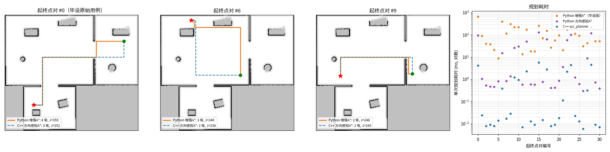

# C++ 方向感知增强 A*（Nav2 规划器插件）vs Python 参考实现

把毕设里的 Python「增强 A*」（`src/path_planning/improved_astar.py` 中的 `EnhancedAStar`）用 C++ 重写成 Nav2 全局规划器插件 `scr_planner/EnhancedAStarPlanner`（包 [`src/scr_planner`](../../../src/scr_planner)），并修正原实现在转弯数上**不保证最优**的问题。



## 算法改动

| | Python `EnhancedAStar`（第一版规划器） | C++ `OrientedAStar`（本包） |
|---|---|---|
| 搜索状态 | `(x, y)` | `(x, y, θ)`，θ ∈ {+x, +y, −x, −y} |
| 邻域 | 8 邻域，斜向额外惩罚 8.0 | 4 邻域（只走横平竖直） |
| 代价 | 步长 + 斜向惩罚 + 转向惩罚（90° 折算 2.5） | 步长（可按代价地图加权）+ `turn_penalty` × 转弯次数 |
| 启发函数 | 曼哈顿距离 | 曼哈顿距离 + `turn_penalty` × 剩余最少转弯数（仍一致/可采纳） |
| 最优性 | **不保证**：同一格只保留第一次出栈的朝向 | 对上述代价**可证最优** |
| 输出 | 栅格点列 | 正交拐点 → 按代价地图分辨率加密的稠密 `nav_msgs/Path`，带朝向 |

**为什么 Python 版不最优**：转向惩罚让代价依赖“从哪个方向进入这个格子”，但 closed 集合只以 `(x, y)` 为键。某个格子第一次以较小 g 出栈后，以另一个朝向到达它的路径（此处 g 稍大，但后面能少转一次弯）就被丢弃了。把朝向放进状态后，同一格的 4 个朝向各自独立，A* 的最优性条件重新成立。

**剩余最少转弯数启发**：从朝向 θ 到达偏移 (dx, dy)，需要覆盖的轴向集合为 R（|R| ≤ 2）；若 θ ∈ R 至少还要转 |R|−1 次，否则 |R| 次。直行一步不会让这个下界减小，转弯一次最多减 1（且已付 `turn_penalty`），所以启发函数仍然一致。它让开阔区域里的启发几乎精确，扩展节点数大幅下降（见下文）。

其他实现细节：起点格本身不检查代价（机器人可能定位在膨胀圈内）；永不掉头回父格（掉头必然不是最优，剪掉不影响最优性）；搜索缓冲区跨调用复用，每次规划只递增时间戳，不重新清零；目标在障碍内时按 `tolerance` 在半径内找最近可通行格。路径首尾用一段≤半格的垂直小段把精确的起点/终点接到栅格路径上，所以**每一段都严格平行于坐标轴**。

## 方法（离线对比）

- **地图**：`src/scr_navigation/maps/my_map.pgm`（299 × 260，0.05 m/格）。直接调用 Python 版的 `GridMap`，得到它的膨胀栅格（膨胀半径 3 格，未知区域视为障碍），再写成 PGM 交给 C++ 基准程序 `bench_grid`。**两边搜索的是同一张二值栅格**，C++ 侧关闭代价加权。
- **起终点**：第一版原用例（`find_valid_points`，#0）+ 在最大 4 连通自由区域中随机抽取的 30 对（种子 42，曼哈顿距离 ≥ 80 格 = 4 m），共 31 对。
- **三种实现**：
  - `py_enhanced`：第一版规划器 `EnhancedAStar(turn_penalty=5.0, diagonal_penalty=8.0)`，原样调用（关闭平滑以得到逐格路径）；
  - `py_oriented`：脚本内的纯 Python 方向感知 A*，与 C++ **同一算法**——用来交叉校验 C++ 的最优代价，并把“算法改进”和“语言/实现加速”分开；
  - `cpp`：`scr_planner` 的 `OrientedAStar`，`turn_penalty = 2.5`（等于 Python 版 90° 转弯的实际惩罚）。
- **指标**（都在逐格稠密路径上计算）：长度、转弯次数、横平竖直比例（轴向步数 / 总步数）、公共目标 **J = 长度(格) + 2.5 × 转弯数**、单次规划耗时、扩展节点数。
- **计时**：Python 每对取 3 次中位数；C++ 每对 20 次取中位数（缓冲区已分配，对应 Nav2 中反复规划的稳态）。4 核笔记本级 CPU，与 Gazebo 等进程共享，绝对数值仅供参考。
- **校验**：脚本对每一对断言 C++ 路径起终点正确、不穿过障碍、每段轴向，且 C++ 报告的代价 = 由路径重算的 J = `py_oriented` 的最优代价（全部 31 对通过）。

## 结果（31 对起终点）

| 实现 | 平均长度 | 转弯数 平均 / 总计 | 横平竖直比例 | 平均 J | 耗时 中位 / 平均 / 最大 | 扩展节点 中位 |
|---|---|---|---|---|---|---|
| Python 增强 A*（第一版规划器） | 8.842 m | 1.94 / 60 | 100 % | 181.68 | 88.8 / 130.9 / 664.0 ms | 3034 |
| Python 方向感知 A* | 8.842 m | 1.68 / 52 | 100 % | 181.03 | 0.87 / 23.2 / 132.3 ms | 207 |
| **C++ scr_planner** | 8.842 m | **1.68 / 52** | 100 % | **181.03** | **0.018 / 0.95 / 5.67 ms** | 207 |

- **转弯更少**：31 对中有 **8 对（26 %）** 第一版规划器比最优解多 1 个弯（包括第一版原用例 #0：4 弯 → 3 弯），**没有一对**比 C++ 更好。长度完全相同——多出的弯纯粹是 `(x, y)` 状态造成的次优，而不是长度/转弯的权衡。
- **横平竖直**：两者都是 100 %。第一版规划器的斜向惩罚（8.0 + 转弯 10.0）已足以消灭斜线，C++ 版则在结构上只允许 4 邻域。
- **耗时**：C++ 相对第一版规划器中位加速 **≈ 2000×**（最小 46×）。拆开看：
  - 同一算法 Python → C++：中位 **47×**（最小 21×），每扩展一个节点约 4.5 µs → 0.18 µs；
  - 算法本身（`py_enhanced` → `py_oriented`）：中位扩展节点 3034 → 207。原实现的启发函数不含转弯项，每转一次 f 就上升 2.5，导致大面积等 f 值泛洪；剩余最少转弯数启发 + 深度优先打破平局让开阔区域几乎沿直线展开。难例（需要绕多个房间）两者扩展数接近，此时差距主要来自语言。
- **最坏情况**：C++ 单次规划最长 5.7 ms（扩展约 3.2 万个状态），远低于 Nav2 默认 1 Hz 重规划周期。

原始数据：[`results.csv`](results.csv)（逐对逐实现）、[`summary.csv`](summary.csv)（汇总）。

## Gazebo 验证

GAZEBO_SECTION

## 单元测试

`colcon test --packages-select scr_planner`：23 个 gtest 全部通过。

- `test_oriented_astar`（17 个）：直线 0 弯、开阔场地恰好 1 弯、绕墙、对准目标的门洞、`turn_penalty` 越过盈亏点（=3）后选择“长 6 格但少 2 弯”的绕行、不可达 / 越界 / 目标在障碍内（含 tolerance 吸附）、起点 = 终点、内切膨胀格不可通行但起点可在其中、`allow_unknown`、代价加权避开高代价走廊、扩展数上限超时、拐点提取；**300 张随机栅格上与独立实现的无启发 Dijkstra（同一状态图）比较最优代价**（多种 `turn_penalty` / 代价权重）；60 张随机栅格上验证“`turn_penalty` 增大时转弯数不增、长度不减”的参数单调性。
- `test_planner_plugin`（6 个）：在真实 `Costmap2DROS` 上调用插件——稠密路径相邻点间距 ≤ 分辨率、每一跳严格轴向、首末位姿等于精确起终点、末位姿朝向 = 目标朝向、中间朝向 = 行进方向；不可达 / 目标在障碍内 / 坐标系错误 / 超出地图时抛 `nav2_core::PlannerException`；动态参数 `turn_penalty`、`tolerance` 生效。

## 结论

1. **转弯数真正最优**：把朝向加入搜索状态后，C++ 版在所有用例上都达到 `长度 + 2.5 × 转弯` 的最优，并与独立 Dijkstra / Python 同算法实现逐一吻合；第一版规划器在约四分之一的用例上多一个弯（论文原用例也在其中）。
2. **速度足够实时**：平均 < 1 ms、最坏 < 6 ms，可直接作为 Nav2 全局规划器在每次重规划中运行；第一版规划器 Python 中位 89 ms、最坏 0.66 s。
3. **算法与语言的贡献可以分开**：同算法 Python→C++ 约 47×；更紧的启发函数在开阔地图上再贡献一个数量级以上的扩展数下降。

## 局限

- **最优是相对 4 邻域栅格而言**：路径只能沿栅格轴向，地图坐标轴若与墙面不平行，“横平竖直”是相对地图而非真实墙面；也没有考虑任意角度的捷径（这正是需求本身）。
- **目标函数是代理指标**：`turn_penalty` 把一次转弯折算成固定步数，没有建模全向底盘实际的加减速时间；代价地图加权（Gazebo 中开启）会让路径远离墙面而略长，此时不再是最短路径。
- **离线对比用的是 Python 版的二值膨胀栅格**，不是 Nav2 代价地图（膨胀半径 0.7 m + 代价衰减）；在 Nav2 中开启代价加权后，路径形状与离线结果不同。
- **起点在障碍内的处理很简单**：只豁免起点格本身；若机器人整个陷在内切膨胀圈深处，规划会失败，需要靠 Nav2 的恢复行为脱困。
- **计时环境**：单机 4 核，与其他进程共享；只比较了单线程规划耗时，没有与 NavFn / Smac 等 Nav2 自带规划器做同条件横向比较。

## 复现

```bash
# 构建 + 单元测试
colcon build --packages-select scr_planner --cmake-args -DCMAKE_BUILD_TYPE=Release
colcon test --packages-select scr_planner && colcon test-result --verbose

# 离线对比（约 1 分钟，结果写到本目录）
PYTHONUNBUFFERED=1 python3 src/scr_planner/scripts/compare_with_python.py \
    --bench build/scr_planner/bench_grid --out docs/experiments/cpp_planner

# Gazebo 中使用新规划器
ros2 launch scr_bringup sim_nav.launch.py gui:=false rviz:=false \
    params_file:=$(ros2 pkg prefix scr_navigation)/share/scr_navigation/config/nav2_params_scr_planner.yaml
ros2 run scr_navigation send_goal.py 3.0 -2.0 0.0
```
