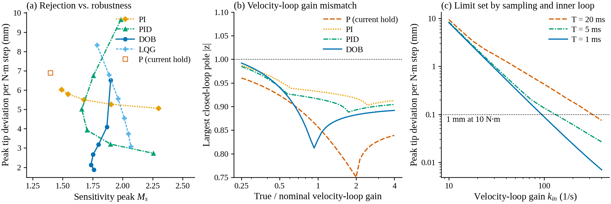
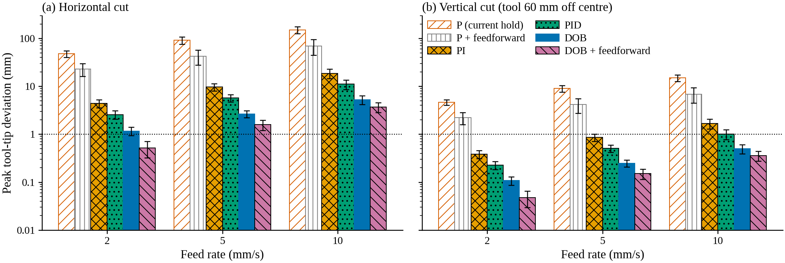
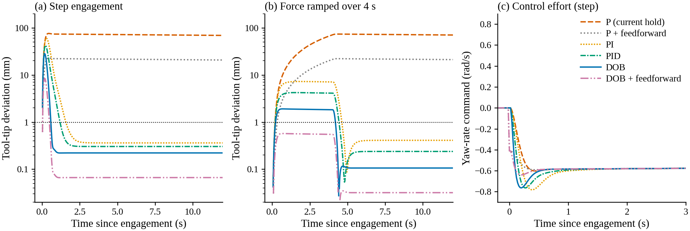
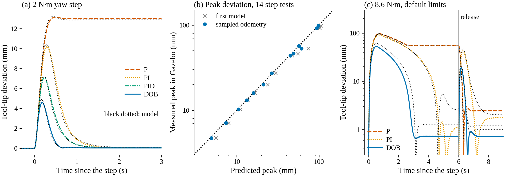
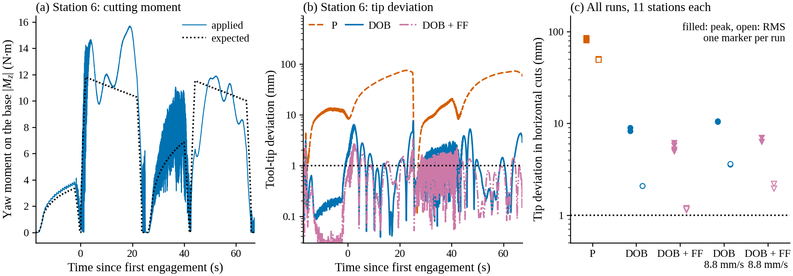
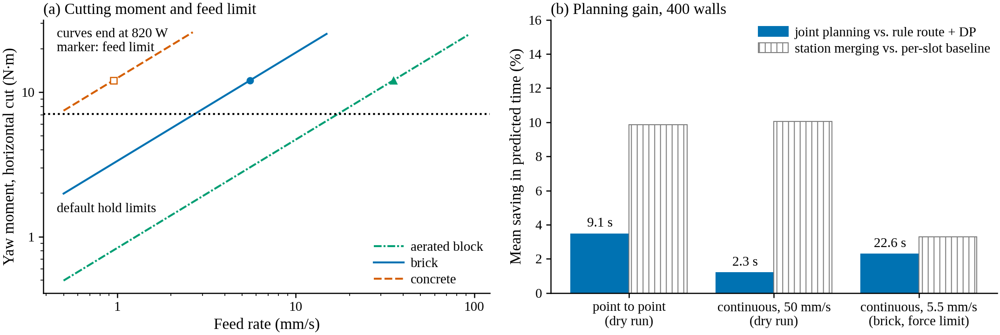

# 切割力扰动与抗扰定点保持：模型、控制律分析、Gazebo 验证与进给速度

仿真中的切割一直是空切，底盘从未受到切削力。本文建立切割力模型，估计平台能否承受真实切割，分析现有比例定点保持在切割力下的表现，设计并比较 PI / PID / 扰动观测器等抗扰控制律，在离线仿真中比较（第 2–9 节）；随后在 Gazebo 中用外力阶跃与带切割力的整墙任务检验这些预测（第 10 节），并用力模型给出进给速度的上限、重新标定时间模型、重跑规划对比（第 11 节）。

主要结果：对象模型与 Gazebo 的阶跃响应相差 6 % 以内（修正里程计的积分方式之后）；烧结砖、进给 5.5 mm/s 的整墙切割中，比例保持的横槽刀尖偏移峰值 81–85 mm、槽线覆盖率 40 %，扰动观测器加前馈为 5.0–6.2 mm（均方根 1.2 mm）、覆盖率 100 %（n = 4），约为离线预测的两倍；进给的上限由轮地摩擦而不是主轴功率决定；在该进给下联合规划相对规则路线的平均节省为 22.6 s（2.28 %，156 面非承重墙）。

## 1. 问题

Gazebo 的墙是刚体，刀尖真的压到切深会把整台机器人顶开，因此仿真中下刀位置改为刀尖停在墙前 10 mm（空切）。定点保持（`base_hold.py`，里程计上的比例控制，增益 5 / 6，50 Hz）在空切下把一站内的底盘漂移从 24.9 mm / 6.07° 压到 0.2 mm / 0.09°（[slot_execution](../slot_execution/README.md)），但这是在只有机械臂反作用力、没有切削力的条件下得到的。这是仿真与真实任务之间最大的差距，需要回答三个问题：

1. 开槽时刀具受多大的力，折算到底盘是多大的力和力矩；30.5 kg 的平台靠轮地摩擦能否撑住。
2. 现有的比例保持在这个力下偏多少。
3. 哪种控制律适合抑制这一扰动，能做到什么程度，瓶颈在哪里。

评估指标是**刀尖偏移**：刀尖在底盘前方 0.735 m（离墙 0.70 m 加切深 35 mm），底盘偏航 1 mrad 就是 0.74 mm，它直接决定槽线精度。

## 2. 切割力模型

### 2.1 文献中的做法与量级

金刚石圆锯片切割石材、混凝土的切削力，文献中通行的描述方式有三点，本模型都沿用：

- **比切削能**：切向力由“去除单位体积材料所需的能量”给出，F_t = u·Q / v_c（Q 为材料去除率，v_c 为刀片线速度）。能量主要消耗在塑性犁耕与摩擦上，断裂能只占很小一部分 [2]，所以 u 远大于材料的断裂能，只能由试验或设备功率标定。
- **当量切屑厚度**：h_eq = a·v_f / v_c（切深 × 进给速度 / 线速度）；单位宽度的切削力是 h_eq 的幂函数 F′ = k·h_eq^n，n < 1（[6]、[8]、[9]），即比切削能随切屑变薄而升高（尺寸效应）。
- **法向力与合力位置**：法向（径向）力是切向力的数倍，力比随线速度变化、在不同花岗岩之间差别不大 [3]。深切时接触弧很长，测得的水平 / 竖直力与切向 / 法向力不重合 [2]，两者由合力在接触弧上的位置换算，这一位置常写成接触弧角的一个比例 α = k·β [5]，顺铣时比逆铣时小 [4]。

量级用手持开槽机的规格校核。Bosch GNF 35 CA [1]：刀片直径 150 mm，空载转速 9300 r/min，输出功率 820 W，槽深 0–35 mm（与本项目 35 mm 的槽深相同）。线速度 v_c = π × 0.15 × 9300 / 60 = 73 m/s，因此

```
F_t ≤ P / v_c = 820 / 73 = 11.2 N
```

**无论切什么材料，这一功率等级的刀具切向力不超过约 11 N**：线速度很高，功率换成力很小。材料越硬，同样功率下进给越慢，力的上限不变。作用在机器人上的主要是法向力（λ·F_t，几十牛）。

### 2.2 参数化模型

```
Q    = b·(a·v_f + c(a)·v_p)          材料去除率：进给 + 下刀，c(a) = 2·sqrt(a·(2R − a)) 为刀片在墙面上的弦长
h_eq = Q / (b·v_c)                   当量切屑厚度
u    = g·u_0·(h_eq / h_0)^(−ε)       比切削能；g 为材料不均匀性增益（均值 1）
F_t  = u·Q / v_c,    F_n = λ·F_t     切向力、法向力
```

分解到进给方向 f 与墙面外法向 n（指向机器人）。进给部分的合力作用在接触弧上 φ_r = κ·φ_e 处（φ_e = arccos(1 − a/R)，从最深点向进给前方量起），下刀部分作用在最深点；σ = +1 为逆铣（最深点处刀齿运动方向与进给同向），σ = −1 为顺铣：

```
F_f = −F_n,f·sin φ_r − σ·F_t,f·cos φ_r − σ·F_t,p      沿进给方向（负 = 阻碍进给）
F_w =  F_n,f·cos φ_r − σ·F_t,f·sin φ_r + F_n,p        沿 n（正 = 把刀具推离墙面）
τ   =  σ·F_t·R，绕 n × f                                主轴反力偶（与 φ 无关）
```

刀具受力等效为作用在刀片中心的 F_f·f + F_w·n 加力偶 τ。

| 参数 | 取值 | 出处 |
|---|---|---|
| 刀片直径 2R | 150 mm | [核对] Bosch GNF 35 CA [1] |
| 转速 / 线速度 v_c | 9300 r/min / 73 m/s | [核对] 同上 |
| 主轴输出功率 | 820 W | [核对] 同上（额定输入 1400 W） |
| 切深 a | 35 mm | [国标] 与 `scr_planner` 的槽深一致（管径 20 mm + 保护层 15 mm） |
| 锯缝总宽 b | 5 mm | [假设] 两片 2.5 mm 刀片同时切两条锯缝，槽芯另行剔除 |
| 比切削能 u_0（参考工况：a = 35 mm，v_f = 5 mm/s） | 加气块 0.10、烧结砖 0.40、C30 混凝土 1.50 J/mm³ | [假设] 按“820 W 时的进给速度约 2.8 / 0.7 / 0.19 m/min”反推的量级；石材湿切的文献值为 1–10 J/mm³ 量级 [文献，数值未核对原文] |
| 尺寸效应指数 ε（n = 1 − ε） | 0.25 | 幂律形式见 [8] [核对摘要]；指数取值为 [假设] |
| 力比 λ = F_n / F_t | 4 | [文献] 石材圆锯的报道值在个位数量级 [3]，具体数值未核对原文 |
| 合力位置 κ | 0.6 | 形式见 [4]、[5] [核对]；取值为 [假设]（切屑厚度随 φ 增大，取略大于弧中点） |
| 铣削方向 | 逆铣 | [假设] 避免刀具自行前窜的常用转向 |
| 不均匀性：变异系数 / 相关长度 | 0.25 / 15 mm | [假设] 相关长度取粗骨料粒径量级 |

标注含义：[核对] 已对照产品页或论文摘要；[文献] 文献中的模型形式或量级，数值未能对照原文；[假设] 本项目的工程假设。**模型的结构有文献依据，数值多数是假设**，其中 u_0 与 λ 对结果的影响最大；模型参数全部可调（`cutting_force.py` 的 `BladeParams`、插件的 SDF 参数）。

### 2.3 换算到底盘

base_link 系 x 指向墙面、y 向左、z 向上。墙面外法向 n = −x；横槽的进给方向 f = ∓y，竖槽 f = ±z。刀片中心在底盘前方 x_c = 0.70 + a − R = 0.66 m，因此：

- **横槽**：进给反力 F_f 沿墙，是底盘的横向力 F_y，并产生偏航力矩 M_z ≈ x_c·F_y + τ；F_w 把底盘推离墙面（F_x）。
- **竖槽**：进给反力沿竖直方向，只改变前后轮压；水平面内只有 F_x，刀具横向偏离底盘中线 y_c 时产生 M_z = y_c·F_w（工作窗口内 |y_c| ≤ 0.08 m）。

烧结砖、切深 35 mm（[`force_table.csv`](force_table.csv)）：

| 进给 | F_t / F_n | 切削功率 | 横槽：F_x / F_y / M_z | 竖槽（y_c = 60 mm）：F_x / F_z / M_z |
|---|---|---|---|---|
| 2 mm/s | 2.4 / 9.6 N | 176 W | −6.6 N / 7.5 N / 5.1 N·m | −6.6 N / −7.5 N / 0.39 N·m |
| 5 mm/s | 4.8 / 19.2 N | 350 W | −13.0 N / 14.8 N / 10.2 N·m | −13.0 N / −14.8 N / 0.78 N·m |
| 10 mm/s | 8.1 / 32.2 N | 589 W | −21.9 N / 25.0 N / 17.1 N·m | −21.9 N / −25.0 N / 1.32 N·m |
| 15.6 mm/s（820 W） | 11.2 / 44.9 N | 820 W | −30.6 N / 34.8 N / 23.8 N·m | −30.6 N / −34.8 N / 1.83 N·m |

最后一行是功率上限，对三种材料相同（混凝土在 2.7 mm/s、加气块在 99 mm/s 达到）。**横槽的扰动以偏航力矩为主，竖槽的扰动小一个量级。**

### 2.4 随机分量与切入瞬态

- **材料不均匀性**：比切削能乘以增益 g = 1 + 0.25·ξ(s)，ξ 是沿切削路程 s 的二阶高斯–马尔可夫过程（两个相关长度 15 mm 的一阶环节串联，单位方差）。不用一阶过程，是因为它的样本路径处处不可导，相当于每前进零点几毫米切削力就有一次小跳变。给定种子时可重复。
- **切入瞬态**：下刀时材料去除率为 b·c(a)·v_p。弦长 c(a) 在刚接触时按 √a 增长，以 2 mm/s 下刀 0.1 s 后（切入 0.2 mm）弦长已有 11 mm，所以**匀速下刀的接触瞬间接近阶跃**；下刀到位、开始进给时力的方向和大小再变一次。


*图 1：切割力模型。(a) 切深 35 mm 时刀片受力随进给速度的变化：粗线为法向力 F_n，细线为切向力 F_t，三种材料；方块为主轴输出功率 820 W 对应的进给上限。(b) 烧结砖上切横槽时底盘受到的横向力、推离墙面的力与偏航力矩；黑点线为仿真底盘默认的偏航力矩上限 9.2 N·m。(c) 一刀的时间历程（烧结砖，下刀 2 mm/s、进给 5 mm/s，种子 3）：先下刀、后进给，黑点线为不含不均匀性的名义偏航力矩。*

## 3. 平台可行性

**轮地摩擦**。麦克纳姆轮只能沿辊子轴线（与车体成 45°）传力，垂直轴线的方向辊子自由滚动。四个轮抱死时，平衡水平力旋量 (F_x, F_y, M_z) 是三个方程、四个未知的辊子轴向力 f_i，剩下的一个自由度用来使 max |f_i| / N_i 最小，这个最小值就是所需的摩擦系数。两个特例：

```
纯平移力：  F_max = 0.707·μ·M·g            （μ = 0.6 时 127 N）
纯偏航力矩：M_max = 0.707·μ·M·g·(l_x + l_y)  （μ = 0.6 时 69 N·m）
```

轮压 N_i 由自重、切削力的竖直分量和它对底盘的俯仰 / 侧倾力矩决定（四点支承按刚性车架对称分配）；最小轮压降到 0 即开始倾覆。


*图 2：平台可行性。(a) 抱死四个麦克纳姆轮撑住切削力所需的摩擦系数随进给速度的变化：粗线为横槽（刀具在最高处 0.81 m），细线为竖槽（刀具横向偏置 80 mm）；曲线画到主轴功率上限为止（方块），灰带为假设的轮地摩擦系数范围 0.3（有粉尘）– 0.6（干净地面）。(b) 最小轮压与静态平均轮压之比，降到 0 即倾覆。*

| 工况（刀具在最不利位置） | 所需摩擦系数 | 最小轮压 / 静态轮压 |
|---|---|---|
| 烧结砖横槽，2 / 5 / 10 mm/s（刀具高 0.55 m） | 0.08 / 0.17 / 0.30 | 0.94 / 0.84 / 0.71 |
| 任意材料横槽，满功率 820 W（刀具高 0.81 m） | 0.49 | 0.37 |
| 任意材料竖槽，满功率 820 W | 0.14 | 0.97 |
| 混凝土横槽，10 mm/s（需 2.2 kW，超出刀具功率） | 倾覆 | −0.17 |

（数据：[`force_table.csv`](force_table.csv)、[`feasibility.csv`](feasibility.csv)。）

**结论**：

- **竖槽可行**：满功率时只需 μ ≈ 0.14，轮压几乎不变。
- **横槽在低进给下可行，满功率下临界**：烧结砖 5 mm/s 以内需 μ ≤ 0.17；满功率时需 μ ≈ 0.44–0.49，在有粉尘的地面（假设 μ ≈ 0.3）上撑不住，且最小轮压只剩静态的 37 %（刀具在最高处时横向力的侧倾力矩卸载一侧车轮）。
- 现有平台要在满功率下稳定切横槽，需要**限制进给**（把切削功率限制在约 350 W 以内，所需 μ 降到 0.17），或者**增加支撑**：落地支腿把接触改为各向同性摩擦后所需 μ 降到 0.36，并可加宽支承；增加配重按比例降低所需 μ。
- 以上是准静态估计，没有计入冲击（刀片咬入钢筋或硬骨料）与振动。

**仿真底盘的驱动上限更紧**：力控底盘（`plant = force`）的驱动力矩上限是 I_z·α_max = 0.92 × 10 = 9.2 N·m，只有上式摩擦上限（69 N·m）的 13 %；定点保持的角速度指令上限 0.5 rad/s 恰好对应同一个力矩（I_z·k_ang·0.5）。烧结砖横槽在 5 mm/s 时的 10.2 N·m 已经超过它。验证切割时需要放宽这两个限幅（第 9 节）。

## 4. 被控对象与传感器

定点保持在保持点附近三个轴（x、y、ψ）解耦，每个轴是同一个二阶模型。

**力控底盘**（`ScrMecanumBaseSystem`，`plant = force`，Gazebo 默认）：指令速度与实际速度之差乘以 M·k_lin 作为驱动力，外力直接作用在底盘上：

```
ė = v
v̇ = k_in·(u + d − v),     d = F / (M·k_in)        （偏航轴：M → I_z，F → M_z）
```

e 为偏离保持点的位移，u 为速度指令，k_in = 20 /s。d 是折算到输入端的扰动，与 u 从同一个通道进入（匹配扰动）。速度环只有比例作用，所以**常值外力不加外环时使底盘以 F / (M·k_in) 匀速漂移**（15 N 即 25 mm/s）；底盘的“刚度”全部来自外环。

**轮地接触底盘**（`plant = wheels`，实验性）：轮子跟随指令转速，底盘只受接触力 F = −sat(c·e_slip, μN)（c = 3000 N·s/m，沿辊子轴线）。外力使底盘相对轮子滑移：线性段内横向滑移速度 F_y / (2c)，偏航滑移角速度 M_z / (2c·(l_x + l_y)²)，烧结砖 5 mm/s 横槽对应 2.5 mm/s 与 5.7 mrad/s（刀尖 4 mm/s）。结构与上式相同（k_in 换成轮速环带宽，d 换成滑移速度），区别在于测量。

**各传感器在切割力下能看到什么**：

| 传感器 | 力控底盘 | 轮地接触底盘（轮子打滑） |
|---|---|---|
| 轮式里程计（50 Hz） | 看得到外力引起的位移（编码器读数由底盘真实运动生成），带 3 % 横向、2 % 转向比例误差 | **看不到**：编码器读的是轮子转角，滑移不产生读数 |
| 陀螺（100 Hz，噪声 0.001 rad/s） | 看得到转动 | **看得到转动**（与轮子无关），看不到平移；有零偏，需要绝对朝向慢校正 |
| 激光墙面拟合（10 Hz，单帧 1.3 mm / 0.26°） | 离墙距离 d、朝向 ψ | 同左；**看不到沿墙位置 u** |
| 定位标记（30 Hz，沿墙 0.3 mm） | 沿墙位置 u | 同左；切割姿态下标记可能不在视野内（[along_wall_accuracy](../along_wall_accuracy/README.md)） |

真机更接近后者：轮子有电机保持，位移来自轮地滑移与辊子变形，里程计看不到。

## 5. 控制律设计与分析

实现见 [`disturbance_observer.py`](../../../src/scr_arm_controller/scr_arm_controller/disturbance_observer.py)；下面的离散分析对实现本身逐个状态分量求响应得到状态空间（`state_space()`），分析的模型与运行的代码是同一个。

### 5.1 比例保持（现状）

u = −k_p·e。闭环特征多项式 s² + k_in·s + k_in·k_p：k_p = k_in / 4 = 5 时为 −10 处的二重极点（临界阻尼），偏航 k_p = 6 时 ζ = 0.91。扰动到偏差的传递函数 1 / (s² + k_in·s + k_in·k_p) 的直流增益不为零：

```
e_ss = F / (M·k_in·k_p)：横向 1 / 3050 m/N，偏航 1 / 110 rad/(N·m)
刀尖沿墙柔度 = 1/3050 + 0.66 × 0.735 / 110 = 4.7 mm/N
```

**横向切削力每 1 N，刀尖稳态偏 4.7 mm**，其中 93 % 来自偏航。空切下 0.2 mm 的保持精度不能外推到有切削力的情形。

### 5.2 PI / PID

u = −k_p·e − k_i·∫e − k_d·v，特征多项式 s³ + k_in·(1 + k_d)·s² + k_in·k_p·s + k_in·k_i。

- **PI**（k_d = 0）：三个极点之和固定为 −k_in，最快的无振荡配置是三重极点 −k_in/3：**k_p = k_in / 3，k_i = k_in² / 27**（k_in = 20：6.67、14.8）。Routh 判据给出 k_i < k_in·k_p。阶跃扰动无稳态偏差，斜坡扰动（斜率 ρ，折算到输入端）留下 ρ / k_i。
- **PID**：三个系数可任意配置。取 (s + ω)(s² + 2ζω·s + ω²)，ζ = 1：**k_p = 3ω² / k_in，k_i = ω³ / k_in，k_d = 3ω / k_in − 1**。ω 受采样与延迟限制，取 ω = 0.4·k_in = 8 rad/s（9.6、25.6、0.2）。微分作用在测量上并经 20 ms 低通。
- **抗积分饱和**：反算式（back-calculation），I ← I + k_i·T·e − (T / T_t)·(u_sat − u)，T_t = k_p / k_i。

### 5.3 扰动观测器（扩张状态观测器）

把 d 作为第三个状态（ḋ = 0），零阶保持离散化（a = exp(−k_in·T)，γ = (1 − a) / k_in）：

```
[e]⁺   [1  γ  T − γ] [e]   [T − γ]
[v]  = [0  a  1 − a] [v] + [1 − a]·u,      y = e
[d]    [0  0    1  ] [d]   [  0  ]
```

“当前估计器”形式的观测器 x̂ = x̂⁻ + L·(y − C·x̂⁻)，增益由 Ackermann 公式把 (I − L·C)·A 的三个极点放在 z = exp(−ω_o·T)（带宽参数化 [10]，只有 ω_o 一个整定量）。控制律

```
u = sat(−k_p·ê − k_d·v̂ − d̂ − d_ff)
```

- **与积分的关系**：扰动状态就是一个积分器，线性区内它等价于一个三阶的输出反馈控制器，同样没有稳态偏差。区别在结构上：名义响应由 k_p、k_d 决定，抗扰带宽由 ω_o 单独决定（二自由度）。
- **限幅**：观测器用限幅后实际下发的指令推进，限幅期间 d̂ 仍然收敛到真实扰动，不存在积分累积，不需要另加抗饱和逻辑。
- **延迟**：测量到指令生效的延迟按整拍计（`delay_steps`，标称 1），观测器用延迟后的指令推进，并把估计向前预测到指令生效的时刻。
- **前馈**：切削力的名义值可由规划（进给速度、切深、刀片方向）预知。把 d_ff = F̂ / (M·k_in) 同时加入观测器模型和指令，观测器只估计剩余部分（模型误差与随机分量），不会重复抵消。
- **卡尔曼形式**：增益改由协方差递推给出，允许某一拍没有测量、各次测量方差不同，用于第 6.3 节低速率、带噪声的墙面相对测量。

### 5.4 LQR / LQG

- **LQR**：最小化 Σ(q_e·e² + r·u²) 的状态反馈，连续时间极限下 k_p → √(q_e / r)；q_e = k_p² 时得到 k_p = 5.69、k_d = 0.26（偏航轴），与手工整定的 k_p = 6 相近。带积分状态的 LQI 给出 PID 形式的增益（`lqi_gains`），用作极点配置整定的对照。
- **LQG**：观测器增益取稳态卡尔曼增益，由 σ_d / σ_y（扰动随机游走与测量噪声之比）一个量决定。里程计反馈几乎没有测量噪声，这个比值没有物理依据，LQG 在这里只是带宽参数化的另一种写法；它的用处在测量有噪声时（第 6.3 节）。

### 5.5 离散闭环：极点、裕度与柔度

模型：T = 20 ms，对象零阶保持，测量到指令延迟一拍，偏航轴。

| 控制律 | 增益 | 最大极点模 | 穿越频率 | 相位裕度 | 增益裕度 | 延迟裕度 | 灵敏度峰值 M_s | 刀尖柔度峰值 | 1 N·m 阶跃的刀尖峰值 / 2 % 调节时间 |
|---|---|---|---|---|---|---|---|---|---|
| P | k_p = 6 | 0.857 | 5.8 rad/s | 64° | 6.1 | 194 ms | 1.40 | 4.67 mm/N（静态） | 6.9 mm / 不恢复 |
| PI | 6.67、14.8 | 0.932 | 6.8 | 42° | 4.7 | 108 ms | 1.68 | 5.55 mm/N | 5.5 mm / 1.40 s |
| PID | 9.6、25.6、0.2 | 0.916 | 9.4 | 43° | 3.6 | 81 ms | 1.70 | 3.76 mm/N | 3.9 mm / 1.14 s |
| DOB | k_p = 6，ω_o = 40 rad/s | 0.830 | 12.9 | 42° | 2.8 | 56 ms | 1.75 | 2.77 mm/N | 2.7 mm / 0.56 s |
| LQG | 5.69、0.26，σ_d/σ_y = 2 | 0.881 | 7.2 | 36° | 2.8 | 88 ms | 1.96 | 5.97 mm/N | 5.6 mm / 0.82 s |

（数据：[`controllers.csv`](controllers.csv)；“刀尖柔度”指横向切削力到刀尖沿墙偏移的增益。）


*图 3：频率响应（偏航轴，T = 20 ms，一拍延迟）。(a) 横向切削力到刀尖沿墙偏移的动态柔度；(b) 灵敏度函数 |S|，峰值越高鲁棒性越差。P 在低频保持 4.7 mm/N 的静态柔度；带积分作用的控制律在低频按 20 dB/dec 下降，代价是 5–20 rad/s 附近的峰值。*

- 积分作用（PI / PID / DOB）把低频柔度降为零，但**柔度峰值只降到 P 静态值的 0.6–1.2 倍**：PI 甚至更高（5.55 mm/N）。峰值由速度环增益和采样延迟决定，控制律的差别有限。
- 在相近的鲁棒性下（M_s ≈ 1.7），阶跃响应峰值 DOB 2.7 < PID 3.9 < PI 5.5 mm/(N·m)，DOB 的调节时间是 PID 的一半。代价是延迟裕度：DOB 56 ms，PID 81 ms，P 194 ms。



*图 4：设计折中与鲁棒性。(a) 各控制律族沿整定参数扫描（PI：k_i；PID：ω；DOB：ω_o；LQG：σ_d/σ_y）得到的“灵敏度峰值 M_s – 1 N·m 阶跃下刀尖峰值”曲线，越靠左下越好。(b) 真实速度环增益偏离标称值时的最大闭环极点模，黑点线为稳定边界。(c) 扰动观测器按同一规则整定（k_p = k_in / 4，ω_o = min(2·k_in, 0.8 / T)）时，1 N·m 阶跃下的刀尖峰值随速度环增益 k_in 与控制周期 T 的变化；黑点线为“10 N·m 阶跃下 1 mm”所需的 0.1 mm/(N·m)。*

- **整定折中**（图 4a，[`tradeoff.csv`](tradeoff.csv)）：DOB 的 ω_o 从 10 增到 80 rad/s，刀尖峰值从 6.5 降到 1.9 mm/(N·m)，M_s 保持在 1.74–1.90；PID 的 ω 超过 9 rad/s 后 M_s 迅速变差（ω = 10 时 2.26）。ω_o 取 40 rad/s：再大收益递减，而对测量噪声与延迟更敏感。
- **速度环增益失配**（图 4b，[`robustness.csv`](robustness.csv)）：真实 k_in 在标称值的 0.25–4 倍内四种控制律都稳定；偏小时都变差（0.25 倍时最大极点模 0.96–0.99），DOB 最接近边界（0.992）。
- **延迟**：回路延迟从 1 拍增到 4 拍，P / PI / PID 仍稳定（0.935 / 0.968 / 0.978），**DOB 在 4 拍时失稳（1.007）**。[精对位](../fine_alignment/README.md)中测到过 `rtf:=2.5` 时控制周期按仿真时间翻倍；DOB 应在 rtf = 1 下使用，或按实测延迟设置 `hold.delay_steps`。

**结构性上限**（图 4c，[`structural_limit.csv`](structural_limit.csv)）。阶跃力矩 M 作用在转动惯量 I_z 上，闭环响应之前底盘先被加速。要把刀尖偏移限制在 δ，闭环位置带宽需满足

```
ω_n² ≳ M·x_t / (I_z·δ)
```

M = 10 N·m、δ = 1 mm、x_t = 0.735 m 时 ω_n ≈ 90 rad/s（14 Hz）。现有结构（50 Hz 外环、k_in = 20 /s）的闭环带宽约 10 rad/s，对应 2.7 mm/(N·m)，即 **1 mm 的预算只容得下约 0.4 N·m 的未预知阶跃力矩**。把同一控制律放到 1 kHz（T = 1 ms）也只降到约 2.1 mm/(N·m)：瓶颈是速度环增益。k_in 提高到 100 /s 且 T ≤ 5 ms 时才到 0.1 mm/(N·m) 量级。因此抑制切入瞬态不能只靠 50 Hz 的外环，需要缓慢切入、前馈，或更硬的内环 / 轮地摩擦（第 7 节）。

### 5.6 限幅

速度指令限幅 u_max 对应最大可抵消的外力 M·k_in·u_max（现有默认值：横向 61 N、偏航 9.2 N·m）。外力超过它时任何控制律都无效，底盘以 (M_z − M_max) / I_z 加速转走。接近限幅时，各控制律的差别体现在退出饱和的过程（第 6.2 节）。

### 5.7 整定规则小结

1. 辨识 k_in（阶跃外力下 P 保持的稳态偏差 e_ss = F / (M·k_in·k_p)），确认 M、I_z。
2. P：k_p = k_in / 4（临界阻尼）。PI：k_p = k_in / 3，k_i = k_in² / 27。PID：ω = 0.4·k_in，ζ = 1。
3. DOB：k_p 沿用 P 的取值；ω_o ≈ 0.8 / T（T = 20 ms 时 40 rad/s）；`delay_steps` 取实测的整拍延迟。检查 M_s ≤ 1.8。
4. 测量有噪声时用卡尔曼形式：r 取单帧测量方差，扰动随机游走 σ_d 取“扰动在约 1 s 内的变化量 / √(1 s 的拍数)”。
5. 限幅按要抵消的最大外力设置：u_max ≥ 1.3·F_max / (M·k_in)，同时放宽底盘驱动上限。

## 6. 离线仿真

### 6.1 设置

- **被控对象**：[`plant_sim.py`](plant_sim.py) 按 `scr_base_control` 的实现建模。力控底盘：驱动力 M·k_lin·(v_cmd − v) 限幅 M·a_max，力矩限幅 I_z·α_max，速度取位姿差分经 5 ms 低通（速度环与编码器共用），编码器误差模型取默认参数（轮径误差 ±0.3–0.6 %，打滑过程 σ = 2 %、τ = 0.5 s，横向 3 %、转向 2 %），积分步长 1 ms。轮地接触底盘：四个轮各自的辊子轴向滑移力（c = 3000 N·s/m，μ = 0.6，轮压随切削力变化），轮速环滞后 20 ms，步长 0.25 ms。
- **控制**：50 Hz，偏差测量延迟一拍；控制律与切割力模型直接调用 `scr_arm_controller` 中的代码。限幅取放宽值（指令 0.25 m/s、4 rad/s，底盘 α_max = 75 rad/s²，对应 μ = 0.6 的摩擦上限），第 6.2 节的限幅试验取现有默认值。
- **扰动**：烧结砖，切深 35 mm，切长 100 mm；横槽（刀具在底盘中线附近）与竖槽（刀具横向偏置 60 mm）；进给 2 / 5 / 10 mm/s。四种切入方式：阶跃（切深与进给同时到位）、斜坡（切削力在 4 s 内线性增加）、先下刀后进给（下刀 2 mm/s，匀速）、斜坡 + 材料不均匀性（种子 1–8，n = 8）。
- **控制律**：P、P + 前馈、PI、PID、DOB、DOB + 前馈。**前馈按名义模型的 70 % 给出**，即假设模型低估切削力 30 %，不假设模型准确。
- **指标**：刀尖偏移（进深与沿墙两个方向的合成）在刀具处于墙内期间的峰值与均方根；底盘位置 / 朝向漂移；速度指令均方根；恢复时间（开始进给后刀尖偏移最后一次超过 0.5 mm 的时刻）；退刀（切削力突然消失）后 2 s 内的峰值单列，此时刀具已离开墙面。
- 全部随机数由固定种子生成，重复运行结果相同。

### 6.2 力控底盘，里程计反馈

**在烧结砖上以 2 mm/s 切横槽、切削力缓慢建立时，扰动观测器把刀尖偏移峰值从比例保持的 48 mm 降到 1.2 mm，加上 70 % 的前馈降到 0.5 mm；阶跃切入时任何反馈控制律都留下厘米级的瞬态。**

本节与图 5–7 的数字由经 Gazebo 阶跃试验修正后的对象模型给出（里程计按控制周期采样累加，见 10.3 节）；修正前的模型在阶跃类工况下把峰值高估约 3–12 %，斜坡类工况相差不到 1 %，结论不变。

斜坡切入 + 材料不均匀性，刀尖偏移峰值 mean ± std（mm，n = 8，[`sim_summary.csv`](sim_summary.csv)）：

| 槽向 | 进给 | P | P + 前馈 | PI | PID | DOB | DOB + 前馈 |
|---|---|---|---|---|---|---|---|
| 横槽 | 2 mm/s | 47.8 ± 7.4 | 22.9 ± 6.7 | 4.42 ± 0.87 | 2.57 ± 0.51 | 1.17 ± 0.23 | 0.52 ± 0.20 |
| 横槽 | 5 mm/s | 92.0 ± 15.7 | 42.6 ± 15.0 | 9.72 ± 1.71 | 5.71 ± 0.99 | 2.65 ± 0.44 | 1.58 ± 0.38 |
| 横槽 | 10 mm/s | 150.8 ± 25.5 | 69.6 ± 24.8 | 18.7 ± 4.2 | 11.1 ± 2.5 | 5.28 ± 1.08 | 3.69 ± 0.85 |
| 竖槽 | 2 mm/s | 4.64 ± 0.61 | 2.22 ± 0.62 | 0.39 ± 0.07 | 0.23 ± 0.04 | 0.11 ± 0.02 | 0.05 ± 0.02 |
| 竖槽 | 5 mm/s | 8.97 ± 1.39 | 4.15 ± 1.41 | 0.86 ± 0.15 | 0.51 ± 0.09 | 0.25 ± 0.04 | 0.15 ± 0.04 |
| 竖槽 | 10 mm/s | 15.0 ± 2.4 | 6.88 ± 2.41 | 1.69 ± 0.40 | 1.00 ± 0.23 | 0.50 ± 0.11 | 0.36 ± 0.08 |



*图 5：斜坡切入 + 材料不均匀性下的刀尖偏移峰值（均值 ± 标准差，n = 8，对数刻度），(a) 横槽，(b) 竖槽（刀具横向偏置 60 mm）；横轴为进给速度，黑点线为 1 mm。*

横槽、进给 5 mm/s 时不同切入方式的刀尖偏移峰值（mm，无不均匀性，[`sim_cases.csv`](sim_cases.csv)）：

| 切入方式 | P | P + 前馈 | PI | PID | DOB | DOB + 前馈 |
|---|---|---|---|---|---|---|
| 阶跃 | 76.1 | 22.9 | 59.9 | 42.2 | 28.2 | 8.4 |
| 先下刀（2 mm/s）后进给 | 75.8 | 22.8 | 28.0 | 19.8 | 13.2 | 4.0 |
| 斜坡（4 s） | 73.8 | 22.2 | 7.3 | 4.2 | 1.9 | 0.57 |
| 阶跃切入的那一刀退刀后（切削力阶跃消失） | 63.9 | 19.2 | 53.5 | 37.9 | 25.4 | 7.6 |



*图 6：横槽、烧结砖、进给 5 mm/s 的时间响应（刀尖偏移为对数刻度，黑点线为 1 mm）。(a) 阶跃切入；(b) 切削力在 4 s 内线性增加；(c) 阶跃切入时的偏航角速度指令：各控制律的稳态指令相同（约 −0.55 rad/s，用来抵消 10 N·m 的力矩），差别只在建立的快慢。*

- **稳态**：P 不恢复，稳态偏差与 5.1 节的 4.7 mm/N 一致（14.8 N → 约 70 mm）；PI / PID / DOB 消除了扰动引起的稳态偏差，但阶跃切入后这一刀结束前刀尖仍偏 0.36 / 0.30 / 0.22 mm（图 6a）。这部分残差有两个来源：保持的是里程计位姿，瞬态期间里程计累计的误差（横向 3 %、转向 2 % 与打滑过程）留在真值里，瞬态越大残差越大（关闭编码器误差模型后降到 0.19 / 0.11 / 0.05 mm）；其余来自刀具沿槽线移动时力臂缓慢变化（斜坡扰动）。按“回到 0.5 mm 以内”计，DOB 用 0.62 s，PID 1.4 s，PI 2.0 s。
- **瞬态由切入方式决定**：同一个 DOB，阶跃 28.2 mm，匀速下刀后进给 13.2 mm，斜坡 1.9 mm。匀速下刀并不“缓”：接触瞬间和开始进给时各有一次接近阶跃的变化（2.4 节）。
- **前馈**：只有前馈、没有积分作用（P + 前馈）时留下模型误差那 30 % 的稳态偏差（22–23 mm）；前馈与 DOB 结合时，可预知的突变（阶跃切入、退刀）按模型误差的比例缩小（28.2 → 8.4 mm），对随机分量没有作用（斜坡 + 不均匀性下 2.65 → 1.58 mm，改善来自斜坡部分）。
- **控制量**：各控制律的速度指令均方根几乎相同（横槽 5 mm/s 时偏航 0.53 rad/s、平移 0.031 m/s），因为它主要是抵消扰动所需的稳态值 d，与控制律无关。
- **竖槽**的扰动小一个量级：DOB 在 10 mm/s 下仍为 0.5 mm。

**限幅与抗积分饱和**（现有默认限幅：偏航指令 0.5 rad/s ≙ 9.2 N·m；横槽阶跃切入 6 s 后退刀，[`saturation.csv`](saturation.csv)）：

| 偏航力矩 | 控制律 | 饱和时间占比 | 切削期间峰值 | 退刀后峰值 | 退刀后回到 1 mm 内 |
|---|---|---|---|---|---|
| 5.1 N·m（2 mm/s） | P / PI / DOB | 0 | 36 / 29 / 13 mm | 34 / 28 / 13 mm | 0.30 / 1.12 / 0.48 s |
| 8.6 N·m（4 mm/s） | P | 58 % | 127 mm | 55 mm | 6 s 内未回到 |
| 8.6 N·m | PI，无抗饱和 | 96 % | 120 mm | 397 mm | 6 s 内未回到 |
| 8.6 N·m | PI，反算式 | 93 % | 120 mm | 52 mm | 6 s 内未回到 |
| 8.6 N·m | DOB | 64 % | 78 mm | 24 mm | 6 s 内未回到（停在 1.2 mm 附近） |
| 10.2 N·m（5 mm/s） | 全部 | 96–98 % | 底盘持续转走（> 1 m） | — | — |


*图 7：接近限幅时的响应（8.6 N·m 的偏航力矩对 9.2 N·m 的上限，阶跃切入 6 s 后退刀）。(a) 刀尖偏移（对数刻度，黑点线为 1 mm）；(b) 偏航角速度指令，黑点线为限幅 −0.5 rad/s。无抗饱和的 PI 在退刀后因积分累积反向冲出近 0.4 m；扰动观测器退出饱和最快。*

外力在限幅以内但裕量很小时（只剩 0.6 N·m），瞬态期间指令长时间饱和。无抗饱和的 PI 退刀后反冲 397 mm；反算式降到 52 mm；DOB 的估计在饱和期间保持正确，退刀后的瞬态最小（24 mm），约 0.5 s 后停在 1.2 mm 附近：长时间饱和期间里程计累计的误差留在真值里，没有回到 1 mm 以内（Gazebo 中同一试验停在 0.72 mm，见 10.4 节）。外力超过限幅时没有控制律有效。**现有默认限幅下，烧结砖横槽的进给不能超过约 4 mm/s。**

### 6.3 里程计看不到打滑时

轮地接触底盘上，同样的切削力使底盘相对轮子滑移，里程计没有读数。比较七种反馈方式（烧结砖横槽，斜坡切入 + 不均匀性，切长 60 mm，种子 1–5，n = 5，[`slip_summary.csv`](slip_summary.csv)）：

| 反馈方式 | 刀尖偏移峰值 / 均方根（2 mm/s） | 刀尖偏移峰值 / 均方根（5 mm/s） | 真实朝向峰值（2 / 5 mm/s） | 沿墙峰值（2 / 5 mm/s） |
|---|---|---|---|---|
| P，里程计（现状） | 101.6 ± 22.2 / 58.6 mm | 74.8 ± 17.3 / 39.6 mm | 4.75° / 3.49° | 95.2 / 70.3 mm |
| DOB，里程计 | 与上一行相同 | 与上一行相同 | 4.75° / 3.49° | 95.2 / 70.3 mm |
| P，现有墙面 EKF（激光） | 39.0 ± 8.7 / 23.1 mm | 54.0 ± 24.5 / 27.4 mm | 0.36° / 2.07° | 39.0 / 52.2 mm |
| P，现有墙面 EKF（激光 + 标记） | 3.19 ± 0.47 / 1.71 mm | 7.74 ± 6.86 / 4.33 mm | 0.20° / 0.22° | 2.9 / 3.7 mm |
| DOB（卡尔曼形式），激光 | 35.5 ± 7.2 / 20.0 mm | 25.6 ± 5.8 / 13.8 mm | 0.24° / 0.28° | 35.5 / 25.6 mm |
| DOB（卡尔曼形式），激光 + 标记 | 3.89 ± 0.74 / 1.40 mm | 4.00 ± 1.07 / 1.81 mm | 0.29° / 0.30° | 3.8 / 3.9 mm |
| DOB（卡尔曼形式），激光 + 标记 + 陀螺 | 2.21 ± 0.66 / 0.77 mm | 2.03 ± 0.74 / 0.77 mm | 0.07° / 0.05° | 0.9 / 0.7 mm |

（峰值为 mean ± std；里程计报告的朝向在前两行始终为 0.00°，其余各行为 3.5–4.9°，即轮子为抵消滑移而转过的角度。）


*图 8：轮地接触底盘上的横槽切割（烧结砖，5 mm/s，种子 1）。(a) 底盘真实朝向偏差；(b) 刀尖沿墙偏移；(c) 真实朝向与里程计报告的朝向：只用里程计反馈时真实朝向偏了几度而里程计读数为零；用墙面相对反馈时轮子持续转动以抵消滑移，里程计读数随之增长而真实朝向保持不变。*

- **里程计反馈完全失效**：P 与 DOB 的结果逐位相同，因为两者看到的偏差都是零，没有发出任何指令。漂移量等于滑移速度乘以切削时间（2 mm/s 的一刀持续 30 s，比 5 mm/s 的 12 s 漂得更多）。
- **只有激光时**，离墙距离与朝向被保持住（朝向 0.24–0.28°，进深 1.5 mm），但沿墙方向的 26–36 mm 滑移没有任何传感器看到；加上定位标记后降到 4 mm 以内。
- **朝向的噪声底**：激光单帧朝向噪声 0.26°，折合刀尖 3.3 mm。卡尔曼形式的观测器把它压到 0.3° 的峰值（刀尖均方根 1.4–1.8 mm），再往下受测量噪声限制。陀螺直接测到底盘的真实转动，用“陀螺积分 + 激光慢校正”的朝向作为测量后，朝向峰值降到 0.05–0.07°，刀尖偏移 2.0–2.2 mm（均方根 0.77 mm），剩下的主要是进深方向（激光测距噪声 1.3 mm）。
- **现有墙面 EKF + 比例保持**在 2 mm/s 下可用（3.2 mm），5 mm/s 下不稳定（7.7 ± 6.9 mm，进深 6.6 mm）。推测原因是该 EKF 以里程计增量做预测、过程噪声按“里程计可信”设置，滑移较快时激光更新跟不上或被门限拒收；没有逐项检查拒收计数，这一解释未经证实。
- 这里的滑移速度由接触模型的粘性系数决定（4 节），数值没有实测依据；这一节说明的是可观测性与结构，不是真机的漂移量。

## 7. 分析

**离线分析与仿真已经表明的**（在本文的模型之内）：

- 比例保持在切削力下有 4.7 mm/N 的静态刀尖柔度，烧结砖上 2 mm/s 的横槽就偏 4 cm 以上。空切的保持精度不代表切割时的精度。
- 积分作用（PI / PID / DOB）消除稳态偏差；在相近的鲁棒性（M_s ≈ 1.7）下，DOB 的瞬态峰值约为 PID 的 0.5–0.7 倍、PI 的 0.3–0.5 倍，接近限幅时退出饱和最快。代价是延迟裕度最小（56 ms）。
- 50 Hz 外环加 k_in = 20 /s 的速度环，抑制不了未预知的突变：1 N·m 的阶跃力矩最好也留下 2.7 mm 的瞬态。毫米级精度要求切削力缓慢建立（斜坡切入）并尽量前馈；随机分量是前馈之后剩下的主要误差来源。
- 里程计看不到轮地滑移时，任何基于里程计的控制律都无效；朝向可由陀螺 + 激光恢复，沿墙位置只有定位标记能看到。

**推测，尚待验证**（其中对象模型与控制律的部分已在 Gazebo 中检验，见第 10 节；力的数值仍是假设）：

- 力的数值。u_0 与 λ 是假设（2.2 节），实际值偏差一倍并不意外；上面的毫米数随切削力线性缩放。结论中与数值无关的是结构性的部分：柔度（mm/N）、控制律之间的相对关系、切入方式的影响。
- 真机上哪种对象模型更贴切。力控底盘把全部刚度交给控制；真机的轮子有电机保持与静摩擦，在摩擦上限之内不会像力控底盘那样被推走，位移主要来自滑移与辊子变形，更接近轮地接触模型，但其中的粘性系数 c 是仿真的正则化参数，没有实测依据。
- 机械臂的变形没有计入：切削力经机械臂关节传到底盘，关节 PID 的柔度会叠加到刀尖偏移上。

**多个因素没有拆开的地方**：6.2 节的随机试验同时包含斜坡切入与不均匀性；前馈的效果只在“模型低估 30 %”这一种误差下评估。

## 8. 局限

- **没有真机数据**：第 2–7 节的数字来自单轴线性分析与平面三自由度的离线仿真；对象模型已与 Gazebo 的阶跃响应核对（10.3 节），但 Gazebo 中的切削力来自同一个未经标定的力模型，两者一致不说明力的数值正确。
- **Gazebo 验证的样本量小**：阶跃试验每个工况 1 次；整墙试验每个配置 1–4 次运行（两份规划、两个种子、一面墙），只看量级与排序，没有做显著性检验。
- **Gazebo 中仍是空切**：刀尖停在墙前，切深由执行器按时间表给出，下刀行程按比例折算；墙对刀具的几何约束（槽壁对刀片的横向支撑）不在模型里，它在真实切割中会限制垂直于槽线的偏移。
- **只验证了力控底盘**：轮地接触底盘在零指令下自身漂移，6.3 节的结论没有 Gazebo 数据支持。
- **切割力模型的数值是假设**：只有刀具规格经过核对；比切削能、力比、合力位置、不均匀性参数没有试验标定，文献数值未能对照原文。
- **准静态**：没有刀片动力学、主轴转速下降、振动与冲击（钢筋、硬骨料），也没有切屑与粉尘的影响。
- **平面模型**：底盘只有 x、y、ψ；轮压变化只用于摩擦上限，不模拟倾覆过程与悬架变形。机械臂视为刚体。
- **三个轴按解耦处理**：小偏差下成立；限幅试验中底盘转过大角度时不再成立，那些数值只说明“失去控制”。
- **稳定性分析是线性区的**：限幅与延迟同时存在时的稳定性只由仿真检验。
- **墙面相对测量的模型是简化的**：激光与标记的噪声取精对位实验的统计值，延迟按一拍计；标记测量与朝向的耦合被忽略。

## 9. 实现与开关

全部新功能默认关闭，不改变现有行为（10.2 节在 Gazebo 中核对过）。

| 内容 | 位置 | 打开方式 |
|---|---|---|
| 切割力模型（Python）：刀片受力、底盘力旋量、轮压与所需摩擦系数、切削过程 | `scr_arm_controller/cutting_force.py` | 库，离线分析与前馈使用 |
| 控制律：P / PI / PID / 扰动观测器（固定增益与卡尔曼形式）/ LQR、LQI、卡尔曼增益设计 | `scr_arm_controller/disturbance_observer.py` | 库 |
| 定点保持的控制律选择 | `base_hold.py` | 节点参数 `hold.mode`（默认 `p`），另有 `hold.max_lin`、`hold.max_ang`、`hold.observer_bandwidth`、`hold.delay_steps`、`hold.velocity_loop_gain`、`hold.feedforward_topic`、`hold.feedforward_gain` |
| 切割力模型（C++，与 Python 对照同一组参考数值） | `scr_description/include/scr_description/cutting_force_model.hpp` | — |
| Gazebo 切割力插件 `libscr_cutting_force.so`：按模型在刀具（或底盘）上施加力旋量；切深由话题 `cutting_force/engagement` 或刀尖到墙面的间隙给出；`cutting_force/test_wrench` 直接给定外力；发布 `cutting_force/wrench` | `scr_description/src/scr_cutting_force.cpp` | 启动参数 `cutting_force:=true`（默认 false，不加载插件），`cutting_force_params:="键=值;键=值"` |
| 力控底盘的驱动上限 | `gazebo.launch.py` | `base_max_accel`、`base_max_ang_accel`（默认空 = 5 m/s²、10 rad/s²） |
| 外力阶跃试验脚本（Gazebo 中运行，打印实测值与离线预测） | [`hold_step_test.py`](hold_step_test.py) | 见第 13 节 |
| 切削状态时间表：由连续轨迹给出切深、进给与预计的底盘力旋量；执行时发布 `cutting_force/engagement` 与 `cutting_force/expected_wrench` | `scr_arm_controller/cut_schedule.py`、`task_skills.py` | 连续轨迹执行时始终发布；前馈由 `hold.feedforward_topic` 打开 |
| 进给缓升、接触点停顿、切完等待、空切下刀折算 | `arm_trajectory.py`、`task_skills.py` | `arm_motion.feed_ramp_time`、`split_plunge`、`cut_dwell`、`scale_dry_plunge`（默认 0 / false） |
| 进给上限 | `cutting_force.feed_limit` | `arm_motion.feed_basis: force_limit`（默认 `fixed`），`material`、`power_fraction`、`friction_mu`、`friction_margin` |
| 带切割力的一组参数 | `scr_arm_controller/config/arm_motion_cutting.yaml` | `arm_motion_params:=<该文件>`，见第 11 节 |
| 带切割力的整墙运行与指标 | [`run_station_test.py`](run_station_test.py)、[`run_matrix.sh`](run_matrix.sh)、[`station_metrics.py`](station_metrics.py)、[`gazebo_analysis.py`](gazebo_analysis.py) | 见第 13 节 |

单元测试：`test_cutting_force.py`（力模型、进给上限）、`test_cut_schedule.py`（切削状态时间表、空行程不切入、接触点拆分）、`test_arm_trajectory.py`（进给缓升、切完等待）、`test_disturbance_observer.py`、`test_cutting_force_model.cpp`（gtest）。

## 10. Gazebo 验证

按“先用可控的外力核对对象模型，再接入切割力模型跑整面墙”的顺序，在 Gazebo（仿真配置 v2，力控底盘，无界面）中逐项检验第 5–6 节的预测。结论先行：

- **对象模型**：稳态偏差与预测相差不到 1 %；各控制律的阶跃峰值在修正里程计的积分方式后与预测相差 0.3–6 %（指令长时间饱和的一例 16 %）。控制律的排序与比例（DOB 约为 PI 的一半）成立，扰动观测器在标称设置下稳定。
- **整面墙**（烧结砖，进给 5.5 mm/s，11 个停靠站）：比例保持的横槽刀尖偏移峰值 81–85 mm、槽线覆盖率 40 %；扰动观测器 8.3–9.0 mm，加 70 % 前馈 5.0–6.2 mm（均方根 1.1–1.2 mm），覆盖率 100 %。相对比例保持的改善与离线预测一致，但绝对值约为离线预测的两倍，**没有达到 1 mm**。
- 验证过程中修改了四处实现（10.1 节），其中两处是会让结果出错的缺陷。

### 10.1 验证中发现并修改的问题

| 现象 | 根因 | 修改 | 验证 |
|---|---|---|---|
| 阶跃峰值比预测高 9–26 %（2 N·m），默认限幅下 DOB 高 59 % | 定点保持由仿真时间定时器驱动，而 `/clock` 只有 10 Hz：50 Hz 的回调每 0.1 s 成批触发 5 次，实际是 10 Hz 的控制 | 控制律改为在里程计回调中计算（里程计 50 Hz、带仿真时间戳），周期与设定不符时告警 | 修改后偏差反向并缩小，见下一行 |
| 修改后预测系统性偏高 3–20 %（饱和的一例 40 %） | 底盘控制器的里程计是“每个控制周期采一次轮速 × 周期”的累加，位姿比连续积分超前半个周期；离线模型按连续积分 | [`plant_sim.py`](plant_sim.py) 的里程计改为按周期采样累加（`odom_period`） | 14 次阶跃试验中 12 次的峰值误差在 6 % 以内（图 9b，10.3 节） |
| 带切割力的第一次整墙运行中切削力涨到插件的 300 N 上限，底盘转过 104°，8 / 11 站完成 | 插件用刀具相对底盘的速度作进给：底盘被推着后退时，相对速度不变而刀片相对墙面的进给已经变了，力不随之减小 | 进给改为刀片中心在世界系中沿刀片方向的速度（一阶低通，时间常数 `velocity_tau`） | 横槽进给期间实际施加的 F_y、M_z 均值与名义值相差 +3 %（10.5 节） |
| 机械臂从伸出位置开始一段空行程时出现约 290 N 的力尖峰 | 切深只按伸缩轴位置判断，空行程经过“墙内”位置时也被算作切入 | 时间表中空行程段的切深恒为零（`cut_schedule.py`，有单元测试） | 单刀试验与整墙运行中空行程期间的力为零 |

另有三处为使空切能代表真实切入而加的参数，默认全部关闭：空切时下刀行程只有 10.6 mm，按行程比例把它映射到 0–35 mm 的切深并相应折算下刀速度（`scale_dry_plunge`，否则切深的变化率是真实下刀的 3.3 倍）；下刀段在接触点先停一下（`split_plunge`）；切完后先等底盘回到保持点再退刀（`cut_dwell`）。

**排查中否定的假设**：阶跃峰值的偏差曾被归因于机械臂经关节 PID 挂在底盘上（偏航加速时滞后，等效转动惯量变小）。把外侧连杆作为弹性连接的质点加入模型后，不饱和的试验中峰值只变化不到 1 %，饱和的一例约 6 %；这一项保留在模型中，但不是偏差的主要来源。

修正定时方式之前的阶跃记录文件在整理目录时被覆盖，只留下当时终端打印的峰值（2 N·m：P / PI / PID / DOB / LQG = 14.8 / 13.0 / 9.6 / 6.6 / 21.0 mm；8.6 N·m 默认限幅：P / PI / DOB = 127 / 113 / 118 mm），上表第一行的百分比据此计算，无法由仓库中的数据复现。

### 10.2 默认行为不变，插件加载

- 默认启动（不带任何新参数）重跑 room3 南墙的联合规划任务（种子 1，n = 1）：11 / 11 站，覆盖率 100 %，各站耗时之和 160.5 s，站内底盘漂移最大 0.38 mm，槽线误差平均 0.21 mm；修改前同一任务为 159.9 s / 0.47 mm / 0.19 mm（[arm_trajectory](../arm_trajectory/README.md) 的 `cont_joint_s1`）。
- `cutting_force:=true` 时插件加载并发布 `/cutting_force/wrench`，未切入时力旋量为零；`sim_nav.launch.py` 把 `cutting_force`、`cutting_force_params`、`base_max_ang_accel` 传到 `gazebo.launch.py`，`alignment_params` 文件中的 `hold.*` 被技能服务器进程中的保持节点读到（启动日志中有控制律名称与插件的 enabled 信息）。

### 10.3 阶跃外力：稳态与各控制律的瞬态

底盘静止，定点保持打开，经 `cutting_force/test_wrench` 在底盘上加 6 s 的常值外力后撤去；真值取 `/ground_truth/odom`（50 Hz）。每个工况 1 次（过程是确定性的，只有里程计误差模型带随机数，种子固定）。

| 试验 | 量 | Gazebo | 模型 |
|---|---|---|---|
| P，F_y = 5 N | 稳态横向偏差 | 1.585 mm | 1.571 mm |
| P，M_z = 2 N·m | 稳态朝向偏差 | 1.018° | 1.005° |
| M_z = 2 N·m | 刀尖偏移峰值，P / PI / PID / DOB / LQG | 13.1 / 10.2 / 7.1 / 4.7 / 15.9 mm | 13.2 / 10.5 / 7.4 / 4.9 / 16.0 mm（第一版模型 13.6 / 11.0 / 7.9 / 5.6 / 16.6） |
| M_z = 8.6 N·m，放宽限幅 | 峰值，P / PI / DOB | 56.6 / 43.7 / 20.1 mm | 56.8 / 44.9 / 21.1 mm |
| M_z = 20 N·m，放宽限幅 | 峰值，DOB | 46.3 mm | 49.0 mm |
| 烧结砖 5 mm/s 横槽的名义力旋量（−13.0 N，14.8 N，10.6 N·m），放宽限幅 | 峰值，DOB | 27.2 mm | 26.6 mm |



*图 9：Gazebo 中的外力阶跃试验与离线模型。(a) 2 N·m 偏航力矩阶跃下各控制律的刀尖偏移，彩色线为 Gazebo 真值，黑色细点线为模型；(b) 14 次试验的峰值，横轴为预测、纵轴为实测，灰叉为第一版模型（里程计连续积分），蓝点为修正后的模型，点线为两者相等；(c) 8.6 N·m、默认限幅（指令长时间饱和），6 s 时撤力（对数刻度）。每个工况 n = 1。*

- 稳态偏差与预测相差 0.9 % 与 1.3 %：M、I_z、k_in 与里程计比例误差的取值与 Gazebo 一致，不需要修改 `hold.velocity_loop_gain`。
- 峰值的排序 DOB < PID < PI < P 成立，DOB / PI = 0.46（预测 0.47）；DOB 在标称设置（`delay_steps = 1`）下没有振荡，延迟裕度 56 ms 在仿真中够用。
- LQG 的峰值（15.9 mm）高于比例保持（13.1 mm），与模型的预测（16.0 mm）一致，后续试验没有再用。
- F_y = 5 N 的试验中底盘还转了 0.07°（刀尖 0.9 mm）：外力加在 `base_link` 原点，整机质心不在原点上；模型把外力当作过质心，没有这一项。它不影响后面的结果（切割力插件按实际作用点施力）。

全部数据见 [`gazebo_step.csv`](gazebo_step.csv)，原始记录在 [`runs/step/`](runs/step/)。

### 10.4 限幅

默认限幅（偏航指令 0.5 rad/s）下 8.6 N·m 的阶跃（图 9c）：

| 控制律 | 峰值，Gazebo / 模型 | 撤力后峰值，Gazebo / 模型 | 撤力后停留处，Gazebo |
|---|---|---|---|
| P | 97.6 / 98.6 mm | 51.4 / 49.4 mm | 2.4 mm |
| PI（反算式抗饱和） | 91.7 / 94.1 mm | 42.5 / 47.4 mm | 1.8 mm |
| DOB | 52.9 / 61.3 mm | 19.3 / 22.3 mm | 0.72 mm |

- 预测“指令长时间饱和、DOB 退出饱和最快、撤力后瞬态最小”成立。DOB 的峰值比模型低 14 %，是全部试验中偏差最大的一例；原因没有查明（饱和期间的行为对驱动力矩限幅与速度滤波的细节敏感）。
- 放宽限幅（偏航指令 4 rad/s，底盘 α_max = 75 rad/s²）后同一外力下 DOB 的峰值由 52.9 mm 降到 20.1 mm，不再饱和，与预测的 21.1 mm 一致。
- 无抗饱和的 PI（预测撤力后反冲 0.4 m）没有在 Gazebo 中试：`base_hold` 没有提供关闭抗饱和的参数。

### 10.5 带切割力的整面墙

**设置。** room3 南墙的两份规划（联合规划与规则路线，各 11 个停靠站、20 刀：16 刀横槽、4 刀竖槽，见 [plan_validation](../plan_validation/README.md)），由行为树任务层完整执行（导航 → 精对位 → 逐站横移与切割）。切割力插件按烧结砖参数（u_0 = 0.40 J/mm³，含材料不均匀性，种子与里程计种子相同）把力旋量加在底盘上，切深由执行器按轨迹时间表发布（`cutting_force/engagement`），进给取刀片中心相对墙面的实际速度（`velocity_tau` = 0.25 s）。进给 5.5 mm/s、下刀 2.5 mm/s（第 11 节），进给建立时间 2 s，接触点停顿，切完等待 1 s；放宽限幅。前馈取执行器发布的名义力旋量的 70 %。

| 配置 | 定点保持 | 进给 | 运行（规划 × 种子） |
|---|---|---|---|
| `p_f5.5` | P（现状） | 5.5 mm/s | 联合 × {1, 2}，n = 2 |
| `dob_f5.5` | DOB | 5.5 mm/s | 联合 × {1, 2}，n = 2 |
| `dobff_f5.5` | DOB + 前馈 | 5.5 mm/s | 联合 × {1, 2}、规则 × {1, 2}，n = 4 |
| `dob_f8.8`、`dobff_f8.8` | DOB、DOB + 前馈 | 8.8 mm/s | 联合 × {1, 2}，各 n = 2 |
| `dob_f5.5_step` | DOB，进给不缓升、接触点不停顿 | 5.5 mm/s | 联合 × 1，n = 1 |
| `dobff_f5.5_tool` | DOB + 前馈，力加在刀具上 | 5.5 mm/s | 联合 × 1，n = 1 |
| `dobff_limit` | DOB + 前馈，进给由 `feed_basis: force_limit` 给出 | 5.54 mm/s | 联合 × 1，n = 1 |
| `dry_f5.5` | P，不加载插件（对照） | 5.5 mm/s | 联合 × 1，n = 1 |

同一规划、同一种子的各配置是配对的（里程计误差与材料不均匀性的随机序列相同）。指标取真值：**刀尖偏移**为底盘相对本站机械臂轨迹开始时刻的位姿变化折算到刀尖处的位移，只在切割阶段统计，并按横槽 / 竖槽分开；**槽线误差**为真实刀尖位置到规划槽线的距离（含机械臂与到站残差）；**覆盖率**为规划槽线中被刀尖轨迹覆盖（3 mm 以内）的比例。计入统计的 17 次运行全部 11 / 11 站完成，没有触发恢复。

**结果。** 逐次运行的范围（[`station_summary.csv`](station_summary.csv)）与逐刀峰值的 mean ± std（[`station_cuts.csv`](station_cuts.csv)）：

| 配置 | n | 横槽刀尖偏移峰值 / 均方根（逐次运行） | 横槽逐刀峰值 | 竖槽逐刀峰值 | 槽线误差平均 / 最大 | 覆盖率 |
|---|---|---|---|---|---|---|
| 对照：不加切削力 | 1 | 0.16 / 0.09 mm | 0.10 ± 0.04 mm（16 刀） | 0.07 ± 0.04 mm（4 刀） | 0.20 / 0.39 mm | 100 % |
| P | 2 | 81.2–85.4 / 49.8–50.9 mm | 68.8 ± 10.3 mm（32 刀） | 10.5 ± 1.2 mm（8 刀） | 2.2–2.3 / 10.1–10.6 mm | 39.9–40.1 % |
| DOB | 2 | 8.3–9.0 / 2.09 mm | 5.66 ± 1.34 mm（32 刀） | 0.98 ± 0.14 mm（8 刀） | 0.19–0.24 / 4.6–6.1 mm | 100 % |
| DOB + 前馈 | 4 | 5.0–6.2 / 1.13–1.20 mm | 3.03 ± 0.93 mm（68 刀） | 0.76 ± 0.16 mm（16 刀） | 0.13–0.21 / 2.9–4.1 mm | 100 % |
| DOB，8.8 mm/s | 2 | 10.5–10.6 / 3.57–3.64 mm | 7.80 ± 1.46 mm（32 刀） | 0.96 ± 0.21 mm（8 刀） | 0.25–0.27 / 6.6–6.9 mm | 100 % |
| DOB + 前馈，8.8 mm/s | 2 | 6.3–7.0 / 1.96–2.21 mm | 4.45 ± 1.33 mm（32 刀） | 0.83 ± 0.10 mm（8 刀） | 0.19–0.22 / 3.6–4.9 mm | 100 % |
| DOB，不缓升、不停顿 | 1 | 9.8 / 2.48 mm | 7.03 ± 1.63 mm（16 刀） | 2.10 ± 0.49 mm（4 刀） | 0.18 / 4.7 mm | 100 % |



*图 10：带切割力的整墙试验（烧结砖，进给 5.5 mm/s）。(a) 联合规划第 6 站（两刀横槽）作用在底盘上的偏航力矩：蓝线为插件实际施加的值，黑点线为执行器按名义模型预计的值；每刀先下刀（力矩随切深增加）再进给。(b) 同一站在三种保持方式下的刀尖偏移（种子 1，对数刻度，黑点线为 1 mm）。(c) 各配置每次运行的横槽刀尖偏移：实心为峰值，空心为均方根，每个标记一次运行（P、DOB 各 n = 2，DOB + 前馈 n = 4，8.8 mm/s 各 n = 2）。*

- **比例保持不能用于带力切割**：横槽中底盘被推开 7–8 cm（朝向 6°），覆盖率只有 40 %。这时底盘在让，刀片相对墙面的进给变小，实际施加的横向力均值只有 10.1 N（名义 15.9 N）。槽线误差的最大值（约 10 mm）远小于刀尖偏移，是因为横槽中底盘主要是偏航，刀尖沿墙、也就是沿槽线方向移动：刀尖仍在槽线附近，但沿槽线的位置错了，规划的槽线有一大半没有切到，这部分体现在覆盖率上。
- **扰动观测器把横槽的偏移降了一个量级**（逐刀峰值 68.8 → 5.66 mm），前馈再降约一半（3.03 mm，均方根 1.2 mm）。四次 DOB + 前馈运行之间的差别很小（峰值 5.0–6.2 mm）。
- **偏移的方向**：横槽的刀尖偏移几乎全部沿墙（DOB + 前馈：沿墙 5.0–6.2 mm，进深 0.50–0.56 mm），沿墙就是沿槽线，它改变的是槽的起止位置与瞬时进给，不使槽偏离槽线；垂直于槽线的误差由槽线误差一列给出。竖槽的沿墙偏移垂直于槽线，为 0.7–0.9 mm。
- **竖槽**的偏移在 1 mm 上下。该统计以本站轨迹开始时刻为参考，包含同一站此前各刀留下的残差，不全是竖槽自身的扰动造成的。
- **进给 8.8 mm/s** 时均方根由 1.2 mm 增加到 2.0–2.2 mm（DOB + 前馈），各站耗时之和由 978.5 s 降到 790.9 s。
- **进给缓升与接触点停顿**在横槽上的作用有限（DOB 逐刀峰值 7.03 → 5.66 mm，n = 1 对 n = 2），在竖槽上较明显（2.10 → 0.98 mm），代价是每站多约 7 s。离线预测中“阶跃切入比缓升大一个量级”没有出现：Gazebo 中即使不设缓升，进给也受 `feed_accel` 与插件中速度低通的限制，不是理想阶跃。
- **切削力核对**：横槽进给期间（每刀中间 60 %）实际施加的 |F_y|、|M_z| 均值为 16.4 N、11.3 N·m，名义值 15.9 N、10.9 N·m（+3 %，DOB + 前馈 n = 4；[`station_runs.csv`](station_runs.csv)）。

**与离线预测的差别及其来源。** 离线仿真在 5 mm/s 下给出 DOB 2.65 ± 0.44 mm、DOB + 前馈 1.58 ± 0.38 mm（6.2 节，逐刀峰值）；Gazebo 在 5.5 mm/s 下为 5.66 ± 1.34 mm 与 3.03 ± 0.93 mm，约为两倍。已经看到的两个现象：

- **切削力与底盘运动耦合**（图 10a）。离线仿真中切削力是时间的给定函数；Gazebo 中进给取刀片相对墙面的实际速度，底盘偏航 1 mrad/s 就在刀片处产生 0.66 mm/s 的速度，是 5.5 mm/s 进给的 12 %。进给期间实际力矩围绕名义值有 ±3 N·m、周期约 10 s 的慢变，离线模型里没有这一项。
- **下刀期间的抖动**。下刀时进给为零，底盘的小幅摆动在全切深下被算作正负交替的进给，力矩出现 ±3 N·m 的高频分量（图 10a 中 25–42 s）；个别下刀段合力瞬时达到 46–90 N（名义约 30 N）。这是低速下力模型对速度符号敏感造成的，真实刀片在近零进给下是否如此没有依据；它使下刀末段与进给起始处的偏移偏大。
- 其余差别（进给建立时间 2 s 对离线的 4 s、每站多刀连续执行、机械臂运动的反作用）没有逐项拆开。

`velocity_tau` 是这里引入的建模参数：单刀试验（[`single_cut_test.py`](single_cut_test.py)，[`runs/single/`](runs/single/)）中取 0.1 s 时施加的横向力标准差约 20 N（抖动），0.25 s 与 0.5 s 时平稳，默认取 0.25 s。它代表刀片与机构对进给变化的平滑，没有实测依据，整墙结果的绝对值依赖于它。

**退刀后的瞬态。** 最大的刀尖偏移不在切割阶段：一刀切完、切削力消失后 3 s 内的峰值平均 3.7–3.9 mm，最大 10.5 mm（DOB）与 14.4 mm（DOB + 前馈）；8.8 mm/s 下最大 21.3 mm。这时刀具已经退出，不影响槽线，但说明 1 s 的切完等待没有完全消除撤力瞬态；不设缓升与停顿时为 9.5 ± 5.8 mm。

**力加在刀具上**（`dobff_f5.5_tool`，n = 1）：横槽逐刀峰值 2.99 ± 0.84 mm，与加在底盘上的 3.03 ± 0.93 mm 没有可分辨的差别；槽线误差最大值 6.5 mm 高于加在底盘上的 2.9–4.1 mm。机械臂关节在切削力下的变形不是刀尖偏移的主要部分，但只有一次运行。

### 10.6 轮地接触底盘

`plant:=wheels` 下重复阶跃试验（P：F_y = 5 N、M_z = 2 N·m；DOB：M_z = 2 N·m，各 1 次，[`runs/step/wheels_*.csv`](runs/step/)）：

- 预测“里程计看不到滑移”成立：加力期间里程计读数的变化小于 10⁻⁶ m / 2 × 10⁻⁶ rad，定点保持没有发出指令，P 与 DOB 的结果相同。
- 预测的滑移速度（5 N 下 0.83 mm/s）不成立，也无法检验：该底盘在零指令、零外力下自身就以约 25 mm/s 漂移（加载插件与否相同），5 N 的外力使漂移再增加约 10 mm/s，比预测大一个量级。零指令漂移的原因没有查明，6.3 节关于该底盘上滑移量的数字不能用 Gazebo 佐证。墙面相对反馈接入保持控制律（6.3 节的结论所指向的方案）没有实现。

### 10.7 预测核对

| 离线预测 | Gazebo 中的结果 | 结论 |
|---|---|---|
| P 保持的稳态柔度（5 N → 1.59 mm，2 N·m → 1.02°） | 1.585 mm，1.018° | 成立 |
| 2 N·m 阶跃的峰值 13.6 / 11.0 / 7.9 / 5.5 mm（P / PI / PID / DOB） | 13.1 / 10.2 / 7.1 / 4.7 mm | 排序与比例成立；数值偏高 3–17 %，修正模型后 0.6–4 % |
| DOB 在标称延迟设置下稳定 | 稳定，无振荡 | 成立（在修正控制周期的触发方式之后） |
| 默认限幅下 8.6 N·m：峰值约 106 / 103 / 74 mm，DOB 退出饱和最快 | 97.6 / 91.7 / 52.9 mm，DOB 最快 | 定性成立；数值偏高 9–40 %，修正后 1–16 % |
| 放宽限幅后 DOB 约 24 mm、不饱和 | 20.1 mm，不饱和 | 成立（修正后预测 21.1 mm） |
| 插件给出的力与模型一致 | 进给期间均值 +3 % | 成立（在进给改为相对墙面的速度之后）；下刀期间有模型之外的抖动 |
| 横槽 5 mm/s：P 约 92 mm，DOB 约 2.7 mm，DOB + 前馈约 1.6 mm（逐刀峰值） | 5.5 mm/s：68.8 / 5.66 / 3.03 mm | P 的量级与控制律之间的排序成立；DOB 的绝对值约为预测的两倍，不成立 |
| 竖槽 5 mm/s：DOB 约 0.25 mm | 0.98 mm（含同站此前各刀的残差） | 未能确认 |
| 阶跃切入比缓升大一个量级 | 逐刀峰值 7.0 对 5.7 mm | 不成立（Gazebo 中的切入不是理想阶跃） |
| 机械臂变形若与底盘的贡献同量级则需并入模型 | 力加在刀具上与加在底盘上无可分辨差别（n = 1） | 不需要并入 |
| 轮地接触底盘上里程计看不到滑移 | 里程计读数不变 | 成立 |
| 轮地接触底盘上的滑移速度 0.83 mm/s（5 N） | 零外力下已有约 25 mm/s 的漂移 | 无法检验 |

### 10.8 作废的运行

| 运行 | 原因 | 处理 |
|---|---|---|
| 默认配置对照（联合规划，种子 1）第一次 | 运行期间同一台机器上有其他计算任务占满处理器，任务没有正常完成 | 作废，机器空闲后重跑，重跑结果计入 10.2 节 |
| `dobff_f5.5`（联合规划，种子 1）第一次 | 同上 | 作废重跑 |
| `dobff_f5.5`（联合规划，种子 1），插件进给取相对底盘的速度 | 10.1 节第三行的缺陷，8 / 11 站 | 作废，修改插件后重跑 |
| `dobff_f5.5`（联合规划，种子 1），`velocity_tau` = 0.1 s，空行程被算作切入 | 10.1 节第四行的缺陷；该次运行 11 / 11 站完成 | 作废，修改后重跑 |

作废运行的记录保留在仓库之外（`~/scr_bags/cutting_force/discarded/`），不计入任何统计。计入统计的运行多数是在同一台 4 核机器上串行进行的，运行前检查过没有其他占用处理器的任务。

## 11. 进给速度的依据与规划收益

此前 `arm_motion.feed_rate` 的默认值 0.05 m/s 是空切下的假设（[arm_trajectory](../arm_trajectory/README.md) 7 节）。这一节用切割力模型给出进给的上限，在该进给下重新标定时间模型，并重跑 400 面墙的规划对比。

### 11.1 进给上限

`cutting_force.feed_limit` 取三项约束中最小的一项，下刀速度只受功率约束：

| 约束 | 含义 | 取值 |
|---|---|---|
| 主轴功率 | 切削功率 ≤ `power_fraction` × 820 W | 0.67：为硬点（比切削能的不均匀性）与主轴掉速留余量 |
| 轮地摩擦 | 横槽、刀具在工作窗口内最不利位置（最高、最偏）时，抱死的轮子所需摩擦系数 × `friction_margin` ≤ `friction_mu` | μ = 0.3（有粉尘的地面的保守值），安全系数 1.5 |
| 定点保持 | 横槽的偏航力矩不超过保持控制律能抵消的值 I_z·k_in·ω_max / 1.3 | 默认限幅 7.1 N·m；放宽限幅 56 N·m（不起约束作用） |

各材料的上限（切深 35 mm，[`feed_limit.csv`](feed_limit.csv)）：

| 材料 | 只看满功率 | 功率 67 % | + 摩擦（安全系数 1.0） | + 摩擦（安全系数 1.5） | 默认限幅下再加定点保持 | 下刀（功率 67 %） |
|---|---|---|---|---|---|---|
| 加气块 | 98.8 mm/s | 57.9 | 55.8 | **35.2** | 17.2 | 16.0 mm/s |
| 烧结砖 | 15.6 mm/s | 9.12 | 8.78 | **5.54** | 2.71 | 2.52 mm/s |
| 混凝土 | 2.67 mm/s | 1.57 | 1.51 | **0.95** | 0.47 | 0.43 mm/s |

- 摩擦与定点保持两项约束对应的力旋量与材料无关（最不利位置的横槽：16.0 N、12.1 N·m，以及 9.4 N、7.1 N·m），材料只决定这个力对应多大的进给。因此**起约束作用的不是主轴功率，而是平台本身**：30.5 kg 的底盘在 μ = 0.3、安全系数 1.5 下允许的进给只有 67 % 功率所允许的 61 %。
- 默认的保持限幅（偏航指令 0.5 rad/s）比摩擦更早起约束，烧结砖只能到 2.7 mm/s；要用到摩擦允许的 5.5 mm/s，需要同时放宽 `hold.max_ang` 与底盘的 `base_max_ang_accel`。
- 上限随 u_0 成反比变化，而 u_0 是假设值（2.2 节），这张表的数值有同样的不确定度。



*图 11：(a) 横槽（刀具在最不利位置）的偏航力矩随进给的变化，曲线止于满功率 820 W，标记为功率 67 %、μ = 0.3、安全系数 1.5 下的进给上限，黑点线为默认保持限幅能抵消的 7.1 N·m；(b) 三个时间模型下 400 面随机墙的平均预测时间节省：蓝柱为联合规划相对规则路线 + DP（非承重墙，n = 156，柱上为秒数），灰柱为规则路线 + DP 相对逐槽基线（全部配对墙，n = 275）。*

**取值。** 带切割力的参数文件 [`arm_motion_cutting.yaml`](../../../src/scr_arm_controller/config/arm_motion_cutting.yaml) 取烧结砖、`feed_basis: force_limit`，得到进给 5.54 mm/s、下刀 2.52 mm/s。选烧结砖是因为它是非承重隔墙最常见的材料，且比切削能居中；选安全系数 1.5 而不是 1.0（8.8 mm/s）是因为 10.5 节中 8.8 mm/s 的刀尖偏移均方根约为 5.5 mm/s 的 1.8 倍（2.1 对 1.2 mm），而总时间只少 19 %。`arm_motion.yaml` 的默认值没有改动（`feed_basis: fixed`，0.05 m/s，空切）。以 `feed_basis: force_limit` 执行的一次整墙运行（`dobff_limit`，n = 1）与直接给定 5.5 mm/s 的结果一致（横槽逐刀峰值 3.38 ± 0.84 mm，各站耗时之和 972.9 s）。

### 11.2 时间模型

在 5.5 mm/s 下执行 room3 南墙的两份规划各两个种子（`dobff_f5.5` 的 4 次运行，44 个停靠站），用 `calibrate_time_model.py --method=traj --feed=0.0055` 标定，得到新的预设 `cut_brick_v1`（加入 `slot_plan.TIME_MODELS`，默认预设仍是 `traj_v1`）：

| 预设 | t_settle | v_strafe | t_point | v_feed | 每站 RMSE | 留一交叉验证 |
|---|---|---|---|---|---|---|
| `traj_v1`（空切，默认） | 4.77 s | 0.1036 m/s | 0.501 s | 0.05 m/s | 0.31 s | 0.31 s |
| `cut_brick_v1` | 4.86 s | 0.0972 m/s | 5.134 s | 0.0055 m/s | 0.54 s | 0.57 s |

- 每个机械臂点折算的时间从 0.50 s 增加到 5.13 s：每刀的下刀按 2.5 mm/s 走完折算后的 35 mm（约 15 s），加上接触点停顿、进给建立与切完等待，这些都按点数计。把 v_feed 也交给回归时得到 0.0055 m/s，与指令值一致。
- **样本外检验**：未参与标定的 6 次 5.5 mm/s 运行（DOB、P、不加切削力、力加在刀具上，规划与标定数据相同）每站 RMSE 0.28–0.40 s，各站耗时之和的误差 −0.0 至 +1.8 s（0.2 % 以内）；`dobff_limit`（进给 5.54 mm/s）偏差 +7.1 s（0.7 %），来自进给的差别。把 v_feed 换成 0.0088 m/s 后预测 4 次 8.8 mm/s 运行，每站 RMSE 0.30–0.33 s，总误差 +0.9 至 +1.5 s（0.2 %）。没有在另一面墙或另一份规划上检验。
- 用 `traj_v1` 预测这些运行会少算 818–859 s（每站 RMSE 85 s），空切的时间模型不能用于带力切割。
- room3 南墙的时间构成（联合规划，预测 980.0 s，实测 978.5 s）：切割 502 s，按点数计的机械臂时间 411 s，每站固定开销 53 s，横移 14 s。空切时切割只占各站耗时的约三分之一，现在切割与按点数计的下刀、等待合计占 93 %。

### 11.3 400 面墙的规划对比

与 [arm_trajectory](../arm_trajectory/README.md) 5.5 节相同的 400 面随机墙（种子 1000 起），只把时间模型换成 `cut_brick_v1`；三种方法都可行的配对墙 275 面，其中非承重墙 156 面（[`benchmark/`](benchmark/)，[`planning_gain.csv`](planning_gain.csv)）。

| 指标 | 逐点执行（`align_v3`） | 连续轨迹，空切 50 mm/s（`traj_v1`） | 连续轨迹，烧结砖 5.5 mm/s（`cut_brick_v1`） |
|---|---|---|---|
| 规则路线 + DP 的平均预测时间（n = 275） | 157.4 s | 120.9 s | 598.6 s |
| 非承重墙，规则路线 + DP → 联合规划的平均节省（n = 156） | 9.10 s，3.46 %（95 % CI [3.02, 3.91] %） | 2.26 s，1.18 %（[1.03, 1.33] %） | 22.6 s，**2.28 %**（[1.98, 2.57] %） |
| 变快 / 持平 / 变慢 | 106 / 50 / 0 | 106 / 50 / 0 | 106 / 50 / 0 |
| 逐槽基线 → 规则路线 + DP（n = 275） | 18.2 s，9.84 % | 15.8 s，10.06 % | 21.5 s，**3.29 %**（249 / 25 / 1） |
| 逐槽基线 → 联合规划（n = 275） | 11.69 % | 10.68 % | 34.3 s，4.55 % |
| 联合规划被下界证明最优 | 92.0 % | 92.7 % | 92.7 %（255 / 275） |
| 联合规划与下界的平均差距 | 0.68 % | 0.50 % | 0.65 % |

- **联合规划的收益按秒计增加到约十倍（2.3 → 22.6 s），按比例计由 1.18 % 回到 2.28 %。** 它省下的仍是同样那些机械臂点（非承重墙平均每面约 4.4 个，同样的 106 面墙），而带力切割时每个点意味着一次慢速下刀、停顿与等待，值 5.1 s 而不是 0.5 s。空切、50 mm/s 的时间模型低估了“少下一刀”的价值。
- **停靠站合并与排序的相对收益由 10 % 降到 3.3 %**：它省的是每站固定开销与横移，绝对值变化不大（15.8 → 21.5 s），但总时间涨到五倍。有 1 面墙上规则路线 + DP 比逐槽基线慢（此前为 0）。
- 两项收益的此消彼长说明：进给受力限制之后，时间主要由“切多长、下几刀”决定，规划层面还能动的是下刀次数（机械臂点数），不再是停靠站数。
- room3 南墙上联合规划相对规则路线的实测节省为 43.8 s（4.3 %，两个种子的平均；空切、50 mm/s 时为 5.2 s，3.2 %）。
- 这一结论依赖于“每刀都要完整下刀一次”和 2.5 mm/s 的下刀速度；下刀速度同样来自未经标定的力模型。

## 12. 结论与建议

**已在 Gazebo 中证实**：对象模型（稳态与各控制律的阶跃响应，修正里程计积分方式后误差 6 % 以内）；控制律的相对关系；比例保持在带力切割下失效（覆盖率 40 %）；扰动观测器把横槽的刀尖偏移降一个量级，前馈再降一半；机械臂变形不是主要部分（n = 1）；时间模型在新进给下的可加结构仍然成立。

**被 Gazebo 推翻或未能确认**：DOB 的绝对精度（约为离线预测的两倍，横槽沿槽线方向峰值 5–6 mm）；竖槽的 0.25 mm；“阶跃切入比缓升差一个量级”；轮地接触底盘上的滑移速度。

**关于默认值的建议**（本次没有改动任何默认值）：

- `hold.mode`：建议在做带力切割时用 `dob`，并打开前馈；它在空切下没有坏处的证据只有阶跃试验，没有以 `dob` 跑过默认的空切任务，因此**不建议现在就把全局默认值从 `p` 改为 `dob`**。先补一组 `dob` 的空切对照（两份规划 × 两个种子），确认精度与耗时不变后再改。
- 保持限幅：`hold.max_ang` 与 `base_max_ang_accel` 的放宽值是带力切割的前提，但 75 rad/s² 对应 μ = 0.6 的摩擦上限，与进给上限所用的 μ = 0.3 不一致；作为默认值之前应改为按同一个 μ 推出。
- 时间模型：`cut_brick_v1` 不应成为默认预设。默认执行路径仍是空切、50 mm/s，`traj_v1` 与它一致；带力切割的参数文件与 `cut_brick_v1` 应成对使用。如果以后把带力切割作为默认执行路径，两者一起切换。
- `arm_motion.feed_rate` 的默认值 0.05 m/s 没有力学依据，比烧结砖的上限高九倍。保留它作为空切默认值的理由只是与此前的实验可比。

**后续工作**：墙面相对反馈接入保持控制律（里程计看不到的滑移）；查明轮地接触底盘在零指令下的漂移；下刀与近零进给下的力模型（下刀期间的抖动是否真实）；退刀前的撤力瞬态（等待时间按偏差收敛判断，而不是固定 1 s）；用同一个摩擦系数推出进给上限与驱动限幅；在另一面墙上检验 `cut_brick_v1`。

## 13. 复现

```bash
colcon build --symlink-install
source install/setup.bash
D=docs/experiments/cutting_force
# 1. 离线分析（不需要 ROS，单核约 6 分钟；--only force | linear | sim | slip 只运行一部分）
python3 $D/analysis.py --seeds 8
# 2. 单元测试
colcon test --packages-select scr_arm_controller scr_description scr_planner
# 3. Gazebo 阶跃试验：一个终端启动仿真，另一个终端运行脚本（每次约 15 s）
ros2 launch scr_description gazebo.launch.py gui:=false cutting_force:=true \
    cutting_force_params:="apply_to=base"          # 放宽限幅时加 base_max_ang_accel:=75
python3 $D/hold_step_test.py --mode dob --wrench 0 0 2 --out $D/runs/step/dob_mz2.csv
python3 $D/hold_step_test.py --mode dob --wrench 0 0 8.6 --max-ang 4.0 --limits raised \
    --out $D/runs/step/dob_mz8.6_raised.csv
# 4. 带切割力的整墙运行（每次约 20 min 墙钟，自行启动并结束仿真；ROS_DOMAIN_ID 49）
BAG=1 bash $D/run_matrix.sh joint 1 dobff_f5.5 dob_f5.5 p_f5.5   # 种子 2、规则路线 rule 同理
bash $D/run_matrix.sh joint 1 dobff_f8.8 dob_f8.8 dobff_f5.5_tool dob_f5.5_step dobff_limit dry_f5.5
# 5. 时间模型标定与 400 面墙（2 进程约 13 min）
R=$D/runs
python3 src/scr_planner/scripts/calibrate_time_model.py $R/dobff_f5.5_joint_s1 \
    $R/dobff_f5.5_joint_s2 $R/dobff_f5.5_rule_s1 $R/dobff_f5.5_rule_s2 \
    --method=traj --feed=0.0055 --loo --compare=traj_v1,cut_brick_v1
python3 src/scr_planner/scripts/task_planning_benchmark.py --scenes 400 --jobs 2 \
    --time-model cut_brick_v1 --out $D/benchmark/data
python3 src/scr_planner/scripts/task_planning_report.py $D/benchmark/data $D/benchmark \
    --time-model=cut_brick_v1
# 6. Gazebo 数据的汇总表与图 9–11（约 10 s）
python3 $D/gazebo_analysis.py
```

Gazebo 运行在 4 核、4 GB 内存的机器上进行，实时因子约 0.85；同一台机器上同时运行其他计算任务会使任务失败（10.8 节）。

| 文件 | 内容 |
|---|---|
| [`force_table.csv`](force_table.csv)、[`feasibility.csv`](feasibility.csv)、[`controllers.csv`](controllers.csv)、[`tradeoff.csv`](tradeoff.csv)、[`robustness.csv`](robustness.csv)、[`structural_limit.csv`](structural_limit.csv) | 力模型、可行性与线性分析 |
| [`sim_cases.csv`](sim_cases.csv)、[`sim_summary.csv`](sim_summary.csv)、[`saturation.csv`](saturation.csv)、[`slip_cases.csv`](slip_cases.csv)、[`slip_summary.csv`](slip_summary.csv) | 离线闭环仿真（修正后的对象模型） |
| [`runs/step/`](runs/step/)、[`gazebo_step.csv`](gazebo_step.csv) | Gazebo 阶跃试验的原始记录（真值、里程计、扰动估计，50 Hz）与对比表 |
| [`runs/single/`](runs/single/) | 单刀试验（`velocity_tau` 的选取、退刀前等待） |
| `runs/<配置>_<规划>_s<种子>/` | 整墙运行：`stations.csv`、`tool_trace.csv.gz`（20 Hz 刀尖与底盘真值）、`wrench.csv.gz`（50 Hz 施加与预计的力旋量）、`summary.yaml`、`skill_params.yaml`、任务层日志与命令 |
| [`station_runs.csv`](station_runs.csv)、[`station_summary.csv`](station_summary.csv)、[`station_cuts.csv`](station_cuts.csv) | 整墙运行的逐次指标、按配置的范围、逐刀峰值统计 |
| [`feed_limit.csv`](feed_limit.csv)、[`planning_gain.csv`](planning_gain.csv)、[`benchmark/`](benchmark/) | 进给上限、三个时间模型下的规划收益、400 面墙的原始结果与统计 |

除 `dry_default`、`dry_f5.5` 外的整墙运行另有 rosbag2 数据包（`~/scr_bags/cutting_force/<运行名>`，仓库之外，共约 2.4 GB）。

## 参考资料

1. Bosch Professional, GNF 35 CA 开槽机产品资料（刀片直径 150 mm，空载转速 9300 r/min，额定输入 1400 W，输出 820 W，槽深 0–35 mm，槽宽 3–39 mm）。已核对。
2. X. Xu, Y. Li, S. Malkin, "Forces and energy in circular sawing and grinding of granite," *J. Manuf. Sci. Eng.*, 123(1): 13–22, 2001. 已核对摘要（能量主要来自塑性犁耕、断裂能占比很小；锯切时切向力与测得的水平力差别明显）。
3. X. Xu, Y. Li, Y. Yu, "Force ratio in the circular sawing of granites with a diamond segmented blade," *J. Mater. Process. Technol.*, 139: 281–285, 2003. 已核对摘要（力比随线速度升高，不同花岗岩之间差别不大）；力比的具体数值未核对。
4. "The effects of machining parameters on the position of resultant force in sawing of granite," *Key Eng. Mater.*, 487: 357–360, 2011. 已核对摘要（顺铣时合力的相对位置小于逆铣）。
5. Z. Wang, Q. Zeng, L. Wan, Z. Lu, J. Zhou, "Investigation of fragment separation during a circular saw blade cutting rock based on ANSYS/LS-DYNA," *Sci. Rep.*, 12: 17346, 2022. 已核对（切向 / 法向力与水平 / 竖直力的换算，合力位置角 α = k·β）。
6. H. K. Tönshoff, H. Hillmann-Apmann, J. Asche, "Diamond tools in stone and civil engineering industry: cutting principles, wear and applications," *Diam. Relat. Mater.*, 11: 736–741, 2002. 题录已核对，内容（当量切屑厚度）凭已有了解引用，未对照原文。
7. J. Konstanty, "Theoretical analysis of stone sawing with diamonds," *J. Mater. Process. Technol.*, 123: 146–154, 2002. 题录已核对，未对照原文。
8. S. Turchetta, "Cutting force in stone machining by diamond disk," *Adv. Mater. Sci. Eng.*, 2010, 631437. 已核对摘要（切向与径向力是当量切屑厚度的幂函数）；系数与指数未核对。
9. W. Polini, S. Turchetta, "Force and specific energy in stone cutting by diamond mill," *Int. J. Mach. Tools Manuf.*, 44: 1189–1196, 2004. 题录已核对，未对照原文。
10. Z. Gao, "Scaling and bandwidth-parameterization based controller tuning," *Proc. American Control Conference*, 2003. 扩张状态观测器的带宽参数化；凭已有了解引用，未对照原文。
11. G. F. Franklin, J. D. Powell, M. L. Workman, *Digital Control of Dynamic Systems*（当前估计器、Ackermann 公式）；K. J. Åström, T. Hägglund, *Advanced PID Control*（反算式抗积分饱和、灵敏度峰值）。教材，未逐条对照。
