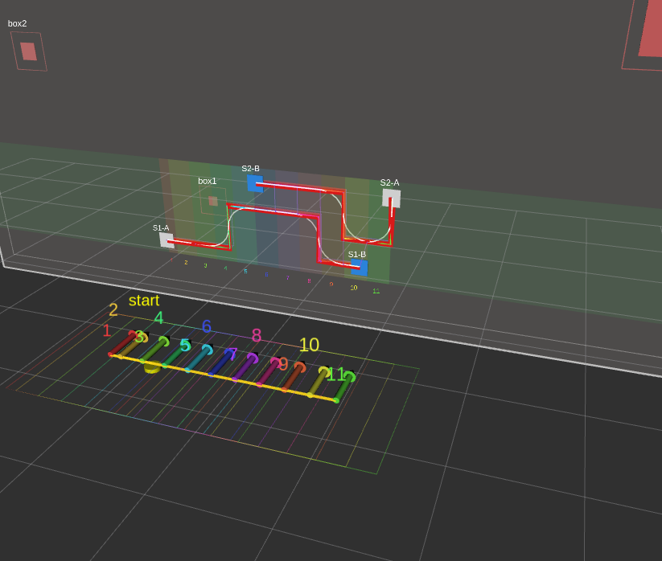

# 开槽可视化与演示

## 问题

开槽规划的输出（槽线、停靠站、每站机械臂可达窗口、访问顺序）和执行结果（刀尖实际轨迹）都是墙面上的几何量，只看数字和日志难以判断规划是否合理、执行是否贴合规划。本部分提供在 RViz 和 Gazebo 中直观检查这些量的工具，并为录制完整演示做准备。

## 方法

工具在 [`src/scr_viz`](../../../src/scr_viz/README.md)，只读取墙面任务 YAML 与规划结果 YAML：

| 工具 | 作用 |
|---|---|
| `plan_viz` | 墙面任务 + 规划结果 → RViz `MarkerArray`；实时画出实际刀尖轨迹 |
| `plan_preview` | 同一份 Marker 几何离线渲染为 PNG（立面图 + 俯视图，中文标签） |
| `spawn_wall_fixtures` | 线盒、插座、开关、配电箱 → 贴墙薄盒 SDF，可在 Gazebo 运行时生成 / 删除 |
| `demo_record` / `make_demo_video` | 固定视角演示相机按仿真时间存帧，合成 MP4 / GIF |

刀尖轨迹由 `/gazebo/link_states` 中 `link4` 的位姿加刀具前伸量推算（与多站执行实验记录器的计算一致），也可以从 `/scr_viz/tool_tip` 话题接收；按离墙距离着色，红色为切割、青色为移动或退刀。墙面实体默认只有外观、没有碰撞体，激光和机械臂都碰不到，因此不影响精对位与切割。

## 结果

### RViz 开槽场景

演示任务为 room3 南墙上的两条槽，墙面另有灯开关和配电箱；规划采用动态规划划分 + 扫掠顺序，共 11 个停靠站。



墙面上：可切高度带（绿）、每站机械臂可达窗口（彩色竖带，下方为站号）、槽线（红，线宽 = 槽宽 35 mm）、导管中心线（白，弯曲半径 12 cm）、已有插座（白）/ 新装线盒（蓝）、障碍物与规范边距轮廓。地面上：停靠站箭头与序号、访问顺序（黄，从定位标记前的起点出发）、底盘轮廓。

同一份 Marker 几何的离线渲染（`plan_preview`）：


### 验证情况

| 项目 | 状态 |
|---|---|
| `plan_viz` + RViz（离线，静态 TF） | 已验证：111 个 Marker，RViz 状态正常，截图如上 |
| 刀尖轨迹（向 `/scr_viz/tool_tip` 手动发点） | 已验证：按离墙距离着色（离墙 12.5 cm 为青色，进入墙面为红色）；`clear_trace` 清空轨迹 |
| 规划 / 任务文件改动后自动重新加载 | 已验证（按文件修改时间检测） |
| 墙面实体与演示相机的 SDF | 已验证：6 个实体和相机的 SDF 均通过 `gz sdf -k`；单元测试检查实体位姿（背面贴墙、朝向） |
| 由 `/gazebo/link_states` 推算刀尖、`--spawn` 运行时生成、演示相机出图 | 未在 Gazebo 中验证 |
| 单元测试 | `colcon test --packages-select scr_viz`：53 项（含 flake8 / pep257），0 失败 |

## 局限

- Gazebo 中的运行时功能（实体生成、演示相机、由真值推算刀尖）尚未在仿真中实际运行验证。
- RViz 的文字只能可靠显示 ASCII，RViz 中的中文标签默认替换为种类 + 序号；中文原名只在 `plan_preview` 中显示。
- 规范边距常量从 `scr_planner/python/wall_rules.py` 复制而来，由单元测试比对；修改规范时需同步。

## 后续工作

在 Gazebo 中完成上表中未验证的项目，并录制完整的多站开槽演示（GIF / MP4）放入 README，见 [路线图](../../ROADMAP.md)。录制流程：

```bash
# 1. 启动仿真
ros2 launch scr_bringup sim_nav.launch.py
# 2. 规划、墙面实体与 RViz
python3 src/scr_planner/scripts/plan_wall_slots.py src/scr_viz/config/wall_task_room3_south_demo.yaml /tmp/plan.yaml
ros2 run scr_viz spawn_wall_fixtures src/scr_viz/config/wall_task_room3_south_demo.yaml --spawn
ros2 launch scr_viz plan_viz.launch.py plan_file:=/tmp/plan.yaml use_sim_time:=true
# 3. 演示相机（每仿真秒 2 帧），同时执行规划
ros2 run scr_viz demo_record --out /tmp/demo_frames --preset oblique --rate 2 --video docs/experiments/demo/slot_demo.mp4
ros2 run scr_arm_controller navigation_cutting_task /tmp/plan.yaml --dry-run-gap=0.01
# 4. 生成 README 用的 GIF
ros2 run scr_viz make_demo_video /tmp/demo_frames docs/experiments/demo/slot_demo.gif --fps 12 --width 480 --every 2
```

由于墙面实体没有碰撞体，执行结果应与不生成实体时一致。

## 复现

离线 RViz 场景与预览图（不需要 Gazebo）：

```bash
ros2 launch scr_viz plan_viz.launch.py static_tf:=true
ros2 run scr_viz plan_preview --task src/scr_viz/config/wall_task_room3_south_demo.yaml \
    --plan src/scr_viz/config/plan_room3_south_demo.yaml --out docs/experiments/demo/plan_viz_preview.png
```

截图方法：GNOME Wayland 下普通截屏工具拿不到画面，但 RViz、gzclient 等 Qt 程序默认走 XWayland，可以直接抓 X 窗口：

```bash
export DISPLAY=:0
xwininfo -root -tree | grep -i rviz          # 找到标题含 “- RViz” 的窗口 id
xwd -silent -id <窗口 id> | convert xwd:- rviz.png
```

上面的 RViz 截图就是这样得到的（裁掉了左侧面板）。
