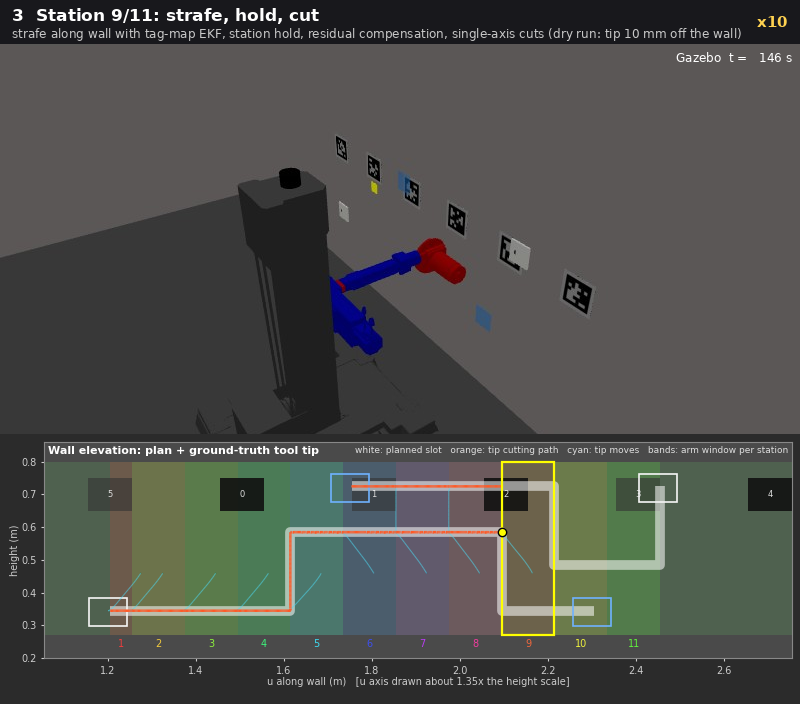
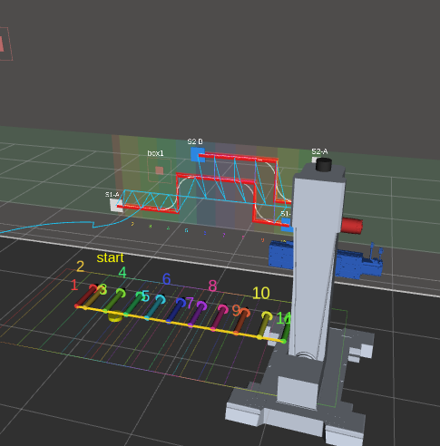
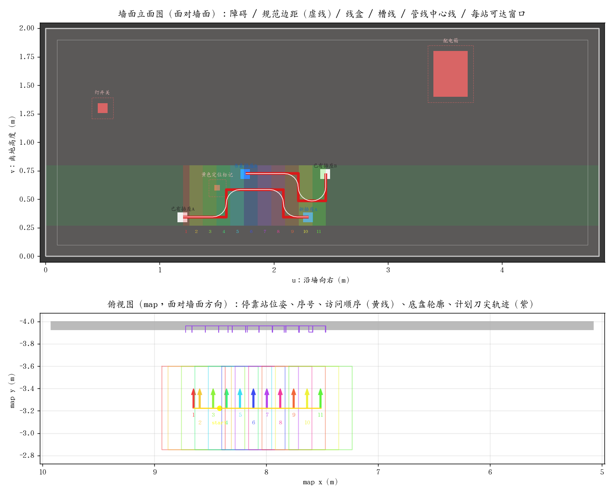

# 开槽可视化与演示


*room3 南墙两条槽的联合规划（11 个停靠站、80 个机械臂点）在 Gazebo 中端到端执行（当前默认配置：每站一条连续轨迹），仿真时间约 200 s，按阶段加速（导航与切割 ×10，精对位 ×4）。上：Gazebo 演示相机；下：导航阶段为占据栅格地图与真值底盘轨迹，之后为墙面立面图（规划槽线、每站机械臂窗口与真值刀尖轨迹）。MP4 版本：[`slot_demo.mp4`](slot_demo.mp4)。*

## 问题

开槽规划的输出（槽线、停靠站、每站机械臂可达窗口、访问顺序）和执行结果（刀尖实际轨迹）都是墙面上的几何量，只看数字和日志难以判断规划是否合理、执行是否贴合规划。本部分提供在 RViz 和 Gazebo 中直观检查这些量的工具，并录制一次完整的多站开槽演示。

## 方法

工具在 [`src/scr_viz`](../../../src/scr_viz/README.md)，只读取墙面任务 YAML 与规划结果 YAML：

| 工具 | 作用 |
|---|---|
| `plan_viz` | 墙面任务 + 规划结果 → RViz `MarkerArray`；实时画出实际刀尖轨迹 |
| `plan_preview` | 同一份 Marker 几何离线渲染为 PNG（立面图 + 俯视图，中文标签） |
| `spawn_wall_fixtures` | 线盒、插座、开关、配电箱 → 贴墙薄盒 SDF，可在 Gazebo 运行时生成 / 删除 |
| `demo_record` / `make_demo_video` | 固定视角演示相机按仿真时间存帧，合成 MP4 / GIF |

刀尖轨迹由 `/gazebo/link_states` 中 `link4` 的位姿加刀具前伸量推算（与多站执行实验记录器的计算一致），也可以从 `/scr_viz/tool_tip` 话题接收；按离墙距离着色，红色为切割、青色为移动或退刀。墙面实体默认只有外观、没有碰撞体，激光和机械臂都碰不到，因此不影响精对位与切割。

演示动画由本目录的两个脚本生成：

- [`make_slot_demo.py`](make_slot_demo.py)：读取一次执行的记录（`tool_trace.csv`、`summary.yaml`）与演示相机帧，逐帧合成。上方为 Gazebo 相机（导航阶段用 `overview` 俯视，到达墙前后用 `oblique`）；下方在导航阶段为占据栅格地图 + 真值底盘轨迹，之后为墙面立面图（与 `plan_viz` 使用同一份墙面几何 `scr_viz.wall_model`，刀尖轨迹为记录器的真值）。按阶段以不同倍速抽帧（仿真时间），GIF 用 ffmpeg 两遍调色板压缩，MP4 用 libx264。
- [`replay_rviz.py`](replay_rviz.py)：用 rosbag2 回放一次执行，`plan_viz` 与 RViz 都用包内的仿真时钟，`plan_viz` 从回放的 `/gazebo/link_states` 推算刀尖轨迹（与在线运行的计算完全相同），按仿真时间截取 RViz 窗口。

在 4 GB 内存的机器上，Gazebo + Nav2 + 任务层 + 两台演示相机 + rosbag2 录制可以同时运行（运行中可用内存约 0.8 GB），RViz 不与仿真同时运行，而是事后回放数据包。

## 结果

### 演示运行

联合规划（[plan_validation](../plan_validation/README.md) 中的 `plans/plan_joint.yaml`），种子 1，当前默认配置（机械臂每站一条连续轨迹，[arm_trajectory](../arm_trajectory/README.md)），另外生成 6 个墙面实体（插座 2、新线盒 2、开关、配电箱）与两台演示相机（Gazebo，n = 1；数据在 [`runs/demo_joint_cont`](../plan_validation/runs/demo_joint_cont/)）：

| 指标 | 结果 |
|---|---|
| 停靠站 | 11 / 11 完成，无恢复，覆盖率 100 % |
| 各站耗时之和 / 总仿真时间 | 162.6 s（时间模型 `traj_v1` 预测 160.9 s）/ 201.3 s |
| 到站沿墙误差最大值（真值） | 1.64 mm |
| 刀尖轨迹误差 平均 / p95 / 最大 | 0.18 / 0.29 / 1.66 mm |

不生成墙面实体、不开演示相机的连续轨迹联合规划运行为 159.9–163.1 s、最大沿墙误差 1.0–2.1 mm（[arm_trajectory](../arm_trajectory/README.md) 的 `cont_joint_s1/s2` 与 [execution_issues](../execution_issues/README.md) 的 `dry_p_joint_s1/s2`，n = 4）；演示运行慢 0–3 s，在这一范围的上沿，实体与相机对执行没有可见的影响。规划文件中记录的预测时间 228.1 s 来自逐点执行的时间模型 `align_v3`。

**此前的版本**：早期录制的演示（机械臂逐点执行，每点 2 s）各站耗时之和 229.0 s（预测 228.1 s）、总仿真时间 268.5 s，到站沿墙误差最大 1.49 mm，刀尖轨迹误差 0.20 / 0.23 / 1.29 mm；数据在 [`runs/demo_joint`](../plan_validation/runs/demo_joint/)。换成连续轨迹后各站耗时之和少 66 s（−29 %），与 arm_trajectory 报告中的 −29.8 % 一致。

| 素材 | 内容 | 大小 |
|---|---|---|
| [`slot_demo.gif`](slot_demo.gif) | 800 × 704，10 帧/s，26.4 s，264 帧 | 2.3 MB |
| [`slot_demo.mp4`](slot_demo.mp4) | 同上，H.264 | 0.4 MB |
| [`demo_nav.png`](demo_nav.png) | 导航阶段 | 42 KB |
| [`demo_align.png`](demo_align.png) | 参考标记处精对位 | 89 KB |
| [`demo_cut.png`](demo_cut.png) | 第 9 站切割 | 97 KB |
| [`rviz_replay_trace.png`](rviz_replay_trace.png) | 回放数据包时 RViz 中的刀尖轨迹（执行结束时；早期逐点执行的演示运行，没有重录） | 59 KB |



*第 9 站：上为 Gazebo 演示相机，下为墙面立面图。白色宽线为规划槽线（宽度示意），橙红为刀尖切割段（空切，刀尖停在墙前 10 mm），青色为刀尖移动，彩色竖带为每站机械臂可达窗口，黄框为当前站，黑色方块为定位标记（地图中的 ID 0 / 2 / 4 颜色较深）。立面图的水平比例约为竖直比例的 1.35 倍。*



*回放早期演示运行（逐点执行）的数据包：`plan_viz` 从 `/gazebo/link_states` 实时累积的刀尖轨迹（红 = 贴墙切割，青 = 移动），与规划槽线、停靠站、访问顺序和机器人模型叠加。*

### RViz 开槽场景（离线）

演示任务为 room3 南墙上的两条槽，墙面另有灯开关和配电箱；规划采用动态规划划分 + 扫掠顺序，共 11 个停靠站。


墙面上：可切高度带（绿）、每站机械臂可达窗口（彩色竖带，下方为站号）、槽线（红，线宽 = 槽宽 35 mm）、导管中心线（白，弯曲半径 12 cm）、已有插座（白）/ 新装线盒（蓝）、障碍物与规范边距轮廓。地面上：停靠站箭头与序号、访问顺序（黄，从定位标记前的起点出发）、底盘轮廓。

同一份 Marker 几何的离线渲染（`plan_preview`）：



### 验证情况

| 项目 | 状态 |
|---|---|
| `plan_viz` + RViz（离线，静态 TF） | 已验证：111 个 Marker，RViz 状态正常 |
| 刀尖轨迹（向 `/scr_viz/tool_tip` 手动发点） | 已验证：按离墙距离着色；`clear_trace` 清空轨迹 |
| 由 `/gazebo/link_states` 推算刀尖 | 已验证（回放演示运行的数据包，`/gazebo/link_states` 20 Hz）：轨迹与规划槽线重合，见上图；未在仿真运行的同时打开 RViz |
| `spawn_wall_fixtures --spawn` | 已验证：运行中的 gzserver 内生成 6 个实体，执行不受影响（见上表）；修复了服务名（见下） |
| 演示相机出图 | 已验证：`overview` 与 `oblique` 两台相机同时出图，每台约 450 帧；修复了话题名（见下） |
| 规划 / 任务文件改动后自动重新加载 | 已验证（按文件修改时间检测） |
| 单元测试 | `colcon test --packages-select scr_viz` 通过（含 flake8 / pep257） |

### 排查：Gazebo 中的两处接口错误

- **实体生成超时**
  - 现象：`spawn_wall_fixtures --spawn` 与 `demo_record` 在运行中的 gzserver 上报“服务 /gazebo/spawn_entity 不可用”。
  - 定位：`ros2 service list` 只有 `/spawn_entity` 与 `/delete_entity`。
  - 根因：`gazebo_ros_factory` 在根命名空间提供服务，没有 `/gazebo` 前缀（与 `gazebo_ros` 的 `spawn_entity.py` 相同）；离线测试只检查了 SDF，没有覆盖服务名。
  - 方案与验证：`gazebo_io.SPAWN_SERVICE / DELETE_SERVICE` 改为 `/spawn_entity`、`/delete_entity`，单元测试固定这两个名字；Gazebo 中 6 个实体与 2 台相机均生成成功。
- **相机没有图像**
  - 现象：相机模型已生成，`demo_record` 在 `/demo_camera/image_raw` 上 30 s 收不到图像。
  - 定位：实际话题为 `/demo_camera/demo_camera/image_raw`。
  - 根因：`gazebo_ros_camera` 把图像发布在 `<插件命名空间>/<camera_name>/image_raw`；SDF 中的 `~/image_raw:=image_raw` 重映射匹配不到这个名字，从未生效。
  - 方案与验证：删除无效的重映射，`sdf_gen.camera_topic()` 给出实际话题，`demo_record` 默认订阅它；单元测试按插件的命名规则检查话题名。

### 排查：演示视角

原 `oblique` 预设（相机在 (6.3, −2.2, 1.6) m）画面左侧约 20 % 被 (7, −2) 处的圆柱设备挡住。把机器人放到横移范围两端（x = 7.45 / 8.75 m）比较了 5 个视角，选定 (6.3, −2.6, 1.8) → (8.1, −3.85, 0.5)：两端刀具与定位标记都不被立柱遮挡，墙面 u 方向在画面中向右，与立面图一致。`overview` 预设改为 7.5 m 高的近似俯视，覆盖起点 (0, 0) 与 room3 南墙。

## 局限

- 演示是空切：刀尖停在墙前 10 mm，Gazebo 中没有材料去除，槽线只在立面图中显示。
- Gazebo 相机渲染跟不上设定帧率（每台设定 4 帧/s，实际约 2.2 帧/s），按仿真时间抽帧后为每仿真秒约 1.6 帧；10 倍速、10 帧/s 的动画中偶有重复帧。
- 俯视相机中机器人较小（约 40 px），导航阶段主要靠下方的地图与轨迹说明。
- RViz 的文字只能可靠显示 ASCII，RViz 中的中文标签默认替换为种类 + 序号；中文原名只在 `plan_preview` 中显示。
- 规范边距常量从 `scr_planner/python/wall_rules.py` 复制而来，由单元测试比对；修改规范时需同步。

## 复现

演示录制（约 6 min 墙钟；仿真隔离在 ROS_DOMAIN_ID 48，结束时清理全部进程。本次录制把模块变量 `DOMAIN` / `MASTER` 改为 49 / `http://localhost:11353`，与同期其他实验一致）：

```bash
source install/setup.bash
# 1. 规划（已提交的 plan_joint.yaml 由此生成，当时的时间模型为 align_v3；演示直接使用该文件）
python3 src/scr_planner/scripts/plan_wall_slots.py src/scr_planner/config/wall_task_room3_south.yaml \
    docs/experiments/plan_validation/plans/plan_joint.yaml --routes=joint --time-model=align_v3
# 2. 仿真 + 墙面实体 + 两台演示相机 + 数据包 + 执行与真值记录
python3 docs/experiments/plan_validation/run_validation.py \
    docs/experiments/plan_validation/plans/plan_joint.yaml docs/experiments/plan_validation/runs/demo_joint_cont \
    --seed 1 --fixtures src/scr_viz/config/wall_task_room3_south_demo.yaml \
    --camera ~/scr_media/demo_frames_cont --presets overview oblique \
    --bag ~/scr_bags/tag_map_val/demo_joint_cont
# 3. 合成 GIF / MP4 / 截图（约 30 s）
python3 docs/experiments/demo/make_slot_demo.py docs/experiments/plan_validation/runs/demo_joint_cont \
    ~/scr_media/demo_frames_cont --task src/scr_viz/config/wall_task_room3_south_demo.yaml \
    --plan docs/experiments/plan_validation/runs/demo_joint_cont/slot_plan.yaml \
    --gif docs/experiments/demo/slot_demo.gif --mp4 docs/experiments/demo/slot_demo.mp4 \
    --stills docs/experiments/demo
# 4. RViz 回放与截图（RViz 窗口出现在桌面上；Wayland 下经 XWayland 用 xwd 截取；
#    现有截图来自早期演示运行的数据包，本次没有重录）
python3 docs/experiments/demo/replay_rviz.py ~/scr_bags/plan_validation/demo_joint \
    --task src/scr_viz/config/wall_task_room3_south_demo.yaml \
    --plan docs/experiments/plan_validation/runs/demo_joint/slot_plan.yaml --out /tmp/rviz --at 60 170 --rate 2
```

手动操作时（不用上面的脚本），各工具可单独运行：

```bash
ros2 launch scr_bringup sim_nav.launch.py
ros2 run scr_viz spawn_wall_fixtures src/scr_viz/config/wall_task_room3_south_demo.yaml --spawn
ros2 run scr_viz demo_record --out /tmp/frames --preset oblique --rate 2 --video /tmp/demo.mp4
ros2 launch scr_viz plan_viz.launch.py plan_file:=<plan.yaml> use_sim_time:=true
ros2 run scr_arm_controller navigation_cutting_task <plan.yaml> --dry-run-gap=0.01
```

离线 RViz 场景与预览图（不需要 Gazebo）：

```bash
ros2 launch scr_viz plan_viz.launch.py static_tf:=true
ros2 run scr_viz plan_preview --task src/scr_viz/config/wall_task_room3_south_demo.yaml \
    --plan src/scr_viz/config/plan_room3_south_demo.yaml --out docs/experiments/demo/plan_viz_preview.png
```

截图方法：GNOME Wayland 下普通截屏工具拿不到画面，但 RViz、gzclient 等 Qt 程序默认走 XWayland，可以直接抓 X 窗口：

```bash
export DISPLAY=:0
xwininfo -root -tree | grep -i rviz          # 找到标题含 “- RViz” 的窗口 id
xwd -silent -id <窗口 id> | convert xwd:- rviz.png
```

原始帧（约 650 张 JPEG）与数据包不提交：帧在 `~/scr_media/demo_frames_cont/`，数据包在 `~/scr_bags/tag_map_val/demo_joint_cont/`（早期录制分别在 `~/scr_media/demo_frames/`、`~/scr_bags/plan_validation/demo_joint/`，约 200 MB，话题含 `/gazebo/link_states`、`/tf`、`/scan`、`/joint_states`、`/ground_truth/odom`、`/task_skills/*`）。
