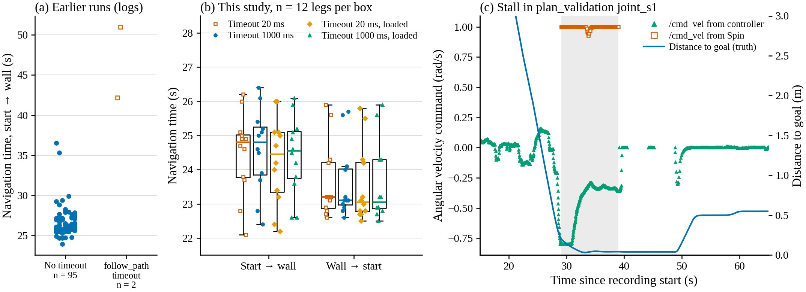
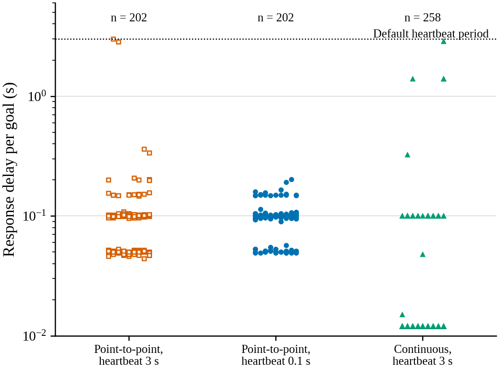
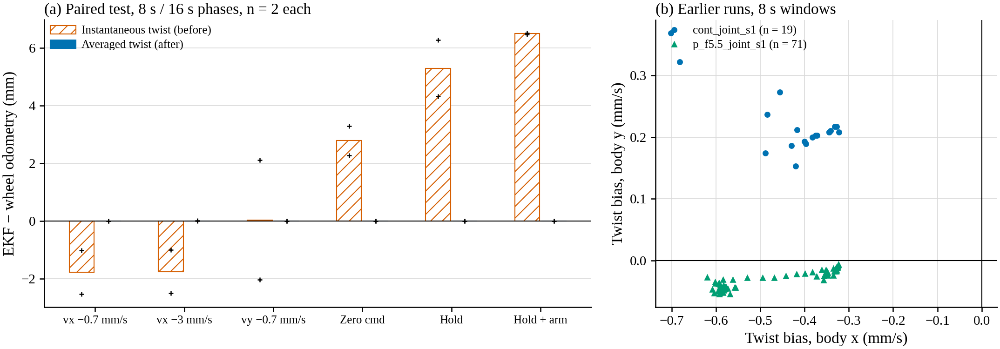
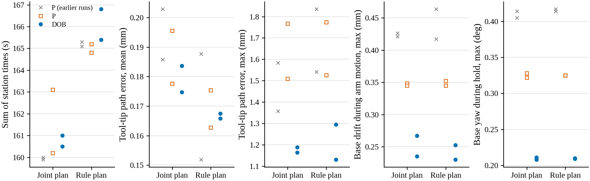

# 执行层遗留问题的排查：导航到达停滞、切割停顿、启动失败、慢速 EKF，以及两项对照

**结论**：四个执行层遗留问题中，两个找到了本仓库内的原因并修正，一个定位到时间花在哪里，一个确认了卡住的位置；两项对照完成。

| 问题 | 结果 | 处理 |
|---|---|---|
| 导航到达前停滞 10–15 s | **原因找到**：bt_navigator 确认目标的时限 20 ms 用仿真时间计，而 `/clock` 0.1 s 一跳，确认跨过一次跳变即被判为超时；控制器其实已接受目标并继续执行，行为树却转入恢复，`Spin` 与这个目标同时发指令。本机历史日志 198 次导航中 5 次出现 `follow_path` 确认超时，其中 4 次随后进入 `Spin`；MPPI 的两次为 42.2 / 51.0 s，无超时的同段导航 23.9–36.5 s（n = 95） | 时限改为 1000 ms；对照 96 段导航（每种配置 24 段）耗时分布不变、修正后 0 次确认超时；停滞本身在对照中未复现（预计频率约 1 %） |
| 切割阶段约 2.7 s 的停顿 | **时间去向已定位**：机械臂控制器按时接受目标、按时完成，是动作的响应晚 1.4–3.0 s 才送达技能服务器；逐点执行时每次运行约一次，连续轨迹（默认）11 次运行中 4 次。晚到量受 DDS 心跳周期控制：心跳由 3 s 改为 0.1 s 后，2 次逐点执行中只有 1 次晚到 114 ms（之前 2 次运行中 2.83 / 3.02 s），即响应样本丢失后在下一次心跳时补发；丢失的原因未查明 | 未改默认配置 |
| Nav2 组件启动失败 | **卡住的位置已确认**：本机日志中 155 次启动唯一的一次失败里，Nav2 组件容器从未处理任何加载请求，而 `launch_ros` 等待 `load_node` 响应没有超时；本节 30 次冷启动（其中 15 次在高负载下）全部正常，未复现 | 未修正 |
| EKF 慢速输出偏小 | **原因找到**：EKF 忠实地积分了底盘控制器发布的 twist，而 twist 是发布那一拍的瞬时速度，与位姿积分不一致，偏差约 0.3–0.5 mm/s | twist 改为两次发布之间的平均速度；配对实验中 EKF − 轮式位姿由 −2.5 至 +6.5 mm 降到 0.02 mm 以内（n = 2 × 6 阶段）。局部闭环仍用轮式里程计（EKF 输出只有 10 Hz） |
| 扰动观测器保持的空切对照 | 4 对运行：各站耗时之和配对差 +0.1 s（扣除两次响应晚到后 +0.5 s，0.3 %），刀尖轨迹误差平均不变、最大值每对都下降（−0.45 mm），底盘漂移 −0.10 mm、偏航峰值 0.33° → 0.21° | 证据支持把 `hold.mode` 默认值改为 `dob`，本报告未改（6.3 节列出尚缺的检查） |
| 单条槽执行精度复测 | 当前默认配置 n = 3：刀尖轨迹误差平均 / 95 分位 / 最大 0.18 / 0.23 / 1.48 mm（仿真配置 v1：1.5 / 12.8 / 15.7 mm，n = 1） | 写入 [slot_execution](../slot_execution/README.md#在当前默认配置上复测) |

全部为 Gazebo 仿真（仿真配置 v2）与本机运行日志；每项的样本量、未验证之处见各节与第 9 节。

## 1. 问题

多站开槽在 Gazebo 中已能稳定完成，但运行记录里有四个一直没有查明原因的现象（[路线图](../../ROADMAP.md) 第 2、4 节），以及两项待做的对照：

1. **导航到达停滞**：Nav2 把底盘送到墙前时，偶尔在目标附近缓慢爬行或静止 10–15 s 才报告到达（[plan_validation](../plan_validation/README.md) 中 `joint_s1` 的导航比其余运行多用约 15 s）。
2. **切割阶段的偶发停顿**：每次运行约一次、约 2.7 s 的停顿（同一报告中 `rule_s1` 第 7 站）。
3. **Nav2 组件偶尔启动失败**：实验脚本加了看门狗与重跑，根因未查明。
4. **EKF 在 mm/s 级慢速运动下输出偏小**：定点保持等局部闭环因此改用原始轮式里程计（[system_modernization](../system_modernization/README.md) 4.5 节）。
5. **扰动观测器作为默认定点保持的空切对照**：切割力实验中扰动观测器明显优于比例保持（[cutting_force](../cutting_force/README.md) 第 10 节），但它在默认的空切任务上是否同样精确、同样快还没有验证。
6. **单条槽执行精度的复测**：[slot_execution](../slot_execution/README.md) 的单条槽数据在仿真配置 v1 上测得。

每一项的做法相同：先在已有记录（运行日志、记录包、提交的实验数据）里找证据，再写最小的复现或插桩实验，原因在本仓库时改掉并给出修改前后的对比；不能复现时记录尝试次数。

## 2. 导航到达停滞

### 2.1 现象与已有记录

在当前导航配置（Smac 2D + MPPI）下提交的 82 次整墙运行（沿墙精度、规划验证、机械臂轨迹、切割力四组实验，每次一段“起点 → 墙前”导航）中，“导航 + 首次精对位”的仿真耗时中位数为 43–44 s，只有 `plan_validation/joint_s1` 一次为 57.7 s，即这种停滞大约每 80 次任务出现 1 次。

`joint_s1` 的记录包（`/cmd_vel`、真值、`/tf`）显示了停滞的过程（图 1(c)，数据由 [`extract_stall_example.py`](extract_stall_example.py) 从记录包提取为 [`stall_example_joint_s1.csv`](stall_example_joint_s1.csv)）：

- 底盘约 29 s 时到达目标附近并开始原地转向（目标朝向与行进方向相差约 120°）；
- 29.1–39.0 s 的 10 s 内，`/cmd_vel` 上同时有两路指令：一路来自控制器（MPPI 经速度平滑器，ω 为 −0.3 至 −0.8 rad/s，带线速度），另一路是线速度为 0、ω = +1.0 rad/s 的纯转动指令，约 5 Hz 交替出现。后者正是 behavior_server 的 `Spin` 恢复行为（`max_rotational_vel` = 1.0），它的时长上限 `time_allowance` 是 10 s；
- 两路指令方向相反，底盘只是缓慢爬行；`Spin` 超时后，控制器也在 39 s 因“无进展”放弃，再等待约 10 s 后重新规划并报告到达。

`Spin` 只应在主导航流程失败之后运行，而控制器只应在主流程中运行，两者同时出现说明行为树认为控制器的目标已经失败，而控制器其实仍在执行它。

### 2.2 定位：确认目标超时

Nav2 Humble 的行为树动作节点（`nav2_behavior_tree::BtActionNode`）发出目标后，按 `node_->now() − time_goal_sent_` 判断服务器是否在 `server_timeout`（`bt_navigator` 的 `default_server_timeout`，本项目为 20 ms）内确认了目标；超时就返回 FAILURE，并丢弃这个目标的句柄。这里的 `now()` 是 bt_navigator 的节点时钟，即仿真时间；而本项目的 `/clock` 每 0.1 s 才发布一次（[arm_trajectory](../arm_trajectory/README.md) 的记录），仿真时间按 0.1 s 跳变。于是：

- 确认过程只要跨过一次 `/clock` 跳变，`elapsed` 就从 0 直接变成 100 ms，大于 20 ms，判为超时——与服务器实际用了多少墙钟时间无关；
- 控制器此时已经接受了目标并在执行。行为树丢弃了句柄，之后既不会再取消它，也不知道它何时结束；
- `FollowPath` 失败两次后主流程失败，行为树进入恢复分支（清代价地图 → `Spin` → `Wait` → `BackUp` 轮流），`Spin` 与这个“无主”的控制器目标同时向 `/cmd_vel` 发指令。

在本机全部历史日志中核对这一点（[`nav_log_scan.py`](nav_log_scan.py) 扫描 ROS 日志目录中 Nav2 组件容器的 166 个日志文件，[`nav_history.csv`](nav_history.csv)，198 次导航，其中 MPPI 118 次、早期的 DWB 80 次）：

| | 导航次数 | 有“确认目标超时”的 | 其中 `follow_path` 超时 | 出现 `Spin` 的 | `Spin` 之前有 `follow_path` / 恢复行为确认超时的 |
|---|---|---|---|---|---|
| MPPI | 118 | 3 | 2 | 2 | 1（另 1 次是起点处于致命代价区、规划连续失败） |
| DWB | 80 | 5 | 3 | 4 | 3（另 1 次无超时） |

- 5 次出现 `follow_path` 确认超时的导航中 4 次随后进入 `Spin`；MPPI 的两次“起点 → 墙前”为 42.2 s 与 51.0 s，同一段导航没有任何超时的 95 次为 23.9–36.5 s（中位数 25.8 s，图 1(a)）；
- 超时之后，日志中控制器没有收到新目标，却在之后报告 “Reached the goal!” 或 “Failed to make progress”——即被丢弃的那个目标一直在执行；
- 与 `joint_s1` 时间线相同的模式（`follow_path` 超时 → `Running spin` → “Exceeded time allowance before reaching the Spin goal” → 控制器到达或无进展 → 重新发目标 → 成功）在日志中出现了 4 次。

**根因**：bt_navigator 的确认时限（20 ms）比仿真时钟的分辨率（100 ms）还小，确认目标是否“超时”取决于 `/clock` 恰好在确认的那几毫秒内跳变与否。负载越高、确认越慢，跳变落在其中的概率越大，这与停滞只是偶发、且多出现在机器负载高的批量实验中一致。

**修正**：`default_server_timeout` 由 20 ms 改为 1000 ms（10 个 `/clock` 周期，[`nav2_params.yaml`](../../../src/scr_navigation/config/nav2_params.yaml)；对比基线 `nav2_params_dwb.yaml` 同步修改，两份文件除规划器与控制器外保持一致）。服务器真的没有响应时，行为树最多晚 1 s 发现，这对导航段没有影响。任务层执行器自己的行为树（`task_executor.yaml`）原本就是 2000 ms，不受此问题影响。

### 2.3 修正前后的对照

[`nav_legs.py`](nav_legs.py) 启动整套仿真（含任务层，但不执行任务），在起点与 room3 南墙标记前的导航目标（与多站任务的 `NavigateToMarker` 相同，需要转向约 90°）之间往返 6 次（12 段），每段记录 `/cmd_vel`、控制器输出 `/cmd_vel_nav`、行为树事件、Nav2 日志、AMCL 位姿与真值。两个编码器打滑种子（1、2），修正前后用相同的种子与相同的导航段；另以“导航期间另开 3 个占满一核的忙循环”作为高负载条件。

| 配置 | 段数 | 成功 | 耗时 平均 / 中位数 / 最大 | 确认目标超时 | 恢复 | `Spin` |
|---|---|---|---|---|---|---|
| 20 ms（修正前） | 24 | 24 | 24.06 / 24.0 / 26.2 s | 0 | 0 | 0 |
| 1000 ms（修正后） | 24 | 24 | 24.10 / 24.0 / 26.4 s | 0 | 0 | 0 |
| 20 ms，高负载 | 24 | 24 | 23.91 / 23.7 / 26.0 s | 1 | 1 | 0 |
| 1000 ms，高负载 | 24 | 24 | 24.01 / 24.0 / 26.1 s | 0 | 0 | 0 |

（Gazebo，仿真时间；每种配置 2 个种子 × 12 段。修正前后同一段的配对差：正常负载 +0.03 ± 0.22 s，高负载 +0.10 ± 0.31 s，n = 24。）



*图 1：(a) 本机历史日志中 MPPI 导航“起点 → 墙前”的耗时，按是否出现 `follow_path` 确认超时分组（n = 95 / 2）；(b) 本节对照实验每段导航的耗时，四种配置各 24 段（每个箱 12 段）；(c) `plan_validation/joint_s1` 中停滞的时间线：三角为控制器经速度平滑器发出的角速度指令，方块为 `Spin` 的纯转动指令（灰色区间），蓝线为底盘到导航目标的真值距离（右轴）。*

结果说明三点：

1. **对照实验没有复现停滞。** 96 段导航中只出现 1 次确认超时（高负载、修正前），被 `FollowPath` 的一次重试吸收，没有进入 `Spin`。按历史日志的频率（MPPI 118 次导航中 2 次 `follow_path` 超时），96 段中预计 1–2 次超时，与观测一致；停滞需要连续两次超时，预计不到 1 次。因此**修正前后到达时间分布相同是预期的结果，它只说明修正没有带来副作用，不能单独证明修正消除了停滞**；修正有效的依据是 2.2 节的机理与日志证据：1000 ms 的时限下，确认需要跨过 10 次 `/clock` 跳变才会被判为超时。
2. **注入故障的尝试没有成功**：为了提高超时的发生率，试过把 Nav2 组件容器与 2 个忙循环固定在同一个核上（4 段，0 次超时），以及在导航期间随机暂停整个 Nav2 组件容器 30 ms（3 段，0 次超时）。前者无效的原因推测是 Linux 调度器优先唤醒等待中的线程，确认延迟仍在毫秒以下（没有测量）；后者无效是因为 bt_navigator 与控制器在同一个进程里，暂停会同时冻结发送方与接收方。两组数据没有保留（未完成 12 段）。
3. **停滞还带来了定位误差**：`joint_s1` 中停滞结束、重新规划后底盘又移动了约 0.5 m，最终离导航目标 0.53 m（真值），此时 map → odom 相对开始时偏了约 0.45 m——在墙前原地反复转向期间 AMCL 发生了跳变。本节 96 段导航中，map 系定位估计与真值之差在导航过程中最大 0.35 m、导航结束时最大 0.21 m，终点真值误差最大 0.30 m（目标容差 0.25 m）；进入墙前精对位后由激光与标记消除。AMCL 在墙前转向时的跳变没有单独研究。

## 3. 切割阶段的偶发停顿

### 3.1 此前记录中的分布

[`pause_history.py`](pause_history.py) 用此前提交的逐站记录计算每站 `CutStation` 的额外耗时（[`pause_history.csv`](pause_history.csv)）：

| 执行方式 | 运行 | 停靠站 | 机械臂轨迹目标 | 额外 > 0.5 s 的站 | 最大 |
|---|---|---|---|---|---|
| 逐点执行（每点一个 2 s 的目标） | 46 | 515 | 4152 | 16 | +2.72 s |
| 连续轨迹（每站一个目标，当前默认） | 26 | 286 | 286 | 0 | +0.18 s |

（逐点执行：额外耗时 = 实测 − (1.02 s + 2.029 s × 点数)，系数来自 [plan_validation](../plan_validation/README.md) 的回归；连续轨迹：实测 − 轨迹名义时长 − 全部站的中位数。只计仿真配置 v2 之后的运行。）

逐点执行中超过 0.5 s 的额外耗时集中在两个量级：约 +1 s（0.85–1.72 s，14 站）与约 +2.7 s（2 站，即 plan_validation 中的 `rule_s1`）。连续轨迹的 286 站中一次也没有。

### 3.2 插桩：时间花在动作响应的送达上

技能服务器对每个轨迹目标记一行计时（发送 → 被接受 → 收到结果，墙钟），与机械臂控制器（`joint_trajectory_controller`）自己的日志 “Received / Accepted new action goal” 按墙钟对齐（[`pause_timing.py`](pause_timing.py)）。用逐点执行跑两次规则路线（种子 1、2，每次 101 个目标，[`goal_timing_p2p.csv`](goal_timing_p2p.csv)）：

| | 目标数 | 控制器收到目标（相对发送） | 客户端收到“已接受”（相对发送） | 额外耗时 > 0.3 s |
|---|---|---|---|---|
| `p2p_rule_s1` | 101 | ≤ 4 ms（全部） | 中位数 3 ms；1 次 337 ms，1 次 **2831 ms** | 1（+0.78 s） |
| `p2p_rule_s2` | 101 | ≤ 4 ms（全部） | 中位数 4 ms；1 次 **3015 ms** | 1（+0.91 s） |

两次停顿的过程相同。以 `p2p_rule_s1` 第 56 个目标为例：控制器在发送后 1 ms 收到并接受目标，按时执行，2.05 s 后报告 “Goal reached”；Python 客户端却在发送后 2.83 s 才收到“已接受”，1 ms 后收到结果。也就是说：

- **控制器没有耽搁**：202 个目标中，控制器收到目标都在 4 ms 以内，到达后立即返回结果（被接受到收到结果的墙钟时间全部 ≤ 2.2 s）。因此此前怀疑的“控制器等待关节速度降到 `stopped_velocity_tolerance` 以下”在这两次运行中不是原因（静止时 Gazebo 报告的关节速度确有约 0.01–0.25 的噪声，`demo_joint` 记录包中一次 0.77 s 的静止期内 joint4 有 87 % 的样本超过 0.01 rad/s，但控制器的计时显示它没有因此等待）；
- **时间丢在响应送达客户端的路上**：响应晚到约 3 s，然后“已接受”与结果几乎同时到达；
- **停顿的大小由晚到的是哪条响应决定**：轨迹在控制器侧照常执行，“已接受”晚到 3 s 时，2 s 的点只多出约 1 s（+0.78、+0.91 s，与历史上 14 站的约 +1 s 一致）；若晚到的是结果，整整多约 3 s（历史上的 +2.65、+2.72 s 推测属于这一种，当时没有计时日志）；
- **连续轨迹并非不受影响**：每站一个 5–20 s 的轨迹，轨迹起点写在目标的时间戳里，“已接受”晚到会被轨迹执行时间覆盖；但结果晚到同样直接加到耗时上。本报告第 6、7 节的 11 次连续轨迹运行（258 个目标，[`goal_timing_dry.csv`](goal_timing_dry.csv)）中结果晚到 4 次：1 次是站轨迹的结果晚到 3.03 s（`dry_p_joint_s2` 第 6 站，该站多用 2.9 s），3 次是站后 1.5 s 缩回动作的结果晚到 1.43 s（三次相同）；另有 1 次“已接受”晚到 0.32 s，未增加耗时。此前 286 站的统计（3.1 节）中连续轨迹没有超过 0.5 s 的站，因为那里只统计 `CutStation` 内的站轨迹，缩回动作不在其中。

晚到的时间有明显的规律：逐点执行中“已接受”晚到 2.83 / 3.02 s，站轨迹的结果晚到 3.03 s，站后缩回的结果晚到 1.43 s——缩回的结果在站轨迹结果之后约 1.55 s 写出，1.55 + 1.43 ≈ 3.0 s。全部落在 3 s 以内，且以 3 s 为界。Fast DDS 中可靠写端的默认心跳周期正是 3 s：一个样本没有送达时，要等写端的下一次心跳、读端回复 NACK 后才重传。这与“响应样本丢失、在下一次心跳时补发”一致，但单凭时间规律还不能确定。

### 3.3 验证：缩短心跳周期

若晚到确实是“样本丢失、等下一次心跳补发”，把可靠写端的心跳周期缩短，晚到的量级应随之缩短。用 Fast DDS 配置文件 [`fastdds_heartbeat_100ms.xml`](fastdds_heartbeat_100ms.xml)（全部写端的默认心跳周期 3 s → 0.1 s，以 `FASTRTPS_DEFAULT_PROFILES_FILE` 传给启动的全部进程，`run_full_wall.py --fastdds-profile`）重跑同样的两次逐点执行：

| | 运行 × 目标 | 晚到的“已接受” | 结果相对名义时长的墙钟延迟 最大 | 各站耗时之和 |
|---|---|---|---|---|
| 默认心跳 3 s | 2 × 101 | 0.34 s、2.83 s、3.02 s | 0.36 s | 244.3 / 245.7 s |
| 心跳 0.1 s | 2 × 101 | 0.114 s（1 次） | 0.20 s | 244.6 / 244.4 s |

（Gazebo，规则路线，种子 1、2，逐点执行；[`goal_timing_p2p.csv`](goal_timing_p2p.csv)。）



*图 2：每个机械臂轨迹目标的响应延迟（“发送 → 已接受”与“结果晚于名义结束”两者中较大的一个；逐点执行取墙钟，连续轨迹取仿真时间，小于 12 ms 的画在 12 ms 处）。0.05 s 一档的分层来自机械臂控制器以 20 Hz 检查并返回结果；点线为 Fast DDS 默认的心跳周期 3 s。左、中：同样的两次逐点执行，心跳 3 s 与 0.1 s；右：本报告第 6、7 节的 11 次连续轨迹运行。*

心跳 0.1 s 时仍出现了 1 次晚到，签名与之前相同（控制器在发送后立即接受，客户端晚收到“已接受”），但只晚了 114 ms，约一个心跳周期。这支持“响应样本丢失、在下一次心跳时补发”的解释：晚到的量级由心跳周期决定，而不是由控制器或任务层决定。

**仍不清楚的是样本为什么丢失。** 本机 `net.core.rmem_max` 为默认的 212 KB，开机以来的 `UdpRcvbufErrors` 为 104942，前视相机以 30 Hz 发布 640 × 480 RGB 图像（约 0.9 MB，超出 Fast DDS 共享内存段的默认大小，走 UDP），这些都是本地丢包的常见来源；但在一次逐点执行的后半段与之后全部运行中逐进程采样 UDP 丢包（[`udp_drops.py`](udp_drops.py)，每 2 s），整机计数没有增加，只有 Nav2 组件容器的套接字记到 2 个丢包。因此丢包的位置（UDP 缓冲、共享内存端口队列或其他）没有确定。


### 3.4 结论

- 停顿的时间花在机械臂动作的响应从控制器（Gazebo 进程）送达技能服务器（Python 进程）的过程中，控制器本身与任务层逻辑没有耽搁；晚到量随 DDS 可靠写端的心跳周期变化（3 s → 晚到 ≤ 3 s；0.1 s → 114 ms），即响应样本丢失后在下一次心跳时补发。
- 逐点执行（保留为基线）每次运行约出现一次（每次约 +1 s 或 +3 s）；当前默认的连续轨迹执行中“已接受”晚到被轨迹覆盖，但结果晚到仍会使一站多用至多约 3 s（本报告 11 次运行中 4 次）。
- 本仓库**没有**为此修改默认配置。缩短心跳周期的配置文件是现成的候选修正，但只有 2 + 2 次运行的证据，它对全部 DDS 流量（心跳报文增加约 30 倍）、CPU 与导航的影响没有测量；样本丢失本身的原因也没有查明。

## 4. Nav2 组件启动失败

### 4.1 已有记录中的失败

[plan_validation](../plan_validation/README.md) 4.4 节记录过一次：Nav2 组件没有加载，行为树执行器等待依赖 300 s 后退出。本机 ROS 日志目录中保留了每次启动的行为树执行器日志（[`startup_log_scan.py`](startup_log_scan.py)，[`startup_history.csv`](startup_history.csv)，含本节的运行）：共 155 次启动，150 次正常激活，1 次即上述失败（“Dependencies did not come up”），另 4 次在启动途中被结束（日志没有结论，不计）。150 次正常启动中，Nav2 组件容器的日志都有 10 行 “Load Library”；失败那次为 0 行。

失败那次的启动日志与 Nav2 组件容器的日志说明了它卡在哪里：

- 组件容器进程（`component_container_isolated`）正常启动，但它自己的日志是**空的**——一次 “Load Library” 都没有，即它从未处理过任何加载请求；正常启动时，容器在启动后约 1 s 内依次加载 `map_server`、`amcl` 等 11 个组件（日志中 10 行 “Load Library”）。
- 启动文件中没有任何 “Loaded node” 行，也没有进程退出；300 s 后只有行为树执行器因等不到 Nav2 而退出。
- `launch_ros` 的 `LoadComposableNodes`（Humble）对每个组件先 `wait_for_service`，再异步调用 `load_node` 并**无限期**等待响应（`load_composable_nodes.py` 的 `_load_node`，只在启动被关闭时放弃）；组件按顺序加载，第一个请求没有回应，后面的都不会发出。

**根因（证据与推断）**：第一次 `load_node` 请求没有到达容器，或容器的响应没有回到启动进程，而启动进程没有超时与重试。`wait_for_service` 返回只说明客户端已发现服务端，不保证服务端也已发现客户端的请求写端；服务端尚未匹配时发出的请求（可靠、易失性）会被丢弃。这类发现阶段的竞态是 DDS 上服务调用的已知风险，负载高时发现更慢、窗口更大。这一步是推断：日志能证明容器没有处理任何请求，但不能区分“请求丢失”与“请求送达而容器卡住”。

### 4.2 冷启动试验

[`cold_start.py`](cold_start.py) 反复启动整套仿真（Gazebo + Nav2 + 任务层，默认参数），等行为树执行器激活（上限 180 s），再观察 15 s 是否有进程退出，然后结束全部进程；未就绪时记录组件容器中实际存在的组件、节点列表与启动日志摘录。

| 条件 | 启动次数 | 就绪 | 就绪用时 | 就绪后进程退出 |
|---|---|---|---|---|
| 默认 | 15 | 15 | 26–27 s | 0 |
| 启动期间另开 3 个占满一核的忙循环 | 15 | 15 | 26–29 s | 0 |

（墙钟时间；[`runs/cold_start_default/cold_starts.csv`](runs/cold_start_default/cold_starts.csv)、[`runs/cold_start_stress/cold_starts.csv`](runs/cold_start_stress/cold_starts.csv)。）

**30 次冷启动没有复现失败。** 按历史频率（约 1 / 150），30 次中出现失败的概率约 18 %，这一结果与历史频率并不矛盾；高负载也没有明显提高失败率（15 次，0 次失败）。因此无法在本机给出修正前后的失败次数对比。

### 4.3 结论与处理

- **能确定的**：失败时 Nav2 组件容器一次加载都没有执行，启动进程在等第一个 `load_node` 的响应且没有超时；任务层的执行器在 300 s 后放弃。问题出在 Nav2 的启动方式（`nav2_bringup` 的组件加载）与 DDS 服务调用之间，不在本项目的节点里。
- **不能确定的**：请求是没送达，还是送达了但容器没有处理；两者在现有日志中无法区分，且 30 次试验没有复现。
- **没有修改默认配置**。可选的规避方式各有代价，都没有验证：`use_composition:=False` 不经过 `load_node`，但 [使用指南 10.11](../../USER_GUIDE.md#1011-nav2-停在生命周期配置阶段) 记录了这种方式偶尔停在生命周期配置阶段；在启动文件中为组件加载加超时与重试需要替换 `nav2_bringup` 的加载方式。实验脚本中已有的看门狗（就绪超时即整次重跑，记录在 `startup_failures.txt`）仍然保留，本报告的运行中没有触发。

## 5. EKF 在慢速运动下的偏差

### 5.1 现象

[system_modernization](../system_modernization/README.md) 4.5 节记录：定点保持期间 13 s 内真值与轮式里程计都移动了 −9.4 mm，robot_localization 的 `/odom` 只变了 +0.1 mm；以 −0.7 mm/s 开环驱动 8 s，真值 / 轮式里程计 / EKF 为 −5.5 / −5.5 / −0.2 mm。此后定点保持、横移等局部闭环改用 `/wheel/odom`。EKF 只融合轮式里程计的 twist（vx, vy）与陀螺的 ωz，不融合位姿。

### 5.2 定位：EKF 忠实地积分了有偏的 twist

[`odom_bag_check.py`](odom_bag_check.py) 在此前两次运行的记录包中，以 8 s 为窗口（步长 4 s）比较真值、`/wheel/odom` 的位姿、`/wheel/odom` 的 twist 按消息时间戳的积分、EKF `/odom` 四者的位移，只取真值位移 < 20 mm 的慢速窗口：

| 记录包 | 窗口数 | twist 相对位姿差分速度的偏差（机体系 x / y） | EKF − twist 积分 | 轮式位姿 − 真值 |
|---|---|---|---|---|
| `arm_trajectory/cont_joint_s1`（空切，比例保持） | 19 | −0.42 ± 0.11 / +0.22 ± 0.05 mm/s | −0.22 ± 0.62 mm | 平均 0.09 mm，最大 0.61 mm |
| `cutting_force/p_f5.5_joint_s1`（带切割力，比例保持） | 71 | −0.49 ± 0.12 / −0.03 ± 0.01 mm/s | −0.01 ± 0.11 mm | 平均 0.08 mm，最大 0.92 mm |

（数据：[`odom_bag/`](odom_bag/)。EKF 与 twist 积分的差在 0.6 mm 以内，轮式位姿与真值一致，偏差全在 twist 与位姿之间。）

也就是说，**EKF 没有问题，它融合的 twist 与同一条消息里的位姿不一致**：每 8 s 差 3–5 mm，约 0.4–0.5 mm/s，正是此前观察到的量级。原因在底盘控制器（`scr_base_control/MecanumDriveController`）：它每个控制周期（1 kHz）由轮速算出机体速度并积分位姿，但每 20 ms 发布一次里程计时，twist 填的是**发布这一拍的瞬时速度**。只要速度里有与 50 Hz 发布同相位的周期分量，按发布时刻采样就得到一个常值偏差，而位姿积分不受影响。

**修正**：twist 改为两次发布之间的平均速度（`TwistAverager`，twist × 周期 = 这段时间的位移），参数 `average_twist`（默认 true，运行中可切换）保留原行为用于对照；单元测试构造了与发布同相位的速度波动，检查平均值等于位移、瞬时采样有偏。

### 5.3 最小复现与修正前后对照

[`odom_slow.py`](odom_slow.py) 只启动 Gazebo（底盘 ros2_control + 编码器误差模型 + EKF，不启动 Nav2 与任务层），按固定序列驱动底盘：−0.7 / −3 mm/s 的 vx、−0.7 mm/s 的 vy 开环各 8 s，零指令 8 s，比例定点保持 16 s（与 `BaseHold` 一样由每条 `/wheel/odom` 触发），定点保持同时机械臂以 2 s 周期往复 16 s。整个序列先以 `average_twist = false`（修正前）、再以 `true`（修正后）各跑 2 遍，同一次启动内配对。



*图 3：(a) 各阶段 EKF 位移减去轮式里程计位姿位移（有指令时取沿指令方向的分量，无指令时取位移的模；柱为 2 遍的平均，十字为单次）；修正后的柱高为 0（十字都在 0 附近）。(b) 此前两次运行中 twist 相对位姿差分速度的偏差，每点一个 8 s 窗口。*

| 阶段 | 真值位移 | EKF − 轮式位姿，修正前 | 修正后 |
|---|---|---|---|
| vx −0.7 mm/s，8 s | 5.58 mm | −1.02 / −2.53 mm | −0.01 / +0.00 mm |
| vx −3 mm/s，8 s | 23.96 mm | −1.01 / −2.51 mm | −0.00 / +0.01 mm |
| vy −0.7 mm/s，8 s | 5.57 mm | −2.04 / +2.11 mm | −0.01 / +0.00 mm |
| 零指令，8 s | 0.005 mm | +2.28 / +3.29 mm | +0.00 / +0.00 mm |
| 定点保持，16 s | 0.01 mm | +4.31 / +6.26 mm | +0.00 / +0.00 mm |
| 定点保持 + 机械臂往复，16 s | 0.10 mm | +6.51 / +6.46 mm | +0.00 / +0.00 mm |

（Gazebo，n = 2 遍 / 阶段，种子 1；[`runs/odom_slow/phases.csv`](runs/odom_slow/phases.csv)、[`odom_summary.csv`](odom_summary.csv)。轮式位姿与真值之差在所有阶段都在 0.2 mm 以内，其中 vy 的 +0.2 mm 是编码器模型的横向打滑 3 %。）

- 修正前，零指令下真值不动（< 0.01 mm），EKF 却在 8 s 内走了 2.3–3.3 mm；慢速开环时 EKF 的位移可能偏小也可能偏大（vy 的两遍为 −2.0 与 +2.1 mm）。这是一个大小约 0.3–0.4 mm/s、方向不定的速度偏差，而不是滤波器的“慢”：它在 3 mm/s 时同样存在（−1.0 / −2.5 mm），只是相对位移小了，此前报告中“−3 mm/s 时 EKF 为 −18.5 mm”的偏小比例因而低于 −0.7 mm/s 时。
- 修正后六个阶段 EKF 与轮式位姿之差都在 0.02 mm 以内。
- **未查明**：零指令、底盘不动时，按发布时刻采样的速度平均值为什么不为零，即仿真中这一与发布同相位的速度分量从哪里来（底盘被控对象由位姿差分得到速度、每个物理步施加速度闭环的力，二者与 20 ms 的发布节拍如何同步，没有继续查）。真实底盘的编码器速度没有这种同步关系，但“只发布瞬时速度”的写法在真实控制器上同样会把与发布同步的扰动（例如由里程计消息触发的定点保持指令）变成偏差，平均值的写法对两者都成立。

### 5.4 局部闭环能否改回 EKF

精度上已经可以：修正后 EKF 与轮式位姿在 mm/s 级运动下一致。但本项目没有改回，原因是**更新率**：仿真中 EKF 的 `/odom` 实际以 10 Hz 发布（`p_f5.5_joint_s1` 记录包中 340 s 内 3402 条；配置的 50 Hz 受 10 Hz 的 `/clock` 限制），而定点保持由每条里程计消息触发、按 50 Hz 整定。改回 EKF 会把保持回路降到 10 Hz，这一点没有在 Gazebo 中验证。局部闭环继续用 `/wheel/odom`（短时与真值一致，见上表），EKF 服务于导航。

## 6. 扰动观测器定点保持的空切对照

### 6.1 设置

默认空切任务（room3 南墙，联合规划与规则路线 × 种子 1、2，11 个停靠站），只把技能服务器的 `hold.mode` 由默认的 `p` 改为 `dob`，其余全部取默认值：不加载切割力插件、底盘限幅取默认（`hold.max_lin` 0.1 m/s、`hold.max_ang` 0.5 rad/s，`base_max_ang_accel` 为插件默认）、`arm_motion.yaml` 默认（连续轨迹，进给 0.05 m/s）、观测器带宽取默认 40 rad/s。对照组是同一版本代码上 `hold.mode = p` 的 4 次运行（同规划、同种子），另列出 [arm_trajectory](../arm_trajectory/README.md) 中此前的 `cont_*` 4 次运行（同为 `p`，但在定点保持改为“由里程计消息驱动”之前测得，见 [cutting_force](../cutting_force/README.md) 第 10 节）。评估用 `arm_trajectory/make_report.py` 的同一套函数（[`analyze_dob.py`](analyze_dob.py)）。

[`run_full_wall.py`](run_full_wall.py) `--hold dob`；数据：[`runs/dry_dob_*`](runs/)、[`runs/dry_p_*`](runs/)、[`dob_runs.csv`](dob_runs.csv)。

### 6.2 结果

| 指标 | `dob`（n = 4） | `p`（同版本，n = 4） | 配对差 `dob − p` | `p`（此前，n = 4） |
|---|---|---|---|---|
| 各站耗时之和 | 160.5–166.8 s | 160.2–165.2 s | +0.1 s（−2.6 至 +2.0） | 159.9–165.3 s |
| 刀尖轨迹误差 平均 | 0.166–0.184 mm | 0.163–0.196 mm | −0.005 mm | 0.152–0.203 mm |
| 刀尖轨迹误差 最大 | 1.13–1.30 mm | 1.51–1.77 mm | **−0.45 mm**（−0.64 至 −0.23） | 1.36–1.83 mm |
| 切割段内横向偏差 最大 | 0.048–0.063 mm | 0.048–0.053 mm | +0.004 mm | 0.137–0.153 mm |
| 机械臂运动期间底盘漂移 最大 | 0.23–0.27 mm | 0.35 mm | **−0.10 mm** | 0.42–0.46 mm |
| 定点保持期间底盘漂移 最大 | 0.25–0.28 mm | 0.37–0.41 mm | −0.12 mm | 0.45–0.49 mm |
| 定点保持期间底盘偏航 最大 | 0.21° | 0.32–0.33° | **−0.12°** | 0.41° |
| 到站沿墙误差 最大 | 1.04–1.86 mm | 1.04–1.88 mm | −0.04 mm | 1.07–2.11 mm |
| 覆盖率 / 完成站数 / 恢复 | 100 % / 11 / 0 | 100 % / 11 / 0 | — | 100 % / 11 / 0 |

（Gazebo，仿真时间，空切；“配对差”为同规划同种子的 4 对之差的平均（括号内为范围）。）



*图 4：默认空切任务中各项指标（每点一次运行；叉：此前的比例保持运行，方块：同版本代码的比例保持，圆点：扰动观测器）。*

- **耗时基本不变**：各站耗时之和的配对差平均 +0.1 s，两个极端值来自第 3 节的动作响应晚到，与控制律无关（`p` 联合规划种子 2 的第 6 站结果晚到 2.9 s，`dob` 规则路线种子 1 一次退刀的结果晚到 1.4 s，[`goal_timing_dry.csv`](goal_timing_dry.csv)）。扣除这两次后，`dob` 每次运行都略慢 0.2–0.8 s（平均 +0.5 s，0.3 %），主要在到站阶段（各站横移与收敛之和多 0.2–0.5 s）。
- **精度相同或略好**：刀尖轨迹误差的平均值不变（它主要由到站沿墙误差决定，与保持控制律无关）；最大值在 4 对中都下降，底盘在机械臂运动期间的漂移与偏航峰值分别下降约 0.1 mm 与 0.12°。切割段内横向偏差在两者中都约 0.05 mm。
- 同为比例保持，本节的运行比此前的 `cont_*` 漂移小（0.35 对 0.42–0.46 mm）、切割段内横向偏差小（0.05 对 0.14–0.15 mm），对应定点保持改为由里程计消息驱动（此前由 10 Hz `/clock` 下成批触发的定时器驱动）之后的变化；两组之间还相差本节的底盘里程计 twist 修正，但定点保持只用里程计的位姿，不受后者影响。

### 6.3 能否把默认值改为 `dob`

现有证据支持改：空切任务上耗时只多约 0.3 %、精度不差（4 对运行中每一对的最大轨迹误差、底盘漂移与偏航都更小），带切割力时它是唯一让槽线覆盖率达到 100 % 的控制律（[cutting_force](../cutting_force/README.md) 第 10 节）。但本节**没有改默认值**，改之前还应补上：

- 样本只有一面墙、两份规划、各 2 个种子（n = 4 对）；
- 默认空切任务只覆盖多站流程的 `HoldBase`，单站任务（`cutting_task.xml`）与精对位、示教零位中调用定点保持的路径没有在 `dob` 下运行；
- `dob` 的参数（观测器带宽、延迟步数、质量 / 惯量）按力控底盘整定，`plant:=wheels` 被控对象上没有试。

## 7. 单条槽执行精度的复测

[slot_execution](../slot_execution/README.md) 中单条槽（room3 南墙第一个任务，1.58 m，10 个停靠站）的“直角折线 + 定点保持 + 补偿”结果在仿真配置 v1 上测得（平均 / 95 分位 / 最大偏差 1.5 / 12.8 / 15.7 mm，n = 1）。用当前的规划器重新规划同一个任务（槽线与 10 个停靠站完全相同，[`plans/`](plans/)），在当前默认配置上执行 3 次（种子 1–3）：刀尖轨迹误差 0.16–0.20 / 0.20–0.28 / 1.45–1.50 mm，到站沿墙误差最大 1.35–1.51 mm（早期 17.0 mm），切割期间底盘漂移最大 0.36–0.39 mm（早期 5.0 mm），覆盖率 100 %，各站耗时之和 115.6–117.3 s（预测 117.0 s）。完整的新旧对比与说明写在 [slot_execution](../slot_execution/README.md#在当前默认配置上复测) 中；早期表格里的圆弧拐角与“底盘不保持”两种版本在当前代码中已不存在，没有复测。

## 8. 默认配置的变化

| 改动 | 文件 | 原因 | 验证 |
|---|---|---|---|
| bt_navigator `default_server_timeout` 20 → 1000 ms | `scr_navigation/config/nav2_params.yaml`、`nav2_params_dwb.yaml` | 仿真时钟 0.1 s 一跳，20 ms 的确认时限使控制器目标被误判为失败，恢复行为与仍在执行的控制器冲突（第 2 节） | 历史日志 198 次导航中的机理证据；对照 96 段导航（修正前后各 48 段）耗时分布相同、修正后 0 次确认超时；停滞本身在对照中未复现 |
| 底盘控制器里程计的 twist 改为两次发布之间的平均速度（参数 `average_twist`，默认 true） | `scr_base_control` | 瞬时速度采样有偏，EKF 融合后在慢速下偏差约 0.3–0.5 mm/s（第 5 节） | 同一次启动内配对：EKF − 轮式位姿由 −2.5 至 +6.5 mm 降到 0.02 mm 以内（6 个阶段 × 2 遍）；单元测试 |
| 机械臂轨迹目标的计时日志 | `scr_arm_controller`（`cartesian_cutting.py`、`task_skills.py`） | 定位切割阶段的停顿（第 3 节） | 只加日志，行为不变 |

没有改的默认值：`hold.mode` 仍为 `p`（第 6 节给出了改为 `dob` 的证据与尚缺的检查）；Nav2 仍在组件容器中启动（第 4 节）；Fast DDS 配置不变（第 3 节）；局部闭环仍用 `/wheel/odom`（第 5 节）。

第 2 节的全部导航对照（包括“修正后”）用的是 twist 修正之前编译的底盘控制器；第 3、5（修正后一半）、6、7 节的运行在两项修正之后（导航时限 1000 ms、twist 平均）。

## 9. 局限

- **导航停滞**：修正的依据是代码机理与历史日志，对照实验中停滞本身没有出现（96 段，预计不到 1 次），修正后的停滞频率没有直接测量；两种故障注入都没能提高确认超时的发生率。
- **切割停顿**：时间花在哪里已经定位到动作响应的送达；样本是逐点执行 2 次运行（202 个目标）与连续轨迹 11 次运行（258 个目标），晚到超过 0.3 s 的响应共 8 次；心跳对照只有 2 + 2 次运行；样本丢失的原因未查明。
- **启动失败**：30 次冷启动未复现；对原因的判断来自一次失败的日志，区分不了“请求丢失”与“容器卡住”。
- **EKF**：最小复现只用了一个种子、每阶段 2 遍；仿真中与发布同相位的速度分量从何而来没有查明。局部闭环改回 EKF 未在 Gazebo 中验证。
- **扰动观测器**：一面墙、两份规划、2 个种子（4 对）；单站任务、精对位中的定点保持路径未在 `dob` 下运行。
- **单条槽**：3 次运行，同一面墙；与早期结果的差别是多处改动的总和，没有拆开。
- 全部为 Gazebo 仿真（仿真配置 v2，力驱动底盘）；耗时类结果在 4 核、约 4 GB 内存、无独立显卡的机器上测得，负载影响第 2–4 节的现象出现频率。

## 10. 复现

机器：4 核、约 4 GB 内存、无独立显卡；一次只运行一个 Gazebo。所有脚本在本目录下运行，运行前 `source install/setup.bash`；仿真隔离在 `ROS_DOMAIN_ID = 49`、`GAZEBO_MASTER_URI = http://localhost:11353`。完整启动日志 `launch.log` 不提交（见 `.gitignore`），提交的是从中提取的 CSV / 文本。

```bash
cd docs/experiments/execution_issues

# 第 2 节：导航段（每次 12 段，约 10 min 墙钟）
bash runs_nav.sh nav_timeout 1 2                                  # 当前参数
python3 nav_legs.py --out runs/nav_default_s1 --seed 1 --server-timeout 20   # 修正前的参数
STRESS=3 bash runs_nav.sh nav_stress_timeout 1 2                   # 高负载
python3 nav_log_scan.py ~/.ros/log --out nav_history.csv           # 历史日志
python3 extract_stall_example.py ~/scr_bags/plan_validation/joint_s1 stall_example_joint_s1.csv
python3 analyze_nav.py                                             # 汇总与图 1

# 第 3 节：切割阶段的停顿
python3 pause_history.py                                           # 此前运行的逐站额外耗时
python3 run_full_wall.py ../plan_validation/plans/plan_rule.yaml runs/p2p_rule_s1 --seed 1 \
    --set mode=point_to_point                                      # 约 7 min
python3 run_full_wall.py ../plan_validation/plans/plan_rule.yaml runs/p2p_rule_hb100_s1 --seed 1 \
    --set mode=point_to_point --fastdds-profile fastdds_heartbeat_100ms.xml
python3 pause_timing.py runs/p2p_rule_s1 runs/p2p_rule_s2 runs/p2p_rule_hb100_s1 runs/p2p_rule_hb100_s2 --out goal_timing_p2p.csv
python3 analyze_pause.py                                           # 图 2
python3 udp_drops.py --period 60                                   # 运行期间各进程的 UDP 丢包

# 第 4 节：冷启动（每次约 2 min）
python3 cold_start.py --out runs/cold_start_default --count 15
python3 cold_start.py --out runs/cold_start_stress --count 15 --stress 3

# 第 5 节：慢速里程计（约 8 min）
python3 odom_slow.py --out runs/odom_slow --seed 1
python3 odom_bag_check.py ~/scr_bags/arm_trajectory/cont_joint_s1 odom_bag/cont_joint_s1.csv --from 60 --to 260
python3 odom_bag_check.py ~/scr_bags/cutting_force/p_f5.5_joint_s1 odom_bag/p_f5.5_joint_s1.csv --from 60 --to 400
python3 analyze_odom.py

# 第 6 节：扰动观测器空切对照（每次约 6 min）
for s in 1 2; do for plan in joint rule; do for h in dob p; do
  python3 run_full_wall.py ../plan_validation/plans/plan_$plan.yaml runs/dry_${h}_${plan}_s$s --seed $s --hold $h
done; done; done
python3 analyze_dob.py
python3 pause_timing.py runs/dry_*/ runs/single_slot_s*/ --out goal_timing_dry.csv

# 第 7 节：单条槽
python3 ../../../src/scr_planner/scripts/plan_wall_slots.py plans/wall_task_single_slot.yaml plans/plan_single_slot.yaml
for s in 1 2 3; do python3 run_full_wall.py plans/plan_single_slot.yaml runs/single_slot_s$s --seed $s; done
python3 analyze_single_slot.py
```

记录包（`p2p_rule_s1`、`p2p_rule_s2`）在仓库之外。提交时 `runs/` 中的 `tool_trace.csv`、`arm_state.csv`、`ekf_trace.csv` 与导航段的 `trace.csv` 已压缩为 `.gz`；`nav2_events.txt` 是 `analyze_nav.py` 从启动日志中提取的 Nav2 关键日志行。

