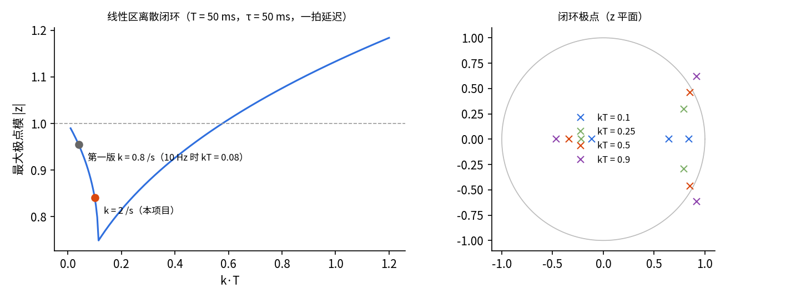
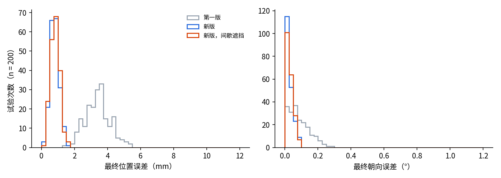
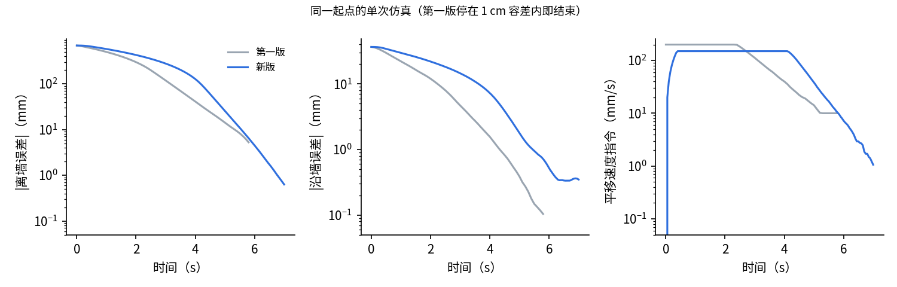

# 精对位：AprilTag + 激光 EKF + 饱和控制律

墙前精对位（把底盘停到定位标记正前方 0.70 m、正对墙面）的第二版设计：检测、状态估计、控制律、收敛判据与零位标定各自独立，结构参照 Nav2 `opennav_docking`（检测 → 滤波位姿 → 控制器 → 到位判断）。本文给出设计、控制律分析与离线仿真；Gazebo 对比实验见 [`../alignment_robustness`](../alignment_robustness/README.md)，多站执行的复测见 [`../slot_execution`](../slot_execution/README.md#精对位改进后的复测)。

## 1. 问题

第一版精对位（色块 + 激光 PBVS）在 Gazebo 中能把底盘停到 2.0 ± 0.6 mm（仿真配置 v2，n = 8），但分析和后续实验暴露出几个结构性问题：

- **停止判据决定了精度**：比例律带最小速度（1 cm/s）和死区（5 mm / 0.5°），滤波后误差进入 1 cm / 1° 就停。离线分析（[`ibvs_vs_pbvs`](../ibvs_vs_pbvs/README.md)）表明残余误差主要来自这一判据，而不是感知。
- **色块没有身份、遮挡时静默偏移**：画面中任何黄色物体都会被当成标记；色块被遮挡一部分时质心偏移，下游无法察觉。
- **滤波器没有运动模型**：指数平滑（α = 0.5）在运动中滞后，测量延迟也未补偿；测量一丢失控制环就原地停住。
- **静态标定误差直接进入结果**：相机绕竖直轴 1° 的安装误差约等于 10 mm 的沿墙误差。
- **多站执行继承对位残差**：多站开槽以“对位停车时的里程计位姿”为墙面坐标原点，每次运行带 0.65–2.3 mm 的常值横向偏差，等于对位停下时的沿墙残余误差。

## 2. 方法

```
相机 30 Hz ──AprilTag 检测（ID、亚像素角点）──IPPE PnP──▶ 标记中心 (x, y) + 协方差 ─┐
激光 10 Hz ──墙面直线拟合（TLS + 离群剔除）──────────▶ (距离, 法向角) + 协方差 ─┤ 按时间戳经里程计
里程计 50 Hz ──位姿历史───────────────────────────────────────────────────────────┤ 变换到当前时刻
                                                                                  ▼
                                  EKF：状态 (d, u, ψ)，里程计增量预测，χ² 门限更新
                                                                                  ▼
               平方根整形饱和律（墙面系 → base_link）→ 防碰撞守护 → /cmd_vel
                                                                                  ▼
               收敛判据：误差在容差内 且 底盘静止 且 σ 足够小，连续 N 周期 → 定点保持
```

| 环节 | 第一版 | 本版 | 代码 |
|---|---|---|---|
| 检测 | HSV 黄色色块质心 | AprilTag tag36h11（ID 0，黑框 10 cm），边缘直线求交的亚像素角点；色块检测器保留为可选项 | `fiducial.py` |
| 标记位置 | 质心射线与激光墙面求交 | IPPE_SQUARE PnP，只取中心位置，各向异性协方差 | `fiducial.py`、`visual_servo_ros.py` |
| 估计 | 指数平滑 α = 0.5 | EKF，里程计预测，延迟补偿，马氏距离门限，标记丢失时外推 | `wall_ekf.py`、`wall_estimator_ros.py` |
| 控制律 | 比例 0.8 + 最小速度 1 cm/s + 死区 5 mm / 0.5°，10 Hz | 平方根整形饱和比例律 + 速度 / 加速度限幅，20 Hz 标称 | `docking_control.py` |
| 停止 | 滤波误差 < 1 cm / 1°，连续 5 周期 | 误差 < 2 mm / 2 mm / 0.3° 且速度 < 3 mm/s、0.3°/s 且 σ < 2 mm，连续 10 周期；之后转入定点保持 | `docking_control.py` |
| 标定 | 无 | 示教零位偏置 (法向, 沿墙, 朝向)，在测量模型内扣除 | `teach_alignment_offset.py` |
| 多站原点 | 对位停车位姿 | 估计的标记位置（停车残差计入） | `navigation_cutting_task.py` |

所有参数是节点参数（`alignment.*`），默认值见 [`config/fine_alignment.yaml`](../../../src/scr_arm_controller/config/fine_alignment.yaml)。对位模式 `positioning_mode = 'visual'` 为本版，`'visual_v1'` 为第一版（对比基线）。

### 2.1 检测：AprilTag

- **检测器**：OpenCV ArUco 模块的 `DICT_APRILTAG_36h11` 字典，与 `apriltag_ros` 同一个标记族。Humble 的 `apriltag_ros` 需另装二进制包，本项目只依赖已有的 `python3-opencv`，换成该节点时只改输入接口。
- **贴图**：`scr_description/scripts/generate_apriltag_model.py` 用 OpenCV 生成 640 × 640 px 的 PNG（8 × 8 格黑框加 1 格白边），作为 Gazebo 模型 `scr_apriltag_tag36h11_0` 的贴图。标记贴在色块正上方（中心离地 0.70 m，沿墙同一位置 x = 8.42），两种检测器可在同一场景中对比。
- **亚像素角点**：OpenCV 的 `cornerSubPix` 针对棋盘格鞍点，用在黑方块的外角（L 形角）上有系统偏差：合成图像上标记深度偏 4.5 mm、角点误差 0.25 px。改为与 AprilTag 库 `refine_edges` 同思路的边缘细化：外框四条边各取 12 个采样点，沿法向用梯度加权质心求亚像素边缘，总体最小二乘拟合直线，相邻直线求交得角点。合成图像（30 个随机位姿，2 灰度级噪声）上角点误差 0.09 px，深度偏差 −0.3 mm，单帧耗时约 5 ms。
- **排查：白边被当成标记**。合成图像上约 1/8 的位姿检测失败，被拒的候选四边形是标记外圈白边的外沿。白边比墙面亮时，白边外沿和黑框都是四边形候选，两者角点只差 1 格；ArUco 的 `minMarkerDistanceRate = 0.05` 把它们当作重复，只保留外面那个，解码必然失败。Gazebo 中的墙面比白边暗，同样会触发。改为 0.01 后 30 / 30 检测成功。
- **位置与协方差**：IPPE_SQUARE（平面方块 PnP）求标记中心在光学系中的位置 t。横向（垂直视线）标准差 σ_px·Z/f，深度 σ_px·Z²/(f·L)·√½；深度另设 5 mm 下限，因为它依赖打印尺寸与焦距标定，1 % 的尺度误差在 0.55 m 处就是 5.5 mm。这样法向距离主要由激光决定，标记主要提供沿墙位置；标记的朝向（PnP 旋转）不使用，因为 10 cm 标记在 0.55 m 处的朝向可观测性很弱（[`ibvs_vs_pbvs`](../ibvs_vs_pbvs/README.md) 第 3 节）。

Gazebo 中 27 个已知位姿（离墙 0.7 / 0.9 / 1.2 m × 沿墙 ±0.15 m × 朝向 ±6°）的感知精度见 [`alignment_robustness`](../alignment_robustness/README.md#感知精度) 。

### 2.2 状态估计：EKF

**状态**取墙面相对量，与项目的墙面坐标 (u, v) 一致：

| 量 | 含义 |
|---|---|
| d | base_link 原点到墙面的垂直距离 |
| u | base_link 原点沿墙的位置，以定位标记为 0，面向墙面向右为正 |
| ψ | 底盘朝向相对“正对墙面”的偏角，逆时针为正 |

**过程模型**：两次里程计位姿之间的 SE(2) 相对变换 (Δx, Δy, Δψ)（表示在前一时刻 base_link 中），合成是精确的，与增量大小无关（机械臂动作期间主节点不处理回调，下一次预测会跨过几秒，也不影响正确性）：

```
d⁺ = d − (Δx cos ψ − Δy sin ψ)
u⁺ = u − (Δx sin ψ + Δy cos ψ)
ψ⁺ = ψ + Δψ
```

过程噪声按里程计运动模型随位移增长（平移 2 %、转角 2 %、每米 0.002 rad），另加每步 0.1 mm / 0.01° 的随机游走。

**测量模型**（c 为零位偏置，传感器看到的是 X + c）：

```
激光墙面   z_L = (d, −ψ) + c 对应项                       线性
标记中心   z_T = R(−ψ)·(d, u) = (d cos ψ + u sin ψ, −d sin ψ + u cos ψ)   非线性，在 X + c 处线性化
```

- **门限**：更新前做 χ² 检验（2 自由度 99 % 分位 9.21），超出则拒收；连续 15 帧拒收标记时认为 u 已失效（例如底盘被外力推动），由标记重新初始化 u。
- **延迟补偿**：每个测量带采集时间戳 t_m，从里程计历史插值出 t_m 时刻的位姿，把测量从 t_m 时刻的 base_link 变换到当前时刻再更新，与 `opennav_docking` 把检测位姿按时间戳经 TF 变换到固定系的做法相同。
- **标记丢失**：只做里程计预测和激光更新，控制环继续运行；σ_u 超过 1 cm 时停车等待，连续 10 s 没有标记更新判定失败。
- **初始化**：第一帧激光给出 d、ψ；第一次看到标记时由 z_T 反解 u。看到标记之前不发运动指令。

### 2.3 控制律

**运动学与反馈线性化**。全向底盘 base_link 速度 (v_x, v_y, ω) 下：

```
ḋ = −(v_x cos ψ − v_y sin ψ),   u̇ = −(v_x sin ψ + v_y cos ψ),   ψ̇ = ω
```

令 (v_x, v_y) = R(−ψ̂)·(v_n, v_l)（先在“指向墙面 / 左方”两个方向给出期望速度，再旋转到 base_link），在 ψ̂ = ψ 时得到三个解耦的积分器 ḋ = −v_n、u̇ = −v_l、ψ̇ = ω。平移与转向互不影响，转向过程中平移路径仍是直线。

**平方根整形饱和比例律**（ArduPilot `sqrt_controller` 的形式）。平移误差 e = (d − d*, u − u*)，沿 −e 方向，速度大小

```
f(|e|) = k·|e|                         |e| ≤ e₀ = a / k²
f(|e|) = √(2a(|e| − e₀/2))             |e| > e₀
v = min(f(|e|), v_max) · e / |e|
```

朝向通道同形。参数：k = 2 /s，a = 0.15 m/s²（转向 0.5 rad/s²），v_max = 0.15 m/s，ω_max = 0.3 rad/s；指令变化率另限 0.4 m/s²、0.8 rad/s²。

- 线性区（|e| ≤ 3.75 cm）是时间常数 1/k = 0.5 s 的指数收敛；
- 平方根区是恒减速度 a 的制动曲线：以当前速度按 a 减速恰好停在线性区边界，两区在 e₀ 处值与斜率都连续（C¹）；
- 变化率限幅 0.4 m/s² 大于制动减速度 0.15 m/s²，减速段不会被限幅器截断。若限幅比制动曲线更紧，限幅器相当于额外的延迟，会产生超调。

### 2.4 控制分析

**连续时间稳定性**。取 V = ½|e|²，V̇ = −|e|·min(f(|e|), v_max) < 0（e ≠ 0）。f 是 [0, k] 扇区内的单调函数，速度饱和也不改变符号，因此对积分器对象全局渐近稳定，|e| 沿直线单调减小；零点附近为指数收敛，速率 k。朝向通道同理。

**离散采样与延迟**。线性区单轴模型：采样周期 T，底盘速度环一阶滞后 τ = 50 ms（`scr_planar_move` 速度环增益 20 /s），指令晚一拍生效：

```
e[k+1] = e[k] + T·v[k]
v[k+1] = a·v[k] + (1 − a)·c[k−1],   a = exp(−T/τ)
c[k]   = −k·e[k]
```



| T | k | k·T | 闭环极点 | 主导时间常数 |
|---|---|---|---|---|
| 50 ms（标称） | 2 /s | 0.10 | 0.841, 0.643, −0.117（全实） | 0.29 s |
| 100 ms（rtf 2.5 下的实际周期，见下文） | 2 /s | 0.20 | 0.719 ± 0.232j, −0.303（ζ ≈ 0.67） | 0.36 s |
| 50 ms | 0.8 /s（第一版增益） | 0.04 | 0.955, 0.469, −0.056 | 1.08 s |

- 稳定边界：k·T ≈ 0.6（T = 50 ms 时 k < 11.6 /s，T = 100 ms 时 k < 6.1 /s）。所选 k = 2 /s 在实际周期下仍有约 3 倍余量。
- 连续近似：L(s) = k·e^(−sT_d) / (s(τs + 1))，穿越频率约 2 rad/s；等效延迟 T_d = 75 ms（半个采样周期 + 一拍计算）时相位裕度 76°，150 ms 时 67°，延迟裕度约 0.6 s。
- **饱和区**：平方根区的等效增益 f(e)/e < k。无延迟时 e[k+1] = e[k]·(1 − T·f(e)/e)，只要 k·T < 1 就单调收敛、不越过零点，因此线性区是最坏情形。有延迟时这只是近似论证（严格证明需要圆判据一类的工具），离线蒙特卡洛与 Gazebo 中都没有出现振荡。
- **采样周期**：控制环用仿真时钟计时。`rtf:=2.5` 时 Python 每周期的计算耗时（标记检测、两次墙面拟合、TF 查询）按仿真时间放大 2.5 倍，实际周期约 100 ms 而不是 50 ms。加速度限幅按实测周期计算；上表说明 k = 2 /s 在两种周期下都稳定且阻尼充分。

**稳态误差与噪声**：

- 对象是积分器（I 型），比例控制对常值目标无稳态误差，不需要积分项，因此也没有积分饱和问题。
- 常值速度扰动 δ 会留下 δ/k 的稳态误差。Gazebo 中零速度指令下底盘有约 0.6 mm/s 的滑移（轮子摩擦为 0），对应 0.3 mm，在容差内。
- 估计噪声 σ_est 经 k 进入速度指令，抖动约 k·σ_est ≈ 2 × 0.4 mm = 0.8 mm/s，低于收敛判据的速度阈值 3 mm/s；位置抖动经积分器平滑后约 σ_est·√(kT/2) ≈ 0.1 mm。

**第一版为什么停在几毫米处**：在 |e| < 1.25 cm 内最小速度 1 cm/s 起主导作用，控制律退化为幅值 1 cm/s 的继电器（每个 100 ms 周期走 1 mm），5 mm 死区内输出为零。停止判据只要求滤波误差 < 1 cm，从远处接近时机器人常在进入 1 cm 球后不久就满足判据，停在接近方向一侧。Gazebo 中第一版的误差几乎全在法向且同号（离墙偏远 2.5–5.7 mm），与这一机理一致。

### 2.5 收敛判据

到位 = 下列条件连续 10 个周期同时成立：

1. |e_d| < 2 mm，|e_u| < 2 mm，|e_ψ| < 0.3°；
2. 底盘实测速度 < 3 mm/s、< 0.3°/s；
3. 估计标准差 σ_d、σ_u < 2 mm。

条件 2 保证停下来的位置就是判定时的位置。实测速度取最近 0.5 s 里程计位移除以时间，而不是 `/odom` 的 twist：力控底盘插件的 twist 取自连杆瞬时速度，静止时也有 ±7 mm/s、±0.3°/s 的抖动（关节 PID 与接触力引起的微振动，位移只有微米级），直接用它判断“已静止”时条件始终不成立（Gazebo 首次运行中 2 / 2 次试验因此超时）。条件 3 防止标记长时间丢失、仅靠里程计外推时宣布到位。

到位后立即转入定点保持（`base_hold.py`）。仿真中轮子摩擦为 0，零速度指令下底盘仍会滑移（实测约 0.6 mm/s、0.08°/s）；真机上由电机保持承担。

### 2.6 零位标定（示教）

静态误差（相机外参、标记安装位置、激光测距偏差）在参考位姿处表现为估计值的常值偏差 c = X̂ − X。做法与 AGV 充电桩、工装定位的“示教零位”相同：

1. 把机器人放到准确的参考位姿（真机上用工装或测量设备；仿真中用 `/gazebo/set_entity_state` 传送到真值目标），定点保持；
2. 以零偏置运行估计器 30 s，记录估计值与同一时刻的真值；
3. c = 估计均值 − 真值，写成参数文件（`offset_normal`、`offset_lateral`、`offset_yaw_deg`，默认 0），并用批均值法给出偏置本身的标准误。

采样时长不能太短：EKF 的朝向估计误差有秒级的相关时间（激光单帧朝向 σ ≈ 0.26°），8 s 均值仍有约 0.03° 的不确定度，经标记测量耦合成约 0.4 mm 的沿墙偏置。Gazebo 中先用 8 s 示教时，名义条件下“示教后”反而略差（见对比实验），据此把默认值改为 30 s。

偏置在测量模型内部扣除：传感器看到的是 X + c，滤波器估计的是 X，所有测量在同一个偏置下保持一致。相机绕竖直轴的偏角 δ 在参考位姿处等效为沿墙偏差约 (d − x_cam)·tan δ ≈ 0.55 m × tan 1° ≈ 9.6 mm。示教得到的沿墙偏置只在参考距离处精确，离开参考距离按距离比例变化；精对位总是停在参考距离，所以这对最终精度没有影响。

验证用的相机安装偏角是启动参数 `camera_yaw_error_deg`（默认 0）：只改 Gazebo 中相机传感器的实际朝向，`robot_state_publisher` 发布的 TF 仍为名义值，即软件“不知道”这个误差，与真机外参不准的情形相同。

```bash
ros2 launch scr_description gazebo.launch.py gui:=false camera_yaw_error_deg:=1.0
ros2 run scr_arm_controller teach_alignment_offset --out taught.yaml
ros2 run scr_arm_controller navigation_cutting_task task.yaml --ros-args --params-file taught.yaml
```

### 2.7 多站执行的墙面坐标原点

第一版以“对位停车时的里程计位姿”为墙面坐标原点，停车时的沿墙残差 e_u 被所有停靠站继承。本版 EKF 的 u 本来就以标记为原点：对位结束时残差保留在状态中，之后站间移动只用里程计预测与激光更新（默认不用标记更新，使每站的行为一致、便于分析；`use_tag = True` 可打开），各站目标 u* 直接取规划的 u_c − u_marker。到站残差测量与机械臂点补偿也改用 EKF 估计。`fold_alignment_residual = False` 恢复第一版语义（以停车位姿为原点），用于对照。

## 3. 离线仿真

`analysis.py` 用与上文相同的模型（全向底盘、速度环一阶滞后 50 ms、激光 10 Hz、相机 30 Hz、测量延迟 50 ms，噪声取 Gazebo 实测量级），直接调用 `scr_arm_controller` 中的估计器、控制律与收敛判据，比较第一版与本版。200 个随机起点（离墙 1.0–1.5 m、沿墙 ±0.3 m、朝向 ±10°，种子 42），配对。



| 方案 | 位置误差 mean ± std | 95 分位 / 最大 | 法向 / 沿墙 绝对值 均值 | 朝向 绝对值 均值 | 耗时 |
|---|---|---|---|---|---|
| 第一版 | 3.41 ± 0.74 mm | 4.67 / 5.45 mm | 3.21 / 0.97 mm | 0.085° | 5.9 s |
| 本版 | 0.80 ± 0.26 mm | 1.27 / 1.53 mm | 0.65 / 0.39 mm | 0.027° | 6.8 s |
| 本版，间歇遮挡 | 0.82 ± 0.27 mm | 1.27 / 1.68 mm | 0.67 / 0.40 mm | 0.029° | 6.8 s |

（n = 200，配对；数据 [`sim_summary.csv`](sim_summary.csv)。）



- 本版的误差由估计噪声决定，第一版由停止判据决定；
- 间歇遮挡（每 3 s 中 1.5 s 看不到标记）对本版几乎没有影响：仿真里程计无误差，丢失期间外推准确。Gazebo 中的结果见对比实验。

离线模型没有考虑：图像渲染（感知误差取统计值）、底盘零速滑移、机械臂对底盘的反作用。

## 4. 局限

- **单个标记、单个参考距离**：示教偏置只在参考距离处精确；标记被完全遮挡时无法对位（安全地报告失败，见对比实验）。
- **只在仿真中验证**：Gazebo 渲染没有运动模糊、卷帘快门、镜头畸变、自动曝光；真机需要相机内参标定，并重新评估角点噪声与 R 的取值。
- **里程计在仿真中是理想的**：插件直接发布模型真值位姿，EKF 的过程噪声取值没有经过真实里程计的检验；遮挡期间的外推精度在真机上会更差。
- **离散时间分析是线性区的**：饱和与延迟同时存在时的稳定性只给出近似论证。
- **测量噪声协方差为人工设定**：注入噪声的实验中 R 按注入量设置（相当于事先标定过噪声水平），没有做自适应估计。

## 5. 复现

```bash
python3 docs/experiments/fine_alignment/analysis.py --trials 200    # 约 30 s，不需要 ROS
colcon test --packages-select scr_arm_controller                      # 单元测试（含 EKF、控制律、AprilTag 合成图像）
```

数据：[`sim_summary.csv`](sim_summary.csv)、[`sim_poles.csv`](sim_poles.csv)。
