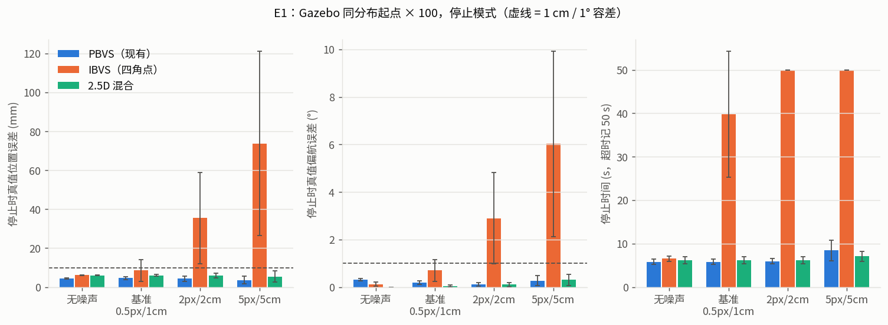
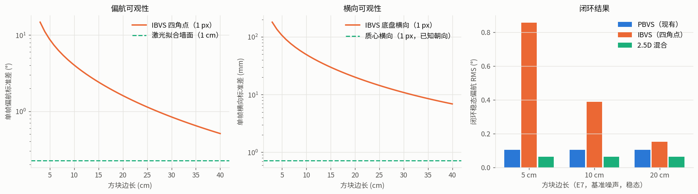
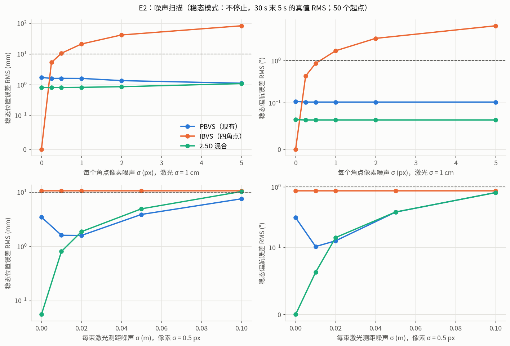
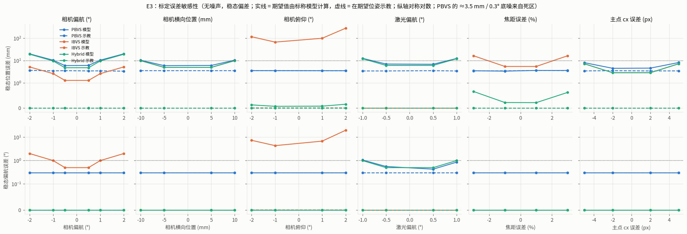
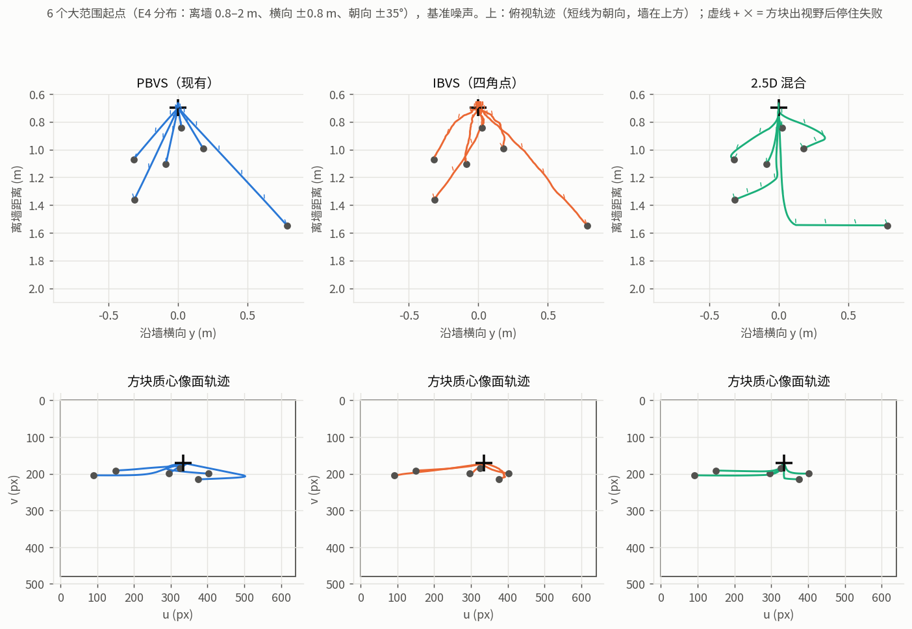

# IBVS vs PBVS：全向底盘墙面方块对位的离线对比

路线图阶段 1 的研究扩展：给现有的相机 + 激光 PBVS（`visual_servo.py`）实现一个基于图像的视觉伺服（IBVS）和一个 2.5D 混合方案，在**离线运动学仿真**里做系统对比，回答“IBVS 值不值得接进主任务”。

**一句话结论**：在本机器人的构型下（3 自由度底盘、5 cm 方块、0.55 m 观测距离），**纯 IBVS 不适合接入**——偏航方向几乎不可观，0.5 px 角点噪声就让偏航误差到 0.8°，而且对相机俯仰 / 方块高度的微小偏差会给出几厘米到十几厘米的错误位姿（仿真中出现刀具撞墙）。教科书上 IBVS“对标定误差不敏感”的优点在这里**完全来自示教期望特征**；同样的示教信息给 PBVS 做一次零偏校正就能得到同样的效果。值得接入的是**示教零偏校正**（改动最小），混合方案可作为可选模式。



## 1. 问题设定

| 项 | 取值（与 Gazebo 模型一致） |
|---|---|
| 底盘 | 麦克纳姆全向，控制量 (vx, vy, wz)，10 Hz，平移 ≤ 0.2 m/s、转速 ≤ 0.3 rad/s |
| 相机 | 640×480，fx = fy = 381.4，主点 (319.5, 239.5)；光心在 base_link 的 (0.149, 0.021, 0.398) m（`joint1 = −0.15` 观测位姿），光轴水平朝前 |
| 激光 | 360 线，±35° 扇区拟合墙面（复用 `fit_wall`），Gazebo 原生噪声 σ = 1 cm |
| 方块 | 5 cm 黄色正方形，中心高出 base_link 0.4976 m（比相机高 0.10 m） |
| 目标 | 离墙 0.70 m、正对方块；容差 1 cm / 1°（与 `navigation_cutting_task` 相同） |

期望位姿处方块在像面上约 35 px 见方，位于 (334, 171) px 附近。

## 2. 方法

### 2.1 交互矩阵（`ibvs.feature_jacobian`）

归一化像点 x = X/Z, y = Y/Z 的经典点特征交互矩阵 L(x, y, Z)（2×6，对应相机在光学系中的旋量）。底盘只有 3 个自由度，相机原点在 base_link 的位置为 p_c、姿态 R_bo（光学系 → base_link），则

```
v_o = R_boᵀ (v_b + ω_b × p_c),  ω_o = R_boᵀ ω_b,   v_b = (vx, vy, 0), ω_b = (0, 0, wz)
```

写成 6×3 的 W，特征雅可比 J = L·W（四角点共 8×3）。标称安装下 W 只剩三项：v_x = −(vy + wz·p_cx)，v_z = vx − wz·p_cy，ω_y = −wz——前进只改变深度，横移只平移像面，转向 = 绕竖直轴旋转 + 相机横移。单元测试用对底盘位姿的中心差分验证了 J（含相机带安装倾角的情形），最大相对误差 < 1e-6。

### 2.2 三种方法

| 方法 | 特征 / 测量 | 控制律 | 停止判据 |
|---|---|---|---|
| **PBVS**（现有，参数不变） | 激光墙面（朝向、距离）+ 方块质心射线与墙面求交 → (yaw, normal, lateral) | 比例控制 + 死区（5 mm / 0.5°）+ 最小速度 | 滤波后误差 < 1 cm / 1°，连续 5 周期 |
| **IBVS**（`IbvsController`） | 四角点归一化坐标 s ∈ R⁸ | u = −λ Ĵ⁺ (s − s*)，λ = 0.8，整体等比限幅 | 线性化位姿误差 Ĵ⁺e < 1 cm / 1°，连续 5 周期 |
| **2.5D 混合**（`HybridController`） | 激光管朝向与离墙距离；图像质心 x_g 管沿墙横向 | wz、v_n 同 PBVS；v_t 由 ẋ_g = −λ(x_g − x_g*) 解出，并前馈抵消转向 / 前进引起的质心像面运动；速度预算优先给横向（保视野） | 与 PBVS 相同 |

三者都对测量做 α = 0.5 的指数滑动平均（与 `visual_servo_ros.py` 一致），测量丢失时原地停住、连续 2 s 丢失判失败。

**期望特征的两种来源**：
- **模型**：用标称内外参把期望位姿下的方块投影出来（PBVS 本来就是这种：误差直接按标称几何换算）；
- **示教**：把机器人摆到真实的期望位姿，取 20 帧平均作为 s*（IBVS）、x_g* 与激光零偏（混合）、或 (yaw, normal, lateral) 零偏（PBVS + 示教零偏）。示教需要一次“真值摆位”（夹具 / 测量），本质上是**针对这个任务构型的隐式标定**——所以对比时必须让 PBVS 也拿到同样的信息，才公平。

### 2.3 IBVS 深度估计方式（E0 消融）

雅可比里的 Ẑ 可取：期望深度 Z*（常数雅可比）、激光墙面与射线求交的当前深度、由方块已知边长估计、以及 Malis 的均值雅可比 (J(s,Ẑ) + J(s*,Z*))/2。100 个起点的结果（完整表见 [results.md](results.md#e0-ibvs-深度方式消融)）：

| 深度方式 | 无噪声：成功 / 真值进入容差 s | 基准噪声（0.5 px / 1 cm），稳态：成功 / 偏航 RMS ° |
|---|---|---|
| Z*（常数） | 100 / 5.9 | 61 / 0.81 |
| 激光 | 100 / 4.9 | 55 / 0.82 |
| 边长 | 100 / 4.8 | 61 / 0.81 |
| 均值 | 100 / 5.3 | 58 / 0.81 |

无噪声时用当前深度约快 1 s；**有噪声时四者没有差别**——误差由下面的弱可观方向决定，深度近似不是瓶颈。主实验采用最常用、不依赖额外传感器的常数雅可比 Z*。

### 2.4 仿真器（`sim.py`）

真值世界与控制器使用的“标称参数”分离：可以单独给相机安装角 / 位置、激光安装角 / 位置、焦距、主点、方块高度加偏差，再加角点像素噪声、激光逐束测距噪声、随机丢帧。底盘为理想全向运动学（零阶保持，每周期 10 个子步积分），任一角点出画面即视为本帧无检测。各方法在同一实验中使用同一组随机起点（配对比较），全部固定种子。

两种评估模式：
- **停止模式**：按各方法自己的判据停下，取停止时的真值误差——与 Gazebo 对位实验相同，反映实际使用；
- **稳态模式**：不停止，运行 30 s，取最后 5 s 真值的 RMS——排除停止判据的影响，衡量精度下限和标定偏差。

## 3. 关键分析：为什么纯 IBVS 的偏航不可观

期望位姿处 J 的奇异值为 4.43 / 0.70 / 0.014，**条件数 314**；最弱的右奇异向量是 (vx, vy, wz) ≈ (0.00, 0.57, −0.82)，瞬时转动中心在底盘前方 0.70 m——正好是方块。也就是说，底盘**绕方块竖直轴“公转”**时，方块的像几乎不变：偏航 δ 与横移 δ·Z 在像面上产生同样的平移，二者只能靠左右边的透视长度差区分，而 1° 偏航只带来约 0.05 px 的边长差。

把单帧测量线性化（σ = 1 px 角点噪声，[observability.md](observability.md)）：

| 方块边长 | J 条件数 | IBVS σ_法向 | IBVS σ_横向（底盘） | IBVS σ_偏航 |
|---|---|---|---|---|
| 5 cm | 314 | 3.8 mm | 107 mm | 8.7° |
| 10 cm | 146 | 3.3 mm | 50 mm | 4.0° |
| 20 cm | 59 | 2.3 mm | 20 mm | 1.6° |
| 30 cm | 32 | 1.7 mm | 11 mm | 0.84° |

对照：激光单次拟合墙面 σ_偏航 = **0.23°**、σ_距离 = 1.1 mm（σ = 1 cm 测距噪声）；已知朝向时质心横向 σ ≈ 0.72 mm / px。偏航上激光比 5 cm 方块的 IBVS 好约 40 倍——这就是混合方案让激光管朝向的理由。



注意“公转”方向上刀尖（底盘前方 0.676 m，几乎就在方块处）的横向几乎不动，所以 IBVS 停止时**刀尖横向误差很小（0.3–3 mm）**，但底盘偏航和底盘横向误差很大。偏航误差直接让沿墙的切割线倾斜（12 cm 横向行程、1° 偏航 → 2 mm 深度变化），也违背“正对墙面”的对位定义。

## 4. 结果

完整表格：[results.md](results.md)；逐次数据 `trials_E*.csv`，汇总 [summary.csv](summary.csv)。

### 4.1 E1 主对比（Gazebo 同分布起点：离墙 1.0–1.5 m、横向 ±0.3 m、朝向 ±10°，各 100 次）

停止模式：

| 噪声（角点像素 σ / 激光 σ） | 方法 | 成功 | 位置误差 mean ± std (max) | 偏航 mean (max) | 停止时间 |
|---|---|---|---|---|---|
| 无 | PBVS | 100/100 | 4.4 ± 0.3 (4.9) mm | 0.30° (0.38°) | 5.8 s |
| 无 | IBVS | 100/100 | 6.1 ± 0.2 (6.4) mm | 0.12° (0.41°) | 6.5 s |
| 无 | 混合 | 100/100 | 5.9 ± 0.2 (6.2) mm | 0.00° | 6.2 s |
| 0.5 px / 1 cm（基准） | PBVS | 100/100 | 4.6 ± 0.7 (6.1) mm | 0.19° (0.34°) | 5.8 s |
| 0.5 px / 1 cm（基准） | IBVS | **25/100**（59 超时） | 8.6 ± 5.6 (22.3) mm | 0.70° (1.83°) | 39.8 s |
| 0.5 px / 1 cm（基准） | 混合 | 100/100 | 6.0 ± 0.5 (7.2) mm | 0.05° (0.20°) | 6.2 s |
| 2 px / 2 cm | PBVS | 100/100 | 4.4 (8.7) mm | 0.11° (0.32°) | 6.0 s |
| 2 px / 2 cm | IBVS | **0/100** | 35.5 (116.0) mm | 2.90° (9.49°) | 超时 |
| 2 px / 2 cm | 混合 | 100/100 | 5.9 (8.3) mm | 0.11° (0.45°) | 6.2 s |
| 5 px / 5 cm | PBVS | 99/100 | 3.6 (10.2) mm | 0.27° (0.91°) | 8.4 s |
| 5 px / 5 cm | IBVS | 0/100 | 73.8 (248.9) mm | 6.03° (20.42°) | 超时 |
| 5 px / 5 cm | 混合 | 93/100 | 5.3 (13.4) mm | 0.30° (1.05°) | 7.1 s |

稳态模式（30 s 末 5 s RMS，衡量精度下限）：基准噪声下 PBVS 1.5 mm / 0.09°，**混合 0.8 mm / 0.06°**，IBVS 10.0 mm / 0.81°；无噪声时 PBVS 停在 3.5 mm / 0.30°（死区 5 mm / 0.5° 造成），IBVS 与混合收敛到 0。

解读：
- 停止模式下 PBVS 与混合的误差（4–6 mm）**主要由 1 cm 停止判据决定**，不是感知误差：指数收敛的方法第一次连续 5 周期落入 1 cm 时正好在 5–6 mm 处。PBVS 因为有最小速度反而停得更近。
- 5 px / 5 cm 下混合有 7 次、PBVS 有 1 次“自认为收敛、但真值位置误差 10.2–13.4 mm”的边界失败：5 cm 测距噪声让激光距离单帧 σ 约 5 mm，停止时的滤波值落入 1 cm 而真值略超出。混合方案没有最小速度，停在离 1 cm 边界更近的地方（约 6 mm），所以更容易越界；这是停止判据与噪声的交互，不是方法本身的精度差异（稳态模式两者都是 100/100）。
- 离线仿真的 PBVS 停止误差 4.4 mm、耗时 5.8 s，与 Gazebo 实测的 2.0 mm、8.7 s 不同：离线是理想运动学，没有 Gazebo 的加减速、延迟与滑行。**绝对数字不是对 Gazebo 的预测，只用来做方法间比较。**

### 4.2 E2 噪声扫描（稳态，50 个起点）



- 像素噪声几乎不影响 PBVS 与混合（横向由质心决定，4 个角点平均 + 滤波 + 闭环积分，5 px 时仍 ≈ 1 mm）；IBVS 随像素噪声线性恶化，0.25 px 就到 5 mm / 0.4°。
- 激光测距噪声是 PBVS 与混合的主要误差源，二者曲线几乎重合（同一个 `fit_wall`）；0.1 m 噪声时都到 7–10 mm / 0.8°。IBVS 不用激光，与测距噪声无关。

### 4.3 E3 标定误差敏感性（无噪声，稳态偏差，10 个起点）



模型期望（每单位误差引起的稳态偏差）：

| 误差项 | PBVS | IBVS | 混合 |
|---|---|---|---|
| 相机偏航 1° | 横向 10 mm | 横向 2.6 mm + **偏航 1.0°** | 横向 9.7 mm |
| 相机横向位置 5 mm | 横向 5 mm | 横向 5 mm | 横向 5 mm |
| 相机俯仰 1° | ≈ 0 | **67–100 mm + 4.4–6.8°；−1° 时刀具间隙 −21 mm（撞墙）** | ≈ 0 |
| 相机横滚 1° | 横向 1.7–1.8 mm | **58–63 mm + 4.6–5.0°** | 横向 1.7 mm |
| 主点 cx 2 px | 横向 2.9 mm | 横向 2.9 mm | 横向 2.9 mm |
| 主点 cy 5 px | ≈ 0 | **52–69 mm + 3.4–4.7°** | ≈ 0 |
| 焦距 1 % | ≈ 0 | 法向 5.5 mm | 0.2 mm |
| 激光偏航 0.5° | 偏航 0.5° + 横向 6 mm | 0（不用激光） | 偏航 0.5° + 横向 6 mm |
| 激光前后位置 10 mm | 法向 7–13 mm | 0 | 法向 10 mm |

示教期望：**三种方法的偏差全部消失**（IBVS、混合精确为 0；PBVS 剩下的 3.5 mm 是死区，不是标定偏差）。

解读：
- IBVS 用 8 个像点约束 3 个自由度，**底盘够不着的像面误差（竖直方向 v 的偏移，来自俯仰、cy、方块高度）被伪逆投到了弱可观的“公转”方向**，于是 1° 俯仰就产生几厘米的错误位姿。PBVS 用的是射线–墙面交点的水平分量，竖直方向的误差天然不进入控制。
- 相机偏航对 PBVS / 混合是 ≈ 10 mm/°（= 观测距离 0.55 m × 1°），这是现有系统横向偏差的主要候选来源（slot_execution 实验中观察到约 5 mm 的横向偏差，对应约 0.5° 相机偏航，**仅为推测，未在 Gazebo 中验证**）。
- **示教把所有静态标定误差都吸收掉，与方法无关**。“IBVS 对标定不敏感”在这里的含义，其实是“IBVS 天然要求示教”。

### 4.4 E6 示教之后方块高度变化（无噪声，稳态）

示教在标称高度进行，运行时方块高 / 低 Δh：

| Δh | PBVS | IBVS | 混合 |
|---|---|---|---|
| ±10 mm | 不受影响 | **78–87 mm + 5.3–5.8°，−10 mm 时刀具间隙 −25 mm（撞墙）** | 不受影响 |
| ±30 mm | 不受影响 | 215–303 mm + 15–20° | 不受影响 |

这是 IBVS 最致命的问题：示教的 s* 只对**同一个相对高度**有效。实际施工中方块高度、地面起伏、升降滑台定位误差都会改变它；PBVS 与混合只用质心的水平坐标和激光，对此免疫。

### 4.5 E4 大范围起点：视野（离墙 0.8–2.0 m、横向 ±0.8 m、朝向 ±35°，起始可见，100 次）

| 噪声 | 方法 | 成功 | 出视野 | 视野余量下降 mean / max | 停止时间 |
|---|---|---|---|---|---|
| 无 | PBVS | 100 | 0 | 31 / 91 px | 7.1 s |
| 无 | IBVS | 100 | 0 | 29 / 61 px | 7.9 s |
| 无 | 混合 | 100 | 0 | 29 / 61 px | 9.2 s |
| 基准 | IBVS | 27 | 0 | — | 39.3 s |

（PBVS 与混合在基准噪声下同样 100/100；余量下降 = 起始视野余量 − 过程中最小余量。）



**没有任何方法丢失方块**。IBVS 的经典优势是保视野，但这台相机水平视场 80°、方块离光轴不远，PBVS 的直线轨迹最多也只多吃掉 30 px 余量。IBVS / 混合的像面轨迹更规整（IBVS 质心近乎直线），代价是混合方案先横移、再前进，耗时多约 2 s。

### 4.6 E5 检测丢帧（基准噪声，100 次）

| 丢帧率 | PBVS 成功 / 时间 | IBVS 成功 / 时间 | 混合 成功 / 时间 |
|---|---|---|---|
| 0 | 100 / 5.8 s | 25 / 39.8 s | 100 / 6.2 s |
| 10 % | 100 / 6.7 s | 20 / 44.7 s | 100 / 7.0 s |
| 30 % | 100 / 9.2 s | 7 / 48.2 s | 100 / 9.6 s |
| 50 % | 99 / 16.7 s | 1 / 49.5 s | 99 / 17.9 s |

丢帧只是让 PBVS / 混合变慢（丢失时原地停住），精度不变；50 % 时各有 1 次因连续 20 帧丢失判失败。

### 4.7 E7 方块尺寸

IBVS 的弱可观方向随方块变大而改善（50 个起点；混合与 PBVS 不受方块尺寸影响，稳态分别为 0.8 mm / 0.06° 与 1.5 mm / 0.09°）：

| 方块边长 | IBVS 基准噪声：停止模式成功 / 停止时间 | IBVS 基准噪声：稳态位置 / 偏航 | IBVS 2 px / 2 cm：停止模式成功 | IBVS 2 px / 2 cm：稳态位置 / 偏航 |
|---|---|---|---|---|
| 5 cm | 16/50 / 40.7 s | 9.9 mm / 0.81° | 0/50 | 39.0 mm / 3.19° |
| 10 cm | 46/50 / 10.6 s | 4.6 mm / 0.37° | 0/50 | 18.2 mm / 1.48° |
| 20 cm | 50/50 / 6.9 s | 1.8 mm / 0.15° | 34/50 | 7.4 mm / 0.58° |

20 cm 方块时 IBVS 在基准噪声下才可用，但仍比混合差约 2 倍，在 2 px 噪声下仍有三分之一失败；而且尺寸不改变第 4.3–4.4 节的竖直方向敏感问题（那是特征选择的问题，不是信噪比问题）。

## 5. 结论

1. **纯 IBVS（四角点、3 自由度）不适合本任务。** 5 cm 方块在 0.55 m 处，“绕方块公转”方向的条件数 314，1 px 角点噪声对应 8.7° 偏航标准差；0.5 px 噪声下 100 次只有 25 次在 50 s 内满足停止判据，2 px 时 0 次。
2. **IBVS 对竖直方向的模型误差极度敏感**：相机俯仰 1°、主点 cy 5 px 或方块高度变化 1 cm 都会让它收敛到偏 5–9 cm、偏航 4–6° 的位姿，部分情况刀具撞墙。这些误差源在实际中都存在。
3. **“IBVS 对标定误差鲁棒”在本问题中完全来自示教。** 给 PBVS 同样做一次示教零偏，它也对所有静态标定误差免疫；两者的区别只剩上面两条，都是 IBVS 吃亏。
4. **混合方案与 PBVS 在实际意义上等价**：停止模式下都在 1 cm / 1° 内 100 % 成功；稳态精度混合略好（0.8 vs 1.5 mm，主要因为 PBVS 有 5 mm 死区），但都远小于 1 cm 停止容差，也小于 Gazebo 中测得的 ~2 mm。混合方案保视野略好、对丢帧同样鲁棒，耗时多约 0.4–2 s。
5. **停止判据是当前对位误差的主要来源**（无噪声时 PBVS 停在 4.4 mm、混合 5.9 mm）。如果需要更高精度，收紧停止容差比换伺服方法更有效。

## 6. 建议：是否接入主任务、怎么接

**不接入纯 IBVS。** 建议按以下优先级：

1. **推荐：给 PBVS 加示教零偏（改动最小，收益最明确）。**
   - `WallMarkerServo` 增加 `offsets = (yaw, normal, lateral)`，在 `measure()` 里从原始误差中减去（滤波之前）；`navigation_cutting_task` 的 YAML 增加对应参数，默认 0。
   - 标定流程：在 Gazebo 中用真值把机器人摆到期望位姿（真机用夹具 / 全站仪），静止采 20 帧，平均得到零偏写入 YAML。可以做成一个小脚本，复用 `alignment_benchmark` 的传送功能。
   - 吸收相机偏航（≈ 10 mm/°）、相机横向位置、主点、激光安装角 / 位置等全部静态误差；前提是**观测距离和相机–方块相对几何不变**（这在本任务中成立：对位距离固定 0.70 m，滑台固定在观测位姿）。
   - Gazebo 验证方案：在 URDF 相机关节上故意加 1° 偏航，比较“无零偏 / 有零偏”的对位真值误差，预期从约 10 mm 降到与标称相同的水平。
2. **可选：混合方案作为第三种 `positioning_mode: hybrid`。** `ibvs.HybridController` 已经是纯算法、接口与 PBVS 相同（输入质心像素 + `wall_in_base()` 的墙面 dict，输出 (vx, vy, wz)），在 `precise_positioning_visual` 中替换 `pbvs_command` 即可；同样需要示教 x_g* 与激光零偏。收益是亚毫米级的稳态精度和更规整的像面轨迹，在当前 1 cm 容差下不显著，**只在之后收紧容差或换窄视场相机时才值得**。
3. 若将来确实需要纯视觉（例如去掉激光），必须换**大尺寸或分布式标记**（≥ 30 cm 宽，或墙上两个相距较远的方块），并且只用对底盘可达的特征（例如只用 u 坐标与面积），否则第 2 条结论里的问题无法避免。

## 7. 局限

- **离线理想运动学**：没有执行器动态、延迟、打滑与 Gazebo 的物理效应；绝对误差与时间不能直接对应 Gazebo（离线 PBVS 4.4 mm / 5.8 s vs Gazebo 2.0 mm / 8.7 s）。结论依赖的是方法间的相对差异与可观性分析，这部分与动力学无关。
- **检测模型简化**：角点噪声为独立高斯，质心由四个带噪角点计算；真实色块质心由大量边界像素得到，可能比角点更准，这会让 PBVS / 混合更占优，不改变结论。部分可见时一律视为丢失（实际检测会给出有偏的质心）。`detect_marker_corners` 只在合成图像上测试过，没有在 Gazebo 图像上验证。
- **墙面理想化**：一面无限大平整墙、没有遮挡与其他物体；激光拟合在真实墙面（踢脚线、开关、凹凸）上会更差，这对 PBVS / 混合不利、对 IBVS 无影响。
- **示教假设**：假设能把机器人精确摆到期望位姿一次；示教误差会 1:1 进入所有方法的结果。
- **停止判据**：IBVS 的停止判据用 Ĵ⁺e 换算成位姿单位，是为了和 PBVS 用同一个容差；换成像素阈值不会改变它在偏航方向“看不清”的本质。
- **样本量**：E3 / E6 每格 10 个起点（无噪声时结果几乎是确定性的，起点只影响收敛过程）；其他实验 50–100 个起点。没有做显著性检验，几毫米以内的差异不应过度解读。

## 8. 文件与复现

| 文件 | 内容 |
|---|---|
| [`src/scr_arm_controller/scr_arm_controller/ibvs.py`](../../../src/scr_arm_controller/scr_arm_controller/ibvs.py) | 纯算法：投影、交互矩阵、`IbvsController`、`HybridController`、角点检测 |
| [`src/scr_arm_controller/test/test_ibvs.py`](../../../src/scr_arm_controller/test/test_ibvs.py) | 32 个单元测试：有限差分校验雅可比、闭环收敛（4 种深度方式 × 3 起点、混合、错误外参 + 示教）、弱可观方向、退化情形、合成图像角点检测 |
| [`sim.py`](sim.py) | 离线仿真器（真值世界 / 传感器 / 三种方法 / 单次试验） |
| [`run_experiments.py`](run_experiments.py) | E0–E7 批量实验、汇总、`results.md` |
| [`plots.py`](plots.py) | 作图与可观性表 |

```bash
cd docs/experiments/ibvs_vs_pbvs
python3 run_experiments.py --jobs 2          # 全部 E0–E7，约 1.25 万次试验，4 核虚拟机上约 30 分钟
python3 run_experiments.py --plot-only       # 只用已有 CSV 重新汇总、作图
```

只依赖 numpy / matplotlib / OpenCV（检测函数），不需要 ROS 与 Gazebo。
