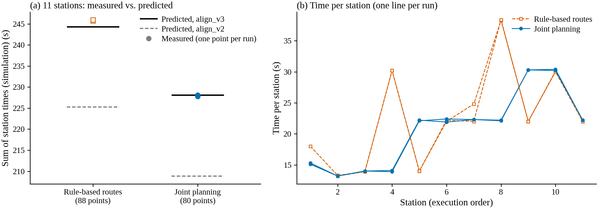
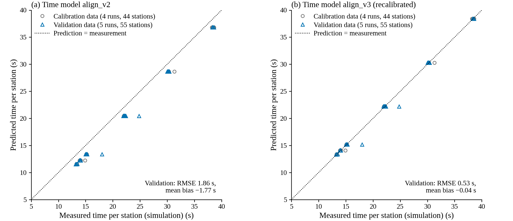

# 规划验证：时间模型重标定与联合规划的 Gazebo 执行

**结论**：按当前默认执行路径重新标定时间模型（预设 `align_v3`：t_settle 4.70 s、v_strafe 0.0971 m/s、t_point 2.030 s，44 站，每站 RMSE 0.22 s，逐次运行留一 0.24 s）后，在 5 次未参与标定的 Gazebo 运行上，各站耗时之和的预测误差在 −1.7 s 到 +0.7 s 之间（≤ 0.7 %）。room3 南墙示例任务上，联合规划第一次在 Gazebo 中执行：11 个停靠站 227.8–228.1 s，规则路线 245.7–246.0 s，**实测节省 17.9 s（7.3 %，n = 2 + 2，配对种子）**，预测节省 16.2 s（6.6 %）；差额来自规则路线每次运行中一次约 2.7 s 的偶发停顿，扣除后实测节省 15.2 s（6.2 %）。两种规划的到站沿墙误差（最大 1.3–2.0 mm）、刀尖轨迹误差（平均 0.18–0.19 mm）相同。



*图 1：Gazebo 中执行同一示例任务的两份规划（规则路线 88 个机械臂点，联合规划 80 点，均为 11 站）。(a) 各站耗时之和：彩色点为每次运行的实测，黑实线为 `align_v3` 预测，灰虚线为 `align_v2` 预测；(b) 每站耗时（横轴为执行顺序，每条线一次运行）。联合规划少 8 个机械臂点（约 16 s），站数与横移相同。*

## 1. 问题

任务级联合规划（[task_planning](../task_planning/README.md)）的全部结论都来自时间模型 `slot_plan.TimeModel` 的预测：room3 南墙示例任务上，联合规划比规则路线预测快 7.3 %（`align_v2`：225.3 s → 208.9 s），但这两份规划从未在 Gazebo 中执行过。同时，默认执行路径已经变化：行为树任务层、标记地图与横移比例估计、横移前机械臂回到观测位姿（[along_wall_accuracy](../along_wall_accuracy/README.md)），每站多出约 2 s，而 `align_v2` 是在这之前标定的。本实验回答三个问题：

1. 当前默认执行路径下，时间模型的参数是多少？标定是否稳定（样本外误差多大）？
2. 时间模型对没参与标定的规划（联合规划、规则路线）预测得准不准？
3. 联合规划的节省在 Gazebo 中是否成立？执行精度有没有因为选线不同而变化？

## 2. 方法

### 2.1 时间模型与标定方法

每站耗时（仿真时间）`t_station = t_settle + 横移距离 / v_strafe + 点数 × t_point`，规划的预测时间为各站之和（不含导航到墙前与第一次精对位，这两步与规划无关）。记录器 `execute_slot_plan.py` 为每站给出 `move_s`（横移到站）、`cut_s`（切割）和 `station_s`（整站），`calibrate_time_model.py` 提供三种估计：

| 方法 | 横移阶段 | 切割阶段 | 每站固定开销 |
|---|---|---|---|
| `joint` | 三个参数对 `station_s` 整体最小二乘 | | |
| `phases`（`align_v2` 所用） | `move_s = a + d / v` 回归 | `t_point = Σ cut_s / Σ 点数`（比值） | `a +` 其余开销均值 |
| `phases-reg`（本轮新增） | 同上 | `cut_s = c_cut + 点数 × t_point` 回归 | `a + c_cut +` 其余开销均值 |

新增 `phases-reg` 的原因见 4.1：横移前回到观测位姿后，每站切割阶段多了约 1.0 s 与点数无关的固定开销，比值估计会把它摊进 `t_point`。

### 2.2 联合规划与规则路线

两份规划都由 `plan_wall_slots.py` 从 `config/wall_task_room3_south.yaml` 生成，划分为合并 DP、顺序为一维扫掠，唯一区别是选线（`--routes=rule` / `--routes=joint`）。槽线与停靠站在 `align_v1`、`align_v2`、`align_v3` 三种时间模型下完全相同（只有预测时间不同）。

| 规划 | 停靠站 | 机械臂点 | 横移 | 槽长 |
|---|---|---|---|---|
| 规则路线（`plans/plan_rule.yaml`） | 11 | 88 | 1.36 m | 2.76 m |
| 联合规划（`plans/plan_joint.yaml`） | 11 | 80 | 1.36 m | 2.76 m |

两者站数、横移与槽长都相同，联合规划把两条槽的拐点挪到停靠站窗口边界上，少 2 个小段（8 个机械臂点）。

## 3. 实验设置

| 项目 | 设置 |
|---|---|
| 仿真 | Gazebo Classic，仿真配置 v2（关节 `position_pid` 力控 + 力控底盘），rtf 1，无界面 |
| 执行路径 | 默认：`sim_nav.launch.py`（Nav2 Smac 2D + MPPI，EKF 里程计，ros2_control 底盘 + 编码器误差模型）→ 行为树任务层；精对位为标记地图（ID 0 / 2 / 4，间距 0.6 m）+ 激光 EKF + 横移比例估计，横移前回观测位姿；不按行程重新对位 |
| 切割 | 空切，刀尖停在墙前 10 mm；残差补偿开启 |
| 随机性 | 编码器打滑过程的种子 `odom_seed`；规则路线与联合规划用同一组种子 1、2 配对 |
| 标定数据 | 沿墙精度实验中默认配置执行 11 站规划（`slot_execution/runs/dp/slot_plan.yaml`，92 点）的 4 次运行：`default_s1`、`default_s2`、`scale_tags_0.6_s1`、`scale_tags_0.6_s2`（后两者参数与默认值相同，只是地图文件路径不同），共 44 站 |
| 验证数据 | 同一份 11 站规划的新运行 `dp11_s3`（种子 3，当前代码）；规则路线、联合规划各 2 次（种子 1、2）；共 5 次运行、55 站，都不参与标定 |
| 演示运行 | 联合规划 1 次（种子 1），另加墙面外观实体（无碰撞体）与两台演示相机，单独列出 |
| 指标 | 各站耗时之和（实测 vs 预测）、每站 RMSE；总仿真时间；到站沿墙误差（真值，每站到位 0.3 s 后）；刀尖轨迹误差（切割段真值刀尖到规划槽线的距离）；覆盖率（槽线每 5 mm 取样，3 mm 内有刀尖经过） |
| 真值来源 | `/gazebo/link_states`（`link4` 位姿 + 刀具前伸量） |

## 4. 结果

### 4.1 时间模型重标定

`align_v2` 在当前默认路径的 44 站上系统性低估：每站平均 −1.72 s，每次运行各站之和低估 18–20 s（7 %–8 %）。差额主要来自横移前回到观测位姿（沿墙精度实验中引入，约 +2 s / 站）。在同一批数据上比较三种估计方法：

| 方法 | t_settle | v_strafe | t_point | 每站 RMSE | 留一交叉验证 RMSE | 各站之和最大误差 |
|---|---|---|---|---|---|---|
| `joint`（整体最小二乘） | 4.65 s | 0.0967 m/s | 2.035 s | 0.22 s | 0.24 s | 1.2 s |
| `phases`（切割阶段用比值） | 3.67 s | 0.0971 m/s | 2.152 s | 0.55 s | 0.56 s | 1.2 s |
| **`phases-reg`（切割阶段用回归）→ `align_v3`** | **4.70 s** | **0.0971 m/s** | **2.030 s** | **0.22 s** | **0.24 s** | 1.1 s |
| 预设 `align_v2`（对照） | 2.83 s | 0.0984 m/s | 2.049 s | 1.74 s | — | 20.1 s |
| 预设 `align_v1`（对照） | 4.40 s | 0.0945 m/s | 2.034 s | 0.31 s | — | 3.6 s |

数据：`calibration.csv`。

**排查：比值估计把每站固定开销算进了每点耗时**

- 现象：按 `align_v2` 的方法（`phases`）标定，`t_point` = 2.152 s，比 `motion.duration` = 2.0 s 加通信开销（此前约 2.03–2.05 s）明显偏大，每站 RMSE 0.55 s 是整体最小二乘的 2.5 倍。
- 定位：按点数分组的切割阶段耗时为 4 点 9.16 s、8 点 17.21 s、12 点 25.55 s、16 点 33.47 s，回归得 `cut_s = 1.02 + 2.030 × 点数`，截距明显不为零（`align_v2` 的数据截距为 −0.50 s）。
- 根因：`CutStation` 开始时先测量到站残差（10 个周期 × 0.1 s），这约 1.0 s 与点数无关（此处原先归因于“观测位姿 → 第一个切割点”的运动，[机械臂连续轨迹](../arm_trajectory/README.md) 的阶段分解表明是残差测量；拟合与结论不受影响）；`t_point = Σcut_s / Σ点数` 把它平摊到每个点上。
- 影响：联合规划的收益来自减少机械臂点数，`t_point` 偏大 6 % 会把“每少一个点省多少时间”高估 6 %。
- 方案：`calibrate_time_model.py --method=phases-reg`，切割阶段也用回归，截距计入每站固定开销。`align_v2` 仍按原方法复现（单元测试 `test_time_model_presets_reproduce_calibration` 对三个预设分别复现）。
- 验证：每站 RMSE 0.55 → 0.22 s，与整体最小二乘一致（两者参数差 < 0.05 s / 0.005 s）。

`align_v1` 在这批数据上误差也不大（每站 −0.23 s），是巧合：第一版精对位的每站固定开销（4.40 s）恰好与“新精对位 + 观测位姿”的开销（4.70 s）接近，两者的组成不同。



*图 2：时间模型的预测与实测，每个点为一个停靠站（横轴实测、纵轴预测，点线为两者相等）。(a) `align_v2`，(b) 重标定后的 `align_v3`；灰色圆点为标定数据（4 次运行，44 站），蓝色三角为验证数据（5 次运行，55 站），右下角为验证数据的 RMSE 与平均偏差。*

### 4.2 样本外预测

| 运行 | 规划 | 点数 | 实测各站之和 | `align_v3` 预测 | 误差 | 每站 RMSE | `align_v2` 误差 | 总仿真时间 | 导航 + 首次精对位 |
|---|---|---|---|---|---|---|---|---|---|
| `dp11_s3` | 11 站规则规划（标定用的同一份规划，新运行） | 92 | 251.8 s | 252.5 s | +0.7 s | 0.13 s | −18.3 s | 295.4 s | 43.6 s |
| `rule_s1` | 规则路线 | 88 | 245.7 s | 244.4 s | −1.3 s | 0.80 s | −20.4 s | 289.0 s | 43.3 s |
| `rule_s2` | 规则路线 | 88 | 246.0 s | 244.4 s | −1.7 s | 0.86 s | −20.7 s | 288.2 s | 42.2 s |
| `joint_s1` | 联合规划 | 80 | 228.1 s | 228.1 s | +0.0 s | 0.11 s | −19.2 s | 285.8 s | 57.7 s |
| `joint_s2` | 联合规划 | 80 | 227.8 s | 228.1 s | +0.3 s | 0.11 s | −18.9 s | 270.6 s | 42.8 s |

55 个验证站上 `align_v3` 的每站 RMSE 为 0.53 s、平均偏差 −0.04 s；`align_v2` 在每次运行上都低估 18–21 s。数据：`runs_summary.csv`、`stations_all.csv`。

规则路线两次运行的每站 RMSE 较大，各来自一个站：`rule_s1` 第 7 站切割阶段多 2.8 s，`rule_s2` 第 1 站横移阶段多 2.9 s，其余各站误差都在 +0.3 s 以内。这是此前报告中已记录的偶发停顿（约 2–3 s，出现在少数站上），四次联合规划 / 规则路线运行中共出现 2 次，联合规划的两次运行中没有出现。

### 4.3 联合规划 vs 规则路线（Gazebo）

| 指标 | 规则路线（种子 1 / 2） | 联合规划（种子 1 / 2） | 差 |
|---|---|---|---|
| 停靠站 / 机械臂点 / 横移 | 11 / 88 / 1.36 m | 11 / 80 / 1.36 m | −8 点 |
| 各站耗时之和，实测 | 245.7 / 246.0 s | 228.1 / 227.8 s | **−17.9 s（−7.3 %）** |
| 各站耗时之和，`align_v3` 预测 | 244.4 s | 228.1 s | −16.2 s（−6.6 %） |
| 扣除偶发停顿后的实测 | 243.1 / 243.2 s | 228.1 / 227.8 s | −15.2 s（−6.2 %） |
| 总仿真时间（含导航与首次精对位） | 289.0 / 288.2 s | 285.8 / 270.6 s | −3.2 / −17.6 s |
| 全部停靠站完成 | 11 / 11，11 / 11 | 11 / 11，11 / 11 | — |
| 到站沿墙误差，平均 / 最大（真值） | 0.50 / 1.51，0.43 / 1.28 mm | 0.55 / 2.00，0.69 / 1.27 mm | 无可见差别 |
| 刀尖轨迹误差，平均 / p95 / 最大 | 0.18 / 0.22 / 0.64，0.18 / 0.24 / 1.10 mm | 0.19 / 0.23 / 0.99，0.19 / 0.29 / 1.50 mm | 无可见差别 |
| 覆盖率 | 99.8 %，99.5 % | 99.8 %，99.3 % | — |

- **节省成立，且与模型一致**：每少一个机械臂点节省约 2.0 s，8 个点约 16 s；扣除偶发停顿后实测节省比预测少 1.0 s（每站多出的 0.1 s 量级的差异，见 4.2）。
- **总仿真时间不是规划的直接比较量**：`joint_s1` 的导航比其余运行多用约 15 s。真值轨迹显示底盘约 30 s 时已到达目标附近，随后以 < 0.03 m/s 缓慢逼近，并静止约 10 s 后 Nav2 才报告到达（终点附近的收敛，与规划无关，两种规划的导航目标完全相同）。其余三次的导航 + 首次精对位为 42.2–43.6 s。
- **精度不受选线影响**：联合规划只是挪动拐点，到站误差与刀尖轨迹误差与规则路线处在同一范围（每组 2 次运行，未做显著性检验）。
- **覆盖率小于 100 % 是采样所致**：未覆盖的取样点离最近的刀尖样本 3.0–5.0 mm，刚超过 3 mm 的判定阈值；刀尖真值来自 20 Hz 的 `/gazebo/link_states`，刀尖快速移动时相邻样本间距可达约 5 mm。没有整段漏切。

### 4.4 启动失败与重跑

批量运行中有一次 `joint_s1` 没有开始执行：Nav2 组件容器加载节点时 `load_node` 请求超时，控制器与规划器等节点没有加载，行为树执行器等待依赖 300 s 后退出。这与规划无关，该次运行作废并整次重跑（同一种子），上表是重跑结果。`run_validation.py` 随后加入启动看门狗：记录器启动后 240 s 内没有任务反馈即判为启动失败、清理后重跑（最多 2 次），失败记录写入 `startup_failures.txt`。之后的运行没有再出现。

### 4.5 演示运行

演示录制（[demo](../demo/README.md)）是联合规划的第 3 次执行（种子 1），另外生成墙面外观实体（无碰撞体）并开两台演示相机、录制数据包：11 / 11 站完成，各站耗时之和 229.0 s（预测 228.1 s，+0.9 s），到站沿墙误差最大 1.49 mm，刀尖轨迹误差平均 0.20 mm。与上表的两次联合规划运行一致；它不计入联合规划与规则路线的配对比较。

### 4.6 离线对比在 `align_v3` 下的结果

任务级联合规划的 400 面墙对比用 `align_v3` 重跑（详见 [task_planning](../task_planning/README.md#时间模型重标定当前默认执行路径与-gazebo-验证)）：非承重墙上联合规划比现有方法平均快 3.46 %（95 % CI [3.02, 3.91] %，n = 156，106 / 50 / 0），相对逐槽基线共快 11.69 %，92.0 % 的配对墙被下界证明最优；`align_v1` / `align_v2` 下分别为 3.53 % / 3.84 %、11.93 % / 12.41 %、92.4 % / 92.0 %。结论不随时间模型改变；room3 示例任务上预测的 6.6 % 与 Gazebo 实测的 7.3 %（扣除偶发停顿 6.2 %）一致，比 400 面墙的平均值大：这面墙有两条带拐点的槽，属于节省较多的一类（`align_v3` 下 2 条槽的非承重墙平均 4.37 %）。

## 5. 分析

**已证实**：

- 当前默认执行路径下，时间模型对没参与标定的两份规划（联合规划、规则路线）预测各站之和的误差为 −1.7 到 +0.3 s（≤ 0.7 %），扣除偶发停顿后每站误差在 ±0.3 s 以内。时间模型可以用于比较规划方案。
- 联合规划在 Gazebo 中的节省与预测一致：同种子配对的两次比较都快 17.6–18.2 s；节省来源（机械臂点数）与离线分析一致。
- 联合规划不影响执行精度（到站误差、刀尖轨迹误差、覆盖率）。
- 执行路径变化后旧预设会系统性失准（`align_v2` 低估 7.5 %），需要按路径重标定；这一点此前只是推断。

**推测（未单独验证）**：

- 偶发停顿出现在哪一站是随机的，2 + 2 次运行不足以判断它是否与规划有关（例如与点数成正比）。若它按点数出现，联合规划的实测节省还会略大于预测。
- 时间模型不含导航与首次精对位（约 43 s，偶尔因终点收敛多 15 s）。对单面墙任务，它们是与规划无关的常数；对多面墙任务需要单独建模。

## 6. 局限

- 样本量：标定 4 次运行，验证 5 次运行；联合规划与规则路线各 2 次，只比较了一面墙、一组任务。
- 仿真：空切（刀尖停在墙前 10 mm），每个机械臂点固定 2.0 s，没有进给速度与切削力；真实切割时间与点数的关系需要重新标定。
- 标定数据都是 11 站、0.05–0.23 m 三档横移距离的规划；更长的横移（> 0.25 m）或站内点数 > 16 的情形是外推。
- 偶发停顿的原因没有定位。


## 7. 复现

```bash
colcon build --symlink-install
source install/setup.bash
# 1. 标定（不需要 Gazebo）：三种估计方法 + 已有预设对比 + 留一交叉验证
R=docs/experiments/along_wall_accuracy/runs
python3 src/scr_planner/scripts/calibrate_time_model.py $R/default_s1 $R/default_s2 \
    $R/scale_tags_0.6_s1 $R/scale_tags_0.6_s2 --method=phases-reg \
    --compare=align_v1,align_v2,align_v3 --loo
# 2. 规划（默认 align_v3）
python3 src/scr_planner/scripts/plan_wall_slots.py src/scr_planner/config/wall_task_room3_south.yaml \
    docs/experiments/plan_validation/plans/plan_rule.yaml --routes=rule
python3 src/scr_planner/scripts/plan_wall_slots.py src/scr_planner/config/wall_task_room3_south.yaml \
    docs/experiments/plan_validation/plans/plan_joint.yaml --routes=joint
# 3. Gazebo 执行（每次约 6 min 墙钟；ROS_DOMAIN_ID 48，结束时清理全部进程与共享内存）
D=docs/experiments/plan_validation
python3 $D/run_validation.py docs/experiments/slot_execution/runs/dp/slot_plan.yaml $D/runs/dp11_s3 --seed 3
python3 $D/run_validation.py $D/plans/plan_rule.yaml $D/runs/rule_s1 --seed 1
python3 $D/run_validation.py $D/plans/plan_joint.yaml $D/runs/joint_s1 --seed 1 \
    --bag ~/scr_bags/plan_validation/joint_s1
#    （种子 2 同理）
# 4. 汇总表与图
python3 $D/make_report.py
```

| 文件 | 内容 |
|---|---|
| [`plans/`](plans/) | `align_v3` 下的规则路线与联合规划文件 |
| [`runs/`](runs/) | 每次运行的 `stations.csv`、`tool_trace.csv.gz`、`ekf_trace.csv`、`summary.yaml`、任务层日志与命令 |
| [`calibration.csv`](calibration.csv) | 三种标定方法与三个预设在标定数据上的误差 |
| [`runs_summary.csv`](runs_summary.csv)、[`stations_all.csv`](stations_all.csv) | 验证运行的汇总与逐站数据 |
| [`run_validation.py`](run_validation.py)、[`make_report.py`](make_report.py) | 单次运行（含启动看门狗）、汇总与作图 |

数据包（不提交）：`~/scr_bags/plan_validation/{joint_s1,joint_s2,demo_joint}`，每个约 190–200 MB，话题含 `/gazebo/link_states`、`/ground_truth/odom`、`/odom`、`/wheel/odom`、`/tf`、`/scan`、`/joint_states`、`/cmd_vel`、`/plan`、`/map`、`/task_skills/status`、`/task_skills/wall_estimate`、`/task_executor/station_records`。

机器：4 核、4 GB 内存的虚拟机，Gazebo rtf 1，每次运行约 5.5–6 min 墙钟。代码版本：本报告所在提交。
