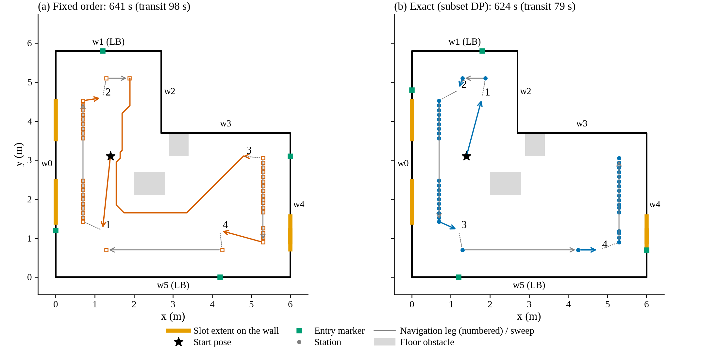
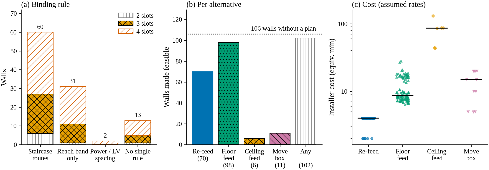
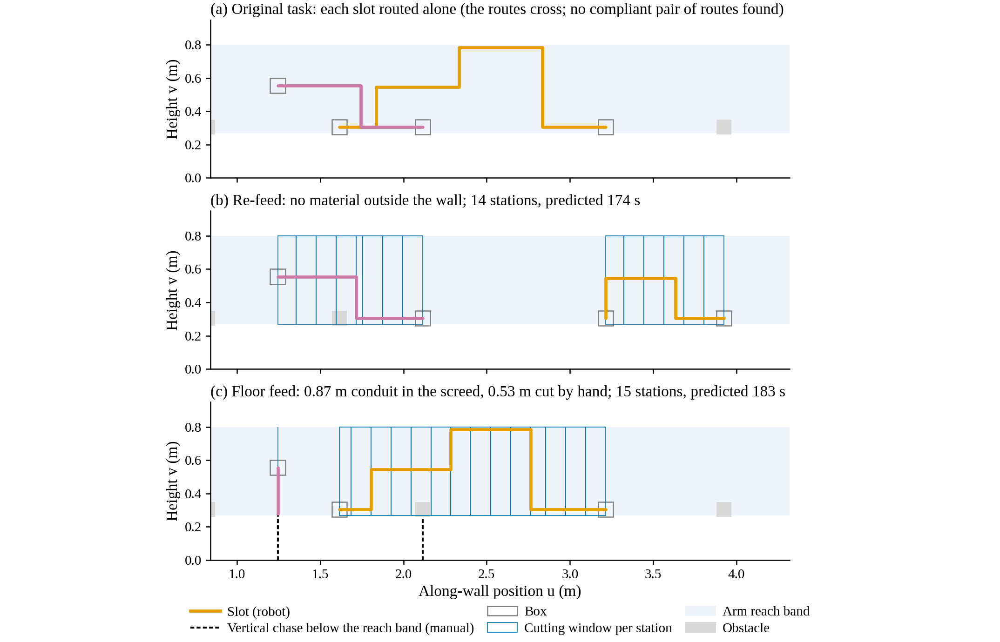
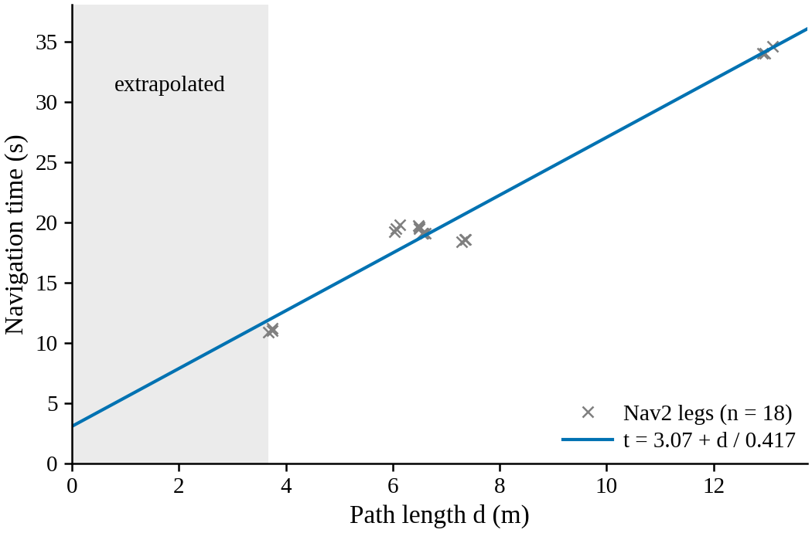
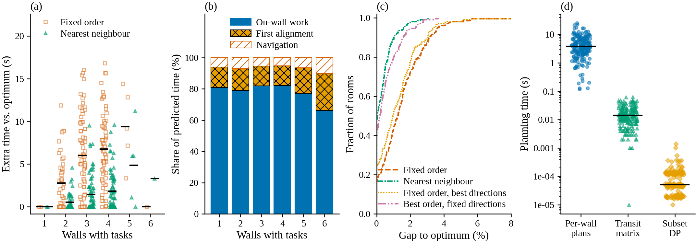

# 房间级规划与无合规方案墙面的替代方案



*图 1：一个随机生成的 L 形房间（种子 177，4 面墙有任务，共 8 条槽）的俯视图：(a) 按墙的列出顺序、一律从左到右；(b) 子集动态规划的最优顺序与方向。橙色粗线为各面墙上槽线的沿墙范围，圆点 / 方块为停靠站，绿色方块为每面墙的入口定位标记，带编号的彩色折线为各段导航（绕开障碍时沿栅格最短路），灰色箭头为墙上的扫掠方向，星号为起始位姿，LB 表示承重墙。两种方案墙上的作业相同，转场从 98 s 降到 79 s。*

**结论**（全部为离线的模型预测，未在 Gazebo 中执行）：

- 单面墙基准中联合规划无解的 106 面墙，冲突都集中在一对槽上；不放松任何开槽规范、只改任务本身，**102 面得到合规方案**：70 面只需换引线点（墙外不增加材料），另 32 面把一到三条槽改为走地（这 32 面的中位数：墙外线管 1.8 m、人工竖槽 1.05 m），4 面仍无解。全部替代方案经独立检查器检查，0 违规。
- 房间级的顺序问题规模很小（一个房间 2–6 面有任务的墙），子集动态规划在 1 ms 内给出精确最优。在 200 个随机房间上，最优方案比“固定顺序”平均快 **5.5 s（1.44 %，95 % CI [1.26, 1.64] %）**，比最近邻快 1.5 s（0.36 %）；墙上作业占预测总时间的81 %，转场中首次精对位（每面墙约 15 s）比导航本身占得多。**访问顺序在单个房间内的优化空间有限**，更值得做的是减少每面墙的固定开销。

## 问题

[任务级联合规划](../task_planning/README.md) 只处理一面墙，留下两个问题：

1. 400 面随机墙中有 106 面没有任何方法给出合规方案（其中 63 面是 4 条槽）。规划器此时只返回“无解”，对施工没有帮助。需要回答：为什么无解，以及能否给出仍然合规、对施工改动尽量小的替代做法。
2. 实际任务是一个房间：几面墙各有若干条槽，机器人要决定先去哪面墙、每面墙从哪端开始、墙与墙之间怎样转场；有的回路从一面墙绕过墙角到相邻的墙。时间模型此前也不含导航与每面墙的首次精对位（[plan_validation](../plan_validation/README.md) 的局限一节）。

约束不变：槽线只有正交直线段，机械臂单轴切割，升降机构不改，可切高度带 0.27–0.80 m；开槽规范（[cpp_planner](../cpp_planner/README.md)）始终是硬约束。

## A. 没有合规方案的墙

### A.1 诊断方法

`plan_alternatives.diagnose` 对每面无解的墙做三件事（判断“可行”时用规则路线并穷举槽的规划顺序，K = 4 时最多 64 次搜索；它比联合规划快，但同样不完备，见局限）：

1. **最少拿掉几条槽**：枚举槽的子集，找到拿掉后其余槽都能合规规划的最小子集；
2. **最小冲突集**：最小的、自身就无解的槽的子集，以及其中的回路组合；
3. **约束性规则**：逐项单独放松一条规则，看放松后是否可行——不限可切高度带、强弱电间距 30 → 5 cm、不限横槽长度、不要求弯曲半径、同类槽间距 5 → 0 cm。放松得到的方案只用于归因，不作为输出。

### A.2 诊断结果

**106 面墙全部是非承重墙上的多槽任务，最小冲突集都是一对槽；80 面拿掉一条槽即可，26 面要拿掉两条。**

| 归类（按“单独放松它就可行”） | 墙数 | 2 / 3 / 4 条槽 | 说明 |
|---|---|---|---|
| 阶梯走法互相挡住 | 60 | 6 / 21 / 33 | 放松“横槽 ≤ 50 cm”或“弯曲半径”即可行。横向跨度超过 50 cm 的槽必须走阶梯形，每个台阶竖向至少 24 cm（两个弯之间 2 × 12 cm），而高度带只有 53 cm，两条阶梯形的槽在 u 方向重叠时排不开 |
| 只有放开高度带才可行 | 31 | 1 / 10 / 20 | 规则本身放松一条都不够，槽必须绕到 0.27–0.80 m 以外（机械臂够不到）才有解 |
| 强弱电间距 | 2 | 0 / 0 / 2 | 强弱电槽之间 30 cm 的间距在高度带里放不下 |
| 任何单项放松都不够 | 13 | 1 / 4 / 8 | 需要同时放松两项以上，未再细分 |

最小冲突集的回路组合：强电–强电 93 面，强电–弱电 11 面，弱电–弱电 2 面。也就是说，多数冲突与强弱电间距无关，而是**两条同类的槽在同一段墙上交叉或重叠**，且各自受“横槽长度 + 弯曲半径 + 高度带”限制只能走阶梯形。

### A.3 替代方案

替代方案不放松规范，而是改任务。按对施工的改动从小到大分三级，每个候选都重新做可行性筛选，排序依次按级别、改动的槽数、代价：

| 级别 | 做法 | 墙上的槽 | 对施工的改变 | 依据 |
|---|---|---|---|---|
| `refeed` 换引线点 | 新点位改从同墙另一个未用的同类已有点位引线；或两条同类槽互换起点 | 仍是合规的正交槽 | 接线拓扑；墙外不增加材料 | [假设] 同类回路的容量允许从另一个点位引出 |
| `floor` 走地 / `ceiling` 走顶 | 这条槽不沿墙横走：两端线盒各开一段竖槽到地面（顶棚），线管在地面垫层（吊顶 / 楼板）内连通 | 只剩竖槽 | 墙外线管长度；竖槽在高度带以外的部分人工开 | 竖槽在承重墙与非承重墙上都允许（GB 50203-2011 3.0.11 限制的是水平沟槽）；点位之间走地 / 走顶是家装的通行做法 [行业] |
| `relocate` 移动线盒 | 新点位沿墙平移 5–20 cm | 仍是合规的正交槽 | 线盒偏离设计位置的距离 | [假设] 容许范围 20 cm，实际应由设计或业主确认 |

说明：

- **走地时机器人还切什么**：线盒中心高于高度带下沿 10 cm 以上时（电视柜 0.55 m、床头 0.68 m），从带下沿到线盒的一段竖槽仍由机器人开，带以下 0.27 m 由人工开；插座高度（0.30 m）的线盒到地面只有 0.26 m，全部在带以下，整段人工开。走顶同理，但带以上到顶棚约 2 m 都要人工开，且墙顶有梁时不可行（梁本体不得开槽）。
- **竖槽也要合规**：引线竖槽与门窗、梁柱、其他线盒保持与普通槽相同的净距，与其他槽保持同类 5 cm、强弱电 30 cm 的间距；它在规划其余槽时是障碍。竖槽穿过墙面底部 10 cm 的边距是必然的（线管要进地面），这一项不计为违规 [假设]。
- **代价**（`installer_cost`，折算的人工分钟，只用于排序）：人工开槽 10 min/m，墙外敷管 3 min/m，线盒每偏移 1 cm 计 1 min，每改一条回路的引线点计 2 min。**这四个单价都是 [假设]**，没有施工定额或实测依据；报告同时给出各项的实际数量（米、厘米），换一组单价可以直接重算。
- 没有采用的做法：在横槽中间加过线盒来“拆分”长横槽。横槽 ≤ 50 cm 的出发点是限制对墙体的削弱，把一条长横槽拆成两段首尾相接的短横槽并不减少削弱，因此不作为合规的替代方案。经相邻墙面绕行在房间级规划中以跨墙角回路的形式处理（B.4）。
- JGJ 242-2011（住宅建筑电气设计规范）与 GB 50303-2015 中关于垫层内暗敷线管的管径、保护层厚度的条文没有核对到原文，本报告不引用具体数值；走地方案只统计线管长度，不检查垫层厚度是否足够。

实现：`plan_alternatives.alternatives` 枚举候选并筛选，`finalize` 对选定方案用联合规划求预测时间，`plan_with_fallback` 是“先联合规划，无解时取排序第一的替代方案”的入口。走地 / 走顶按改动的槽数递增枚举，出现可行方案后不再枚举更大的子集。

### A.4 结果



*图 2：106 面无解墙面（种子 1000–1399 中联合规划无解者）。(a) 约束性规则的归类，按槽数堆叠；(b) 各级替代方案各自能解出的墙数（括号内），Any 为至少一级可行；(c) 各级排序第一的方案的代价（对数轴，黑横线为中位数；单价为假设）。*

| 替代方案 | 可行的墙 | 改动 1 / 2 / 3 条槽 | 代价中位数（最大） | 墙外线管 | 人工竖槽 | 线盒移动 | 机器人预测时间（均值） | 违规 |
|---|---|---|---|---|---|---|---|---|
| 换引线点 | **70 / 106** | 6 / 64 / 0 | 4.0（4.0） | 0 | 0 | 0 | 246 s | 0 |
| 走地 | **98 / 106** | 67 / 29 / 2 | 8.6（28.2） | 均值 1.37 m | 均值 0.70 m | 0 | 228 s | 0 |
| 走顶 | 6 / 106 | 2 / 3 / 1 | 86.2（131.3） | 均值 2.12 m | 均值 7.33 m | 0 | 232 s | 0 |
| 移动线盒 | 11 / 106 | 11 / 0 / 0 | 15.0（20.0） | 0 | 0 | 均值 13.2 cm | 277 s | 0 |
| 任一级 | **102 / 106** | — | — | — | — | — | — | 0 |

- 按级别取第一个可行的方案：70 面用换引线点，32 面用走地（其中 11 面改一条槽、19 面改两条、2 面改三条；墙外线管中位数 1.8 m，人工竖槽中位数 1.05 m，代价中位数 15.9）；走顶与移动线盒从未成为首选（走顶的人工竖槽长，移动线盒只在 11 面墙上可行，且这 11 面都有更小的改动可用）。
- 换引线点的 70 面中，64 面是**两条槽互换起点**，6 面是改接到未用的已有点位。这与诊断一致：冲突多是两条槽交叉，互换起点后变成不交叉的两条。生成器给每个新点位随机指定引线的已有点位，没有避免交叉；实际布线时电工会按就近原则接线，所以这一级更像是“纠正一个不合理的任务指定”，而不是让步。
- 走地方案中机器人仍承担引上段的一部分：平均每面墙 0.26 m 的竖槽在高度带内由机器人开。
- 机器人的预测时间在替代方案之间差别不大，不参与排序；走地把一条横向的槽移出墙面，机器人的工作量反而减少。
- 耗时：诊断每面墙平均 1.5 s，枚举并筛选全部候选平均 4.6 s（最长 16.9 s）。



*图 3：种子 1022 的墙（两条强电槽）。(a) 原任务：两条槽各自单独规划的路线互相交叉，没有找到同时合规的一对路线；(b) 换引线点：一条槽改从右侧未用的已有插座引线；(c) 走地：一条槽改为两端竖槽 + 垫层内 0.87 m 线管，虚线为高度带以下、需人工开的竖槽。浅蓝带为机械臂可切高度，竖框为各停靠站的切割窗口。*

**仍无解的 4 面墙**（种子 1018、1147、1226、1331）：

| 种子 | 槽数 | 原因 |
|---|---|---|
| 1018 | 4 | 唯一“拿掉即可”的那条槽，其高处线盒（0.68 m）下方、水平相距 5 cm 处有另一条槽的插座，竖槽下不去；上方有配电箱，也上不去 |
| 1226、1331 | 4 | 需要同时改两条槽，而可选的每一对里都有一条槽的高处线盒下方被其他插座挡住 |
| 1147 | 2 | 一强一弱两条槽：任一条改走地后，它的引上竖槽与另一条槽之间保持不了 30 cm 的强弱电间距 |

这些墙上，带内的点位过密是根本原因；在三级替代方案之外，只能把其中一条槽整条交给人工（或调整点位设计）。

## B. 房间级规划

### B.1 房间任务

`room_plan.Room`（YAML 格式见 [`config/room_task_room3.yaml`](../../../src/scr_planner/config/room_task_room3.yaml)）：

| 项目 | 内容 |
|---|---|
| 墙 | 每面墙就是一个单面墙任务（map 中的两个端点、高度、是否承重、墙面障碍、开槽任务），另有名称与定位标记的沿墙位置 |
| 地面 | 边界多边形与矩形地面障碍；可通行区域 = 边界内、离边界与障碍不少于 0.45 m（Nav2 代价地图的机器人半径 0.4 m + 0.05 m） |
| 墙前空间 | 机器人在停靠站处离墙 0.70 m，导航目标离墙 1.2 m；这两处落在可通行区域内才算“站得进去”。因此离墙角约 0.45 m 以内没有站位，靠墙的柜子前也没有 |
| 起始位姿 | 机器人进入房间后的位姿 |
| 跨墙角回路 | 线盒 A 在一面墙上、线盒 B 在相邻墙上的回路 |

### B.2 每面墙的方案与两个方向

每面墙先用 A 节的 `plan_with_fallback`（联合规划；无解时取排序第一、且每个停靠站都站得进去的替代方案）。槽线确定后，对两个扫掠方向 d ∈ {+, −}（沿墙坐标 u 增大 / 减小）分别得到一个选项：

- 入口标记：离该方向第一站最近、且标记前的导航目标可通行的定位标记；机器人导航到标记前、精对位，再横移到第一站（与现有执行流程相同）；
- 作业时间 s(i, d)：以入口标记为起点、按方向 d 依次访问各站的预测时间（`slot_plan.TimeModel`，默认 `traj_v1`）；
- 入口位姿 e(i, d)（标记前 1.2 m）与出口位姿 x(i, d)（最后一站）。

两个方向的停靠站划分相同，作业时间只差“入口标记到第一站”的横移，通常不到 1 s；方向的意义主要在于它决定了从哪里进、从哪里出。

### B.3 转场时间模型

```
t_transit = t0 + d / v + t_align        t0 = 3.07 s，v = 0.417 m/s，t_align = 15 s
```



*图 4：Nav2（Smac 2D + MPPI）18 段导航的用时与路径长度，以及线性拟合；灰色区域为拟合数据未覆盖的短距离。*

| 参数 | 取值 | 依据 |
|---|---|---|
| t0、v | 3.07 s、0.417 m/s | [system_modernization](../system_modernization/README.md) 4.2 节 Smac 2D + MPPI 的 18 段导航（[`legs.csv`](../system_modernization/runs/nav_mppi_smac2d/legs.csv)，路径 3.7–13.1 m）最小二乘拟合，残差 RMS 1.28 s，留一 1.38 s |
| t_align | 15 s | [plan_validation](../plan_validation/README.md) 中“导航 + 首次精对位”为 42.2–43.6 s（n = 4；另有一次因 Nav2 终点收敛多用约 15 s），按任务层日志其中导航约 28 s，余下约 15 s。这是由总时间减出来的估计，不是直接测量 |
| d | 路径长度 | 两点连线在可通行区域内时取直线距离，否则取 5 cm 栅格上 8 邻接的最短路（比真实最短路最多长约 8 %） |

房间内的转场多为 1–6 m，大部分低于拟合数据的最短距离 3.7 m，属于外推；短距离上 Nav2 的起步与终点收敛占比更大，实际用时可能高于模型。

### B.4 跨墙角回路

线管必须连续，所以两面墙上的做法要一起定（`room_plan.apply_links`）：

- **A. 墙角过线**：两面墙各开一条从线盒到“过线口”的槽。过线口离墙角 0.40 m——机器人站不进墙角，这是它够得到的最近位置——两面墙取同一高度 h；过线口到墙角的 0.40 m 横槽由人工开，两面墙合计 0.80 m。槽线必须竖直到达过线口，并在过线口前留足弯曲半径要求的直段；墙角一侧的横段长 0.40 m，不超过 50 cm。h 在高度带内逐厘米枚举，取两面墙都仍可规划且槽长之和最小者。承重墙禁止横槽，此法不适用。
- **B. 走地**：两端线盒各开竖槽到地面，线管在垫层内绕过墙角（与 A.3 的走地相同）；走地的竖槽被挡住时再试走顶。

先试 A，不可行用 B。墙角处线管要穿过两面墙的交接部位，槽线越过“离阴角 10 cm”的边距，这一项不计为违规 [假设]；过线口处的弯与墙角处的弯没有做圆弧净空检查。

### B.5 顺序问题

n 面有任务的墙，每面两个选项。要选一个访问顺序 π 和每面墙的方向 d，使

```
T = Σ_i s(i, d_i) + c0(π_1, d) + Σ_k c( x(π_k, d) → e(π_{k+1}, d) )
```

最小，其中 c 为转场时间，c0 从起始位姿算起；路径是开放的，做完最后一面墙即结束。这是每簇两个节点的广义旅行商问题（GTSP；Noon & Bean 1993）。一个房间里 n 很小，直接用子集动态规划（Held–Karp 的簇版本）精确求解：

```
f[S][(i, d)] = 已完成墙的集合 S、最后停在 (i, d) 时的最短时间
f[S ∪ {j}][(j, e)] = min_{(i, d)} f[S][(i, d)] + c(x(i, d) → e(j, e)) + s(j, e)
```

复杂度 O(2ⁿ · (2n)²)，n = 6 时约 9000 次状态转移。因为是精确解，其他方法与它的差就是与最优的差距，不需要另求下界。pytest 中在 120 个随机实例（n = 1–6）上与全枚举对照；基准中 n ≤ 5 的房间也逐个与全枚举对照。

对比方法：

| 方法 | 顺序 | 方向 |
|---|---|---|
| 固定顺序（基线） | 按墙的列出顺序（顺时针） | 一律 + |
| 最近邻（基线） | 每一步去转场时间最短的 (墙, 方向) | 同左 |
| 固定顺序 + 最优方向（消融） | 列出顺序 | 链上动态规划 |
| 最优顺序 + 固定方向（消融） | 子集动态规划 | 一律 + |
| **最优** | 子集动态规划 | 子集动态规划 |

## 实验设置

**A 部分**：`task_planning` 基准的 400 面墙（`wall_gen.residential_wall`，种子 1000–1399）中联合规划无解的 106 面，名单取自 [`task_planning/data/results.csv`](../task_planning/data/results.csv)（`align_v1` 时间模型下的结果；可行性几乎不依赖时间模型，`traj_v1` 下无解的墙为 107 面，相差一面）。替代方案的预测时间用 `traj_v1`。

**B 部分**：`room_gen.residential_room(seed)`，种子 0–199，共 200 个房间，每个房间由种子完全确定。

| 项目 | 设置（均为规则化的假设，不是实测户型） |
|---|---|
| 平面 | 70 % 矩形（边长 3.0–6.0 m），30 % L 形（外包 4.5–6.5 m，缺角每边不小于 1.5 m）；实际生成矩形 142 个、L 形 58 个 |
| 墙 | 每面墙由 `wall_gen.residential_wall` 按墙长生成（门窗、梁柱、已有点位同 task_planning）；30 % 承重；长度不小于 2.4 m 的墙各有 0–3 条槽（概率 0.25 / 0.35 / 0.25 / 0.15），至少两面墙有任务 |
| 可站立 | 任务两端离墙角不小于 0.55 m；任务范围内的站位与至少一个标记前的导航目标可通行 |
| 地面障碍 | 0–2 个：靠墙的柜子（不挡该墙任务的停靠范围）或房间中部的堆料 |
| 定位标记 | 有任务的墙每 0.6 m 一个（room3 南墙标记地图的间距）[假设] |
| 跨墙角回路 | 40 % 的房间有一条：墙角一侧 0.6–1.5 m 处的已有插座 → 相邻墙上 0.6–1.5 m 处的新点位（高度 0.30 / 0.55 / 0.68 m） |
| 起始位姿 | 房间内随机的可通行位置 |
| 时间模型 | 墙上作业 `traj_v1`；转场见 B.3 |

**指标**：预测总时间及其构成（墙上作业 / 导航 / 首次精对位）、各方法与最优的差、规划耗时、每面墙的状态（原任务可行 / 用了替代方案 / 无方案）、独立检查器的违规数、站不进去的停靠站数。

**统计**：与 task_planning 相同。配对差值 d = T_A − T_最优；Wilcoxon 符号秩检验（双侧，|d| < 0.05 s 视为持平并剔除）；效应量为配对秩二列相关 r_rb；均值的 95 % 置信区间来自配对 bootstrap（10000 次，种子 0）。

## 结果

### B 部分：200 个随机房间

**最优方案从不比基线慢，但差距不大：比固定顺序平均快 5.5 s（1.44 %），比最近邻快 1.5 s（0.36 %）；最近邻在 95 / 200 个房间里已经是最优。**

| 对比（A → 最优） | 样本 | 快 / 持平 / 慢 | 平均节省 | 95 % CI | 中位数 | 最大 | Wilcoxon p | r_rb | 占 A 的作业以外时间 |
|---|---|---|---|---|---|---|---|---|---|
| 固定顺序 | 全部 200 | 168 / 32 / 0 | 5.5 s，**1.44 %** | [1.26, 1.64] % | 1.26 % | 11.3 % | < 1e-10 | 1.00 | 7.1 % [6.4, 7.9] |
| 　2 面墙 | 46 | 31 / 15 / 0 | 2.8 s，1.17 % | [0.83, 1.54] % | 0.94 % | 4.3 % | 1.2e-06 | 1.00 | 5.5 % |
| 　3 面墙 | 76 | 64 / 12 / 0 | 6.0 s，1.62 % | [1.29, 2.01] % | 1.55 % | 11.3 % | < 1e-10 | 1.00 | 8.2 % |
| 　4 面墙 | 70 | 68 / 2 / 0 | 6.8 s，1.44 % | [1.19, 1.72] % | 1.26 % | 5.3 % | < 1e-10 | 1.00 | 7.3 % |
| 　5 面墙 | 5 | 5 / 0 / 0 | 9.4 s，1.97 % | [1.13, 2.83] % | 2.09 % | 3.5 % | 0.062 | 1.00 | 8.1 % |
| 最近邻 | 全部 200 | 105 / 95 / 0 | 1.5 s，**0.36 %** | [0.29, 0.44] % | 0.06 % | 3.0 % | < 1e-10 | 1.00 | 1.9 % [1.5, 2.3] |
| 固定顺序 + 最优方向 | 全部 200 | 154 / 46 / 0 | 4.9 s，1.23 % | [1.06, 1.42] % | 0.98 % | 11.3 % | < 1e-10 | 1.00 | 6.1 % |
| 最优顺序 + 固定方向 | 全部 200 | 120 / 80 / 0 | 1.9 s，0.53 % | [0.43, 0.63] % | 0.19 % | 3.5 % | < 1e-10 | 1.00 | 2.7 % |

（有任务且得到方案的墙数：1 面 2 个房间、2 面 46 个、3 面 76 个、4 面 70 个、5 面 5 个、6 面 1 个；1 面与 6 面的房间样本太少，不单列。5 面墙只有 5 个房间，p = 0.062，不能下结论。r_rb = 1.00 是“最优方案是精确解”的直接结果。最后一列以“A 的总时间 − 最优方案的墙上作业时间”为分母，是近似。）



*图 5：200 个随机房间。(a) 固定顺序与最近邻比最优方案多用的时间，按有任务的墙数分组，黑横线为均值；(b) 最优方案预测时间的构成；(c) 各方法与最优的差距的累积分布；(d) 规划耗时的三个部分（对数轴，黑横线为中位数）。*

**时间构成**（最优方案，200 个房间的均值）：预测总时间 410.5 s，其中墙上作业 81.1 %（95 % CI [80.0, 82.2] %），首次精对位 13.1 %（[12.4, 13.9] %），导航 5.8 %（[5.4, 6.2] %）。每个房间平均 25.9 个停靠站，导航总路程 4.35 m，即每段转场约 1.4 m；最优方案的 633 段转场中 608 段可以走直线。转场时间平均 67.6 s，其中每面墙 15 s 的首次精对位与 3.07 s 的导航起步开销与顺序无关，能被顺序优化的只有“路径长度 / 速度”这一项，平均不到 11 s。这就是差距小的原因。

**消融**：顺序比方向重要。只优化方向（固定顺序）仍比最优多 4.9 s，只优化顺序（方向一律 +）只多 1.9 s。方向的作用是让上一面墙的出口靠近下一面墙的入口；房间只有几米见方，这一项每次能省的路程有限。

**每面墙的状态**（648 面有任务的墙）：

| 状态 | 墙数 | 说明 |
|---|---|---|
| 原任务可行 | 541 | 联合规划直接给出方案 |
| 用了替代方案 | 92 | 换引线点 80 面，走地 12 面（墙外线管中位数 1.68 m，人工竖槽 0.53 m）；代价中位数 4.0 |
| 没有方案 | 15 | 14 面没有合规方案、三级替代方案也都不可行；1 面有合规方案但有停靠站站不进去 |

- 多槽墙（2–3 条槽）共 361 面，其中 103 面原任务无解（29 %）；A 部分的替代方案解出其中 92 面，11 面三级替代方案都不可行。另有 4 面单槽墙没有方案：3 面被跨墙角回路的引上竖槽挡住，1 面有停靠站站不进去。多槽墙里替代方案也不可行的比例（11 / 103）高于 A 部分（4 / 106）：房间里任务两端要离墙角 0.55 m，同样长度的墙上点位更挤。
- 15 面没有方案的墙分布在 14 个房间里；这些墙不参与排序，房间的预测时间不含它们，规划结果的状态为 `partial`。
- 全部方案经独立检查器检查：0 违规；没有站不进去的停靠站（没有方案的那 1 面除外）。

**跨墙角回路**（65 个房间各一条）：

| 做法 | 条数 | 对施工的改变 |
|---|---|---|
| 走地 | 50 | 垫层内线管中位数 2.11 m，人工竖槽中位数 0.53 m |
| 墙角过线 | 7 | 人工横槽 0.80 m（两面墙各 0.40 m） |
| 走顶 | 1 | — |
| 未解决 | 7 | 两端的引线竖槽都被其他线盒或门窗挡住，墙角过线也不可行 |

墙角过线只在 7 条回路上可行：它要求两面墙都不是承重墙，线盒离墙角足够近（否则横槽 ≤ 50 cm 迫使槽线走阶梯，再加上过线口前的直段要求，高度带里排不下），并且两面墙能取到同一个高度。走地没有这些限制，是更通用的做法。已知的不足：走地的引上竖槽是在本墙规划之前确定的，没有检查它是否把本墙原本可行的任务挡成无解；15 面没有方案的墙里有 6 面带有回路的竖槽，其中 3 面是只有一条槽的墙，可以确定是被竖槽挡住的。

**规划耗时**（单线程，机器负载较高时测得，仅作量级参考）：每个房间的墙面规划中位数 3.8 s（95 分位 11.3 s，最大 21.8 s），转场矩阵 14 ms，子集动态规划 0.05 ms（最大 1.4 ms）。耗时几乎全在每面墙的联合规划与替代方案枚举上。动态规划的结果在 n ≤ 5 的 199 个房间上与全枚举逐一相同。

### room3 房间任务

[`config/room_task_room3.yaml`](../../../src/scr_planner/config/room_task_room3.yaml) 是按 `room.world` 的 room3 写的房间任务：南墙沿用已在 Gazebo 中执行过的两条槽，东墙（设为承重墙）两条竖槽，北墙一条槽，另有一条从东墙绕过东南角到南墙的回路；地面障碍为设备柜与圆柱设备。规划结果在 [`example_room3/`](example_room3/)：

| 方法 | 顺序与方向 | 预测总时间 |
|---|---|---|
| 固定顺序 | south+ east+ north+ | 411.9 s |
| 固定顺序 + 最优方向 | south+ east− north+ | 405.9 s |
| 最近邻 / 最优 | north+ east+ south+ | **400.2 s** |

最优方案：22 个停靠站，墙上作业 323.7 s，导航 31.5 s（三段共 9.3 m），首次精对位 45 s。跨墙角回路因东墙是承重墙而走地：垫层内线管 1.8 m；东墙插座（中心高 0.34 m）到地面的 0.30 m 竖槽人工开；南墙电视柜插座的引上段，高度带以下的 0.27 m 人工开，带内的 0.28 m 由机器人开（南墙因此是 3 条槽、12 个停靠站）。

**能直接执行的部分**：`example_room3/wall_south.yaml` 与单面墙规划文件格式相同，入口标记就是现有的参考标记（x = 8.42），可以用现有命令执行：

```bash
ros2 launch scr_bringup sim_nav.launch.py gui:=false rviz:=false
ros2 run scr_planner execute_slot_plan.py docs/experiments/room_planning/example_room3/wall_south.yaml /tmp/room3_south --dry-run-gap=0.01
```

东墙与北墙在 `room.world` 中没有定位标记，执行前需要在世界文件与标记地图里加上（任务文件中的 `markers` 是建议位置），并把任务执行器的 `marker_x / marker_y` 换成各墙入口标记的位置；三面墙之间的衔接目前要逐面墙手动启动。

### Gazebo 验证需要检查什么

本报告的全部数字都是模型预测。要在仿真中验证，至少需要：

1. **转场模型**：房间内 1–6 m 的导航用时是否符合 `3.07 + d / 0.417`（现有数据最短 3.7 m），以及到新墙面后首次精对位的用时（15 s 是由总时间减出来的）与成功率；两者之和决定了转场在总时间中的占比。
2. **多面墙连续执行**：换墙时标记地图 / 参考标记的切换，机械臂收回与展开，以及一面墙结束位置到下一面墙入口的导航是否会因贴近墙角或障碍而失败（规划中只按 0.45 m 的外廓半径判断可通行）。
3. **靠近墙角的停靠站**：离墙角 0.45–0.6 m 的站位上精对位与定点保持是否正常（侧墙进入激光视野），机械臂横向伸出时是否与侧墙干涉。
4. **顺序的实际差别**：对同一个房间任务分别执行固定顺序与最优顺序。预测差只有几秒到十几秒，与 Nav2 终点收敛的偶发延迟（plan_validation 中出现过一次约 15 s）同一量级，需要多次重复才能分辨。
5. **引上竖槽**：从高度带下沿起刀的竖槽（走地方案中机器人承担的部分）在最低位置的可达性与精度。

## 分析

**已证实**（在模型与生成器的范围内）：

- 无解墙面的冲突总是集中在一对槽上，且 88 %（93 / 106）是两条强电槽之间；约束性的规则是“横槽 ≤ 50 cm + 弯曲半径 + 53 cm 高度带”的组合，而不是强弱电间距。
- 不放松规范、只改任务，可以为 102 / 106 面墙给出合规方案；其中 70 面的改动只是接线拓扑。
- 房间内的顺序问题可以精确求解，耗时可忽略；最近邻已经很接近最优（平均差 0.36 %）。
- 在本报告的转场模型下，一个房间内与顺序有关的时间只占总时间的 2–3 %，优化顺序最多拿回其中的一部分。

**推测（未验证）**：

- 互换起点之所以有效，是因为生成器随机指定引线点造成了交叉；按就近原则指定引线点的真实任务中，原任务无解的比例可能本来就低得多。没有用就近指定的生成器重跑 400 面墙来确认。
- 多个房间、经门洞转场时，导航路程是几米到十几米，顺序的影响应当更大；本报告没有做多房间实验。
- 转场中占比最大的是每面墙的首次精对位（13 %）。如果换墙后能利用上一面墙结束时的定位缩短首次精对位，收益会超过顺序优化。

**对后续工作的含义**：房间级规划的价值目前主要在于把“每面墙一个任务文件”串成一个完整的、能给出总工时和施工改动清单的方案，以及在无解时给出可执行的替代做法；而不在于顺序优化省下的几秒。


## 局限

- **全部是模型预测**。墙上作业的时间模型在 room3 南墙上标定并做过样本外检验（[arm_trajectory](../arm_trajectory/README.md)）；转场模型的导航部分来自 3.7–13.1 m 的导航段，房间内的短距离是外推；首次精对位 15 s 是减出来的估计。没有任何房间任务在 Gazebo 中执行过。
- **可行性判断不完备**：诊断与替代方案的筛选都用“规则路线 + 穷举槽顺序”，联合规划也是逐条规划；它们找不到方案不等于方案不存在。“106 面无解”“4 面仍无解”都是在这个意义上说的。相应地，“最少拿掉几条槽”可能偏大，替代方案可能比实际需要的改动更大。
- **代价单价是假设**：人工开槽、敷管、移动线盒、改引线点之间的折算没有施工数据支撑；级别的先后顺序（换引线点 < 墙外引线 < 移动线盒）是本报告的设定，不同工地可能不同。垫层 / 吊顶是否允许敷管（地暖、垫层厚度）没有建模。
- **替代方案的组合有限**：一面墙上只取同一级的改动（换引线点最多涉及两条槽，移动线盒只动一条），不混用不同级别。
- **房间生成器**是规则化设定：平面只有矩形与 L 形，墙之间的结构没有关联（门只是墙面上的障碍，不连通其他房间），地面障碍只有矩形。
- **顺序优化的前提**：每面墙的任务一次做完，不在墙之间穿插；不考虑电量、粉尘、与工人的协同等实际排程因素。
- **跨墙角回路**：墙角过线的人工横槽与过线口处的弯没有做净空检查；一个房间最多一条回路；回路与本墙其他槽的相互影响只通过“加上过线槽后仍可规划”来保证。
- **停靠站可站立**只检查机器人圆形外廓的中心位置，没有检查机械臂伸出时与侧墙、柜子的干涉。

## 复现

```bash
colcon build --symlink-install --packages-up-to scr_planner
# A：106 面无解墙面的诊断与替代方案，2 个进程约 9 min（4 核 / 4 GB 机器，与其他任务共用）
python3 src/scr_planner/scripts/infeasible_walls_benchmark.py --jobs 2
# B：200 个随机房间，2 个进程约 9 min；可中断续跑（每个房间的结果缓存在 data/cache/，--fresh 重算）
python3 src/scr_planner/scripts/room_planning_benchmark.py --rooms 200 --seed0 0 --jobs 2
# 统计、表格与图（本报告的数字都来自它的输出），约 1 min
python3 src/scr_planner/scripts/room_planning_report.py
# room3 房间任务 → example_room3/
python3 src/scr_planner/scripts/plan_room.py src/scr_planner/config/room_task_room3.yaml \
    docs/experiments/room_planning/example_room3
# 测试
colcon test --packages-select scr_planner && colcon test-result --verbose
```

| 文件 | 内容 |
|---|---|
| [`data/infeasible_walls.csv`](data/infeasible_walls.csv) | 每面无解墙一行：诊断结果与排序第一的替代方案 |
| [`data/infeasible_alternatives.csv`](data/infeasible_alternatives.csv) | 每面墙 × 每一级替代方案一行（424 行） |
| [`data/rooms.csv`](data/rooms.csv)、[`data/walls.csv`](data/walls.csv) | 每个房间一行；每个房间 × 每面有任务的墙一行 |
| [`fallback_summary.csv`](fallback_summary.csv)、[`room_summary.csv`](room_summary.csv)、[`room_paired_tests.csv`](room_paired_tests.csv)、[`transit_fit.csv`](transit_fit.csv) | 统计结果 |
| [`example_room3/`](example_room3/) | room3 房间任务的规划结果：`room_plan.yaml` 与三面墙的规划文件 |

代码（`src/scr_planner`）：

- `python/plan_alternatives.py`：诊断、三级替代方案、独立检查（`stub_violations`）、`plan_with_fallback`；
- `python/room_plan.py`：房间任务、地面最短路、转场模型、跨墙角回路、每面墙的两个方向、子集动态规划与基线、YAML 读写；
- `python/room_gen.py`：随机房间生成器；`python/wall_gen.py` 增加墙宽与整墙筛选两个参数（不给出时已有种子生成的墙不变）；
- `scripts/plan_room.py`：命令行入口；`scripts/infeasible_walls_benchmark.py`、`room_planning_benchmark.py`、`room_planning_report.py`：实验与统计；
- `test/test_room_plan.py`：16 项测试（替代方案合规与排序、走地竖槽长度、检查器能发现冲突、地面最短路、动态规划与全枚举一致、生成器可复现、任务文件读写、跨墙角回路的两种做法、room3 规划文件可被执行器的解析函数读取且每个机械臂点在关节限位内）。

## 参考文献

- GB 50203-2011 砌体结构工程施工质量验收规范，3.0.11（承重墙体不得开凿水平沟槽）。
- GB 50303-2015 建筑电气工程施工质量验收规范，12.2.1（导管弯曲半径）。
- Noon, C. E., Bean, J. C. An efficient transformation of the generalized traveling salesman problem. *INFOR*, 31(1): 39–44, 1993.
- Held, M., Karp, R. M. A dynamic programming approach to sequencing problems. *J. SIAM*, 10(1): 196–210, 1962.
- Macenski, S., Martín, F., White, R., Ginés Clavero, J. The Marathon 2: a navigation system. *IROS*, 2020.（Nav2）
