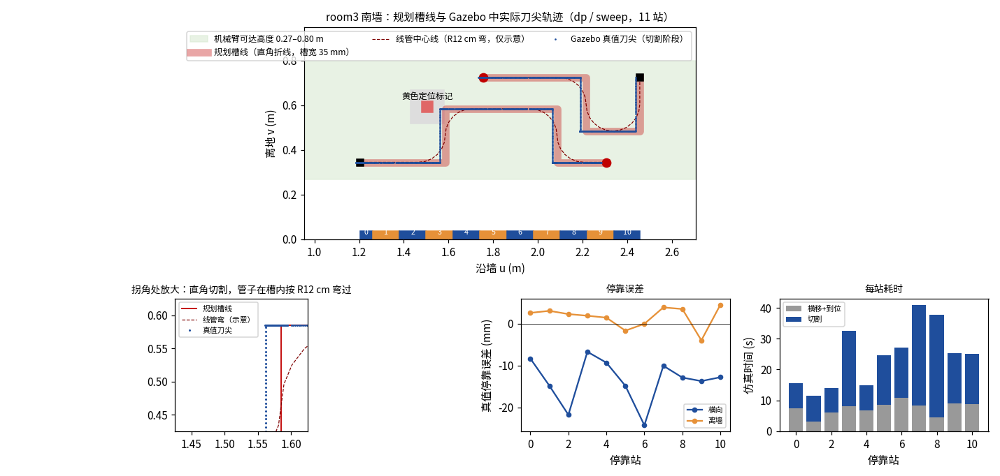
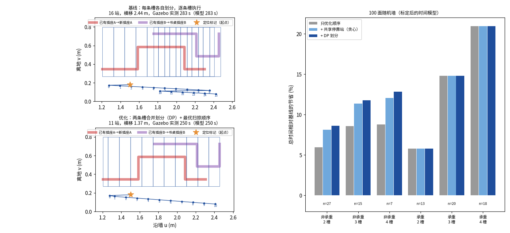

# 墙面开槽：离线规划 → 多站执行，及停靠站顺序优化



*room3 南墙上两条槽在 Gazebo 中按优化方案执行的结果（力控仿真，main a43d3dd）。浅红粗线是规划槽线（直角折线），蓝点是切割阶段的真值刀尖，虚线是线管在槽内按 R12 cm 弯过的中心线（仅示意，不切），底部色块是 11 个停靠站各自负责的墙面窗口。下排：拐角放大、每站真值停靠误差、每站耗时。*

## 范围

本项目负责**开槽路径规划**，以及让机械臂**按规划的切割轨迹逐站走完**，不要求在仿真中真正切出槽（Gazebo 的刚体墙也无法模拟切削）。因此执行一律采用**空切**：下刀位置改为刀尖停在墙面前 10 mm，其余动作（退刀、转刀片、沿轴切割）与真实切割完全一致。验证的指标是刀尖在墙面内 (u, v) 的轨迹是否与规划槽线吻合，以及每站耗时。切深 35 mm 只作为规划输出，用于检查机械臂 X 行程是否足够。

## 架构：先离线规划整条开槽路径，再由主任务逐站执行

```
墙面任务 YAML ──plan_wall_slots.py──▶ 规划结果 YAML ──navigation_cutting_task──▶ 逐站执行
（墙位置 / 墙体类型 /           （每条槽的直角折线、按执行顺序     （只读规划文件，执行中
 已有物体 / 起止线盒）            排列的停靠站、每站底盘位姿与       不重新规划）
                                  机械臂切割点、预测时间）
```

- **规划**：`scr_planner/scripts/plan_wall_slots.py`，命令行工具，不需要 ROS。也可以用 `wall_slot_planner_node.py`，它额外在 `/wall_slot_plan/markers` 上发布 RViz 显示。
- **执行（唯一主路径）**：`ros2 run scr_arm_controller navigation_cutting_task <plan.yaml> --dry-run-gap=0.01`。主任务识别到规划文件（含 `wall` / `stations`）就走多站流程 `NavigationCuttingTask.run_slot_plan`；给它单站任务文件（如 `task_at_target.yaml`）则仍走原来的单站流程。多站流程全部复用主任务已有的模块：
  1. **Nav2** 导航到定位标记正前方 1.2 m；
  2. **精对位**（AprilTag + 激光 EKF，见 [`fine_alignment`](../fine_alignment/README.md)）到标记前 0.70 m；墙面坐标原点取 EKF 估计的标记位置（第一版取对位停车时的里程计位姿，见“精对位改进后的复测”）；
  3. 逐站：
     - **到站**：沿墙横移（墙面相对状态 EKF：沿墙位置由里程计外推，离墙距离与朝向由激光更新；经激光**防碰撞守护**限速）；站间距离超过 `--max-strafe`（默认 1.5 m）时，先缩回机械臂、退到离墙 1.2 m 用 **Nav2** 过去，再横移 / 接近到站；
     - **定点保持**：`base_hold.py`（力控底盘整定的 P 5 / 6、50 Hz）；
     - **残差补偿**：用传感器测出横向 / 离墙 / 朝向残余误差，修正本站的机械臂点（刀尖离底盘中心约 0.69 m，0.5° 朝向误差就会让刀尖横移约 6 mm）；
     - **切割**：逐点执行；`--dry-run-gap` 为空切。
- **实验记录器**：`scr_planner/scripts/execute_slot_plan.py` 不再有自己的执行逻辑。它继承主任务、调用同一个 `run_slot_plan`，只额外订阅 Gazebo 真值，记录刀尖轨迹、每站到位误差、底盘漂移，并与规划槽线比较，输出 `stations.csv` / `tool_trace.csv` / `summary.yaml`。本报告的数据都由它产生。
- 每站的 `points` 与 `navigation_cutting_task` 单站任务 YAML 的格式相同；pytest（`test_main_task_executes_plan_file`、`test_main_task_compensation_cancels_station_error`）检查主任务对规划文件的解析、空切位置和补偿公式。

此前有两套执行器：`execute_slot_plan.py` 自带横移、定点保持（k = 1.0、20 Hz，按旧的运动学仿真整定）和补偿；主任务只有单站流程。现在合并为主任务一条路径，记录器只做评估。

## 任务约束：可切高度

机械臂 Z 行程为 0.157–0.707 m（相对 base_link），base_link 离地 0.1025 m，再扣去 1 cm 余量后，**可切高度为离地 0.27–0.80 m**。这是**任务约束**：按机器人能力布置插座、线盒的位置，而不是修改机械臂。

- 墙面任务里所有线盒都放在这个范围内，规划时也把槽线限制在其中。
- 随机墙面生成器的 `random_scene(band=…)` 模式按此生成任务：
  - 非承重墙：已有插座 → 新插座的低位改造；
  - 承重墙：同一竖线上的上下两个线盒，因为承重墙只能开竖槽。
- 2a 的规范对比实验用的是全高度任务，以检验规划规则本身，保持原样以便复现。

其他由机器人决定的量：

| 项目 | 数值 | 说明 |
|---|---|---|
| 每站可切宽度 | 12 cm | Y 行程 14 cm 减去两侧对位余量 |
| 最大切深 | 41 mm | 目标槽深 35 mm（Φ20 管 + 15 mm 保护层）可以达到 |
| 刀尖到底盘中心 | 约 0.69 m | 0.5° 的朝向误差会让刀尖横移约 6 mm，所以要补偿 |

## 切割方式：只切横平竖直的直线

机械臂是直角坐标解耦结构：joint1 = Z（竖切），joint2 = Y（横切），joint3 = X（切深），joint4 = 刀片方向（只取 0° 或 90°）。**每一刀只动一个轴**：下刀 → 沿一个轴切 → 退刀；到拐角时退刀、刀片转 90°、再下刀。pytest 会逐点检查这一点。

线管弯曲半径（GB 50303-2015 第 12.2.1 条，Φ20 管为 R12 cm）只作为**规划约束**：两个弯之间的直线段 ≥ 24 cm，拐角内侧半径 12 cm 的圆弧范围内没有障碍。这样管子能敷进直角槽并在拐角处弯过去。

## 停靠站划分与访问顺序优化（研究扩展）

### 问题

一面墙上通常有多条槽。每站只能切 12 cm 宽，所以要决定两件事：

- **划分**：每个停靠站负责哪一段墙面窗口，多条槽之间能否共用一个停靠站；
- **顺序**：从定位标记出发，按什么顺序访问这些站。

目标是总时间最短。

### 时间模型（在 Gazebo 中标定）

```
每站耗时 = t_settle + 横移距离 / v_strafe + 机械臂点数 × t_point
```

（本小节为第一版精对位下的标定，现保存为预设 `align_v1`；精对位第二版下的重标定见下文“时间模型重标定”。）

用力控仿真（main a43d3dd）上、经主任务执行路径的四次完整执行（54 个停靠站）最小二乘拟合：**t_settle = 4.40 s，v_strafe = 0.0945 m/s，t_point = 2.034 s，R² = 1.000，每站 RMSE 0.10 s**（`calibrate_time_model.py`，已写入 `slot_plan.TimeModel`）。

| 标定数据 | t_settle | v_strafe | t_point | 每站 RMSE |
|---|---|---|---|---|
| 旧仿真，合并 main 12a14f6 之前（27 站） | 6.85 s | 0.172 m/s | 2.14 s | — （R² 0.956） |
| 旧仿真，合并 12a14f6 之后（27 站） | 4.88 s | 0.110 m/s | 2.04 s | 0.55 s |
| **力控仿真 a43d3dd，主任务执行路径（54 站）** | **4.40 s** | **0.0945 m/s** | **2.034 s** | **0.10 s** |

- 上一版模型用于新仿真时整体偏高 1.6 %（每站 0.32 s），差别不大；但每站耗时的离散程度从 0.55 s 降到 0.10 s，执行变得非常确定（见下文“新旧仿真对比”）。
- 换用新参数后，示例任务两种方案的划分与停靠站**完全不变**，只是预测值从 288.0 / 253.9 s 变为 283.3 / 250.0 s。
- 规律：仿真或执行代码改动后都应重标定。各版本数据都保存在 `runs/` 中。

### 方法

| 方案 | 划分 | 顺序 |
|---|---|---|
| naive（基线） | 每条槽各自贪心划分，站不共享 | 逐条槽执行，每条从左到右 |
| sweep | 同上 | 一维最优扫掠：从标记出发先到较近的一端，再单向扫到另一端 |
| greedy | 所有槽合并后贪心划分（站数最少） | 一维最优扫掠 |
| **dp** | 所有槽合并后**动态规划**划分 | 一维最优扫掠 |

- **扫掠顺序的最优性**：所有停靠站都在同一条墙线上，从定位标记出发访问它们，可以证明“先到较近的一端、再扫到另一端”的横移距离最短。pytest 在随机算例上与暴力枚举全部排列对照过。
- **DP 划分**：
  - 状态是“u 以左的槽线已切完”；下一站从第一个未切的位置开始，在窗宽以内选一个结束位置；
  - 候选位置是 5 mm 网格加上所有拐点的 u，这样站的边界可以对齐到拐角；
  - 目标是最小化 Σ(t_settle + 点数 × t_point)。
- **近似**：DP 不考虑横移距离，因为扫掠顺序下总横移几乎不随划分变化；所以它在完整时间模型下不保证最优。pytest 验证了在它的目标函数上它从不劣于贪心。

### Gazebo 验证（示例：room3 南墙两条槽，全部停靠站端到端）

两条槽：

- 已有插座 A（离地 0.34 m）→ 新插座 A，横向 1.1 m；
- 已有插座 B（0.72 m）→ 书桌插座 B，横向 0.7 m。

两条槽在 u 方向重叠，可以共用停靠站。每次运行都是完整的端到端流程：启动仿真 → Nav2 → 视觉对位 → 全部停靠站 → 机械臂回位；每种方案跑两次。



| 方案 | 停靠站 | 横移 | 机械臂点 | **Gazebo 实测（各站耗时之和）** | 模型预测 | 刀尖轨迹误差（平均 / 95 分位 / 最大） | 覆盖率 |
|---|---|---|---|---|---|---|---|
| 基线 | 16 | 2.44 m | 92 | **283.1 / 283.7 s** | 283.3 s | 0.31 / 1.2 / 1.8 mm；0.45 / 2.2 / 2.7 mm | 99.3 / 90.1 % |
| 优化（DP + 扫掠） | 11 | 1.37 m | 92 | **249.8 / 249.9 s（−11.8 %）** | 250.0 s | 0.33 / 1.0 / 1.3 mm；0.24 / 0.4 / 1.2 mm | 99.3 / 98.2 % |

- 4 次运行的全部 54 个停靠站都到位、切完，横移全部在容差内收敛，没有一个点被关节限位钳制。
- 不带记录器、直接用主任务命令行（`navigation_cutting_task <plan.yaml>`）再跑一次优化方案：11 / 11 站完成，各站耗时之和 246.7 s。比记录器少约 3 s，是因为记录器每站到位后停 0.3 s 采真值（11 站 × 0.3 s）；所以时间模型的 t_settle 里含有这 0.3 s。
- 刀尖在切割阶段离墙 8.9–10 mm（空切间隙 10 mm），没有接触墙面。
- 同一方案两次运行的总耗时相差 ≤ 0.6 s。模型预测与实测相差 ≤ 0.4 s，但这些运行同时也是标定数据，属于样本内检验；用上一版（旧仿真标定的）模型做样本外预测，偏高 1.6 %。
- 覆盖率（规划槽线每 5 mm 取样，3 mm 内有刀尖经过即算已切）对参考偏差很敏感：基线第二次运行的参考偏差是 2.3 mm（见下文），离 3 mm 阈值不远，所以覆盖率降到 90 %，轨迹误差最大值仍只有 2.7 mm。

### 新旧仿真对比

同一示例任务、同一组规划文件，执行代码分别是旧版 `execute_slot_plan.py`（旧仿真）和主任务执行路径（新仿真）。

| 指标 | 旧仿真（main 12a14f6，`runs/oldsim_*`） | 力控仿真（main a43d3dd，本次） |
|---|---|---|
| 优化方案总耗时 | 254 s | 249.8 / 249.9 s |
| 基线总耗时 | 288 s | 283.1 / 283.7 s |
| 优化相对基线节省 | 11.9 % | 11.8 % |
| 刀尖轨迹误差（优化方案，平均 / 95 分位 / 最大） | 0.81 / 4.0 / 11.9 mm | 0.33 / 1.0 / 1.3 mm；0.24 / 0.4 / 1.2 mm |
| 刀尖轨迹误差（基线） | 0.56 / 2.4 / 6.5 mm | 0.31 / 1.2 / 1.8 mm；0.45 / 2.2 / 2.7 mm |
| 覆盖率（优化 / 基线） | 77.5 / 85.6 % | 99.3, 98.2 / 99.3, 90.1 % |
| 到站朝向误差（平均 / 最大） | 0.48–0.64° / 1.16° | 0.29–0.36° / 0.57° |
| 切割期间底盘漂移（真值，平均 / 最大） | 0.48–1.36 / 2.18 mm | 0.26–0.27 / 0.32 mm |
| 到站横向误差（平均绝对值） | 1.6–2.2 mm | 0.65–2.3 mm（每次运行的常值偏差，站间标准差 0.4–0.5 mm） |
| 横移 + 到位平均耗时 | 4.8–5.0 s | 4.5–4.9 s |
| 每站耗时 RMSE（时间模型拟合） | 0.55 s | 0.10 s |

**仿真配置变化**（仿真配置 v1 → v2，提交 a43d3dd）：

- 机械臂关节从 gazebo_ros2_control 的 position 接口（每周期直接设关节位置）改为 `position_pid` 力控；轮子改 `velocity_pid`；
- 底盘从 `gazebo_ros_planar_move`（给所有连杆设同一速度）换成力控插件 `scr_planar_move`（速度 P 环，只对底盘施加力 / 力矩）；
- 结果：底盘实际转速 / 指令转速从 18–37 % 恢复到 0.99–1.01，机械臂跟踪误差 ≤ 0.2 mm / 0.14°，撞墙不穿透；
- 定点保持按力控底盘重新整定（P 5 / 6，50 Hz）。

**结论与归因**：

1. **耗时与顺序优化的收益基本不变**（节省 11.9 % → 11.8 %）。每站时间主要由机械臂点数决定（2.03 s / 点），转向失真对这部分没有影响；横移只略快一点。
2. **精度明显提高**：95 分位轨迹误差从 2.4–4.0 mm 降到 0.4–2.2 mm，最大误差从 6.5–11.9 mm 降到 1.2–2.7 mm。直接原因是到站朝向误差减半、切割期间底盘几乎不动（漂移最大 0.32 mm）。这同时来自两处改动，本实验没有拆开：
   - 仿真修复：底盘能按指令转向，横移收敛时朝向残差更小；
   - 执行路径统一后改用主任务的 `BaseHold`（按力控底盘整定）代替记录器里那套旧增益的保持器。
3. **剩下的主要误差是每次运行的参考偏差**：到站横向误差在一次运行内几乎是常数（例如 +1.2 ± 0.4 mm、+2.3 ± 0.5 mm），各站相对参考的重复性是 0.4–0.5 mm。这个常值就是起点视觉对位停下时沿墙方向的残余误差：

   | 运行 | 对位真值误差（沿墙 / 法向） | 到站横向误差（平均） | 相机横向感知误差 |
   |---|---|---|---|
   | 优化 1 | 1.0 / −2.5 mm | +1.26 mm | −1.5 mm |
   | 优化 2 | 0.3 / −1.8 mm | +0.65 mm | −2.2 mm |
   | 基线 1 | 1.0 / −3.1 mm | +1.17 mm | −1.8 mm |
   | 基线 2 | 1.9 / −3.1 mm | +2.29 mm | −1.6 mm |
   | 每站 Nav2 | 1.3 / −2.2 mm | +1.46 mm | −1.4 mm |

   两者相差 ≤ 0.4 mm。对位在传感器误差进入 1 cm 容差（死区 5 mm）后就停下，加上相机横向感知误差，参考原点会有 0.3–1.9 mm 的偏差；之后所有站都继承它。精对位改进后的复测见下文“精对位改进后的复测”。

### 逐站 Nav2 导航（远站路径）

`--max-strafe=0.1` 让 11 站中的 10 站（站间距 0.12 m 及以上的全部）都走“缩回机械臂 → 退到离墙 1.2 m → Nav2 → 横移 / 接近到站”，用来验证远站路径（真实墙面上停靠站可能相距数米或被家具隔开）。

| | 沿墙横移（默认） | 每站 Nav2 |
|---|---|---|
| 完成 | 11 / 11 | 11 / 11（10 段 Nav2 全部成功） |
| 各站耗时之和 | 249.9 s | 322.3 s（+29 %） |
| 每站到站平均耗时 | 4.5 s | 10.9 s |
| 到站横向 / 离墙误差（平均绝对值） | 0.65–1.26 / 0.40–0.50 mm | 1.46 / 2.15 mm |
| 刀尖轨迹误差（平均 / 95 分位 / 最大） | 0.24–0.33 / 0.4–1.0 / 1.2–1.3 mm | 0.30 / 1.1 / 1.6 mm |

- 精度不受影响：横向参考始终是对位时的里程计位姿（Nav2 只负责粗到达，最后由横移闭环到站），里程计在 10 段往返后没有可见漂移；离墙误差变大是因为从 1.2 m 接近时停在 5 mm 容差的边缘，到站后由补偿消除。
- 没有观察到 AMCL 在墙前的航向漂移影响：AMCL 只用在 Nav2 的粗导航阶段，离墙 0.7 m 处的精定位只用激光拟合墙面和里程计。
- 代价是每站多约 6.4 s，所以只在站间距离大时用（默认阈值 1.5 m，约 16 s 横移）。

### 离线对比（100 面随机墙，标定后的模型）

条件：任务全部在可切高度内；每面墙 2–4 条槽；定位标记位置随机；种子 7。时间模型为上面新标定的参数。

| 方案 | 平均站数 | 平均横移 | 平均总时间 | 相对基线节省（平均 / 中位 / 最大） |
|---|---|---|---|---|
| 基线 | 11.09 | 4.55 m | 222 s | — |
| 只优化顺序 | 11.09 | 2.59 m | 202 s | 11.0 / 9.0 / 43.3 % |
| + 共享停靠站（贪心） | 9.57 | 2.58 m | 196 s | 12.2 / 11.6 / 43.3 % |
| **+ DP 划分** | 9.58 | 2.55 m | 195 s | **12.5 / 11.9 / 43.3 %** |

按墙体类型和槽数细分（相对基线的平均节省，DP + 扫掠）：

| | 2 条槽 | 3 条槽 | 4 条槽 |
|---|---|---|---|
| 非承重墙 | 8.6 %（27 面） | 11.8 %（15 面） | 12.8 %（7 面） |
| 承重墙 | 5.8 %（13 面） | 14.8 %（20 面） | 21.0 %（18 面） |

结论：

1. **收益主要来自访问顺序和共享停靠站**，槽越多收益越大。新模型的横移更慢（v 0.110 → 0.0945 m/s），所以顺序优化的收益比上一版（9.8 %）略高。
2. **DP 划分在 40 / 100 面墙上优于贪心，但平均只多省 0.3 %**。原因是贪心已经保证站数最少，而每站的固定开销（4.4 s）只相当于约 2 个机械臂点。
3. **承重墙上只有顺序能优化**：每条槽是一条竖线，一站切完，站之间不能共享。

原始数据：[`station_order_results.csv`](station_order_results.csv)、[`station_order_summary.csv`](station_order_summary.csv)。

## 精对位改进后的复测

上文的多站结果（`runs/dp`、`runs/dp_repeat` 等）使用第一版精对位（色块 + PBVS，墙面坐标原点 = 对位停车时的里程计位姿），每次运行带 0.65–2.3 mm 的常值横向偏差。精对位换成 AprilTag + 激光 EKF + 饱和控制律（[设计](../fine_alignment/README.md)、[对比实验](../alignment_robustness/README.md)）后，用**同一份规划文件**（`runs/dp/slot_plan.yaml`，优化方案 11 站）、同一执行路径和记录器复测。变化有三处，本实验没有全部拆开：

1. 起点对位更准（名义条件下 0.5 mm 对 4 mm 量级）；
2. **墙面坐标原点改为 EKF 估计的标记位置**：停车时的沿墙残差保留在估计状态中，各站目标直接取规划的 u（相对标记），而不是以停车位姿为原点（`alignment.fold_residual`，默认开）；
3. 站间横移改用同一个 EKF（里程计预测 + 激光更新，站间不用标记）与平方根整形控制律，到站残差与机械臂点补偿也改用 EKF 估计。

第 2 项单独做了消融：`fold_residual:=false` 恢复“以停车位姿为原点”，其余与新版相同。

| 运行 | 精对位 | 原点 | 起点停车残差（估计） | **到站横向误差 均值 ± 站间标准差** | 到站朝向 平均 / 最大 | 刀尖轨迹误差（平均 / 95 分位 / 最大） | 覆盖率 | 各站耗时之和 |
|---|---|---|---|---|---|---|---|---|
| `dp`（第一版，存档） | 第一版 | 停车位姿 | — | +1.26 ± 0.38 mm | 0.29° / 0.57° | 0.33 / 0.98 / 1.29 mm | 99.3 % | 249.8 s |
| `dp_repeat`（第一版，存档） | 第一版 | 停车位姿 | — | +0.65 ± 0.41 mm | 0.36° / 0.51° | 0.24 / 0.37 / 1.18 mm | 98.2 % | 249.9 s |
| `fine_align_dp` | 新版 | **标记** | +0.19 mm | **+0.24 ± 0.12 mm** | 0.06° / 0.11° | 0.20 / 0.22 / 0.93 mm | 99.6 % | 233.5 s |
| `fine_align_dp_repeat` | 新版 | **标记** | +0.46 mm | **−0.18 ± 0.18 mm** | 0.06° / 0.13° | 0.24 / 0.53 / 0.77 mm | 99.8 % | 233.2 s |
| `fine_align_dp_nofold`（消融） | 新版 | 停车位姿 | +0.50 mm | +0.86 ± 0.18 mm | 0.05° / 0.08° | 0.35 / 1.11 / 1.28 mm | 96.9 % | 233.7 s |

（每次 11 / 11 站完成，0 个点被关节限位钳制；仿真配置 v2，Nav2 流程 `rtf` 1；数据在 `runs/fine_align_*`。）

结论：

1. **每次运行的常值横向偏差基本消失**：两次复测的均值为 +0.24 / −0.18 mm，第一版为 +1.26 / +0.65 mm（此前另外三次为 +1.17 / +2.29 / +1.46 mm）。消融中关掉原点修正后偏差回到 +0.86 mm，与该次停车残差 +0.50 mm 同号、同量级，说明偏差来源确实是“以停车位姿为原点”，原点修正去掉了它。样本只有 2 + 1 次运行，偏差剩余的 ±0.2 mm 量级与站间标准差相当，未做显著性检验。
2. **站间重复性也提高**：站间标准差 0.12–0.18 mm（第一版 0.38–0.41 mm），到站朝向误差 0.06°（第一版 0.29–0.36°）。这一项来自站间横移改用 EKF + 新控制律（第一版用激光朝向的指数平滑，单帧抖动约 ±1°），与原点修正无关。
3. **横移更快**：每站“横移 + 到位”平均 2.8 s（第一版 4.5 s），各站耗时之和 233 s，比第一版少 6.5 %。时间模型（`slot_plan.TimeModel`，t_settle 4.40 s、v 0.0945 m/s）是用第一版执行路径标定的，现在偏保守，需要重新标定。
4. 刀尖轨迹误差的 95 分位从 0.37–0.98 mm 降到 0.22–0.53 mm，最大值从 1.2–1.3 mm 降到 0.8–0.9 mm。

## 时间模型重标定（精对位第二版）

上文的时间模型（t_settle 4.40 s、v_strafe 0.0945 m/s、t_point 2.034 s）是用第一版精对位下的执行数据标定的；精对位第二版的站间横移改用 EKF 与平方根整形控制律后，每站“横移 + 到位”从约 4.5 s 降到 2.8 s，该模型偏保守。用 `runs/fine_align_dp`、`fine_align_dp_repeat`、`fine_align_dp_nofold` 三次运行的 33 个停靠站重新标定。`nofold` 只改变墙面坐标原点，横移、定点保持与切割的时序与另两次相同，所以一并纳入。

**方法**。`stations.csv` 中每站耗时 = 到站 `move_s` + 切割 `cut_s` + 其余固定开销（测残差、记录器采真值等，1.2–1.3 s）。这批数据的横移阶段非常确定（`move_s` 对横移距离的线性拟合残差 0.05 s），但切割阶段在 3 / 33 个站上有 2.2–2.7 s 的停顿（`fine_align_dp` 第 7 站、`fine_align_dp_repeat` 第 8 站、`fine_align_dp_nofold` 第 0 站）。横移距离只有 0.055 / 0.12 / 0.23 m 三档，0.23 m 只出现在每次运行的第 0 站，所以对每站总耗时做整体最小二乘时，`nofold` 第 0 站的停顿被当成横移变慢：v_strafe = 0.063 m/s，逐次运行留一交叉验证时在 0.052–0.097 m/s 之间摆动。为此 `calibrate_time_model.py` 增加按阶段估计（`--method=phases`）：

- 横移阶段：`move_s = a + d / v_strafe`，最小二乘；
- 切割阶段：`t_point = Σ cut_s / Σ 点数`，停顿按平均摊入；
- 固定开销：`c = mean(station_s − move_s − cut_s)`；`t_settle = a + c`。

**结果**：

| 预设 | 标定数据 | 方法 | t_settle | v_strafe | t_point |
|---|---|---|---|---|---|
| `align_v1` | 第一版精对位，`dp`、`dp_repeat`、`per_slot`、`per_slot_repeat`（54 站） | 整体最小二乘 | 4.40 s | 0.0945 m/s | 2.034 s |
| **`align_v2`（默认）** | 第二版精对位，`fine_align_*`（33 站） | 按阶段估计 | **2.83 s** | **0.0984 m/s** | **2.049 s** |

在第二版的 33 个停靠站上比较：

| 模型 | 每站 RMSE | 平均偏差（预测 − 实测） | 各站耗时之和的误差（`dp` / `nofold` / `repeat`） |
|---|---|---|---|
| `align_v1` | 1.65 s | +1.50 s | +16.5 / +16.3 / +16.8 s（约 +7.1 %） |
| `align_v2`，样本内 | 0.68 s（去掉 3 个停顿站为 0.24 s） | −0.02 s | −0.2 / −0.4 / +0.1 s |
| `align_v2`，逐次运行留一交叉验证 | 0.68 s | — | −0.1 / −0.3 / +0.4 s |
| 整体最小二乘（对照），留一交叉验证 | 0.79 s | — | −0.1 / −0.4 / +0.4 s |

反过来，`align_v2` 用于第一版的 54 站时每站偏低 1.54 s，即两个预设各自只适用于对应的执行路径。对本节使用的 11 站规划（`runs/dp/slot_plan.yaml`），`align_v1` 预测 250.0 s，`align_v2` 预测 233.5 s，三次实测 233.2–233.7 s（样本内）。

- 两个预设保存在 `slot_plan.TIME_MODELS`，`TimeModel()` 的默认值为 `align_v2`；`plan_wall_slots.py --time-model=align_v1` 等可复现此前的报告数字。
- 重标定只改变 t_settle（4.40 → 2.83 s），t_point 与 v_strafe 基本不变：站数在总时间中的权重下降，机械臂点数的权重相对上升。
- **局限**：只有一份规划（11 站）、3 次运行；横移距离只覆盖 0.055–0.23 m，站间相距 1 m 以上时 v_strafe 是外推值；停顿的原因没有排查。用新模型规划的任务尚未在 Gazebo 中做样本外验证。任务级规划在新模型下的结果见 [task_planning](../task_planning/README.md#时间模型重标定精对位第二版)。

```bash
python3 src/scr_planner/scripts/calibrate_time_model.py docs/experiments/slot_execution/runs/fine_align_dp \
    docs/experiments/slot_execution/runs/fine_align_dp_repeat docs/experiments/slot_execution/runs/fine_align_dp_nofold \
    --method=phases --compare=align_v1,align_v2 --loo
```

## 单条槽的执行精度（补偿方法的验证，旧仿真）

在单条槽示例上，切割方式与补偿方法逐步改进的结果（旧仿真上测得，未重测）：

| 版本 | 平均偏差 | 95 分位 | 最大 |
|---|---|---|---|
| 圆弧拐角，底盘不保持 | 50 mm | 142 mm | 148 mm |
| 圆弧拐角，定点保持 | 6.8 mm | 20 mm | 22 mm |
| **直角折线 + 定点保持 + 补偿** | **1.5 mm** | **12.8 mm** | **15.7 mm** |

仿真中发现并解决的问题：

- **为什么必须空切**：真的下刀到切深时，刚体墙会把整台机器人顶开（旧仿真约 35 mm，力控仿真约 9 mm、3–4°），接触力还会扭曲轨迹。空切时刀尖始终离墙 9–10 mm，没有接触。
- **机械臂运动时底盘漂移**：旧仿真中不加保持时一站内最多漂 11 cm，与机械臂关节被运动学驱动有关（已由 a43d3dd 修复）。现在到站即用 `BaseHold` 定点保持，切割期间漂移 ≤ 0.32 mm。
- **朝向误差 × 力臂**：激光测得的朝向与真值相差 ≤ 0.15°，所以按测量值补偿有效。

数据在 [`runs/single_slot`](runs/single_slot)。

## 本次端到端打通中发现并修复的问题

| 问题 | 现象 | 根因 | 修复 |
|---|---|---|---|
| 两套执行器 | 多站执行在 `execute_slot_plan.py` 里，主任务只能跑单站；两边各有一套定点保持 | 多站功能最初作为独立实验脚本开发 | 多站流程并入 `NavigationCuttingTask.run_slot_plan`，主任务直接读规划文件；记录器只做真值评估 |
| 定点保持增益过时 | 记录器自带的保持器 k = 1.0、20 Hz、限速 0.05 m/s | 按旧的运动学仿真整定，没有跟着 a43d3dd 更新 | 统一用 `base_hold.py`（P 5 / 6、50 Hz），漂移最大值 2.18 → 0.32 mm |
| 导航目标被拒绝 | 仿真启动后立即运行任务，第一个 Nav2 目标被拒绝，任务直接失败 | `navigate_to_pose` action 服务器先于 bt_navigator 激活出现，`wait_for_server` 已返回但目标会被拒绝 | `navigate_to_pose` 被拒时等 3 s 重试（最多 10 次） |
| 退出时 abort | 记录器在执行失败的提前退出路径上 `terminate called without an active exception` | 定点保持的后台线程没停就退出 | 所有退出路径按顺序停线程、销毁节点 |

## 局限

- **真机上的切削反力不在本项目范围内**：空切不受切削反力；上真机时，刀具反力对底盘的影响需要另行评估，但本项目的定点保持与残差补偿机制可以直接沿用。
- **参考偏差**：第一版精对位下每次运行到站横向误差有 0.65–2.3 mm 的常值偏差，等于起点对位停下时的沿墙残余误差；精对位改进并以估计的标记位置为原点后降到 ±0.2 mm 量级（见“精对位改进后的复测”，2 + 1 次运行）。
- **时间模型来自仿真**：54 个停靠站、两种方案；示例任务的预测是样本内检验。真机上需要重新标定。DP 不考虑横移距离，所以在完整模型下只是近似最优。
- **离线对比有选择偏差**：100 面墙是从 175 面中选出的。其余 75 面至少有一条槽在可切高度内找不到合规路线（在 0.53 m 高的带内，“横槽 ≤ 50 cm”和“两弯间 ≥ 24 cm”很难同时满足），被跳过。所以非承重多槽墙在样本中偏少（49 面，承重墙 51 面）。
- **多条槽按任务顺序依次规划**：先规划的槽占用了位置，后面的槽可能因此无解。没有做联合规划，也没有调整规划顺序。
- **单一定位标记**：整面墙以一个标记为参考，远站靠里程计保持横向参考；本仿真中 10 段 Nav2 往返没有可见漂移，但真机上的里程计漂移更大，跨数米的墙面可能需要多个标记或在远站重新对位。
- **到站后的残差可能超出余量**：残差超过机械臂 1 cm 的横向余量时，补偿量会被关节限位钳制（主任务会记录被钳制的点数；本次 5 次运行均为 0）。
- **停靠站碰撞检查**：停靠站位姿还没有与占用地图做碰撞检查。

## 复现

```bash
# 1. 离线规划（不需要 ROS）
python3 src/scr_planner/scripts/plan_wall_slots.py src/scr_planner/config/wall_task_room3_south.yaml /tmp/plan_dp.yaml
python3 src/scr_planner/scripts/plan_wall_slots.py src/scr_planner/config/wall_task_room3_south.yaml /tmp/plan_naive.yaml \
    --partition=per_slot --order=slot_by_slot

# 2. Gazebo 中逐站执行（只读规划文件）。带 Nav2 的流程用 rtf=1
ros2 launch scr_bringup sim_nav.launch.py gui:=false rviz:=false
#   主任务（执行主路径）：
ros2 run scr_arm_controller navigation_cutting_task /tmp/plan_dp.yaml --dry-run-gap=0.01
#   或带真值记录的实验记录器（同一执行路径 + 评估输出）：
ros2 run scr_planner execute_slot_plan.py /tmp/plan_dp.yaml /tmp/run_dp --dry-run-gap=0.01
#   每站都走 Nav2 的对照：再加 --max-strafe=0.1
#   精对位改进后的复测（runs/fine_align_*）；原点消融再加 --ros-args -p alignment.fold_residual:=false
ros2 run scr_planner execute_slot_plan.py docs/experiments/slot_execution/runs/dp/slot_plan.yaml /tmp/run_fine_align --dry-run-gap=0.01

# 3. 标定时间模型、离线对比、作图
python3 src/scr_planner/scripts/calibrate_time_model.py /tmp/run_naive /tmp/run_dp
PYTHONUNBUFFERED=1 python3 src/scr_planner/scripts/station_order_benchmark.py --walls 100
python3 src/scr_planner/scripts/plot_execution.py src/scr_planner/config/wall_task_room3_south.yaml /tmp/run_dp \
    docs/experiments/slot_execution/execution.png
python3 src/scr_planner/scripts/plot_station_order.py /tmp/run_naive /tmp/run_dp \
    docs/experiments/slot_execution/station_order_results.csv docs/experiments/slot_execution/station_order.png
```

数据目录：`runs/fine_align_dp`、`runs/fine_align_dp_repeat`、`runs/fine_align_dp_nofold` 为精对位改进后的复测（未保存约 0.7 MB 的 `tool_trace.csv`，与其他运行一致）；`runs/dp`、`runs/dp_repeat`、`runs/per_slot`、`runs/per_slot_repeat`、`runs/dp_nav2_each_station` 为第一版精对位下的力控仿真数据；`runs/oldsim_*` 为旧仿真（main 12a14f6）数据，`runs/v1_*` 为更早（合并 12a14f6 之前）的数据。
