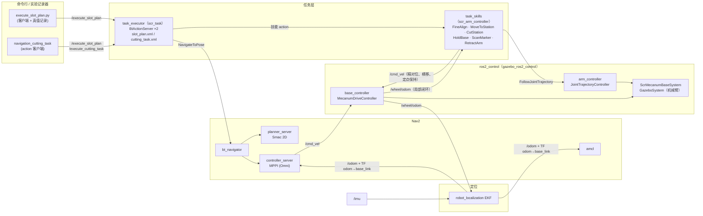
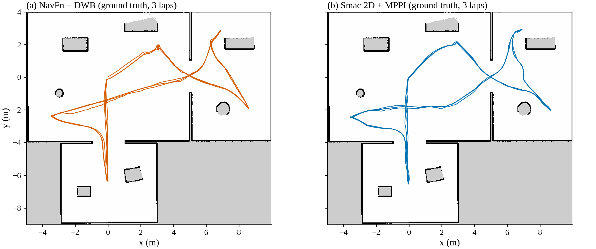
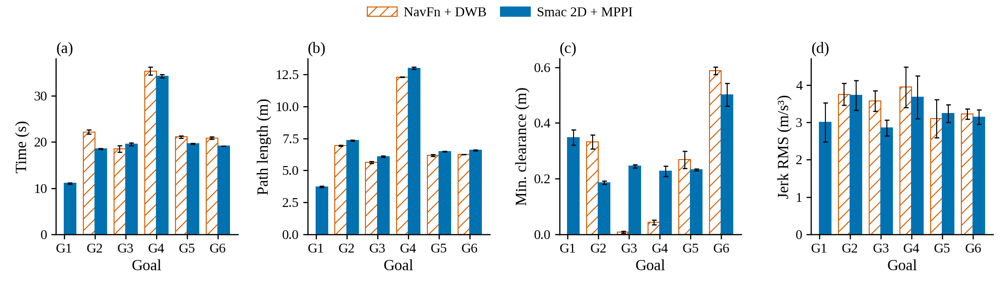
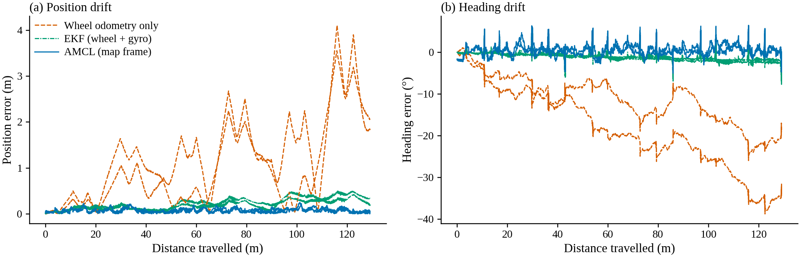

# 系统层现代化：行为树编排、Nav2 MPPI / Smac、定位融合与底盘 ros2_control

本报告记录 ROS 2 系统层的四项改动及其 Gazebo 验证：任务流程由顺序程序改为行为树编排的技能 action；Nav2 由 NavFn + DWB 改为 Smac 2D + MPPI；轮式里程计改为由编码器模型计算并与 IMU 融合；底盘接入 ros2_control。

| 改动 | 主要结果（Gazebo，数据见各节） |
|---|---|
| 行为树编排（BehaviorTree.CPP v3 + 6 个技能 action） | 11 站开槽 11 / 11 完成，到站横向误差 0.19 mm（平均绝对值）、刀尖轨迹误差 0.19 / 0.23 / 1.36 mm（平均 / 95 分位 / 最大），各站耗时之和 232.5 s，与原顺序程序（233.2–233.5 s）相当；11 个行为树结构测试覆盖重试、重新对位与失败报告 |
| Smac 2D + MPPI（Omni） | 固定 6 目标、3 圈：18 / 18 到达（NavFn + DWB 15 / 18）；同口径 15 段：最小外廓间隙 183 mm（DWB 5 mm），角速度指令变化均方根 0.018 rad/s（DWB 0.072），控制器 CPU 9.7 %（DWB 45.5 %，单核百分比） |
| 编码器误差模型 + IMU + robot_localization EKF | 129 m 巡回路线上，融合陀螺后里程计漂移由 1.4–1.6 % 降到 0.14–0.26 %，航向误差由 18–33° 降到 2–3°；局部闭环（定点保持、横移）改用原始轮式里程计（4.5 节排查） |
| 底盘 ros2_control（自写麦克纳姆控制器 + Gazebo 仿真硬件接口） | 力驱动被控对象的速度跟踪比 0.98–1.00，与早期力控插件相同；轮子驱动被控对象可运行但跟踪与里程计明显变差，保留为实验选项 |
| 真实里程计下的精对位与多站执行 | 单站精对位 0.7 mm、定点保持漂移 0.10 mm，与真值里程计时相当；11 站开槽的沿墙误差随离标记的距离线性增长到 25 mm（横移只靠里程计外推，约为横移距离的 −2.8 %），横移时保留标记更新后最大 14 mm。多站精度在这一里程计模型下没有保住，原因与下一步见 4.5 节 |

## 1. 问题

此前的系统层有四处与主流 ROS 2 做法不一致，也限制了后续工作：

1. **任务流程是一个约 1400 行的顺序程序**（`NavigationCuttingTask`）：单站任务、多站执行、重试与失败处理写在同一个类里，流程改动要改代码，失败时只能整体退出，也无法单独复用某一步（例如只做精对位）。
2. **导航使用 NavFn + DWB**：DWB 对全向底盘需要大量采样（每周期 15 × 15 × 20 条轨迹），在 4 核机器上占用较高；NavFn 的路径贴着代价地图的膨胀边界。
3. **`/odom` 是 Gazebo 的真值位姿**：力控底盘插件直接发布模型世界位姿，里程计没有误差，因此传感器融合没有意义，精对位与多站执行对里程计的依赖也从未被检验。
4. **底盘绕过 ros2_control**：机械臂经 `gazebo_ros2_control` 控制，底盘却由自写 Gazebo 插件直接订阅 `/cmd_vel`。换到真机时底盘一侧没有可复用的控制器。

## 2. 方法

### 2.1 架构



一个任务（例如多站开槽）是行为树执行器上的一个 action，结构与 Nav2 的 `bt_navigator` 相同：树中的技能节点是技能服务器 action 的客户端，导航直接复用 Nav2 的 `NavigateToPose` 行为树节点。命令行入口 `navigation_cutting_task` 与实验记录器 `execute_slot_plan.py` 只发送目标、接收反馈与每站记录。

### 2.2 任务编排：技能 action + 行为树

**技能拆分。** 原顺序程序中的步骤拆成 6 个 action（定义在新包 `scr_interfaces`）：

| 技能 | 作用 | 成功条件 |
|---|---|---|
| `FineAlign` | 精对位到定位标记前 `standoff` 处，确定墙面坐标原点 | 收敛判据满足（`docking_control.ConvergenceMonitor`） |
| `MoveToStation` | 墙面坐标闭环横移 / 接近到沿墙 `lateral_offset`，到站后进入定点保持 | 收敛，或残差在机械臂补偿范围内（横向 20 mm、离墙 10 mm、朝向 1.5°） |
| `CutStation` | 测到站残差 → 补偿机械臂点 → 逐点执行；单站任务另做可达性检查、缩回与空切后移 | 全部点执行完 |
| `HoldBase` | 定点保持，直到被取消 | —（一直运行） |
| `ScanMarker` / `RetractArm` | 扫描定位标记 / 机械臂缩回 | 检测到 / 动作完成 |

六个技能放在**同一个进程**（`task_skill_server`）中，而不是各自一个节点：精对位确定的墙面原点保存在墙面相对状态 EKF 中，之后的横移沿用同一个估计；横移收敛时开始的定点保持要一直持续到切割结束。拆成多个节点就要把 EKF 状态和保持目标在节点之间传递。技能代码（`task_skills.py`）可以由多线程执行器驱动（等待时只按仿真时钟轮询，不再自行 spin 节点），也可以像早期那样被实验脚本顺序调用（`alignment_benchmark`、`teach_alignment_offset` 不需要修改）。

**行为树库的选择。** 考虑过 BehaviorTree.CPP v3 与 py_trees_ros：

| | BehaviorTree.CPP v3 | py_trees_ros |
|---|---|---|
| 与 Nav2 的关系 | Nav2 Humble 的 `bt_navigator` 使用同一版本；可以直接复用 `BtActionServer`（把一棵树包装成 action 服务器）、`BtActionNode`（action 客户端节点模板）和现成的 `NavigateToPose` 节点 | 需要自己写 Nav2 action 的行为节点 |
| 树的表达 | XML，结构与代码分离，可用 Groot 查看；改恢复策略不需要重新编译 | Python 代码构造树 |
| 实时性 / 资源 | C++，tick 周期 10 ms，CPU 占用可忽略 | Python，与技能服务器争用 GIL |
| 依赖 | Humble 已安装（Nav2 依赖） | 需额外安装，CI 也要增加依赖 |
| 与现有 Python 技能的耦合 | 通过 action 边界，天然解耦 | 可在同一进程直接调用技能，但会把编排与执行重新耦合在一起 |

选择 BehaviorTree.CPP v3：与 Nav2 的模式一致，能复用 Nav2 已有的基础设施，技能与编排之间的边界是 ROS 2 action，两侧可以分别测试与替换。代价是任务层分成 C++ 与 Python 两部分，规划文件的解析在两侧各有一份（`scr_task/task_files.cpp` 与 `scr_arm_controller/slot_execution.py`），由各自的测试对照同一份 11 站规划文件检查。

**行为树与恢复策略。** 多站开槽的树（[`slot_plan.xml`](../../../src/scr_task/behavior_trees/slot_plan.xml)）：

```
Sequence
├─ LoadSlotPlan                       读规划；标记前的导航目标、墙面原点 u
├─ RetryUntilSuccessful(2) ─ NavigateToPose(标记前 1.2 m)
├─ AlignToMarker  = Fallback[ FineAlign,
│                             Sequence[CountRecovery, RetractArm, NavigateToPose(标记前), FineAlign] ]
├─ ForEachStation                     逐站写出 station_u / points / nav_leg …
│   └─ Sequence
│       ├─ Fallback[ ReachStation = Sequence[ IfThenElse(nav_leg → RetractArm, NavigateToPose), MoveToStation ],
│       │            Sequence[CountRecovery, RetractArm, NavigateToPose(标记前), AlignToMarker, ReachStation] ]
│       ├─ Parallel(1 成功即结束)[ HoldBase, RetryUntilSuccessful(2) ─ CutStation ]
│       └─ RecordStation
└─ RetractArm
```

到站失败时回到标记前重新对位，重新建立墙面原点后再到站：横移只用里程计外推沿墙位置，失败最可能的原因是估计已经不可信，重新看到标记是唯一能恢复绝对参照的办法。切割失败重试一次（重新测残差、重新执行本站全部点）。仍失败时整个任务失败，`ForEachStation` 把失败的停靠站与节点写进结果，例如 `station S2 failed (CutStation aborted: arm motion failed)`。单站任务的树（[`cutting_task.xml`](../../../src/scr_task/behavior_trees/cutting_task.xml)）结构相同但更短。

行为树的结构用模拟技能节点测试（`test_behavior_trees`，11 项）：同名、同端口的模拟节点代替 action 客户端，按停靠站注入失败，检查调用次数、恢复计数、定点保持的启停与失败报告，不需要 ROS 通信。

**排查：每站耗时偏大 7 %。** 第一次 Gazebo 运行中各站耗时之和为 249 s，比原顺序程序多 16 s，而技能服务器日志中站间的额外开销只有约 0.15 s / 站。把记录器的真值轨迹（仿真时间）与 `StationRecord` 中的时间对照，发现到站与切割的时长一致，多出的部分全在“每站总耗时”里，且比例接近该次运行的墙钟 / 仿真时间之比（1.11）。根因：`nav2_behavior_tree::BtActionServer` 放在黑板上的 ROS 节点是另建的客户端节点，它的时钟不跟随 `/clock`（实测为墙钟），而计时节点用了它。改为把执行器节点自己的时钟（仿真时间）放到黑板上供计时使用后，各站耗时之和为 232.5 s（表 4.1）。

### 2.3 Nav2：Smac 2D + MPPI

- **全局规划器选 Smac 2D 而不是 Hybrid-A\***：麦克纳姆底盘可以原地转向和横移，没有最小转弯半径，Hybrid-A\* 的运动学约束（Dubins / Reeds–Shepp 原语）不适用，还会大幅增加搜索开销。Smac 2D 是代价感知的 8 邻接 A\* 加路径平滑，`cost_travel_multiplier = 2.0` 让路径远离障碍。
- **局部控制器选 MPPI，运动模型 Omni**：在控制序列上加采样噪声、按代价指数加权平均（信息论 MPC），天然支持 `vy`。4 核机器上采样数取默认值的一半（1000 条、40 步 × 50 ms = 2 s 时域、20 Hz）。全向底盘不需要“车头对准路径”，`PathAngleCritic` 关闭前进偏好，另加 `TwirlingCritic` 抑制行进中的无谓旋转；`ObstaclesCritic` 的膨胀参数与代价地图一致。
- 两套配置（[`nav2_params.yaml`](../../../src/scr_navigation/config/nav2_params.yaml) 与 [`nav2_params_dwb.yaml`](../../../src/scr_navigation/config/nav2_params_dwb.yaml)）只有 `FollowPath` 与 `GridBased` 不同。
- 顺带修正：`controller_server.min_y_velocity_threshold` 原为 0.5 m/s，会把 |vy| < 0.5 m/s 的横向速度反馈置零，对全向底盘不合理，两份文件都改为 0.001。为确认对比结果不是由这一修改造成，另用未修改的原参数文件跑了 1 圈（4.2 节）。

### 2.4 轮式里程计、陀螺与 EKF

仿真中底盘由力直接驱动，轮子摩擦为 0、不参与驱动（早期为消除 `gazebo_ros_planar_move` 的旋转失真而做的选择，见 [`EVOLUTION`](../../EVOLUTION.md)）。因此编码器读数无法从轮子的实际转动得到，改为按“轮子随底盘纯滚动”的假设由底盘实际机体速度经麦克纳姆逆运动学计算，再叠加误差：

```
ω_meas,i = (1 + scale_i + g_i) · IK(vx, (1 + lateral_slip)·vy, (1 + yaw_slip)·wz)_i
```

| 误差项 | 默认值 | 含义 |
|---|---|---|
| `scale_i` | +0.4 %、−0.3 %、+0.5 %、−0.6 % | 每个轮固定的轮径 / 标定误差 |
| `g_i` | σ = 2 %，相关时间 0.5 s | 一阶高斯–马尔可夫打滑过程（随机，`odom_seed` 控制种子） |
| `lateral_slip` | 3 % | 横移时辊子打滑，编码器高估横向位移 |
| `yaw_slip` | 2 % | 转向时打滑，编码器高估转角 |

这些量的数量级按麦克纳姆底盘常见的里程计误差选取（纵向 1–3 %，横向和转向更大），不是对某台真机的标定结果。控制器把四个测得轮速经正运动学（最小二乘）积分为轮式里程计 `/wheel/odom`。

陀螺（`/imu`，100 Hz）的角速度取底盘实际角速度，加白噪声 σ = 0.001 rad/s 与零偏 5 × 10⁻⁵ rad/s（约 10°/h，相当于启动时标定过零偏的 MEMS 器件）。陀螺由底盘硬件接口生成，而不是 Gazebo 的 IMU 传感器，原因见下面的排查。`robot_localization` 的 EKF 以平面模式融合轮式里程计的 `(vx, vy)` 与陀螺的 `wz`，发布 `/odom` 与 `odom → base_link`。角速度只取陀螺：轮式里程计的 `wz` 含转向打滑与轮径误差带来的系统偏差，一起融合时滤波器的角速度在两次陀螺更新之间被拉向轮式值。不用 IMU 的姿态（没有磁力计时航向不可观）和加速度（零偏积分发散）。

技能服务器的局部闭环（定点保持、墙面相对状态估计的预测）用轮式里程计 `/wheel/odom`，导航用融合后的 `/odom`，原因见 4.5 节的排查。

真值由 `gazebo_ros_p3d` 发布在 `/ground_truth/odom`（另有 `/gazebo/model_states`），只用于评估。`localization:=wheel` 时不启动 EKF，控制器直接发布 `/odom` 与 TF；`odom_error:=false` 时编码器误差全为 0。

**排查：Gazebo 中底盘的“只在位姿里出现”的转动。**

- 现象：第一次长路线运行中，EKF 的航向误差随时间近似线性增长（约 0.06°/s），两个打滑种子的曲线几乎重合，EKF 的位置漂移反而大于只用轮式里程计；同一配置下的多站执行中，底盘相对墙面逐站转动到 −12.5°，而墙面相对状态估计报告的朝向始终小于 0.1°，激光墙面测量被 χ² 门限拒收（NIS 从 118 增长到 556）。
- 定位：底盘特性测试的纯平移段（前、后、左、右）中，真值位姿差分得到的转速都是 −0.0011 至 −0.0016 rad/s，方向与平移方向无关；早期力控插件（`/odom` 为真值）的测试中同样存在，与早期文档记录的“零速度指令下约 0.08°/s 的缓慢转动”一致。以 0.3 m/s 直行时，真值位姿差分转速为 −0.0013 rad/s，而 Gazebo IMU 读数为 +0.0003 rad/s、`gazebo_ros_p3d` 的连杆角速度为 −0.0028 rad/s。
- 根因：这部分转动只出现在底盘位姿里，不出现在连杆速度里（推测来自 ODE 的约束误差修正，未进一步证实）。早期插件与新的力驱动被控对象都用连杆速度做速度闭环，所以它不受控制；编码器模型与 Gazebo IMU 都读连杆速度，所以也测不到。早期配置下定点保持用的是真值 `/odom`，这一转动被位置闭环纠正，因而一直没有暴露。
- 方案：硬件接口的速度闭环、编码器模型与陀螺都改用由相邻物理步位姿差分（低通 5 ms）得到的底盘实际速度（`velocity_source`，默认 `pose`）。
- 验证：纯平移段的真值转速降到 |wz| ≤ 1 × 10⁻⁵ rad/s，跟踪比 0.999–1.000（4.3 节）；60 s 特性测试序列后 EKF 航向误差由 4.5–7.1° 降到 0.26°（4.3、4.4 节）。修正前的长路线与多站数据保留在 4.4、4.5 节的“修正前”行中，说明这一问题的影响。
- 遗留：Gazebo 的 IMU 传感器与连杆速度在此场景下仍不可信；`base_control:=plugin`（早期配置）保持原样以便复现早期结果。

### 2.5 底盘 ros2_control

**可行性。** Humble 的 `ros2_controllers` 没有麦克纳姆控制器（`mecanum_drive_controller` 从 Jazzy 开始提供）；底盘又由力控插件驱动，不经过任何关节接口。三种做法：

| 做法 | 评价 |
|---|---|
| 维持现状（插件直接订阅 `/cmd_vel`） | 真机上底盘一侧没有可复用的控制器，里程计也只能是真值 |
| 把底盘建成三个虚拟关节（x、y、yaw），用 `GazeboSystem` 的速度接口驱动 | 改动模型结构；虚拟关节的接口与真机硬件（四个轮子）不对应，控制器不能直接移植 |
| **自写控制器 + 自写仿真硬件接口**（采用） | 控制器只依赖四个轮子的速度命令 / 状态接口，与真机一致；被控对象的物理模型留在硬件接口里，可以替换 |

新包 `scr_base_control` 实现两个插件：

- `MecanumDriveController`（`controller_interface`）：结构仿照 `diff_drive_controller`，`cmd_vel` → 逆运动学 → 四个轮的速度命令，超时停车；四个轮的速度状态 → 正运动学 → 里程计积分，发布 `nav_msgs/Odometry` 与可选的 TF（实时发布器）。这一部分换到真机时不需要修改。
- `ScrMecanumBaseSystem`（`gazebo_ros2_control::GazeboSystemInterface`，按 `<hardware><plugin>` 由 pluginlib 加载，与机械臂的 `GazeboSystem` 并存于同一个控制器管理器）：对上提供与真机相同的轮子接口，对下有两种被控对象（硬件参数 `plant`）：
  - `force`（默认）：命令轮速经正运动学得到机体速度指令，在底盘上施加力 / 力矩做速度闭环，算法与早期的 `scr_planar_move` 插件相同；编码器读数按 2.4 节的误差模型生成。
  - `wheels`：轮子由关节电机驱动（目标转速 + 最大力矩 3 N·m），底盘只受轮–地接触力推动（见下）；编码器读数是轮子关节的实际转速。

**轮子驱动被控对象的尝试。** Gazebo Classic 中模拟麦克纳姆轮的常见做法是给轮子碰撞体设置各向异性摩擦：辊子轴线方向（与轮轴成 45°）摩擦系数高，垂直方向为 0（ODE 的 `fdir1`、`mu`、`mu2`）。实现后底盘的行为像普通四轮滑移底盘：横移指令几乎不产生横向运动，原地转向的实际角速度约为指令的 2.2 倍（= (lx + ly) / ly，即只有纵向摩擦时的转向几何）。原因是 ODE 的 `fdir1` 在碰撞体自身坐标系中表达，轮子转动时摩擦方向跟着转；指定其他表达坐标系（`gz:expressed_in`）是新版 Gazebo 的功能；Gazebo 11 中 `expressed_in` 只用于关节轴，给 `fdir1` 加这一属性后底盘行为不变。不建单个辊子（每轮 9–12 个带被动关节的连杆）就无法用 ODE 摩擦表达麦克纳姆轮。

因此 `wheels` 被控对象的接触力在硬件接口中计算：每个轮在辊子轴线方向上的滑移速度 `e = (v_接地点 − r·ω·x̂)·r̂` 产生摩擦力 `F = −sat(c·e, μN)·r̂`（`c` = 3000 N/(m/s)，μ = 1，N = 整机重量 / 4），作用在底盘的接地点处（高度取 base_link 原点）；反作用力矩加在轮子关节上，作为电机负载。垂直于辊子轴线的方向辊子自由滚动、无力。底盘只因轮子转动而运动，打滑由接触力饱和与电机力矩限制产生。两种被控对象的对比见 4.3 节。

## 3. 实验设置

| 项目 | 设置 |
|---|---|
| 仿真 | Gazebo Classic 11.10，`room.world`，物理步长 1 ms，`rtf` 1（实测实时率 0.99），无界面 |
| 仿真配置 | 早期底盘：仿真配置 v2（`base_control:=plugin`，`/odom` 为真值）。新底盘：仿真配置 v2 的机械臂 + `base_control:=ros2_control`，`plant:=force`，编码器误差模型开，EKF 融合（默认） |
| 行为树执行（4.1） | 早期底盘 + NavFn + DWB（只改任务层）；单站任务 `task_at_target.yaml`；11 站规划 `slot_execution/runs/dp/slot_plan.yaml`，空切间隙 10 mm，补偿开 |
| 导航对比（4.2） | 早期底盘（排除里程计误差的影响，只比较规划器与控制器）；固定 6 个目标的巡回路线（大房间东北 → 东侧房间墙前 → 东侧房间北部 → 大房间西南 → 南侧房间 → 起点，经过两处约 1.9 m 宽的门洞），每圈约 40 m，每种配置 3 圈（18 段）；Nav2 服务器分进程运行（`use_composition:=False`）以分别统计 CPU |
| 底盘特性（4.3） | 只启动 Gazebo 与控制器；10 段速度指令（平移、横移、旋转、组合、0.05 m/s 慢速横移），每段 5 s，取后半段真值机体速度 / 指令 |
| 定位漂移（4.4） | 新底盘，Smac 2D + MPPI，同一条巡回路线 3 圈（约 120 m），打滑过程种子 1、2 各一次；同一次运行中同时记录轮式里程计、EKF 输出与 map 系（AMCL）位姿 |
| 精对位与多站（4.5） | 新底盘 + EKF + Smac 2D + MPPI；技能的局部闭环用轮式里程计 `/wheel/odom`（见 4.5 节排查）；同一单站任务与 11 站规划；另做一次横移时保留标记更新（`alignment.strafe_tag_updates: true`，[`fine_alignment_strafe_tag.yaml`](fine_alignment_strafe_tag.yaml)） |
| 真值 | `/gazebo/model_states`、`/gazebo/link_states`、`/ground_truth/odom`（只用于评估） |
| 里程计漂移的口径 | 估计轨迹在起点处与真值对齐（平移 + 旋转），之后的位置误差；map 系位姿直接与真值比较（地图与 Gazebo 世界系重合） |
| 平滑性口径 | 真值位姿 10 Hz 采样、中心差分得到加加速度与角加速度的均方根；另统计相邻两次 `/cmd_vel` 角速度之差的均方根 |
| 间隙口径 | 底盘碰撞盒（0.747 × 0.566 m）外廓到静态地图障碍栅格的最小距离 |

## 4. 结果

### 4.1 行为树执行

**行为树执行与原顺序程序的精度、耗时相当。**

| 运行 | 执行方式 | 完成 | 到站横向误差（平均绝对值 / 最大） | 到站朝向（平均） | 刀尖轨迹误差（平均 / 95 分位 / 最大） | 覆盖率 | 各站耗时之和 |
|---|---|---|---|---|---|---|---|
| `fine_align_dp`（[早期](../slot_execution/README.md#精对位改进后的复测)） | 顺序程序 | 11 / 11 | 0.24 / 0.55 mm | 0.06° | 0.20 / 0.22 / 0.93 mm | 99.6 % | 233.5 s |
| `fine_align_dp_repeat`（早期） | 顺序程序 | 11 / 11 | 0.22 / 0.41 mm | 0.06° | 0.24 / 0.53 / 0.77 mm | 99.8 % | 233.2 s |
| [`bt_dp`](runs/bt_dp/summary.yaml) | 行为树 | 11 / 11 | 0.19 / 0.53 mm | 0.08° | 0.19 / 0.23 / 1.36 mm | 100 % | 232.5 s |

（仿真配置 v2，早期底盘，NavFn + DWB；0 次恢复，0 个点被关节限位钳制。早期运行的“各站耗时”包含记录器每站 0.3 s 的真值采样等待，行为树版本的记录器在旁路采样、不阻塞执行，因此两者相差的约 1 s 主要来自这一项。）

单站任务（客户端日志 [`runs/bt_single`](runs/bt_single/client.log)，服务器日志在 [`runs/bt_dp/task_layer.log`](runs/bt_dp/task_layer.log) 开头）：84.3 s 完成，精对位宣布到位时的真值误差 0.5 mm / 0.08°，扫描与切割期间定点保持的真值最大漂移 0.22 mm。

### 4.2 Nav2：Smac 2D + MPPI 与 NavFn + DWB

**Smac 2D + MPPI 全部到达，路径离障碍更远、指令更平滑，控制器 CPU 只有 DWB 的约五分之一。**

| 配置 | 到达 | 用时 / 段 | 路径 / 段 | 最小间隙（全部段） | 间隙均值 | 加加速度 RMS | 角加速度 RMS | 角速度指令变化 RMS | 控制器 CPU | 规划器 CPU |
|---|---|---|---|---|---|---|---|---|---|---|
| NavFn + DWB | 15 / 18 | 23.6 ± 6.2 s | 7.46 ± 2.54 m | **0.005 m** | 0.248 m | 3.52 m/s³ | 0.58 rad/s² | 0.072 rad/s | 45.5 ± 4.5 % | 4.0 % |
| Smac 2D + MPPI | **18 / 18** | 22.2 ± 6.2 s | 7.89 ± 2.67 m | **0.183 m** | 0.278 m | 3.32 m/s³ | 0.34 rad/s² | 0.018 rad/s | **9.7 ± 0.5 %** | 3.9 % |

（同口径：两种配置都每圈到达的 G2–G6 共 15 段；均值 ± 段间标准差。CPU 为单核百分比，即该进程占一个核的比例；机器 4 核。原始数据 [`runs/nav_*`](runs/)，逐目标数据 [`nav_per_goal.csv`](nav_per_goal.csv)。）





- **到达率**：DWB 三圈都没有到达 G1（离柜子 0.36 m，在 0.7 m 膨胀半径之内），在目标前 0.55 m 处反复调整约 170 s 后被 progress checker 判定失败。用未修改的原参数文件（`min_y_velocity_threshold = 0.5`）跑 1 圈，G1 同样失败，G3 的最小间隙同样只有 15 mm（[`runs/nav_navfn_dwb_legacy`](runs/nav_navfn_dwb_legacy/legs.csv)），说明差别不是 2.3 节的参数修改造成的。
- **间隙**：DWB 在进入东侧房间北部（G3）时三圈的最小间隙为 5–11 mm，几乎擦过门洞边缘；MPPI 的最小间隙 183 mm。代价是 Smac 2D 的路径更绕（同口径路径长 6 %），但 MPPI 行驶更连续，总用时仍短 6 %。
- **平滑性**：线加加速度两者接近；角加速度与角速度指令的变化 MPPI 明显更小（DWB 每周期在离散的角速度采样之间跳变）。
- **CPU**：DWB 每周期评估 15 × 15 × 20 条轨迹，控制器占 45 % 单核；MPPI（1000 条采样）占 10 %。整机占用（4 核平均）分别为 47 % 与 36 %，其中 Gazebo 约占 45–50 % 单核。

### 4.3 底盘被控对象

**ros2_control 的力驱动被控对象与早期力控插件行为一致；轮子驱动被控对象可以运行，但跟踪与里程计明显变差，未采用。**

| 被控对象 | 平移 前 / 后 | 横移 左 / 右 | 旋转 逆 / 顺 | 斜行 vx / vy | 0.05 m/s 慢速横移 | 平移段寄生转速 | 实时率 | gzserver CPU | 60 s 后里程计误差：轮式 / EKF |
|---|---|---|---|---|---|---|---|---|---|
| 早期力控插件（`plugin`） | 1.001 / 0.999 | 0.998 / 1.002 | 0.998 / 1.001 | 1.001 / 0.997 | 0.991 | 1.2 × 10⁻³ rad/s | 0.995 | 46.5 % | —（`/odom` 为真值） |
| ros2_control `force`（默认） | 1.000 / 1.000 | 1.000 / 1.000 | 1.000 / 1.000 | 1.000 / 1.000 | 1.000 | 1 × 10⁻⁵ rad/s | 0.995 | 46.1 % | 46 mm、6.4° / 44 mm、0.26° |
| ros2_control `wheels`（实验） | 0.952 / 0.967 | 0.942 / 0.956 | 0.996 / 0.991 | 0.917 / 0.921 | **0.404** | 7.8 × 10⁻³ rad/s | 0.996 | 46.4 % | 422 mm、18.6° / 386 mm、−24.5° |

（数值为实际 / 指令速度之比，取每段后 2.5 s 的真值位姿差分；“寄生转速”为四个纯平移段中真值转速的最大绝对值；60 s 序列行驶 9.5–9.9 m、转动约 10 rad，里程计误差为终点位置误差与航向误差。圆弧段（0.25 m/s + 0.4 rad/s）三种被控对象的转速比都是 0.98 左右（`wheels` 为 0.77），原因未查明。原始数据 [`runs/base_*`](runs/)。）

- `force` 与早期插件的跟踪一致（差别在 0.3 % 以内），平移时的寄生转动由 1.2 × 10⁻³ rad/s 降到 1 × 10⁻⁵ rad/s（2.4 节排查）。实时率与 CPU 不变：控制器与硬件接口在 1 kHz 下的计算量可以忽略。
- `wheels` 能按麦克纳姆运动学运动（横移、旋转方向与比例正确），但稳态跟踪只有 0.92–0.97，0.05 m/s 的慢速横移只走出 40 %，平移时寄生转速 7.8 × 10⁻³ rad/s；轮式里程计 60 s 后误差 0.42 m（4.5 %）。慢速下的大比例滞后说明存在接近恒定的阻力，接触力模型只有线性滑移段，稳态滑移与阻力成正比；EKF 在这一被控对象上航向误差更大（−24.5°），推测与接触力引起的高频摆动有关，未进一步分析。
- 结论：默认使用 `force`；`wheels` 作为实验选项保留，用于后续的轮–地接触建模（见第 6 节）。

### 4.4 定位漂移

**融合陀螺后，129 m 路线上的里程计漂移由 1.4–1.6 % 降到 0.14–0.26 %，航向误差由 18–33° 降到 2–3°。**

| 运行 | 来源 | 终点位置误差 | 最大位置误差 | 漂移（终点 / 里程） | 终点航向误差 | 最大航向误差 |
|---|---|---|---|---|---|---|
| 种子 1 | 仅轮式里程计 | 1.83 m | 4.10 m | 1.42 % | −32.9° | 38.8° |
| 种子 1 | EKF（轮式 + 陀螺） | **0.19 m** | 0.48 m | **0.14 %** | −3.1° | 7.7° |
| 种子 1 | AMCL（map 系） | 0.06 m | 0.25 m | — | −0.2° | 6.5° |
| 种子 2 | 仅轮式里程计 | 2.06 m | 3.55 m | 1.59 % | −18.5° | 26.0° |
| 种子 2 | EKF（轮式 + 陀螺） | **0.34 m** | 0.50 m | **0.26 %** | −2.1° | 7.0° |
| 种子 2 | AMCL（map 系） | 0.04 m | 0.23 m | — | −0.2° | 6.3° |

（新底盘默认配置，Smac 2D + MPPI，巡回路线 3 圈 129 m，约 360 s 仿真时间；同一次运行中同时记录三种估计，轨迹完全相同。两次导航都 18 / 18 到达。原始数据 [`runs/loc_seed1`](runs/loc_seed1/trajectory.csv)、[`runs/loc_seed2`](runs/loc_seed2/trajectory.csv)；汇总 [`odom_summary.csv`](odom_summary.csv)。）



- 轮式里程计的位置误差主要来自航向误差：转向打滑（2 %）与四个轮的轮径误差使航向每转一圈偏几度，之后每走一米都按错误的方向积分。陀螺把航向误差压到 2–3°（剩余部分与 5 × 10⁻⁵ rad/s 零偏在 360 s 内积累的 1.0° 同量级，另有 EKF 的时间对齐误差），位置漂移随之下降一个数量级。
- EKF 的平移仍来自轮子，横向打滑（3 %）和轮径误差造成的距离误差没有被修正，这是 0.2–0.3 m 剩余误差的来源；没有外部位置参照时这一部分只能靠标定（轮径、横移系数）减小。
- 全局定位由 AMCL 负责，map 系误差在两次运行中终点 0.04–0.06 m、最大 0.23–0.25 m，与里程计漂移无关；航向曲线上的尖峰来自转向时估计与真值采样时刻不完全对齐。
- 导航本身不受里程计误差影响：两次运行都 18 / 18 到达，单段用时与 4.2 节（真值里程计）相差 1 % 以内。

**修正前的对照**（2.4 节排查，速度闭环与传感器读连杆速度，[`runs/linkvel_loc_seed*`](runs/)）：同一路线上 EKF 终点误差 1.37 / 0.99 m、航向误差 +22.1° / +18.7°，与轮式里程计（1.03 / 1.12 m）相当甚至更差。两个种子的 EKF 航向误差曲线几乎重合、随时间线性增长，说明误差来自与打滑无关的确定性来源，即陀螺测不到的那部分转动。

### 4.5 真实里程计下的精对位与多站执行

**精对位、定点保持与停靠位姿的离墙 / 朝向精度保住了；沿墙位置随横移距离累积误差，多站开槽的精度没有保住。**

> 后续工作：多标记地图与横移比例在线估计把这一误差降到 1.5 mm，见 [沿墙精度报告](../along_wall_accuracy/README.md)。

| 运行 | 单站：对位真值误差 / 保持漂移 | 到站沿墙误差（平均绝对值 / 最大） | 到站离墙 / 朝向（平均绝对值） | 切割时底盘漂移（最大） | 刀尖轨迹误差（平均 / 95 分位 / 最大） | 覆盖率 | 恢复次数 | 各站耗时之和 |
|---|---|---|---|---|---|---|---|---|
| `bt_dp`（4.1，真值里程计） | 0.5 mm / 0.22 mm | 0.19 / 0.53 mm | 0.17 mm / 0.08° | 0.28 mm | 0.19 / 0.23 / 1.36 mm | 100 % | 0 | 232.5 s |
| [`slot_ekf`](runs/slot_ekf/summary.yaml) | 0.7 mm / 0.10 mm | 11.5 / **24.8 mm** | 0.24 mm / 0.05° | 0.24 mm | 3.85 / 19.5 / 25.1 mm | 71.2 % | 0 | 230.4 s |
| [`slot_ekf_tag`](runs/slot_ekf_tag/summary.yaml)（横移时保留标记更新） | — | 5.0 / **14.4 mm** | 0.26 mm / 0.06° | 0.24 mm | 1.82 / 7.1 / 14.2 mm | 64.6 % | 0 | 229.9 s |
| 修正前 1：[`linkvel_slot_ekf`](runs/linkvel_slot_ekf/summary.yaml)（连杆速度） | 2.1 mm / 42.4 mm | 141.9 / 242.3 mm | 116 mm / 5.5° | 57.1 mm | 94.5 / 385 / 402 mm | 29.0 % | 0 | 229.4 s |
| 修正前 2：[`ekfodom_slot_ekf`](runs/ekfodom_slot_ekf/summary.yaml)（局部闭环用 EKF `/odom`） | 1.3 mm / 21.9 mm | 21.7 / 52.0 mm | 6.9 mm / 0.36° | 805 mm（含恢复时的导航段） | 7.95 / 32.6 / 37.3 mm | 40.3 % | 3 | 463.2 s |

（新底盘默认配置：力驱动被控对象、编码器误差模型、EKF，Smac 2D + MPPI；同一份 11 站规划，空切间隙 10 mm，补偿开。“修正前”两行分别对应 2.4 节与下面的排查，数据保留以说明问题的影响。）

`slot_ekf` 各站的沿墙误差（mm，按站序）：+7.8、+6.1、+2.2、−0.9、−5.2、−9.8、−13.6、−16.7、−19.1、−20.3、−24.8；对应停靠站相对标记的距离为 −0.23 m 至 +0.91 m。误差与距离近似成正比，比例约 −2.8 %，与编码器模型的横向打滑 3 %（编码器高估横移距离，底盘提前停下）一致。传感器给出的到站残差始终在 ±0.2 mm 以内：激光只能观测离墙距离与朝向，站间横移关闭了标记更新，沿墙位置只有里程计外推，补偿无从修正这部分误差。

横移时保留标记更新（`slot_ekf_tag`）后，标记仍在视野内的几站误差被拉回（S4 回到 −0.1 mm），最大误差由 24.8 mm 降到 14.4 mm；离标记较远的站（S7–S10）看不到标记，误差仍随距离增长。覆盖率反而略低（64.6 %），是因为该指标只统计 3 mm 以内经过的槽线，两次运行的大部分站都超出这一范围，覆盖率在这里不能区分两者。

**排查：融合后的 `/odom` 带着定点保持一起漂移。**

- 现象：`ekfodom_slot_ekf` 中单站任务切割期间底盘漂移 21.9 mm / 6.0°，多站每站切割期间漂移 10–20 mm，3 个停靠站触发了重新对位的恢复路径（恢复本身按设计生效，任务 11 / 11 完成，但耗时翻倍）。
- 定位：单独测试定点保持（机械臂不动）：13 s 内真值与轮式里程计都移动了 −9.4 mm，EKF 的 `/odom` 只变了 +0.1 mm，定点保持据此持续输出约 −0.7 mm/s 的指令。再以恒定的慢速指令驱动底盘 8 s：−0.7 mm/s 时真值 / 轮式里程计 / EKF 的位移为 −5.5 / −5.5 / −0.2 mm，−3 mm/s 时为 −23.7 / −23.9 / −18.5 mm。
- 根因：robot_localization 的 EKF 输出在 mm/s 级的慢速运动下明显偏小（导航速度下正常，4.4 节）；话题、坐标系与融合配置检查无误，滤波器内部的原因未查明。定点保持与精对位预测都是对亚毫米位移敏感的局部闭环。
- 方案：技能服务器的局部闭环（定点保持、墙面相对状态估计的预测、横移外推）改用轮式里程计 `/wheel/odom`（参数 `odom_topic`，`sim_nav.launch.py` 在融合定位时自动设置）；全局导航仍用融合后的 `/odom`。这也是常见做法：局部、高频的位置闭环用原始轮式里程计，融合结果服务于导航。
- 验证：`slot_ekf` 中切割时底盘漂移 0.10–0.24 mm，与真值里程计时（0.28 mm）相当，没有触发恢复。
- 遗留：EKF 慢速响应的原因；若换成其他融合方式（例如自写的平面滤波器），局部闭环可以改回融合结果。

## 5. 分析

**已证实：**

1. **行为树编排没有改变执行结果。** 在相同仿真配置下，行为树执行的 11 站开槽与原顺序程序的到站误差、刀尖轨迹误差和耗时处于同一水平（4.1 节）；恢复路径在 `ekfodom_slot_ekf` 中真实触发了 3 次并完成任务，结构测试覆盖了其余路径。拆分后的技能可以单独调用（对位实验脚本不需要改动），新任务只需写一棵行为树。
2. **MPPI + Smac 2D 在本场景中优于 NavFn + DWB**：到达率、离障间隙、指令平滑性与 CPU 都更好，代价是路径长 6 %（4.2 节）。DWB 的问题集中在靠近障碍的目标与门洞：它沿着 NavFn 贴近膨胀边界的路径走，目标在膨胀区内时无法接近。
3. **陀螺融合把里程计漂移降低一个数量级**，前提是陀螺能测到底盘的全部转动（4.4 节与 2.4 节排查）。
4. **局部闭环需要的里程计与导航需要的不同**：定点保持对亚毫米、mm/s 级的运动敏感，本项目中用原始轮式里程计更合适（4.5 节排查）。

**推测（未单独验证）：**

1. 多站开槽的沿墙误差主要来自编码器模型的横向打滑项（3 %），因为误差与横移距离成正比且比例与之相符（4.5 节）。没有做关闭该项的对照运行。真机上这一项的大小需要标定，标定后剩余的随机部分（本模型 σ = 2 %、相关时间 0.5 s）在 0.1 m 级的站间横移上约为毫米级。
2. Gazebo 中底盘的“只出现在位姿里”的转动来自 ODE 的约束误差修正（2.4 节）。

**对执行精度的含义。** 之前多站开槽 0.2–0.3 mm 的精度建立在“里程计等于真值”上：站间横移只靠里程计外推沿墙位置。里程计带上合理的误差后，这一设计的沿墙精度退化到厘米级。能观测沿墙位置的手段只有定位标记，因此可行的方向是：(a) 在墙面上布置多个标记或使用连续的墙面特征，使每个停靠站都能看到参照；(b) 每隔若干站回到标记重新对位（行为树中已有这一恢复路径，可改为按距离触发）；(c) 标定里程计的横移系数。这些都超出本次改造的范围，列为下一步。

## 6. 局限

- **样本量**：导航对比每种配置 18 段（同口径 15 段），定位漂移 2 次运行，行为树与多站执行每种配置 1 次运行，未做显著性检验。CPU 数据来自同一台 4 核机器，未在其他机器上重复。
- **里程计误差模型是假设的**：误差项与数量级按麦克纳姆底盘的常见情况选取，不是标定结果；4.4、4.5 节的数值随这些参数变化，结论（陀螺压住航向漂移、横移外推的误差随距离累积）不依赖具体数值。
- **力驱动被控对象**：底盘由力直接驱动，轮子不参与。编码器读数由底盘运动推算，因此打滑只体现在测量上，不影响运动本身；真机上打滑同时影响运动。轮子驱动的被控对象（`plant:=wheels`）跟踪与里程计都明显变差（4.3 节），接触力模型只有线性滑移段、作用点高度取 base_link 原点，未与真机数据对照。
- **陀螺由硬件接口生成**：Gazebo 的 IMU 传感器在本模型中与底盘位姿不一致（2.4 节），所以改用自写的陀螺模型；它不含刻度因子误差、温漂与振动。
- **robot_localization 的慢速响应**原因未查明（4.5 节）。
- **导航对比在早期底盘（真值里程计）上进行**，排除了里程计误差的影响；新底盘上 MPPI + Smac 2D 同样 18 / 18 到达（4.4 节），DWB 未在新底盘上重复。
- **未涉及**：Gazebo Classic 到新版 Gazebo 的迁移（新版的 `fdir1` 支持指定表达坐标系，也自带麦克纳姆驱动插件，届时可以重新评估轮子驱动的被控对象）；Groot 可视化与行为树热重载只做了接口准备（XML 树、`behavior_tree` 目标字段），未做演示。

## 7. 复现

机器：4 核 CPU、约 4 GB 内存（另有交换分区），无独立显卡；全部运行均为无界面 Gazebo、`rtf` 1。原始数据在 [`runs/`](runs/)，汇总表与图由 [`make_report.py`](make_report.py) 生成（`nav_summary.csv`、`nav_per_goal.csv`、`odom_summary.csv`、`base_summary.csv`、`slot_summary.csv` 与 `fig_*.png`）。

```bash
colcon build --symlink-install
colcon test && colcon test-result --verbose          # 含行为树结构测试、运动学 / 误差模型测试

# 4.1 行为树执行（早期底盘 + NavFn + DWB，只改任务层），约 8 min
ros2 launch scr_bringup sim_nav.launch.py gui:=false rviz:=false base_control:=plugin \
    params_file:=$(ros2 pkg prefix scr_navigation)/share/scr_navigation/config/nav2_params_dwb.yaml
ros2 run scr_arm_controller navigation_cutting_task task_at_target.yaml
ros2 run scr_planner execute_slot_plan.py docs/experiments/slot_execution/runs/dp/slot_plan.yaml \
    runs/bt_dp --dry-run-gap=0.01

# 4.2 导航对比（早期底盘；Nav2 分进程以统计 CPU），每种配置 3 圈约 13 min
ros2 launch scr_bringup sim_nav.launch.py gui:=false rviz:=false task:=false \
    use_composition:=False base_control:=plugin [params_file:=.../nav2_params_dwb.yaml]
ros2 run scr_navigation nav_benchmark.py --out runs/nav_mppi_smac2d --rounds 3 --label mppi_smac2d

# 4.3 底盘特性（只启动 Gazebo 与控制器），每种约 2 min
ros2 launch scr_description gazebo.launch.py gui:=false [base_control:=plugin | plant:=wheels]
ros2 run scr_base_control base_characterization.py --out runs/base_force_ekf --label force

# 4.4 定位漂移（默认配置），每个种子约 13 min
ros2 launch scr_bringup sim_nav.launch.py gui:=false rviz:=false task:=false \
    use_composition:=False odom_seed:=1
ros2 run scr_navigation nav_benchmark.py --out runs/loc_seed1 --rounds 3 --wheel-topic /wheel/odom

# 4.5 真实里程计下的单站与多站（默认配置），约 10 min
ros2 launch scr_bringup sim_nav.launch.py gui:=false rviz:=false
ros2 run scr_arm_controller navigation_cutting_task task_at_target.yaml
ros2 run scr_planner execute_slot_plan.py docs/experiments/slot_execution/runs/dp/slot_plan.yaml \
    runs/slot_ekf --dry-run-gap=0.01

python3 docs/experiments/system_modernization/make_report.py
```

每次运行后结束全部子进程（gzserver、robot_state_publisher、component_container 等）并执行 `fastdds shm clean`，否则下一次启动时 TF / DDS 可能异常。Nav2 分进程启动时偶尔停在生命周期配置阶段（同时出现 Fast DDS 共享内存端口错误），重新启动即可。
