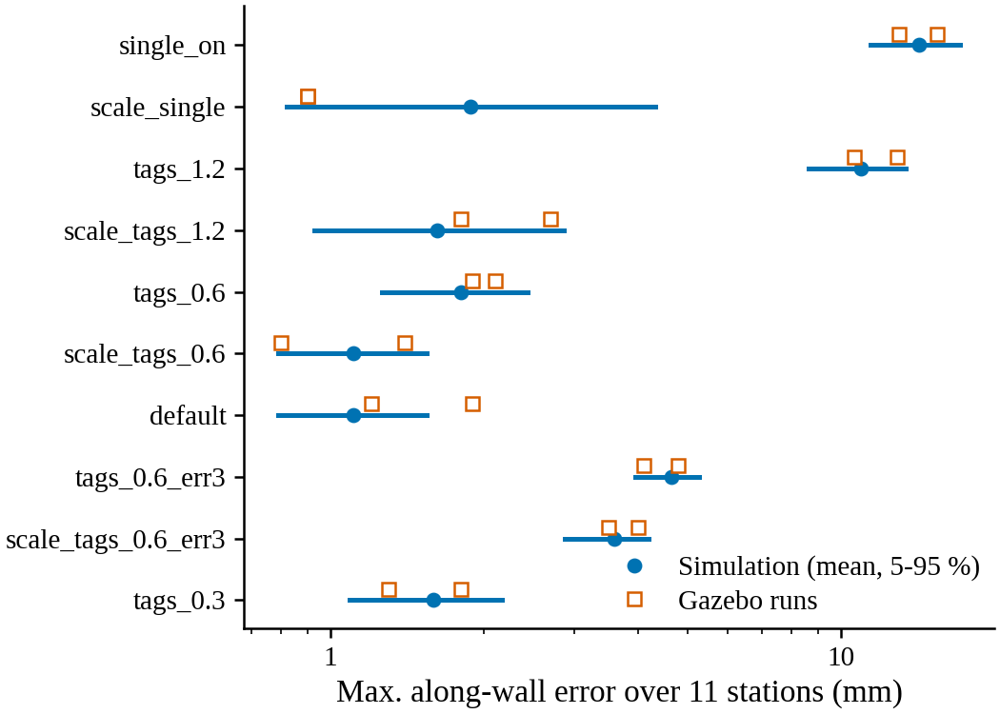
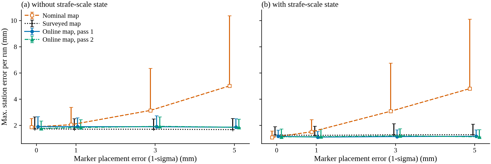
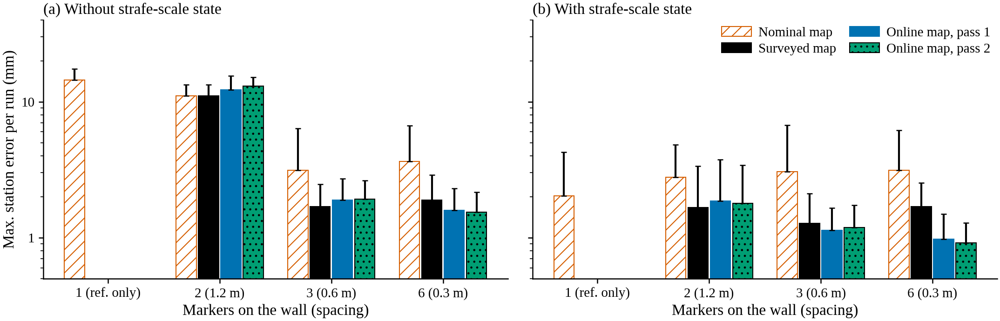
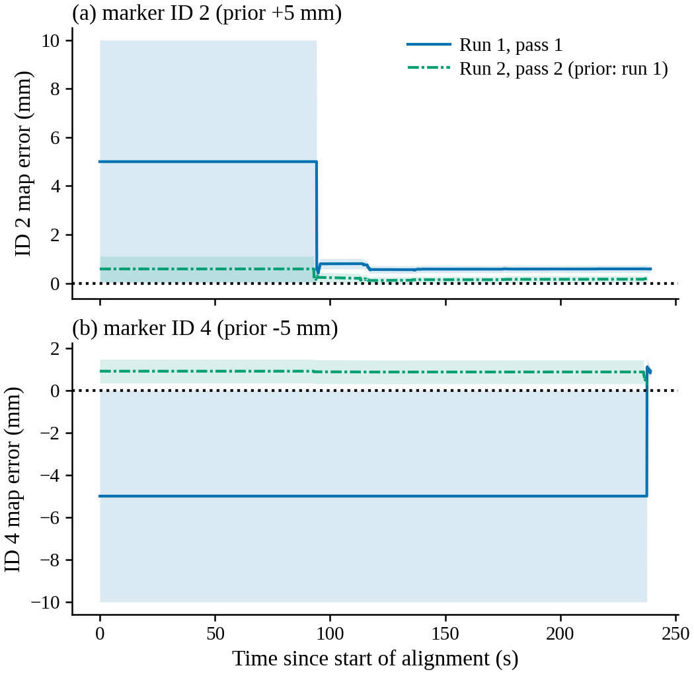
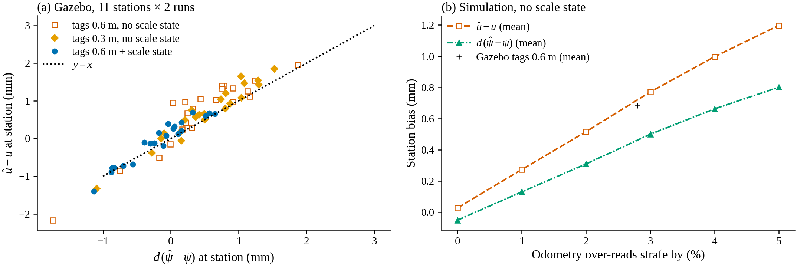
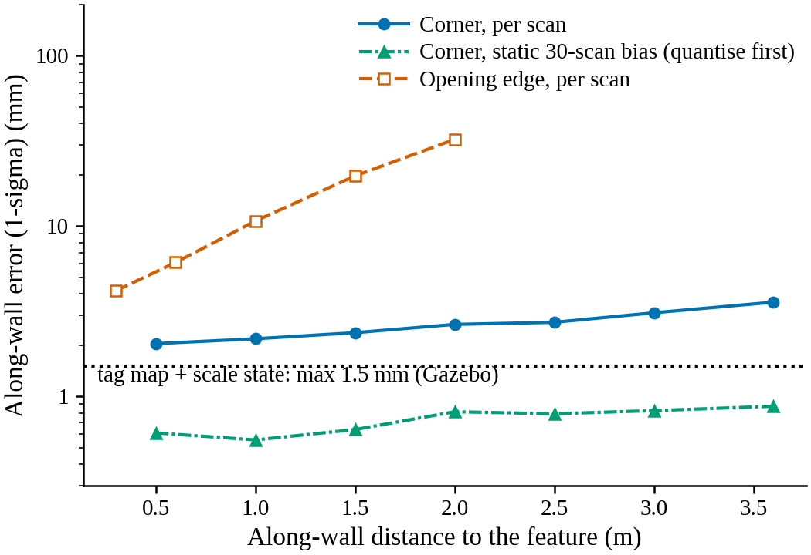
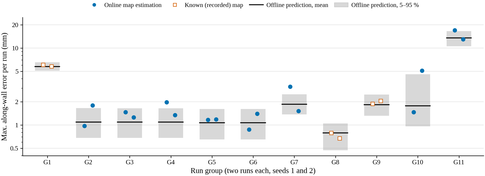
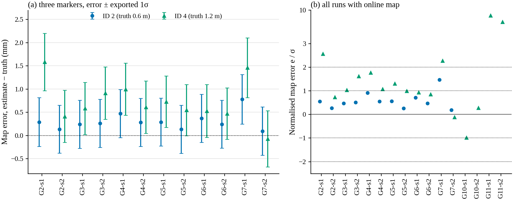

# 标记地图在线估计：去掉沿墙精度对标记粘贴精度的依赖

手工粘贴的定位标记有毫米级的位置误差，而多标记地图把标记位置当作已知常数，误差几乎一比一进入沿墙精度。本报告把非参考标记的沿墙位置并入墙面 EKF 的状态，在作业中与底盘位置、横移比例一起估计（EKF-SLAM，默认关闭的参数 `alignment.estimate_tag_map`）。离线结果（噪声模型取自已录制的 Gazebo 数据，仿真器先用 10 组已有配置检验）：**在线估计使 11 站的沿墙误差不再随粘贴误差增长**；用两次录制运行回放，地图从 ±5 mm 的错误先验回到 1 mm 以内。同时定位了不估计横移比例时剩余偏差的来源，并估算了墙角等自然特征的精度。第 2–7 节为离线结果；第 8 节按事先给出的预期值在 Gazebo 中验证（22 次有效运行）：地图记录值偏 ±3 / ±5 mm 时，在线估计把每次 11 站的最大误差由已知地图的 5.8–6.1 mm 降到 0.9–2.0 mm，与地图正确时同一水平，第 6 节的偏差解释成立；验证中发现并修正了两个缺陷（最后一站的地图更新没有写出、重新对位后首次观测的重新初始化抛出异常）。

| 问题 | 主要结果 |
|---|---|
| 粘贴误差（3 个标记，估计横移比例；仿真，每格 n = 100，每次 11 站最大值的平均） | σ_p = 0 / 1 / 3 / 5 mm：名义地图 1.07 / 1.50 / 3.07 / 4.79 mm，**在线估计 1.15 / 1.10 / 1.13 / 1.16 mm**，实测地图 1.26 / 1.23 / 1.27 / 1.28 mm；第二遍沿用估计 1.11–1.19 mm |
| 标记数量（σ_p = 3 mm） | 2 / 3 / 6 个标记：在线估计 1.87 / 1.13 / 0.98 mm；两个标记不同框时必须估计横移比例，否则比例误差进入地图（12 mm） |
| 回放录制数据（数据包 2 次运行 + 1 次第二遍） | ID 2 / ID 4 从 ±5 mm 的先验回到 +0.13 … +0.59 / +0.18 … +0.90 mm，站点误差最大 0.95–1.44 mm；同框标记对给出间距，单帧标准差约 0.2 mm，相机看到的间距偏短 0.058 % |
| 一致性 | 去掉相机系统误差后地图 NEES 2.16（2 维，n = 40）；相机系统误差需要 0.5 mm 的协方差下限 |
| 不估计横移比例时的同号偏差 | 横移比例误差经朝向泄漏：仿真 +0.69 mm / +0.036°，Gazebo +0.68 mm / +0.035°（n = 22）；去掉比例误差即消失 |
| 不依赖标记 | 墙角：单帧 2.0–3.6 mm、静止 30 帧残余 σ 0.5–0.9 mm（理想墙面）；门洞边缘 4–32 mm。建议只把墙角作为地图原点的锚点测试 |
| Gazebo 验证（第 8 节，每组 n = 2 次运行） | 记录值 ±5 mm：已知地图每次最大 6.08 / 5.79 mm，在线估计 1.98 / 1.34 mm，第二遍 1.17 / 1.18 mm；G2–G6 共 10 次平均 1.35 mm（预期 1.07–1.09 mm，2 次高于 95 分位）；地图 ID 2 +0.27 ± 0.10 mm（预期 +0.25），ID 4 +0.74 ± 0.35 mm（预期 +0.60），ID 4 的导出协方差偏乐观；`odom_error:=false` 时带符号平均 +0.17 / −0.16 mm（对照 +0.90 / +0.36） |

## 1. 问题

[`along_wall_accuracy`](../along_wall_accuracy/README.md) 用“0.6 m 间距的定位标记 + 横移比例在线估计”把 11 站的最大沿墙误差降到 1.5 mm，但留下三个问题：

1. **标记位置必须准确**。地图中的标记位置被当作已知常数，记录值偏 ±3 mm 时依赖该标记的站点偏 3–4 mm（Gazebo，n = 2，`tags_0.6_err3` 4.4 mm、`scale_tags_0.6_err3` 3.7 mm），即粘贴误差几乎一比一进入结果。手工粘贴的误差通常是毫米级，要做到亚毫米就要在粘贴后逐个测量。
2. **不估计横移比例时剩 1–2 mm 的同号偏差**，与约 0.1° 的朝向估计偏差同步，原因只是推测（4.7 节）。
3. **不依赖标记的方案只讨论过**，没有量化。

本报告回答：标记位置能否在作业中由机器人自己估计（第 2–5 节）；剩余偏差的来源（第 6 节）；墙角等自然特征能提供多少沿墙精度（第 7 节）；以及在 Gazebo 中怎样验证（第 8 节）。全部结果为离线计算：离线仿真器的噪声取自已录制的 Gazebo 数据（第 3 节），并先用已有的 10 组 Gazebo 配置检验仿真器（3.3 节）。没有新的 Gazebo 运行。

## 2. 方法

### 2.1 问题的表述

墙面相对状态与 [`wall_ekf.py`](../../../src/scr_arm_controller/scr_arm_controller/wall_ekf.py) 相同：离墙距离 `d`、沿墙位置 `u`（参考标记为 0，面向墙面向右为正）、朝向偏角 `ψ`、横移比例修正 `s`（真实横移 = (1 + s)·里程计横移）。把非参考标记的沿墙位置 `m_1 … m_K` 也作为未知量。作业中已有的测量：

| 测量 | 模型 | 涉及的未知量 |
|---|---|---|
| 激光拟合墙面（10 Hz） | `z_L = (d, −ψ)` | `d`、`ψ` |
| 标记 `i`（每周期，画面中所有地图内标记） | `z_i = R(−ψ)·(d, u − m_i)`，`m_0 ≡ 0` | `d`、`u`、`ψ`、`m_i` |
| 轮式里程计（每周期的 SE(2) 增量） | `Δu = −((1 + s)Δy cos ψ + Δx sin ψ)` 等 | `s`、`ψ` |
| 陀螺 | 只进入导航用的 `/odom`，墙面估计器不使用 | — |

线性化到 `ψ ≈ 0` 时标记的横向测量是 `y_i ≈ (u − m_i) − d·ψ`，深度测量是 `x_i ≈ d + (u − m_i)·ψ`（深度的测量噪声按 5 mm 取，信息很弱）。

### 2.2 可观测性

- **规范自由度只有一个**：把全部 `u` 与全部 `m_i`（含参考标记）同时平移 `c`，上表所有测量都不变。所以地图只能相对某个参照确定。固定一个标记（参考标记 `m_0 ≡ 0`，本项目原有的约定）就消除了它；也可以换成“一个实测过的标记”或墙角（第 7 节）。这个参照相对施工图的偏差对所有站点相同，任何地图估计方法都去不掉，只能靠对参照本身的测量。
- **同帧两个标记直接给出间距**：`y_i − y_j = m_j − m_i`，与 `ψ`（一阶）、里程计、`s` 都无关。间距 0.6 m 的标记在观测位姿下同框的范围约为底盘位于两标记之间的 0.2 m（可见窗口 0.81 m，见 3.1 节）。
- **一个标记在画面中移动给出 `s`**：同一标记两次观测之间的净横移 `D` 使 `s` 的信息按 `D²` 增长（along_wall 报告 2.4 节）。
- **不同时刻看到两个标记时，间距与 `s` 耦合**：`m_j − m_i = (1 + s)·D_odom + (y_i − y_j)`。只有这一类信息时二者不可分；但只要有上一条（任何一个标记在画面中移动过）或同帧观测，`s` 与 `m_j` 就都可观测。**一段已知的标记间距**在这里的作用是替代“画面中的移动”来固定 `s`。
- **相机尺度是近似的第二个规范自由度**：标记打印尺寸或焦距的比例误差 `e` 使横向测量整体乘 `(1 + e)`，在线估计的地图与 `s` 会跟着缩放，站点误差 ≈ `e·u`（离参考标记 0.9 m、`e` = 0.1 % 时 0.9 mm）。`e` 只由深度测量对激光的弱约束可观测；一段卷尺实测的标记间距（例如 1.2 m ± 0.5 mm，0.04 %）可以把它固定。Gazebo 的相机没有这项误差。
- **高度与标记朝向**：标记中心的高度 `v_i` 由每次检测直接给出（滑台高度由关节读数已知），没有规范自由度，但与沿墙精度无关，没有放进滤波器；标记绕法向的旋转不改变中心位置；PnP 的旋转本来就不使用（10 cm 标记在 0.55 m 处朝向可观测性很弱，[`fine_alignment`](../fine_alignment/README.md) 2.1 节）。

### 2.3 估计器的选择

常见的标记地图做法有两类。`fiducial_slam`（UbiquityRobotics `fiducials` 软件包）以第一个标记为原点，新标记的位姿由与已知标记同框的观测求出，按方差加权逐步更新；`tagslam`（基于 GTSAM 的因子图）把每帧的标记观测、里程计、已知标记位姿与标记之间的实测距离都写成因子，整体优化；`marker_mapper` 一类工具对一组图像做离线批量优化。本项目的情形与它们不同：每面墙只有 2–6 个标记，未知量只是一维的沿墙位置，相机始终正对墙面，墙面相对状态已经由一个 EKF 估计。

选用 **EKF-SLAM**：在现有 `WallEKF` 的状态后面追加 `m_1 … m_K`（[`tag_map_slam.py`](../../../src/scr_arm_controller/scr_arm_controller/tag_map_slam.py) 的 `TagMapEKF`）。理由：

- 状态维数 ≤ 10，每周期的计算量与现有滤波器同级；激光、标记、延迟补偿、χ² 门限、重新初始化等逻辑全部复用；
- 问题近似线性（`|ψ|` < 5°，路标一维）。线性高斯问题中，滤波器在最后时刻的地图边缘分布与批量最小二乘（平滑）的结果相同；因子图的优势在于重新线性化与离群值的事后处理，这里用处不大。单元测试 `test_ekf_matches_batch_least_squares` 用同一模块中的批量高斯–牛顿解（`batch_wall_pass`）对照：120 个历元的合成横移中两者的地图估计相差 < 0.2 mm，标准差相差 < 25 %；
- 地图与 `s` 是墙面与底盘的性质，重新对位时只重置 `(d, u, ψ)`，`(s, m)` 的均值与协方差（含互协方差）保留，与 `s` 现有的处理一致。

测量模型对 `m_i` 的雅可比是 `−∂z_i/∂u`；参考标记不在状态中。先验为地图中的记录位置，标准差可设（默认取地图文件中每个标记的 `sigma`）。

**系统误差下限**：相机对同一标记每帧的系统误差（与方位角有关的横向偏差、深度偏差）不随帧数平均。滤波器内部不建模它，而是在导出地图时把 `σ_floor²` 加到每个标记的方差上（参数 `tag_map_floor`），使导出的协方差与实际误差相符，第二遍作为先验时不会过度相信。取值在 5.1 节由一致性检查标定。

**首次观测的重新初始化**：一个标记首次被看到、而测量与先验不一致（χ² 门限拒收）时，按这次测量与当前底盘估计重新初始化该标记的位置，协方差按一阶传播构造（EKF-SLAM 中新路标的常规做法）；只用于尚未被接受过的非参考标记，载入上一遍的估计时视为已确认。排查过程：第一版蒙特卡洛中，σ_p = 5 mm 的一次试验里 ID 2 实际偏 +17.5 mm（3.5σ），先验 σ 5 mm 使每次观测都被门限拒收，在线估计与名义地图一样得到 18 mm 的站点误差；加入重新初始化后同一试验为 1.3 mm（单元测试 `test_tag_far_outside_its_prior_is_reinitialized_on_first_sighting` 覆盖这一情形）。

**作为第二遍的先验**：第一遍结束时的估计（均值 + 完整协方差）写成带 `covariance` 字段的地图 YAML（`TagMapEstimate.to_dict()`）；第二遍把它作为 `tag_map` 载入，开启在线估计时协方差作为先验，关闭时退化为普通地图（每个标记的 σ 取边缘标准差）。

### 2.4 参数与接口（默认关闭）

技能服务器的精对位参数（[`fine_alignment.yaml`](../../../src/scr_arm_controller/config/fine_alignment.yaml)）新增四项，默认值使行为与之前完全相同：

| 参数 | 默认 | 含义 |
|---|---|---|
| `alignment.estimate_tag_map` | `false` | 非参考标记的位置作为 EKF 状态在线估计 |
| `alignment.tag_map_prior_sigma` | `0.0` | 先验标准差（米）；0 = 用地图文件中每个标记的 `sigma` |
| `alignment.tag_map_floor` | `0.0` | 导出协方差中计入的相机系统误差（米，1σ）；建议 0.0005 |
| `alignment.tag_map_output` | `''` | 估计结果写入的地图 YAML（每 5 s 至多一次，重新对位时也写）；空串不写 |

开启时 `WallStateEstimator` 改用 `TagMapEKF`，首次由标记初始化 `u` 时使用该标记的当前估计位置；每次估计更新写日志（各标记的 `u ± σ`）。`/task_skills/wall_estimate` 消息不变（没有地图字段）。

## 3. 实验设置

### 3.1 离线测量仿真器

[`wall_sim.py`](wall_sim.py) 不重新仿真底盘与控制，而是沿**录制的真值轨迹**合成测量：取 Gazebo 中默认配置的两次运行（`default_s1`、`default_s2`，数据包提取到 [`bag_data/`](bag_data/)）里估计器每个周期的时刻与底盘真值，各 506 个周期（约 10 Hz，只在精对位、站间横移与到站残差测量阶段运行；切割期间不运行，下一周期的里程计增量跨过整段切割）。11 个停靠站位于参考标记的 −0.230 … +0.906 m。闭环的影响（底盘停在估计认为的位置）只有毫米级，对测量合成可以忽略，所以同一条真值轨迹可以被不同的估计器复用，同一次试验的随机量在各方法之间共用（配对比较）。

估计器与 ROS 节点使用同一份代码（`WallEKF` / `TagMapEKF`），按节点的顺序每周期做里程计预测、激光更新、标记更新，首次看到标记时由离画面中心最近的标记初始化 `u`，连续 15 帧整帧拒收时重新初始化；测量协方差与节点相同（激光取 `fit_wall` 协方差的中位数 σ_d = 1.12 mm、σ_φ = 0.236°；标记横向 0.3 mm、深度 5 mm，沿视线方向构造）。

**站点误差**取每站到站残差测量阶段最后一个周期的 `û − u`。它对应 Gazebo 报告中的“补偿后刀尖沿墙误差”（到站真值误差减去补偿所用的传感器残差，等于 `−(û − u)`），所以下文直接与该列比较。统计口径：每个单元 n 次试验 × 11 站；“平均 / 95 分位 / 最大”对全部 11·n 个站点误差的绝对值，“每次最大”为每次试验 11 站中最大值的平均。

### 3.2 噪声模型

[`noise_model.py`](noise_model.py) 从已录制的数据拟合，结果在 [`noise_model.yaml`](noise_model.yaml)（每项注明 fitted / calibrated / assumed 与样本量）。数据：4 个数据包（`default_s1/s2`、`single_off_s1/s2`，44 段站间横移、10295 帧激光、40 段定点保持）与 along_wall 的 31 次运行（标记残差的交叉检查）。

| 项 | 仿真器中的模型 | 数值 | 来源 |
|---|---|---|---|
| 里程计横移比例 `s` | 每次试验抽一次 | 均值 −2.79 %（4 次运行 −2.75 / −2.59 / −2.73 / −3.10 %），运行间 σ 0.22 % | 拟合，n = 4 次运行 |
| 每段横移的随机打滑 | 每段横移抽一次比例偏差 | σ 0.56 %（段长中位数 118 mm、4.1 s） | 拟合，n = 44 段 |
| 横移引起的朝向误差 | 确定项 κ·Δy + 每段随机项 | κ = 7×10⁻⁵ rad/m（可忽略），随机项 σ 1.44 mrad（0.082°）/ 段 | 拟合，n = 44 段 |
| 定点保持期间的里程计漂移 | 跨切割的增量加白噪声 | 沿墙 0.024 mm，朝向 0.045 mrad | 拟合，n = 40 |
| 精对位阶段转向的打滑 | 转角 × (1 + 2 %) | 2 % | 假设（编码器模型的 `yaw_slip` 参数） |
| 激光离墙距离 | 每帧白噪声 + 每站偏差 | σ 1.13 mm；每站偏差 σ 0.15 mm | 拟合，n = 10295 帧 / 44 站 |
| 激光朝向 | 每帧白噪声 + 每站偏差 | σ 0.222°（站内 0.222°，相邻帧相关系数 −0.05）；每站偏差 σ 0.032° | 拟合，n = 10294 帧 / 44 站 |
| 标记横向（静止） | 偏差 a + b·方位角 + 白噪声 | a = 0.05 mm，b = −0.47 mm/rad，σ 0.089 mm | 拟合，n = 449（31 次运行交叉检查：σ 0.086 mm，n = 5407） |
| 标记横向（横移中） | 白噪声 | σ 0.6 mm | 标定：使横移中的门限接受率等于 Gazebo 的 97.0 %（575 / 593） |
| 标记深度 | 偏差 + 白噪声 | −0.89 mm，σ 0.24 mm | 拟合，n = 449 |
| 标记可见范围 | `u − u_i` 窗口，按离墙距离缩放 | −0.377 … +0.437 m（离墙 0.70 m） | 拟合，n = 1126 |
| 标记粘贴误差 σ_p | 每个非参考标记一个高斯偏差 | 0 / 1 / 3 / 5 mm | 假设（蒙特卡洛变量） |
| 实测地图的测量误差 | 记录值 = 实际 + 高斯 | 0.5 mm | 假设（卷尺 / 全站仪量级） |

**排查：横移中的标记残差为什么不能直接拟合。** 现象：横移中标记横向残差的分布明显重尾，两分量混合拟合为 67 % σ 0.12 mm + 33 % σ 2.4 mm，还拟合出 −7.5 ms 的“时间偏差”。定位：估计器发布 `wall_estimate` 时用节点时钟打时间戳，而节点时钟跟随 10 Hz 的 `/clock`，数据包的接收时间同样只有 0.1 s 分辨率；横移速度中位数 5 cm/s，取样时刻误差就带来 ±2.5 mm 的真值误差，与尾部分量的量级一致。结论：这一残差是真实误差的上界，不能当作噪声模型。方案：用不受时间戳影响的量标定——默认配置两次运行中横移时标记更新的门限接受率 97.0 %（`default_s1` 271 / 289，`default_s2` 304 / 304）。[`calibrate_tag_noise.py`](calibrate_tag_noise.py) 在同样的估计器配置下扫描高斯噪声，σ = 0.6 mm 时接受率 97.3 %（每个取值 16 次仿真），时间偏差项置 0。遗留：接受率只约束了噪声的总体量级，分布形状（高斯还是少量大误差）没有约束；同一原因也使 along_wall 报告图 4 中横移时的估计误差尖峰包含了真值取样误差。

### 3.3 仿真器检验

先用 along_wall 中做过的 10 组配置（标记数量、地图误差、是否估计比例都与 Gazebo 相同）驱动仿真器，每组 40 次（两条轨迹交替），与 Gazebo 每次运行的最大站点误差比较（[`validate_sim.py`](validate_sim.py)，[`validation.csv`](validation.csv)）：

| 配置 | Gazebo 两次运行：最大 (mm) / 带符号平均 (mm) | 仿真 n = 40：每次最大的平均（5–95 分位）/ 带符号平均 (mm) |
|---|---|---|
| `single_on` 一个标记，不估计比例 | 15.4、13.0 / +4.5、+3.4 | 14.2（11.4–17.1）/ +3.7 |
| `scale_single` 一个标记 + 比例 | 0.9、0.9 / +0.2、+0.2 | 1.9（0.8–4.3）/ +0.1 |
| `tags_1.2` 两个标记，不估计比例 | 12.9、10.6 / +2.6、+2.3 | 10.9（8.6–13.4）/ +2.4 |
| `scale_tags_1.2` | 1.8、2.7 / +0.8、+0.1 | 1.6（0.9–2.9）/ +0.1 |
| `tags_0.6` 三个标记，不估计比例 | 1.9、2.1 / +0.9、+0.4 | 1.8（1.3–2.4）/ +0.8 |
| `scale_tags_0.6`（与 `default` 同配置） | 0.8、1.4（`default` 1.9、1.2）/ +0.1、−0.3 | 1.1（0.8–1.5）/ +0.1 |
| `tags_0.6_err3` 地图记录值 ±3 mm | 4.8、4.1 / +2.1、+1.5 | 4.7（4.0–5.3）/ +2.0 |
| `scale_tags_0.6_err3` | 3.5、4.0 / +1.1、+1.3 | 3.6（2.9–4.2）/ +1.1 |
| `tags_0.3` 六个标记，不估计比例 | 1.8、1.3 / +1.0、+0.2 | 1.6（1.1–2.2）/ +0.6 |



*图 1：10 组配置下每次运行 11 站中的最大沿墙误差（横轴，对数刻度）：朱红方块为 Gazebo 的两次运行，蓝点与横线为离线仿真 40 次的平均与 5–95 分位。*

20 次 Gazebo 运行中有 19 次落在仿真的 5–95 分位内（`default` 的 1.9 mm 略高于 1.5 mm；`scale_single` 的两次 0.9 mm 在下沿），带符号的平均偏差（例如不估计比例时的 +0.8 mm 同号偏差）也一致。仿真器用于下文的比较，但它与 Gazebo 共用同一条真值轨迹与拟合出的噪声，不能替代新条件下的 Gazebo 验证（第 8 节）。

## 4. 结果：蒙特卡洛

[`monte_carlo.py`](monte_carlo.py)：粘贴误差 σ_p ∈ {0, 1, 3, 5} mm × 标记布局（1 / 2 / 3 / 6 个标记，间距 — / 1.2 / 0.6 / 0.3 m）× 是否估计横移比例，每个单元 100 次试验（两条录制轨迹交替），同一次试验中各地图来源共用同一组随机量：

| 地图来源 | 估计器 | 说明 |
|---|---|---|
| (a) 名义地图 | `WallEKF`，σ_map = 2 mm 计入测量噪声 | 与当前默认配置相同，地图 = 设计位置 |
| (b) 实测地图 | `WallEKF`，σ_map = 0.5 mm | 粘贴后测量，记录值 = 实际 + N(0, 0.5 mm)（假设） |
| (c) 在线估计，第一遍 | `TagMapEKF`，先验 = 设计位置、σ 5 mm，下限 0.5 mm | 先验 σ 固定，不随实际 σ_p 调整 |
| (d) 第二遍 | `TagMapEKF`，先验 = (c) 结束时的估计（均值 + 协方差） | 另一条轨迹、新的随机量，横移比例回到默认先验 |

另算了 (d) 的另一种用法“把第一遍的估计当作已知地图、不再在线估计”（`d_fixed`），结果与 (d) 相差 0.1 mm 以内，只列在 [`mc_summary.csv`](mc_summary.csv) 中。

### 4.1 粘贴误差的影响（3 个标记，间距 0.6 m）

**在线估计使站点误差不再随粘贴误差增长**：估计横移比例时，名义地图的每次最大误差由 1.07 mm（σ_p = 0）增长到 4.79 mm（σ_p = 5 mm），在线估计在 1.10–1.16 mm 之间，与实测地图（1.23–1.28 mm）相当；第二遍（1.11–1.19 mm）与第一遍没有可区分的差别。

估计横移比例（n = 100 次 × 11 站；平均 / 95 分位 / 最大为全部站点误差的绝对值，“每次最大”为每次试验 11 站最大值的平均，单位 mm）：

| σ_p | (a) 名义地图 | (b) 实测地图 | (c) 在线估计，第一遍 | (d) 第二遍 |
|---|---|---|---|---|
| 0 | 0.44 / 1.10 / 1.85；每次最大 1.07 | 0.55 / 1.38 / 2.79；1.26 | 0.49 / 1.21 / 1.85；1.15 | 0.48 / 1.15 / 2.25；1.11 |
| 1 mm | 0.65 / 1.70 / 3.24；1.50 | 0.54 / 1.37 / 2.79；1.23 | 0.49 / 1.18 / 2.27；1.10 | 0.49 / 1.17 / 2.13；1.13 |
| 3 mm | 1.22 / 5.01 / 8.26；3.07 | 0.53 / 1.34 / 2.66；1.27 | 0.48 / 1.18 / 1.88；1.13 | 0.51 / 1.28 / 2.06；1.19 |
| 5 mm | 1.81 / 7.59 / 18.09；4.79 | 0.57 / 1.40 / 2.75；1.28 | 0.55 / 1.20 / 1.94；1.16 | 0.47 / 1.13 / 2.04；1.12 |

不估计横移比例：

| σ_p | (a) 名义地图 | (b) 实测地图 | (c) 在线估计，第一遍 | (d) 第二遍 |
|---|---|---|---|---|
| 0 | 0.95 / 1.93 / 3.23；1.85 | 0.80 / 1.85 / 3.40；1.73 | 0.94 / 1.98 / 3.26；1.90 | 0.92 / 1.85 / 3.05；1.76 |
| 1 mm | 1.01 / 2.30 / 4.47；2.04 | 0.82 / 1.84 / 2.95；1.70 | 0.94 / 1.96 / 2.97；1.89 | 0.91 / 1.89 / 2.81；1.83 |
| 3 mm | 1.42 / 4.88 / 8.87；3.13 | 0.82 / 1.90 / 2.96；1.69 | 0.92 / 1.95 / 3.48；1.88 | 0.95 / 2.00 / 3.40；1.91 |
| 5 mm | 2.12 / 8.05 / 12.00；5.00 | 0.80 / 1.81 / 3.17；1.67 | 0.94 / 1.93 / 3.25；1.85 | 0.94 / 1.93 / 2.77；1.84 |



*图 2：3 个标记（间距 0.6 m）时，每次试验 11 站最大沿墙误差的平均（点）与 95 分位（误差棒上端）随标记粘贴误差（1σ，横轴）的变化；(a) 不估计横移比例，(b) 估计横移比例。朱红虚线为名义地图，黑点线为实测地图，蓝实线为在线估计第一遍，绿点划线为第二遍。每点 n = 100。*

- 名义地图下误差集中在依赖 ID 2、ID 4 的后 4–5 站，95 分位与最大值随 σ_p 线性增长（σ_p = 5 mm 时最大 18 mm），与 along_wall 中“地图误差一比一进入结果”一致。
- 不估计横移比例时，在线估计同样去掉了对 σ_p 的依赖（1.85–1.90 mm），但整体停在 1.9 mm 左右：剩下的是第 6 节的同号偏差（带符号平均 +0.75 mm）。3 个标记时相邻标记在 0.2 m 的范围内同框，间距由同框观测决定，不需要横移比例。
- 实测地图在估计比例时略差于在线估计（1.27 vs 1.13 mm）。原因见 4.2 节：相机看到的间距本身带系统误差，在线估计得到的是“相机看到的地图”，与站点测量自洽。

### 4.2 标记数量

σ_p = 3 mm 时每次最大误差的平均（mm，n = 100；只有参考标记时没有地图可估计，σ_p 不适用）：

| 布局 | 估计比例：(a) / (b) / (c) / (d) | 不估计比例：(a) / (b) / (c) / (d) |
|---|---|---|
| 1 个（只有参考标记） | 2.03 | 14.44 |
| 2 个（0、1.2 m） | 2.77 / 1.67 / 1.87 / 1.79 | 11.01 / 11.00 / 12.22 / 13.03 |
| 3 个（间距 0.6 m） | 3.07 / 1.27 / 1.13 / 1.19 | 3.13 / 1.69 / 1.88 / 1.91 |
| 6 个（间距 0.3 m） | 3.13 / 1.69 / 0.98 / 0.91 | 3.64 / 1.89 / 1.59 / 1.54 |



*图 3：σ_p = 3 mm 时不同标记布局下每次最大误差的平均（柱高，对数刻度）与 95 分位（误差棒上端）；(a) 不估计横移比例，(b) 估计横移比例。只有参考标记时只有名义地图一种。n = 100。*

- **两个标记之间不同框（间距 1.2 m）时，在线估计离不开横移比例**。不估计比例时 ID 4 的位置只能由“里程计横移 + 标记测量”推出，里程计 2.8 % 的比例误差直接进入地图（地图误差平均 11.9 mm，NEES 44–50，表 5.1），站点误差比名义地图还大（12.2 vs 11.0 mm）。估计比例时在线估计（1.87 mm）回到实测地图（1.67 mm）的水平。所以开启 `estimate_tag_map` 时应同时开启 `estimate_scale`（当前默认已开启）。
- **6 个标记时在线估计（0.98 mm）明显优于实测地图（1.69 mm）**。同框观测的回放（5.2 节）表明相机看到的间距每 0.3 m 短约 0.17 mm；按真实位置测量的地图与相机不自洽，标记之间的过渡处产生拒收和跳变，标记越密越明显。在线估计的地图吸收了这一相机误差。这是推测，依据是回放中的间距偏差与仿真中“去掉相机系统误差后两者相当”（5.1 节的消融）；没有单独验证拒收率。
- 1 个标记 + 横移比例（2.03 mm）与 along_wall 的 `scale_single`（Gazebo 0.9 mm，n = 2）同一量级，见 3.3 节的检验。

## 5. 结果：一致性与回放

### 5.1 一致性检查

**估计器本身是一致的；地图协方差偏小来自相机的系统误差，按 0.5 mm 的下限计入后 NEES 落在合理范围。**

[`consistency.py`](consistency.py)：3 个标记、σ_p = 3 mm、估计比例、第一遍，每种情形 40 次，逐项关闭仿真器中的误差源，看地图 NEES（不含下限，2 个自由度，一致时均值为 2；40 次平均的 95 % 区间为 1.43–2.67）：

| 关闭的误差源 | 地图 NEES | 地图误差 RMS / 平均 (mm) | 滤波器的 σ RMS (mm) | 站点每次最大 (mm) |
|---|---|---|---|---|
| 无（全部开启） | 12.2 | 0.50 / +0.43 | 0.16 | 1.15 |
| 横移中的随机朝向误差 | 11.8 | 0.50 / +0.43 | 0.16 | 0.98 |
| 激光的每站偏差 | 11.8 | 0.50 / +0.43 | 0.16 | 1.02 |
| 标记横向偏差（a + b·方位角） | 50.7 | 1.06 / +0.97 | 0.16 | 1.42 |
| 标记深度偏差 | 17.5 | 0.60 / −0.54 | 0.16 | 1.11 |
| 标记横向与深度偏差 | 2.83 | 0.20 / +0.01 | 0.16 | 1.06 |
| 全部系统误差 | 2.16 | 0.18 / 0.00 | 0.16 | 0.70 |

- 关闭全部系统误差后 NEES = 2.16，在 95 % 区间内：滤波器的线性化、过程噪声与测量噪声的设定与仿真一致。
- 地图的过度自信几乎全部来自相机对标记的两项系统误差（横向偏差随方位角变化、深度偏 −0.9 mm）。二者单独关闭时误差反而变大，说明它们的作用部分抵消，单独解释任何一项都不对；同时关闭后误差 0.20 mm、NEES 2.83。这两项误差每帧相同，不随观测次数平均。
- 标定的下限：floor² = mean(e²) − mean(σ²)，3 个标记 0.48 mm，6 个标记 0.31 mm，2 个标记为 0（地图 σ 约 2 mm，由里程计决定）。取 `tag_map_floor = 0.5 mm`。

蒙特卡洛中（n = 100 每单元，[`mc_summary.csv`](mc_summary.csv)）计入下限后的地图 NEES 与站点 NEES（`(û − u)² / σ_u²` 的平均）：

| 布局（地图维数） | 地图 NEES（含下限 / 不含）：估计比例 | 不估计比例 | 站点 NEES：估计比例 / 不估计比例 |
|---|---|---|---|
| 2 个（1） | 0.66–0.97 / 0.70–1.03 | 44–50 / 48–54 | 1.01–1.17 / 15–17 |
| 3 个（2） | 1.53–1.65 / 11–12 | 2.3–3.0 / 16–18 | 1.31–1.38 / 4.3–4.6 |
| 6 个（5） | 1.87–2.02 / 34–37 | 2.6–3.4 / 47–49 | 1.16–1.20 / 3.5–3.8 |

（范围为 σ_p = 0–5 mm 的四个单元，第一遍。n = 100 次平均的 95 % 区间：1 维 0.74–1.30，2 维 1.63–2.41，5 维 4.40–5.64。）计入下限后 3 个标记时略偏保守，6 个标记时明显保守（下限按 3 个标记标定）；两个标记且不估计比例时完全不一致（上一节）。站点 NEES 在估计比例时为 1.0–1.4，不估计比例时 3.5–17，反映第 6 节的未建模偏差。

### 5.2 用录制数据回放

[`replay.py`](replay.py) 回答“已录制的运行能否用来检验地图估计”。

**同帧标记对（只用仓库中已提交的数据）**。along_wall 31 次运行的 `ekf_trace.csv` 中，同一周期画面里有两个标记的帧给出间距 `|p_i − p_j|`，它与朝向、里程计都无关（[`replay_covisible.csv`](replay_covisible.csv)）：

| 标记对（真实间距） | 帧数 / 运行数 | 测得间距 − 真值：平均 ± 标准差 (mm) | 其中静止帧 / 横移帧 |
|---|---|---|---|
| 0–2（0.6 m） | 925 / 10 | −0.34 ± 0.22 | −0.30 / −0.36 |
| 2–4（0.6 m） | 327 / 10 | −0.36 ± 0.19 | −0.34 / −0.36 |
| 5–0、0–1、1–2、2–3、3–4（0.3 m） | 68–530 / 2 | −0.16 … −0.18 ± 0.12–0.16 | −0.15 … −0.21 / −0.15 … −0.20 |

单帧标准差约 0.2 mm，与静止时的横向噪声相符；偏差与间距成正比（约 −0.058 %），表现为相机的尺度误差（2.2 节的第二个近似规范自由度），在 Gazebo 的理想相机中也存在，来源（角点细化或 PnP）未拆开。这一项说明：只要两个标记能同框，间距在一次作业中就能确定到 0.2 mm/√帧数，剩下的是相机标定的问题。

**完整回放（数据包）**。仓库中的 `ekf_trace.csv` 没有里程计，不能完整回放；数据包 `default_s1/s2`（真实轮式里程计 50 Hz、激光 10 Hz、估计器周期的标记测量）可以，提取结果在 `bag_data/`。地图先验故意给错：ID 2 记为 0.605 m、ID 4 记为 1.195 m（各偏 ±5 mm），σ 5 mm，下限 0.5 mm，估计比例。时间戳的限制见 3.2 节：回放只用底盘静止（里程计速度 < 5 mm/s）周期的标记测量，并从精对位阶段结束前 2 s 开始（[`replay.py`](replay.py) 文件头记录了两次失败的尝试）。

| 回放 | ID 2 估计 − 真值 (mm) | ID 4 估计 − 真值 (mm) | σ（含下限，mm） | 横移比例 | 站点误差 最大 / 平均 (mm，n = 11) |
|---|---|---|---|---|---|
| `default_s1`，第一遍 | +0.59 | +0.90 | 0.52 / 0.57 | −2.84 % | 1.44 / 0.40 |
| `default_s2`，第一遍 | +0.13 | +0.18 | 0.52 / 0.56 | −2.68 % | 0.99 / 0.37 |
| `default_s2`，第二遍（先验 = `default_s1` 的估计） | +0.19 | +0.33 | 0.52 / 0.55 | −2.67 % | 0.95 / 0.35 |



*图 4：数据包回放中 ID 2 (a) 与 ID 4 (b) 的地图估计误差（估计 − 世界中的真实位置，纵轴）随时间的变化，阴影为 ±1σ；蓝实线为 `default_s1` 第一遍（先验 +5 / −5 mm），绿点划线为 `default_s2` 第二遍（先验为蓝线的终值）。ID 4 只在最后一站进入视野。*

两次第一遍都从 ±5 mm 的错误先验回到 1 mm 以内，误差在 1.7σ 以内（σ 含 0.5 mm 下限）；ID 4 只在最后一站看到一次，就从 −5 mm 回到 +0.9 / +0.2 mm。站点误差 0.95–1.44 mm，与 Gazebo 中地图正确时的默认配置（1.1 / 1.9 mm）同一水平。地图估计的偏差为正（+0.1 … +0.9 mm），与仿真（5.1 节表中 +0.43 mm、第 8 节 +0.25 / +0.60 mm）同号；而同框间距偏短（−0.35 mm / 0.6 m）。地图主要由“同一标记在画面中移动 + 横移比例”决定，同框只占 0.2 m 的窗口，二者的系统误差方向不同，没有进一步拆开。

**若要从仓库中的运行记录完整回放**，`ekf_trace.csv` 还缺：(1) 每周期的里程计位姿（或增量）与其时间戳；(2) 激光墙面拟合 `(d, φ, cov)` 与扫描时间戳；(3) 标记的原始检测（相机光学系中的位置、协方差、图像时间戳），而不是已补偿到当前时刻的位置；(4) 估计器内部时刻（最近一帧里程计的时间戳）——现在 `WallEstimate` 用 10 Hz 的节点时钟打时间戳，回放时只能用静止帧。把 `WallEstimate.header.stamp` 改为估计器内部时刻、并增加原始检测的话题，就能在不录图像的情况下完整回放。

## 6. 剩余的同号偏差：横移比例误差经朝向泄漏

**不估计横移比例时到站的同号偏差由横移比例误差引起：它推动朝向估计，到站后标记把朝向误差折算成 `d·(ψ̂ − ψ)` 的沿墙误差。** 证据有三条（[`bias_analysis.py`](bias_analysis.py)，[`bias_gazebo.csv`](bias_gazebo.csv)，[`bias_sim.csv`](bias_sim.csv)）：

**机理**。线性化后标记的横向测量为 `y ≈ (u − m) − d·ψ`，单个标记分不开 `u` 与 `ψ`。横移中里程计高估横移（向右横移时预测的 `u` 跑在前面），每帧标记新息 `y − ŷ` 为负；EKF 把新息按 `P_uy`、`P_ψy ≈ −d·P_ψψ` 分给 `u` 与 `ψ`，`ψ̂` 被推向正值。激光每帧朝向 σ 0.22°、权重有限，到站后 1 s 的残差测量内拉不回来；标记继续约束 `û − d·ψ̂ ≈ u − d·ψ`，于是 `û − u ≈ d·(ψ̂ − ψ) > 0`。

**Gazebo 记录**（每站到站残差测量结束时，2 次运行 × 11 站，n = 22）：

| 配置 | `û − u` 平均 ± 标准差 (mm) | `ψ̂ − ψ` 平均 | `d·(ψ̂ − ψ)` 平均 (mm) | 二者的相关系数 |
|---|---|---|---|---|
| `tags_0.6`，不估计比例 | +0.68 ± 0.91 | +0.035° | +0.43 | 0.93 |
| `tags_0.3`，不估计比例 | +0.69 ± 0.73 | +0.042° | +0.52 | 0.97 |
| `scale_tags_0.6`，估计比例 | −0.06 ± 0.58 | −0.014° | −0.17 | 0.96 |
| `default`，估计比例 | −0.14 ± 0.68 | −0.013° | −0.15 | 0.98 |

**离线仿真**（`tags_0.6` 配置，每种 40 次 × 11 站）：

| 里程计误差 | `û − u` 平均 (mm) | `ψ̂ − ψ` 平均 | 每次最大 (mm) |
|---|---|---|---|
| 完整模型 | +0.69 | +0.036° | 1.75 |
| 横移比例误差置 0（保留随机打滑与朝向噪声） | −0.01 | −0.006° | 1.01 |
| 只保留横移比例误差 | +0.69 | +0.036° | 1.64 |
| 横移中的随机朝向误差置 0 | +0.67 | +0.034° | 1.65 |
| 全部编码器误差关闭（对应 `odom_error:=false`） | −0.01 | −0.007° | 0.84 |
| 完整模型，估计横移比例 | −0.01 | −0.006° | 1.06 |



*图 5：(a) Gazebo 中每站到站时的沿墙估计误差（纵轴）与离墙距离 × 朝向估计误差（横轴），黑点线为 y = x；朱红方块 / 橙菱形为不估计比例（标记间距 0.6 / 0.3 m），蓝点为估计比例；每种 22 个点。(b) 仿真中里程计横移比例误差（横轴）对平均沿墙偏差（朱红）与 `d·(ψ̂ − ψ)`（绿）的影响，每点 20 次 × 11 站；黑十字为 Gazebo `tags_0.6` 的平均（横移比例取拟合值 2.8 %）。*

- 大小与符号都对上：仿真 +0.69 mm / +0.036°，Gazebo +0.68 mm / +0.035°（n = 22）；Gazebo 中 `û − u` 与 `d·(ψ̂ − ψ)` 的相关系数 0.93–0.98。
- 只去掉比例误差偏差就消失，只保留比例误差偏差不变；偏差随比例误差线性增长（每 1 % 约 +0.24 mm），随估计器中激光朝向权重减弱而增大（σ_φ × 0.5 / 1 / 2 / 4：+0.65 / +0.74 / +1.19 / +1.64 mm）。
- 横移中的随机朝向误差（每段 0.08°，拟合值，比估计器过程噪声给出的大约 6 倍）不是偏差的来源（关闭后 +0.67 mm），它只增加离散度。
- 报告 along_wall 中的“1–2 mm”是每次运行 11 站的最大值；其中同号部分约 +0.7 mm，其余是随机部分（标准差 0.7–0.9 mm）。

**确认实验**：在 Gazebo 中以 `odom_error:=false`（关闭全部编码器误差）重跑 `tags_0.6`，预期带符号平均 +0.03 mm（仿真，n = 40），每次最大 0.79 mm（0.47–1.05）；对照 `tags_0.6` 的 Gazebo 值 +0.9 / +0.4 mm。只关闭横向打滑需要在 `gazebo.launch.py` 中把 `lateral_slip` 单独做成启动参数，预期与上面相同；现有启动参数只能整体关闭。见第 8 节 G8。

## 7. 不依赖标记的沿墙参照

**平直墙面对 2D 激光没有沿墙信息；room3 南墙上能用的特征只有两端的墙角。按本机激光的噪声与角分辨率，墙角在 0.5–3.6 m 外单帧给出 2.0–3.6 mm（1σ）的沿墙位置，静止 30 帧平均后的残余偏差 σ 0.5–0.9 mm；门洞边缘在 0.3–2 m 外单帧 4–32 mm。** [`marker_free.py`](marker_free.py)，[`marker_free.csv`](marker_free.csv)。

| 特征 | 离特征的沿墙距离 | 单帧 σ (mm) | 静止 30 帧平均后的偏差：σ / 最大 (mm) | 说明 |
|---|---|---|---|---|
| 墙角（侧墙 0.1–3 m 段的直线与正面墙求交） | 0.5 m | 2.0 | 0.46–0.61 / 2.7–3.0 | 侧墙上 128 个点 |
| | 1.0 m | 2.0–2.2 | 0.45–0.55 / 2.0–2.5 | 97 个点 |
| | 2.0 m | 2.6 | 0.45–0.81 / 1.1–2.3 | 65 个点 |
| | 3.6 m | 3.2–3.6 | 0.67–0.87 / 1.8–2.9 | 42 个点 |
| 门洞 / 窗洞边缘（深度跳变） | 0.3 m | 4.2 | 静止时不平均：±7.2 | 束间距 14 mm |
| | 1.0 m | 10.7 | ±18.6 | 束间距 37 mm |
| | 2.0 m | 32 | ±56 | 束间距 112 mm |

（墙角两列中的范围对应“先加噪声再量化”与“先量化再加噪声”两种顺序；每个距离 300 帧（单帧）与 100 个静止位姿 × 30 帧。激光：360 束 / 360°、σ 10 mm、分辨率 1 cm，底盘离墙 0.70 m。门洞为解析计算：束间距 = d·Δθ / cos²β。）



*图 6：本机激光对墙角（蓝：单帧；绿：静止 30 帧平均后的残余偏差，先量化再加噪声）与门洞边缘（朱红：单帧）给出的沿墙定位误差（1σ，纵轴对数刻度）随离特征的沿墙距离（横轴）的变化；黑点线为多标记地图 + 横移比例在 Gazebo 中的最大站点误差 1.5 mm。墙面为理想平面。*

- **墙面上有哪些特征**：room3 南墙（`room.world`，4.85 m）没有门窗洞口，两端是与东墙、西侧墙的内角；11 个停靠站离左端墙角 1.27–2.41 m、离右端 2.44–3.58 m。施工中的毛坯墙常见的特征还有门洞、窗洞、壁柱和已有的插座盒（本规划正以“已有插座A”为端点），但位置与槽线的关系随墙而定。
- **传感器限制的精度**：墙角由侧墙上几十到上百个点拟合直线求交，测距噪声被平均，单帧 2–3.6 mm，随帧数下降；量化（1 cm）在静止时留下 0.5–0.9 mm 的残余偏差。这与标记方案的站点误差（1.1–1.5 mm 最大）同一量级。门洞边缘受 1° 角分辨率限制，离开 0.5 m 以上就是厘米级，单独不可用。
- **墙角之外的误差**：Gazebo 中墙面是理想平面。实际墙角的抹灰圆角、踢脚线、墙面不平整、家具遮挡以及机械臂对激光的遮挡（激光装在 0.98 m 高处，侧墙方向是否被立柱挡住未检查）都会进入，量级可能是毫米到厘米，无法在 Gazebo 中评估。BIM / 施工图配准在平直区段退化，信息仍只来自墙角与洞口，并额外引入图纸与实际的偏差，在墙角方案验证之前不值得做。
- **与标记地图的关系**：标记地图唯一的规范自由度是一个平移（2.2 节），现在由参考标记定义，而参考标记相对施工图的位置也要测量。墙角正好可以固定这个平移——槽线规划本来就以墙端为原点（`slot_plan.yaml` 的 `left_end`）。

**建议**：值得做一次 Gazebo 测试，但目标是“墙角作为地图的锚点”，不是替代标记：(1) 先在已有数据包的 `/scan`（4 个包都录了）上离线拟合墙角，检查侧墙是否被机器人自身遮挡、单帧误差是否与上表相符，不需要新的仿真；(2) 若通过，在 Gazebo 中每站额外输出墙角相对底盘的沿墙距离，与真值和标记估计比较。门洞边缘与 BIM 配准不建议测试。

## 8. Gazebo 验证

8.1–8.3 为运行 Gazebo 之前制定的方案与预期值（原样保留），8.4 起为执行情况与结果。

目的：在 Gazebo 中确认 (1) 开启在线估计后，地图记录值有 ±3 / ±5 mm 误差时站点误差回到无地图误差的水平；(2) 第二遍载入第一遍的估计后不变差；(3) 开启在线估计在地图正确时不带来损失；(4) 第 6 节的偏差解释。方案沿用 along_wall 的实验脚本与同一份 11 站规划，只改精对位参数。

### 8.1 需要的改动（只改实验脚本，不改代码默认值）

在 [`run_experiment.py`](../along_wall_accuracy/run_experiment.py) 中：

1. `CONFIGS` 增加以下配置（地图名按 `along_wall_accuracy/maps/` 解析；`tags_0.6_err5.yaml` 在本目录 [`maps/`](maps/) 中，复制过去或在 `params_file()` 中允许绝对路径）：

   ```python
   SLAM = dict(strafe_tag_updates=True, estimate_scale=True, estimate_tag_map=True,
               tag_map_prior_sigma=0.005, tag_map_floor=0.0005)
   'slam_ok':        (dict(SLAM, tag_map='tags_0.6'), 0.0),
   'slam_err3':      (dict(SLAM, tag_map='tags_0.6_err3'), 0.0),
   'slam_err5':      (dict(SLAM, tag_map='tags_0.6_err5'), 0.0),
   'known_err5':     (dict(tag_map='tags_0.6_err5', strafe_tag_updates=True,
                           estimate_scale=True), 0.0),
   'slam_err5_noscale': (dict(SLAM, tag_map='tags_0.6_err5', estimate_scale=False), 0.0),
   'tags_0.6_noodomerr': (dict(tag_map='tags_0.6', strafe_tag_updates=True,
                               estimate_scale=False), 0.0),   # 启动参数加 odom_error:=false
   ```

2. `params_file()` 中，对开启 `estimate_tag_map` 的配置写入 `tag_map_output = <out>/tag_map_estimate.yaml`（`out` 为本次运行目录）；增加命令行参数 `--prior-map <文件>`，给出时用它覆盖 `tag_map`（第二遍）。
3. 增加命令行参数 `--launch-arg KEY:=VALUE`（可重复），追加到 `ros2 launch` 命令；`tags_0.6_noodomerr` 用 `--launch-arg odom_error:=false`。
4. 运行结束后把 `tag_map_estimate.yaml` 留在运行目录（`make_report.py` 不需要改；地图估计另行汇总）。

### 8.2 运行表（共 16 次，每次约 6–7 min 墙钟，约 2 h）

| 编号 | 配置 | 种子 | 说明 |
|---|---|---|---|
| G1 | `known_err5` | 1、2 | 对照：已知地图，记录值 ±5 mm，估计比例 |
| G2 | `slam_ok` | 1、2 | 地图正确时开启在线估计 |
| G3 | `slam_err3` | 1、2 | 与 along_wall 的 `scale_tags_0.6_err3` 同一张地图 |
| G4 | `slam_err5` | 1、2 | 第一遍 |
| G5 | `slam_err5` + `--prior-map runs/slam_err5_s<k>/tag_map_estimate.yaml` | 1、2 | 第二遍（输出目录 `slam_err5_pass2_s<k>`） |
| G6 | `slam_err3` + `--prior-map …slam_err3_s<k>/…` | 1、2 | 第二遍 |
| G7 | `slam_err5_noscale` | 1、2 | 不估计比例时在线估计是否仍有效（有同框观测） |
| G8 | `tags_0.6_noodomerr`（`odom_error:=false`） | 1、2 | 第 6 节的确认实验 |
| G9 | `tags_0.6`（已有数据，可不重跑） | — | G8 的对照 |

命令示例：

```bash
source install/setup.bash
python3 docs/experiments/along_wall_accuracy/run_experiment.py slam_err5 --seed 1
python3 docs/experiments/along_wall_accuracy/run_experiment.py slam_err5 --seed 1 \
    --out docs/experiments/along_wall_accuracy/runs/slam_err5_pass2_s1 \
    --prior-map docs/experiments/along_wall_accuracy/runs/slam_err5_s1/tag_map_estimate.yaml
python3 docs/experiments/along_wall_accuracy/run_experiment.py tags_0.6_noodomerr --seed 1 \
    --launch-arg odom_error:=false
```

### 8.3 指标与预期值

指标与 along_wall 相同：每站补偿后刀尖沿墙误差（`lateral_mm − sensed_lateral_mm`），报告每次运行的最大值与带符号平均；另记录 `tag_map_estimate.yaml` 中 ID 2、ID 4 的估计值与 σ（真值 0.600、1.200 m）、日志中的 `tag_init` 次数（首次重新初始化）与标记接受率。预期值由 [`gazebo_predictions.py`](gazebo_predictions.py) 用离线仿真器按同样配置运行 40 次得到（[`gazebo_predictions.csv`](gazebo_predictions.csv)）：

| 运行 | 每次最大：预期平均（5–95 分位）(mm) | 带符号平均 (mm) | ID 2 / ID 4 地图误差 (mm) |
|---|---|---|---|
| G1 `known_err5` | 5.7（5.1–6.5） | +2.2 | — |
| G2 `slam_ok` | 1.1（0.7–1.7） | +0.2 | +0.25 ± 0.12 / +0.60 ± 0.23 |
| G3 `slam_err3`、G4 `slam_err5`（第一遍） | 1.1（0.7–1.7） | +0.2 | 同 G2 |
| G5、G6（第二遍） | 1.1（0.7–1.6） | +0.1 | +0.22 ± 0.11 / +0.53 ± 0.20 |
| G7 `slam_err5_noscale` | 1.9（1.4–2.5） | +0.7 | +0.32 ± 0.12 / +0.75 ± 0.22 |
| G8 `tags_0.6_noodomerr` | 0.8（0.5–1.1） | +0.0 | — |
| G9 `tags_0.6`（对照，已有：1.9、2.1 / +0.9、+0.4） | 1.8（1.3–2.5） | +0.7 | — |

G2–G4 的预期相同：先验 σ 5 mm 时，后验中先验均值的权重约为 (0.16 / 5)² ≈ 0.1 %，±5 mm 的先验偏差只留下几微米；仿真中三者用同一组随机量，所以数值一致。地图误差的正偏差来自相机系统误差（5.1 节），回放中为 +0.1 … +0.9 mm。

判据：G3–G6 的每次最大误差落在预期的 5–95 分位内，且明显低于 G1；G2 不高于 along_wall 的 `default`（1.1 / 1.9 mm）；G8 的带符号平均在 ±0.3 mm 以内（G9 为 +0.4 / +0.9 mm）。若 G3–G5 的地图估计偏离真值超过 1 mm，先检查日志中是否出现大量拒收或重新初始化。

### 8.4 执行情况

按 8.1–8.3 执行，另有三处与方案不同：

- **运行目录**：结果写到本目录的 [`gazebo_runs/`](gazebo_runs/)（[`run_gazebo.sh`](run_gazebo.sh)），不放进 along_wall 的 `runs/`：那里的 `make_report.py` 按固定配置表汇总，遇到新配置会出错。实验脚本另加了 `--domain` / `--gazebo-port`（本次为 49 / 11353）与提交前把运行目录中的绝对路径改为相对路径两项，不影响运行。
- **补充两个标记的情形（G10、G11）**：第 4.2 节的“两个标记不同框时必须估计横移比例”在方案里没有对应的运行。用 ID 0、ID 4 两个标记（间距 1.2 m，地图中 ID 4 记为 −5 mm，[`maps/tags_1.2_err5.yaml`](maps/tags_1.2_err5.yaml)），在线估计，估计 / 不估计横移比例，各 2 次。预期值在运行 Gazebo 之前用 `gazebo_predictions.py` 补算并先提交（原有各行不变）。
- **机械臂运动**：along_wall 的运行（以及由它们拟合的噪声模型、G9 对照）用的是逐点执行；本次运行在当前默认配置上，机械臂为整站连续轨迹，各站耗时之和约 166 s（along_wall 为约 252 s）。到站误差只取决于到站时的估计，二者的差别没有单独拆开。

**执行中发现并修正的两个缺陷**（修正后重跑，单元测试见 [`test_tag_map_slam.py`](../../../src/scr_arm_controller/test/test_tag_map_slam.py)）：

1. **最后一站的地图更新没有写出**。第一次 G4 运行（种子 1）中 ID 4 只在最后一站进入画面，30 帧全部被接受，但导出的 `tag_map_estimate.yaml` 中 ID 4 仍是先验 1.195 m ± 5.02 mm。原因：写文件限频为每 5 s 一次，且只在接受了非参考标记的周期尝试；最后几次更新落在限频窗口内，之后再没有触发写出。第二遍会因此载入一个没有收敛的先验。修正：`WallStateEstimator.flush_map()` 在每次墙面闭环结束、每站残差测量之后与节点关闭时立即写出未写的更新（测试 `test_updates_inside_the_save_period_are_written_by_flush`）。修正后同一配置的 ID 4 为 1.2010 m ± 0.56 mm。修正前的那次运行站点数据有效（最大 1.21 mm），但地图不完整，记为剔除。
2. **对位重新开始后首次观测的重新初始化抛出异常**。G11 的两次运行在第 10 站都报 `KeyError('tag_init')`，横移中止，行为树回参考标记重新对位后完成。原因：`WallStateEstimator.reset()` 把 `ekf.stats` 整体换成只有 `wall`、`tag` 两个计数的字典，`TagMapEKF` 的 `tag_init`、`tag_pair` 计数随之丢失；先验与测量一致时不会走到重新初始化，所以 G2–G7、G10 没有触发。修正：清零时保留全部键；另加累计次数 `reinit_count` 并写进地图日志（测试 `test_reinitialization_after_a_new_alignment_keeps_counters`）。G11 在修正后重跑。

**剔除的运行**（数据在 [`gazebo_runs_discarded/`](gazebo_runs_discarded/)，大文件未提交）：

| 运行 | 现象 | 原因 | 处理 |
|---|---|---|---|
| `slam_err5_s1_no_flush` | 完成 11 站，最大 1.21 mm；导出地图中 ID 4 未更新 | 缺陷 1 | 修正后重跑 |
| `slam_err3_s1_starved` | 第 7 站横移 60 s 内估计器既没有融合激光也没有融合标记（日志：时间戳超出里程计历史），底盘真值偏离目标 −103 mm、朝向 −20°，任务在 7 站后中止 | 技能服务器收到的里程计落后于激光与图像，延迟补偿找不到对应时刻；同一时段数据包中 `/wheel/odom`、`/scan` 按时发布（最大时间戳间隔 0.04 / 0.11 s），问题在接收侧 | 重跑 |
| `slam_err3_pass2_s1_starved` 与 7 次 `*_noexec1` | 精对位阶段激光与标记的接受数都是 0，两次对位都超时，一个停靠站都没有执行 | 同上，集中出现在连续约 20 min 内：机器负载平均 7–8（4 核），交换区占用约 2 GB，有非本实验的进程占用 CPU | 重跑；`run_gazebo.sh` 此后自动把“没有执行任何停靠站”的运行移出并重跑（最多 3 次） |
| `slam_err5_pass2_s2_noexec1`、`slam_err3_pass2_s2_noexec1` | 没有启动 | 对应的第一遍失败，没有估计文件 | 第一遍重跑后再跑 |
| `slam2_err5_noscale_s1/s2_keyerror` | 第 10 站 `KeyError('tag_init')`，经恢复后完成；最大 17.5 / 14.5 mm，ID 4 地图 +16.2 / +13.8 mm | 缺陷 2 | 修正后重跑 |

剔除的运行都不是因为结果不好：除缺陷 1、2 外，失效发生在估计器之外（同一种失效在不开启在线估计的 `known_err5`、`tags_0.6_noodomerr` 上也出现）。与执行层报告（[execution_issues](../execution_issues/README.md) 第 3 节）中的“动作响应晚到”一样，都是进程收不到或晚收到 DDS 消息，本报告没有进一步定位；精对位阶段完全收不到测量时，技能会在 10 s 后报“定位标记丢失”并失败，不会带着错误的估计运动，但横移中只缺激光与标记时（`slam_err3_s1`）底盘按过期的里程计外推，偏离 0.1 m 才由超时与残差判据停下。这一点作为执行层的问题记录。

### 8.5 结果：预期与实测

每组 2 次运行（种子 1、2），每次 11 站全部完成，在线估计的运行覆盖率都是 100 %（`known_err5` 为 82.7 %：地图误差使槽线错位）。站点误差 = 补偿后刀尖沿墙误差，与离线仿真器同号（`e = û − u`）。数据：[`gazebo_runs.csv`](gazebo_runs.csv)、[`gazebo_vs_prediction.csv`](gazebo_vs_prediction.csv)，脚本 [`gazebo_validation.py`](gazebo_validation.py)。

| 组 | 配置 | 每次最大 (mm)：实测 / 预期平均（5–95 分位） | 带符号平均 (mm)：实测 / 预期 | ID 2 / ID 4 地图误差 (mm)：实测 / 预期 | 预期是否成立 |
|---|---|---|---|---|---|
| G1 | `known_err5` | 6.08、5.79 / 5.73（5.09–6.53） | +1.48、+1.20 / +2.17 | — | 成立 |
| G2 | `slam_ok` | 0.97、1.80 / 1.09（0.68–1.66） | −0.29、+0.17 / +0.16 | +0.29、+0.13 / +1.58、+0.41；预期 +0.25 / +0.60 | 基本成立（1 次高于 95 分位） |
| G3 | `slam_err3` | 1.47、1.26 / 1.09（0.68–1.65） | −0.11、+0.37 / +0.16 | +0.24、+0.26 / +0.58、+0.91 | 成立 |
| G4 | `slam_err5` | 1.98、1.34 / 1.09（0.68–1.65） | −0.14、+0.36 / +0.16 | +0.47、+0.28 / +1.00、+0.61 | 基本成立（1 次高于 95 分位） |
| G5 | `slam_err5` 第二遍 | 1.17、1.18 / 1.07（0.65–1.61） | −0.18、+0.02 / +0.08 | +0.29、+0.13 / +0.73、+0.55；预期 +0.22 / +0.53 | 成立 |
| G6 | `slam_err3` 第二遍 | 0.88、1.40 / 1.07（0.65–1.61） | +0.20、+0.13 / +0.08 | +0.37、+0.24 / +0.53、+0.47 | 成立 |
| G7 | `slam_err5_noscale` | 3.15、1.52 / 1.86（1.37–2.50） | +0.96、+0.58 / +0.70 | +0.78、+0.09 / +1.46、−0.08；预期 +0.32 / +0.75 | 偏差成立；最大值 1 次高于 95 分位 |
| G8 | `tags_0.6_noodomerr` | 0.79、0.67 / 0.79（0.47–1.05） | +0.17、−0.16 / +0.03 | — | 成立 |
| G9 | `tags_0.6`（along_wall，对照） | 1.88、2.07 / 1.83（1.32–2.48） | +0.90、+0.36 / +0.73 | — | 成立 |
| G10 | 两个标记，估计比例 | 1.47、5.10 / 1.78（0.96–4.56） | −0.14、+1.04 / +0.12 | ID 4：−2.05 ± 2.08、+0.81 ± 2.93 / −0.17 ± 1.55 | 地图成立；最大值 1 次高于 95 分位 |
| G11 | 两个标记，不估计比例 | 17.09、13.02 / 13.58（10.53–16.54） | +5.34、+3.57 / +3.70 | ID 4：+15.99 ± 1.94、+12.45 ± 1.91 / +13.22 ± 2.30 | 成立（失效模式与大小一致；1 次高于 95 分位） |

（Gazebo，空切，当前默认配置的机械臂连续轨迹；每格 n = 2 次运行 × 11 站。预期为离线仿真器 n = 40。“成立”指实测落在预期的 5–95 分位内、符号与大小一致；n = 2 不能检验分布。）



*图 7：每次运行 11 站补偿后刀尖沿墙误差的最大值（对数坐标）。蓝色圆点为在线估计，朱红方块为已知地图；灰色带为离线预期的 5–95 分位，黑线为预期平均。G9 为 along_wall 中已有的两次运行。*

**站点误差**：

- **在线估计去掉了地图误差的影响**。地图记录值偏 ±5 mm 时，已知地图（G1）每次最大 6.08 / 5.79 mm，在线估计（G4）1.98 / 1.34 mm，第二遍（G5）1.17 / 1.18 mm；±3 mm（G3、G6）1.26–1.47 / 0.88–1.40 mm。方案的判据“G3–G6 落在预期 5–95 分位内且明显低于 G1”：8 次中 7 次在区间内（G4 种子 1 的 1.98 mm 高于 1.65 mm），全部低于 G1 的四分之一。
- **地图正确时开启在线估计没有损失**：G2 为 0.97 / 1.80 mm；同为估计比例、已知正确地图的 along_wall 运行（`scale_tags_0.6`、`default`，逐点执行的机械臂）为 0.80 / 1.38 / 1.87 / 1.18 mm。
- **Gazebo 比预期略差**：G2–G6 的 10 次平均 1.35 mm，预期 1.07–1.09 mm；10 次中 2 次高于 95 分位（预期约 0.5 次）。超出的都是单个站：G4 种子 1 的第 7 站 −1.98 mm（该站同时看到 ID 0 与 ID 2）、G2 种子 2 的 1.80 mm。仿真器的噪声模型取自逐点执行的运行，本次为连续轨迹，二者没有拆开；n = 10 也不足以区分。
- **第二遍没有变差**：G5、G6 四次 0.88–1.40 mm（平均 1.16 mm），第一遍 G3、G4 四次 1.26–1.98 mm（平均 1.51 mm）。

### 8.6 地图估计与协方差



*图 8：(a) 三个标记的在线估计运行中，导出地图（第一遍结束时）的误差与导出的 1σ（含 0.5 mm 系统误差下限）；蓝色圆点 ID 2（真值 0.6 m），绿色三角 ID 4（真值 1.2 m）。(b) 全部在线估计运行的归一化误差（误差 / 导出 σ），点线为 ±1、±2，纵轴超过 3 后为对数刻度。*

- **ID 2 与预期一致**：G2–G6 的 10 次平均 +0.27 mm、标准差 0.10 mm（预期 +0.25 ± 0.12 / +0.22 ± 0.11 mm）。
- **ID 4 偏差略大**：平均 +0.74 mm、标准差 0.35 mm（预期 +0.60 ± 0.23 / +0.53 ± 0.20 mm），最大 +1.58 mm（G2 种子 1，ID 4 只有 13 帧）。ID 4 只在最后一站进入画面，且位于可见窗口边缘（方位角最大），相机的横向系统误差在这里最大。
- **协方差的一致性随标记而不同**。导出 σ：ID 2 为 0.52 mm，ID 4 为 0.55–0.62 mm（去掉 0.5 mm 下限后分别为 0.13–0.16、0.23–0.36 mm）。归一化误差的均方根：ID 2 为 0.55（保守），ID 4 为 1.39（偏乐观，最大 2.56）；二维 NEES 平均 2.16（n = 10，期望 2，10 次平均的 95 % 区间约 1.1–3.2）。整体平均合格，是 ID 2 的保守与 ID 4 的乐观相互抵消的结果。去掉下限时归一化误差的均方根为 2.1 / 2.8，说明下限是必要的（与 5.1 节的离线结论一致），但一个与观测几何无关的常数下限不够：只在窗口边缘被看到的标记需要更大的下限（约 1 mm）。
- **首次观测的重新初始化**：G2–G7、G10 中没有触发（记录值偏差 ≤ 5 mm，先验 σ 5 mm，首次观测都通过门限）。这些运行在缺陷 2 修正之前，没有记录次数，但当时任何一次重新初始化都会抛出 `KeyError`，它们的日志中都没有。G11 的重跑中两次都在 ID 4 首次出现时触发 1 次。
- G7（不估计比例）的地图：种子 1 中 ID 4 +1.46 mm，种子 2 中 −0.08 mm（ID 4 只接受了 23 帧中的 8 帧）；有同框观测时地图仍可用，但标记的接受率下降（种子 1 中 ID 0 为 66 %，估计比例时 92–100 %）。

### 8.7 两个标记：横移比例必须一起估计

- **估计比例（G10）**：ID 4 的地图误差 −2.05 ± 2.08 / +0.81 ± 2.93 mm（|误差 / σ| ≤ 1），在线估计本身工作正常。种子 2 的最大误差 5.10 mm 出现在第 9 站：两个标记之间、画面中没有任何标记的一站，沿墙位置只靠横移比例外推；同一位置在已知地图（along_wall `scale_tags_1.2`）上为 1.81 / 2.68 mm。两个标记之间 1.2 m 的空档是这种布局的弱点，与地图是否在线估计无关。
- **不估计比例（G11）**：失效与预期一致。缺陷 2 修正后的两次运行中，ID 4 首次出现时测量与先验不一致（先验由里程计外推的位置给出，比例误差约 2.8 %、行程约 1.2 m），被重新初始化 1 次；之后地图吸收了比例误差：ID 4 的地图误差 +15.99 / +12.45 mm（预期 +13.22 ± 2.30 mm），而导出的 σ 只有 1.94 / 1.91 mm，归一化误差 8.2 / 6.5、NEES 68 / 43（离线 44–50），协方差完全失真。站点误差从第 4 站起随离参考标记的距离增长，最后一站 17.09 / 13.02 mm，覆盖率 64.6 / 73.6 %。修正前的两次运行（`*_keyerror`）数值相近（最大 17.5 / 14.5 mm，地图 +16.2 / +13.8 mm），只是多了一次恢复。结论：标记不同框时，在线估计必须与横移比例估计一起开启。

### 8.8 偏差解释的确认（G8）

关闭全部编码器误差后，到站偏差消失：带符号平均 +0.17 / −0.16 mm（判据 ±0.3 mm），对照 G9 为 +0.90 / +0.36 mm。按第 6 节的取法（每站残差测量结束时），`û − u` 为 +0.18 / −0.16 mm，`d·(ψ̂ − ψ)` 为 +0.08 / −0.19 mm；G9 为 +0.96 / +0.41 与 +0.68 / +0.18 mm。每次最大 0.79 / 0.67 mm，与预期 0.79 mm 一致。第 6 节“同号偏差来自里程计误差经朝向泄漏”的解释在 Gazebo 中成立（n = 2 × 11 站）；只关闭横移比例误差的运行仍需要单独的启动参数，没有做。

### 8.9 结论：能否默认开启 `estimate_tag_map`

证据支持在**同时估计横移比例**的前提下默认开启：

- 地图记录值有 ±3 / ±5 mm 误差时，站点误差由 5.8–6.1 mm（已知地图）回到 0.9–2.0 mm（8 次运行），与地图正确时同一水平；地图正确时开启没有可见的损失（G2）；第二遍沿用估计不变差；
- 地图估计在 0.1–1.6 mm 以内（三个标记，20 个标记估计），G10 中两个标记的情形也在 1σ 内。

但本报告**没有改默认值**，改之前还应处理：

1. 本次发现的两个缺陷已修正。缺陷 1 的修正早于全部有效运行；缺陷 2 的修正之后只跑了 G11 的 2 次，其余运行没有走到重新初始化，结论不受影响，但默认开启前应在最终代码上复跑一轮 G3–G6；
2. 不估计横移比例且标记不同框时，地图会吸收里程计的比例误差且协方差失真（G11）。默认开启时应强制 `estimate_scale`（或在没有同框观测时拒绝开启）；
3. 系统误差下限应随观测几何变化，至少对只在窗口边缘被看到的标记取更大的值（8.6 节）；
4. 执行层的消息接收问题（8.4 节）与本功能无关，但它在本次 34 次启动中造成 9 次失效，需要在执行层单独处理。

## 9. 分析

### 9.1 已证实（离线，n 见各节）

1. **在线估计的地图去掉了站点误差对粘贴误差的依赖**：3 个标记、估计横移比例时，粘贴误差 σ_p 由 0 增到 5 mm，名义地图的每次最大误差 1.07 → 4.79 mm，在线估计 1.10–1.16 mm，实测地图 1.23–1.28 mm（仿真，每单元 n = 100）。第二遍沿用第一遍的估计时 1.11–1.19 mm，与第一遍没有可区分的差别：一遍作业内地图就已收敛。
2. **用录制的 Gazebo 数据回放**，地图从 ±5 mm 的错误先验回到 +0.1 … +0.9 mm，站点误差 0.95–1.44 mm（2 次运行 + 1 次第二遍，每次 n = 11 站）。
3. **规范自由度只有一个平移**：单元测试中从不看到参考标记时，两个标记各自的 σ 停在先验，间距的 σ 降到先验的 30 % 以下；同框观测直接给出间距（回放：单帧标准差约 0.2 mm）。
4. **在线估计需要横移比例状态或同框观测**：两个标记不同框（间距 1.2 m）且不估计比例时，里程计的比例误差进入地图（地图误差约 12 mm，NEES 44–50）。
5. **估计器一致**：去掉相机系统误差后地图 NEES 2.16（2 维，n = 40）；相机系统误差使地图协方差偏小，计入 0.5 mm 下限后 NEES 1.5–3.0（2 维）。
6. **不估计横移比例时的同号偏差（+0.7 mm）由横移比例误差经朝向泄漏产生**：仿真复现了大小与符号（+0.69 mm / +0.036°，Gazebo +0.68 mm / +0.035°，n = 22），只去掉比例误差即消失，随比例误差线性增长。

### 9.2 推测（未单独验证）

1. 6 个标记时实测地图不如在线估计（1.69 vs 0.98 mm），推测是相机看到的间距本身偏短（每 0.3 m 约 0.17 mm），实测地图与相机不自洽；没有统计拒收率。
2. 地图估计的正偏差（仿真 +0.25 / +0.60 mm、回放 +0.1 … +0.9 mm）与同框间距的负偏差（−0.35 mm / 0.6 m）方向相反，二者来自相机横向偏差与深度偏差的不同组合，没有拆开；它们对站点误差的影响在 1.1 mm 的水平以下。
3. 墙角的传感器限制精度（静止 30 帧 σ 0.5–0.9 mm）与标记同一量级，但实际墙角的施工偏差与遮挡未知。
4. Gazebo 中 ID 4 的地图偏差（+0.74 mm，n = 10）大于预期（+0.60 mm），导出协方差对它偏乐观（8.6 节）。推测是它只在最后一站、可见窗口边缘被看到，相机的横向系统误差随方位角增大；没有用固定位姿的静止观测单独验证。

### 9.3 对系统的建议

- 开启 `estimate_tag_map` 时同时开启 `estimate_scale`（当前默认已开启），先验 σ 取粘贴误差的上限量级（5 mm），`tag_map_floor` 取 0.5 mm；首次观测的重新初始化保证先验偏得更多时也能收敛。
- 标记仍需要：沿墙位置只有在看到标记时才可观测（along_wall 5.1 节）。在线估计改变的是“标记要不要测量”，不是“要不要贴标记”。
- 参考标记相对施工图的位置仍要测量一次，或由墙角确定（第 7 节）；一段实测的标记间距可以约束相机尺度。
- 默认值不变。Gazebo 验证（8.9 节）支持在同时估计横移比例的前提下默认开启；开启前还需要在修正后的代码上复跑一轮、对只在窗口边缘被看到的标记加大系统误差下限，并在不估计比例时拒绝开启。

## 10. 局限

- **全部为离线结果**。仿真器沿两条录制的真值轨迹合成测量，噪声由 4 个数据包与 31 次运行拟合，并用 10 组已有 Gazebo 配置检验（20 次运行中 19 次落在仿真的 5–95 分位内）；它不包含闭环对轨迹的影响，也不包含新的失效模式（例如标记首次出现在画面边缘时的检测质量）。第 8 节的 Gazebo 运行每组只有 2 次（种子 1、2），只能检查结果是否落在预期区间内，不能检验分布；运行在当前默认的连续轨迹上，而噪声模型取自逐点执行的运行。
- **横移中的标记噪声是标定的**，只匹配了门限接受率（97 %），分布形状没有约束（3.2 节）。
- **相机系统误差来自 Gazebo 的相机**（理想针孔、无畸变）。真机上的标定残差、打印尺寸误差会改变 5.1 节的系统误差下限，也引入 2.2 节所说的相机尺度误差；本报告没有建模后者。
- **粘贴误差模型**：每个标记独立的高斯偏差，没有考虑成组的系统偏差（例如按同一把尺子的刻度误差整体缩放），后者与相机尺度误差一样表现为近似的规范自由度，需要一段实测间距约束。
- **只有一面墙、一份规划**（单调向右的 11 站）。往返式规划、多面墙之间的地图拼接、标记被碰动后的在线修正（`map_walk`）都没有评估。
- **参考标记本身**：参考标记相对施工图的位置误差对所有方法相同，本报告的方法不能消除它（2.2 节）；墙角作为参照的可行性只做了第 7 节的估算。
- **剩余偏差的解释**（第 6 节）由 G8 在 Gazebo 中确认（n = 2 × 11 站）；只关闭横移比例误差的运行没有做。

## 11. 复现

机器：4 核 CPU、约 4 GB 内存；全部为单进程、`nice -n 19`，与 Gazebo 实验同时运行。线性代数库限制为单线程（`OPENBLAS_NUM_THREADS=1`）后，每次蒙特卡洛试验（5 种地图来源）约 0.4 s。

```bash
cd docs/experiments/tag_map_estimation
export OPENBLAS_NUM_THREADS=1
# 1. 从数据包提取原始测量（数据包不在仓库中；提取结果已提交在 bag_data/）
source ../../../install/setup.bash
python3 extract_bags.py ~/scr_bags/along_wall                  # 约 40 s
# 2. 噪声模型：拟合，再标定横移中的标记噪声（写回 noise_model.yaml）
python3 noise_model.py && python3 calibrate_tag_noise.py        # 约 1 min
# 3. 仿真器检验、一致性检查
python3 validate_sim.py && python3 consistency.py               # 约 1 min
# 4. 蒙特卡洛（每个布局一批，每批 < 10 min）
for L in 1 2 3; do nice -n 19 python3 monte_carlo.py --layout $L; done
nice -n 19 python3 monte_carlo.py --layout 6 --scale 0
nice -n 19 python3 monte_carlo.py --layout 6 --scale 1
python3 monte_carlo.py --summary
# 5. 回放、偏差检验、不依赖标记的估算、Gazebo 方案的预期值
python3 replay.py && python3 bias_analysis.py && python3 marker_free.py && python3 gazebo_predictions.py
# 6. 图
python3 make_figures.py
# 7. Gazebo 验证（第 8 节；约 5 min / 次，20 次；数据包写到 ~/scr_bags/tag_map_val/），汇总与图
bash run_gazebo.sh
python3 gazebo_validation.py
# 单元测试
colcon test --packages-select scr_arm_controller && colcon test-result --verbose
```

**数据文件**：[`bag_data/`](bag_data/)（4 次运行的轮式里程计、真值、陀螺、激光墙面拟合、估计器周期记录、阶段）、[`noise_model.yaml`](noise_model.yaml)、[`noise_segments.csv`](noise_segments.csv)、[`noise_tag_residuals.csv`](noise_tag_residuals.csv)、[`validation.csv`](validation.csv)、[`mc/`](mc/)（逐次试验）、[`mc_summary.csv`](mc_summary.csv)、[`consistency.csv`](consistency.csv)、[`replay_covisible.csv`](replay_covisible.csv)、[`replay_map.csv`](replay_map.csv)、[`replay_stations.csv`](replay_stations.csv)、[`bias_gazebo.csv`](bias_gazebo.csv)、[`bias_sim.csv`](bias_sim.csv)、[`marker_free.csv`](marker_free.csv)、[`gazebo_predictions.csv`](gazebo_predictions.csv)；Gazebo 验证：[`gazebo_runs/`](gazebo_runs/)（每次运行的站点记录、估计器周期记录、导出的地图、任务层日志；刀尖轨迹 `tool_trace.csv.gz`）、[`gazebo_runs_discarded/`](gazebo_runs_discarded/)、[`gazebo_runs.csv`](gazebo_runs.csv)、[`gazebo_vs_prediction.csv`](gazebo_vs_prediction.csv)、[`gazebo_map_history.csv`](gazebo_map_history.csv)。


