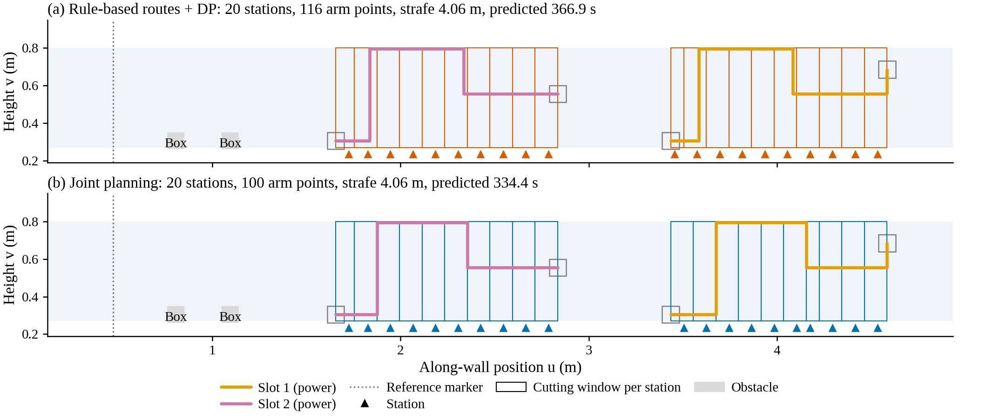
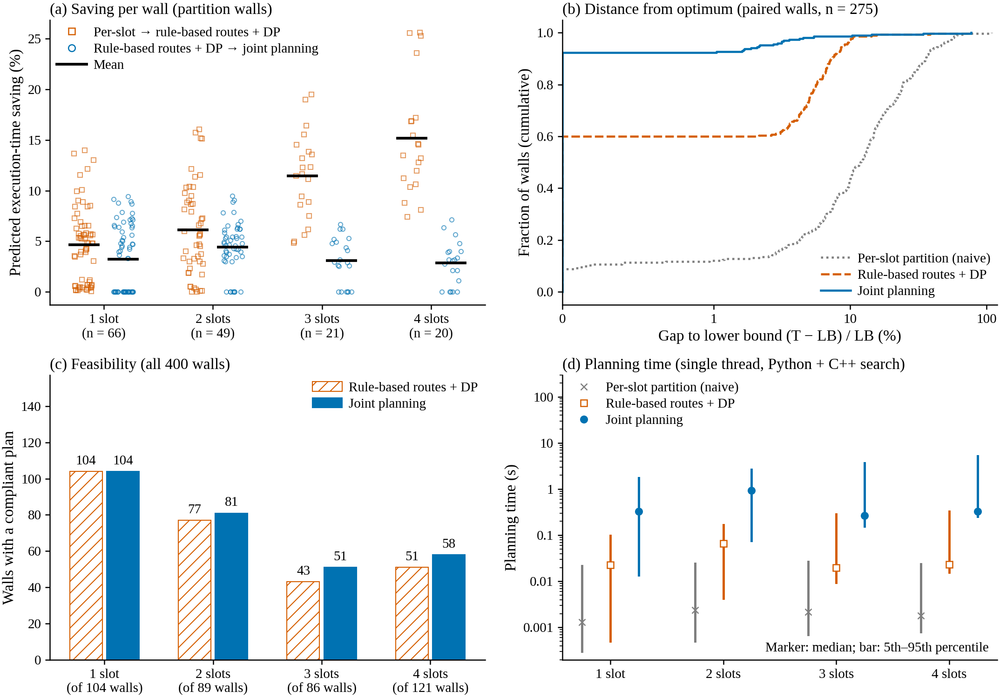

# 任务级联合规划：槽线走向 + 停靠站划分 + 访问顺序



*图 1：一面随机生成的非承重墙（种子 1121，两条强电槽，预测执行时间节省最多的 2–3 条槽墙面，`align_v1` 时间模型）：(a) 先按开槽规范代价选线、再用 DP 划分停靠站；(b) 联合规划。横轴为沿墙位置 u，纵轴为离地高度 v；浅蓝带为机械臂可切高度 0.27–0.80 m，竖框为各站切割窗口，三角为站位，点线为定位标记。两者槽线长度、弯数、停靠站数和横移都相同，联合规划只是把拐点挪到停靠站窗口的边界上，机械臂点从 116 个降到 100 个，预测时间 366.9 s → 334.4 s（−8.9 %）。*

**结论**：在 400 面随机住宅墙上，联合规划在所有方案可比的墙上**从不比现有方法慢**；非承重墙上预测执行时间平均再降 **3.5 %**（95 % CI [3.1, 4.0] %，n = 156，Wilcoxon p < 1e-10），相对逐槽划分的基线共降 **11.9 %**。用下界证书可以证明它在 **92 %** 的墙上已是该时间模型下的最优解。代价是规划耗时从约 25 ms 增加到约 0.4 s（中位数）。

（本报告正文的数字都使用第一版精对位下标定的时间模型，即预设 `align_v1`。按此后的执行路径重标定后结论不变：`align_v2` 下非承重墙节省 3.84 %，当前默认的 `align_v3` 下 3.46 %，证明最优的比例都约为 92 %，见文末“时间模型重标定”两节。room3 南墙示例任务上，联合规划已在 Gazebo 中执行：11 个停靠站实测 228 s，规则路线 246 s，**实测节省 7.3 %**，与预测（6.6 %）一致，见 [plan_validation](../plan_validation/README.md)。）

## 问题

单条槽线的规划已经做到了规范约束下的最优（[cpp_planner](../cpp_planner/README.md)：分段 A*，GB 50203 / GB 50303 等硬约束），停靠站的划分与访问顺序也已优化（[slot_execution](../slot_execution/README.md)）。但两步是先后做的：先按“槽长 + 弯数 + 规范偏好”选线，再给选好的线划分停靠站。机械臂沿墙只能覆盖 12 cm，同样合规、长度和弯数都相同的两条走法，需要的停靠站数和机械臂点数可能不同。本实验回答：**把选线和停靠站一起优化，执行时间能降多少？离最优还有多远？代价是什么？**

所有槽线都是直角折线，任意角规划器（Theta*、JPS 等）在这里没有可比性；需要比较的是任务层面的选择。

## 方法

### 问题形式化

一面墙上有 K 条槽（1–4 条），每条从起点线盒到终点线盒。决策包括三部分：

1. 每条槽的合规直角折线 r_k（开槽规范为硬约束，槽与槽之间保持间距，强弱电之间 30 cm）；
2. 停靠站划分：若干宽度不超过 w = 12 cm 的墙面窗口，每段槽线归某一站切；
3. 停靠站访问顺序。

目标是 `slot_plan.TimeModel` 的预测执行时间（本报告正文使用预设 `align_v1`：第一版精对位下 Gazebo 中 54 个停靠站标定，每站 RMSE 0.10 s）：

```
T = Σ_站 (t_settle + 横移距离 / v_strafe) + t_point × 机械臂点数
t_settle = 4.40 s，v_strafe = 0.0945 m/s，t_point = 2.034 s
```

每站内，一段被窗口截出的子折线若有 s 个直线小段，需要 4s 个机械臂点：下刀 / 退刀、每小段终点、每次转向的退刀-转刀-下刀（`slot_plan.count_points`）。因此

```
机械臂点数 = 4 × Σ_槽线的每个直线段 (该段跨过的窗口数)
```

竖直段只落在一个窗口里；横向段每跨过一条窗口边界就多出一个小段，即多 4 个点、约 8.1 s。一个拐点如果正好落在窗口边界上，拐点两侧的横段分属两站，比拐点落在窗口中间少一个小段。这就是同样合规的两条线执行时间不同的主要来源。

三部分决策的难度不同：

| 子问题 | 性质 | 本项目的解法 |
|---|---|---|
| 访问顺序 | 所有站在一条直线上，从起点出发访问全部点的最短开放路径是“先到较近一端，再扫到另一端” | 闭式解，pytest 与全排列枚举对照 |
| 窗口划分（槽线已定） | 一维 DP，状态是“u 以左已切完” | `partition_dp`，本轮起把横移计入目标，成为该时间模型下的精确解（见“排查”） |
| 槽线选择 | 每条槽的合规走法数量巨大，代价取决于窗口位置，且多条槽通过共享窗口和间距约束互相耦合 | 本实验的重点：站感知选线 + 联合搜索 |

一般的 GTSP 式跨槽排序（Noon & Bean 1993；Helsgaun 2015）在多站点不共线时有意义；这里所有停靠站共线，排序部分退化成闭式解，联合问题的难点只剩“选哪条线”和“窗口怎样对齐”。

### 相关工作

- **移动机械臂的底座位置规划**。可达性图（Zacharias et al. 2007）与逆可达性图（Vahrenkamp et al. 2013）解决“为一个任务选底座位置”；Xu et al.（2021）对多托盘拣选求最少的底座位置序列；MoboTSP（Adrian & Pham 2020）先把目标聚类成底座位置、再排序，以减少底座移动和执行时间。这些工作都把**任务点视为给定**，只选底座位置和顺序。本项目的不同之处是任务（槽线）本身可选：在合规走法中挑一条让底座位置更少、机械臂点更少的。
- **建筑机器人**。In situ Fabricator（Giftthaler et al. 2017；Dörfler et al. 2016）在建筑现场逐站完成砌筑等任务，同样受限于“底座每停一次只能覆盖一块工作区”，其工作区划分在给定设计上进行。
- **直角布线**。VLSI 中的 Lee 迷宫布线（Lee 1961）及其带转弯代价的扩展、Hightower 线搜索（Hightower 1969）、障碍物间的最少弯直角路径（Lee, Yang & Wong 1996）和正交连接线布线（Wybrow et al. 2009）。本项目的分段 A* 属于这一类，但开槽规范中“弯曲半径要求两侧直段足够长”“横槽最长 50 cm”是整段属性，逐格的 Lee 布线无法表达；下文把 Lee 布线作为经典基线对照。
- **区间覆盖**。用最少的定长区间覆盖直线上的点集（或区间并集），从左到右贪心是精确的，这是经典结论；现有的贪心划分与本文停靠站数的下界都用了它。

### 站感知选线：窗口格上的列代价

给定窗口格的相位 φ（所有窗口落在边界列 c ≡ φ (mod 12) 的等宽格上），一条路线的预测时间几乎可以沿路线累加：

| 事件 | 代价（秒） | 搜索中的位置 |
|---|---|---|
| 每个直线段 | 4 t_point = 8.14 | 转弯代价 |
| 横向段从内部穿过一条窗口边界 | 4 t_point | `through_cost_x[c]`，c 为边界列 |
| 进入一个尚未打开的窗口 | t_settle + w / v = 5.67 | `step_cost_pos / step_cost_neg`（按方向）；已被其他槽打开的窗口为 0 |
| 原规范代价 J（槽长、竖槽优先、“电上水下”、弯数） | × ε = 10⁻³ | 轴权重 / 代价权重，只在预测时间相同的路线之间排序 |

为此在 C++ `OrientedAStar` 中加入三类非负列代价（`SearchParams::step_cost_pos / step_cost_neg / through_cost_x`，C API `scr_planner_plan_ex`）。搜索的每条边仍是一整段直线，开槽规范仍是硬约束；step 代价按“当前列到目标列之间每一步至少走一次”的前缀和加入启发函数，满足一致性，搜索保持最优。gtest `ColumnCostsMatchStepwiseDijkstra` 在 300 个随机栅格上与独立实现的逐格 Dijkstra 对照，代价完全一致。

“进入新窗口”的代价是近似：同一条槽回头再进入同一窗口时会重复计。最终方案总是用精确评估（下节）选出，近似只影响候选的质量，不影响结果的正确性。

### 联合搜索

`task_plan.joint_routes`：

1. 对每个相位 φ ∈ {0, …, 11}（1 cm 步长）：
   - 按任务顺序逐条规划，已规划的槽作为障碍，并把它们打开的窗口记为免费；
   - 某条槽被前面的槽堵死时，把它提到最前重新排序（rip-up and reroute 的简化版，最多 K + 1 种顺序；第一个相位上再穷举全部 K! 种顺序以找到可行顺序）；
   - 两轮坐标下降：固定其余槽、重规划第 k 条，只接受让精确预测时间下降的修改。
2. 每个候选都用精确评估：合并 DP 划分（含横移）+ 站位摆放 + 一维扫掠顺序。
3. 原规则路线（现有方法的选线）也作为候选。最终取预测时间最短者，所以结果**不劣于现有方法**。

也考虑过“对每条槽生成 k 条最短 / 多样路线，再逐一 DP 评估”。k 条最短路线在这里多是同一走法挪 1 cm，彼此的窗口占用几乎相同；按窗口相位生成的 12 个候选在“拐点与窗口边界的相对位置”这一真正起作用的维度上是多样的，而且每个候选都是该相位下的最优解，所以采用后者。

### 下界：离最优还差多少

`task_plan.lower_bound` 同时松弛三处，每处都对任何合规方案成立：

1. 每条槽单独规划，忽略其他槽的间距约束；长 L 的横向段至少跨 ⌈L / w⌉ 个窗口（`run_cost_x` 表），每个直线段至少一个小段；
2. 每条槽在 u 方向的投影至少覆盖两端线盒之间的区间，停靠站数 ≥ 这些区间并集的最少窗口覆盖数（贪心，精确）；
3. 横移 ≥ 最左站中心不超过 u_min + off、最右站中心不小于 u_max − w + off 时的最短扫掠距离。

任何方案的预测时间 T 都不小于 LB，(T − LB) / LB 是该方案离最优的距离的上界；T = LB 时该方案**被证明最优**。

本来计划用 MILP（OR-Tools 或 PuLP/CBC）对小场景求精确最优，但离线环境中没有可用的 MILP 求解器（SciPy 1.8 也没有 `milp`）。改用下界证书后，最优性检验不再局限于小场景：每面墙都可以检验，而且多数墙上能直接证明最优（见结果）。

### 经典基线：Lee 迷宫布线

`task_plan.lee_route`：逐格 Dijkstra，状态 (x, y, 方向)，代价 = 逐格轴权重 + “电上水下”代价 + 转弯代价，即带转弯代价的 Lee 布线。它与 `OrientedAStar` 关闭“弯曲半径”和“横槽最长 50 cm”两条整段约束后的目标函数完全相同，用来：

- 在真实墙面上独立校验分段 A* 的单槽最优性；
- 统计逐格布线（含最少弯版本）违反开槽规范的比例，说明为什么必须用整段搜索。

## 实验设置

**场景**：`wall_gen.residential_wall(seed)`，种子 1000–1399，共 400 面墙，每面墙由种子完全确定。

| 项目 | 设置 |
|---|---|
| 墙体 | 宽 3–6 m，高 2.8 m；30 % 为承重墙（只能开竖槽，窄墙垛不可开槽） |
| 结构 | 梁（50 %）、端部构造柱（30 %）、门（50 %，宽 0.8–1.0 m）、窗（50 %，普通窗台 0.9 m 或飘窗 0.5 m） |
| 已有点位 | 1–4 个插座（中心离地 0.30 m）、0–1 个弱电口；门边开关（1.30 m）、配电箱（底边 1.6–1.8 m）、吊顶接线盒、家居弱电箱（底边 0.3–0.4 m，20 %）、已有弱电竖向线槽（25 %） |
| 开槽任务 | 每面墙 1–4 条（均匀），从已有插座 / 弱电口引到同墙的新插座（0.30 m）、电视柜插座（0.55 m）、床头插座（0.68 m）或新弱电口；承重墙只能在已有点位正上方加点位 |
| 规则 | 与 [cpp_planner](../cpp_planner/README.md) 相同的开槽规范；另加强弱电槽之间 30 cm、同类槽之间 5 cm、他槽两端线盒外扩 5 cm |
| 可切高度 | 任务两端都在 0.27–0.80 m 内（任务约束，见 [slot_execution](../slot_execution/README.md)）；开关、配电箱等带外点位只作为障碍 |
| 可行性 | 生成时只保留**各自单独可规划**的任务；多条槽之间互相阻挡不排除，那是规划方法要解决的问题 |
| 定位标记 | 每面墙在 u ∈ [0.3, W − 0.3] m 内随机 |

**对比方法**：

| 方法 | 选线 | 划分 | 顺序 |
|---|---|---|---|
| 逐槽划分（基线） | 规则路线：逐条槽规范代价 J 最优 | 每条槽各自贪心，站不共享 | 逐条槽、每条从左到右 |
| 先选线后 DP（现有） | 规则路线 | 全部槽合并 DP | 一维最优扫掠 |
| 现有（修正前评估） | 规则路线 | 同上，但用修正前的评估（见“排查”） | 同上 |
| 站感知·各槽独立 | 窗口格选线，不共享窗口、不做坐标下降 | 合并 DP | 扫掠 |
| 站感知·共享窗口 | 窗口格选线，已打开的窗口免费 | 合并 DP | 扫掠 |
| 站感知·共享+坐标下降 | 再加两轮坐标下降 | 合并 DP | 扫掠 |
| **联合规划** | 上一行的全部候选 + 规则路线 | 合并 DP | 扫掠 |
| 下界 | — | — | — |

**指标**：预测执行时间（`TimeModel`，不取整的精确值）、停靠站数、机械臂点数、横移距离、槽线总长、弯数、违规数（`task_plan.plan_violations`：单槽规范、高度带、槽间间距、他槽线盒，与规划器无关的独立检查）、规划耗时、是否得到合规方案、与下界的差距。

**统计**：配对样本为三种主要方法都得到合规方案的墙（n = 275，其中承重墙 119 面）。差值 d = T_A − T_B；Wilcoxon 符号秩检验（双侧，|d| < 0.05 s 视为持平并剔除）；效应量为配对秩二列相关 r_rb；均值与中位数的 95 % 置信区间来自配对 bootstrap（10000 次，种子 0）。T − LB ≤ 0.01 s 记为“已证明最优”。

## 结果

### 执行时间

联合规划在 275 面配对墙上 106 面更快、169 面持平、0 面更慢。持平的主要是承重墙（只有竖槽，没有可选的走法）和不需要拐点的短槽。

| 方法（配对样本 n = 275 的均值） | 预测时间 | 停靠站 | 机械臂点 | 横移 | 槽长 | 弯数 | 违规 |
|---|---|---|---|---|---|---|---|
| 逐槽划分（基线） | 174.3 s | 8.76 | 45.8 | 4.02 m | 1.655 m | 2.90 | 0 |
| 现有（修正前评估） | 160.1 s | 8.39 | 46.7 | 2.67 m | 1.655 m | 2.90 | 0 |
| 先选线后 DP（现有） | 155.8 s | 8.42 | 44.8 | 2.62 m | 1.655 m | 2.90 | 0 |
| **联合规划** | **150.6 s** | 8.40 | 42.2 | 2.62 m | 1.659 m | 2.92 | 0 |
| 下界 | 149.3 s | 8.37 | 41.7 | 2.62 m | — | — | — |

| 对比（A → B） | 样本 | 快 / 持平 / 慢 | 平均节省 | 95 % CI | 中位数 | 最大 | Wilcoxon p | r_rb |
|---|---|---|---|---|---|---|---|---|
| 现有 → 联合 | 全部 275 | 106 / 169 / 0 | 5.2 s，2.00 % | [1.68, 2.33] % | 0.00 % | 9.5 % | < 1e-10 | 1.00 |
| 现有 → 联合 | 非承重墙 156 | 106 / 50 / 0 | 9.2 s，**3.53 %** | [3.08, 3.98] % | 3.94 % | 9.5 % | < 1e-10 | 1.00 |
| 　1 条槽 | 66 | 35 / 31 / 0 | 5.6 s，3.22 % | [2.44, 4.01] % | 3.47 % | 9.4 % | 1.6e-07 | 1.00 |
| 　2 条槽 | 49 | 41 / 8 / 0 | 11.5 s，4.43 % | [3.73, 5.10] % | 4.65 % | 9.5 % | 1.9e-08 | 1.00 |
| 　3 条槽 | 21 | 15 / 6 / 0 | 11.6 s，3.07 % | [2.10, 4.03] % | 2.96 % | 6.7 % | 6.1e-05 | 1.00 |
| 　4 条槽 | 20 | 15 / 5 / 0 | 13.1 s，2.83 % | [1.90, 3.77] % | 3.11 % | 7.1 % | 6.1e-05 | 1.00 |
| 逐槽划分 → 现有 | 全部 275 | 250 / 25 / 0 | 18.5 s，10.06 % | [8.95, 11.20] % | 6.92 % | 40.8 % | < 1e-10 | 1.00 |
| 逐槽划分 → 联合 | 全部 275 | 251 / 24 / 0 | 23.7 s，**11.93 %** | [10.87, 13.01] % | 10.65 % | 40.8 % | < 1e-10 | 1.00 |
| 修正前评估 → 现有 | 全部 275 | 179 / 96 / 0 | 4.3 s，2.54 % | [2.24, 2.84] % | 2.22 % | 9.4 % | < 1e-10 | 1.00 |

r_rb = 1.00 表示所有非零差值方向相同（没有一面墙变慢），这是“规则路线也是候选”的直接结果，不是统计上的偶然。

节省来自哪里（非承重墙，联合 − 现有的平均差）：机械臂点 −4.46 个（105 面减少、0 面增加），停靠站 −0.03 个（6 面减少、1 面增加），横移不变，槽长 +7 mm（8 面变长），弯数 +0.03。也就是说，联合规划几乎不改变线形的长度和弯数，只是把拐点挪到窗口边界上；每对齐一个拐点省一个小段，即 4 个点、约 8.1 s。



*图 2：(a) 非承重墙上每面墙的预测执行时间节省，按槽数分组，黑横线为均值；(b) 各方法与下界差距 (T − LB) / LB 的累积分布（横轴对称对数刻度，0 处的阶跃高度即已证明最优的比例）；(c) 全部 400 面墙中得到合规方案的墙数；(d) 规划耗时，点为中位数，竖线为 5–95 分位。灰色为逐槽划分，朱红为先选线后 DP（规则路线），蓝色为联合规划。*

### 离最优还差多少

| 方法 | 已证明最优 | 平均差距 | 中位数 | 95 分位 | 最大 |
|---|---|---|---|---|---|
| 逐槽划分（基线） | 24 / 275（8.7 %） | 15.7 % | 11.9 % | 44.7 % | 109 % |
| 先选线后 DP（现有） | 165 / 275（60.0 %） | 2.81 % | 0 | 8.8 % | 77 % |
| **联合规划** | **254 / 275（92.4 %）** | 0.67 % | 0 | 2.2 % | 77 % |
| 联合规划（全部 294 面有解的墙） | 255 / 294（86.7 %） | 1.28 % | 0 | 5.7 % | 77 % |

按槽数，联合规划被证明最优的比例为 1 条槽 103 / 104，2 条 71 / 77，3 条 37 / 43，4 条 43 / 51。没有任何方案低于下界（逐墙断言）。

### 消融

四种站感知变体在 156 面非承重配对墙上的结果**完全相同**（平均节省均为 3.53 %，逐墙预测时间一致）：

| 变体 | 相对现有方法的平均节省 | 规划耗时中位数 |
|---|---|---|
| 站感知·各槽独立 | 3.53 % | 0.32 s |
| 站感知·共享窗口 | 3.53 % | 0.33 s |
| 站感知·共享+坐标下降 | 3.53 % | 0.35 s |
| 联合规划（再加规则路线候选） | 3.53 % | 0.40 s |

即全部收益来自“在公共窗口格上为每条槽单独求站感知最优路线，再统一 DP 评估”；跨槽共享窗口与坐标下降在这批墙上没有带来额外收益（分析见下）。规则路线候选在配对墙上也从未胜出，它的作用是保证“不劣于现有方法”。

### 可行性

| | 现有 | 联合规划 |
|---|---|---|
| 得到合规方案的墙 | 275 / 400 | 294 / 400 |

- 联合规划多解出 19 面墙。其中 9 面只靠调整槽的规划顺序就能解出（按规则路线穷举全部顺序验证），另外 10 面还需要站感知搜索给出的不同走法，为后面的槽留出空间。
- 106 面墙所有方法都无解，其中 63 面是 4 条槽：可切高度带只有 53 cm，强弱电要隔 30 cm，几条槽逐条规划时会互相堵死。下界在这些墙上都存在，说明每条槽单独都可行，问题在槽与槽的相互作用（见“局限”）。

### 规划耗时

单线程（Python 评估 + C++ 搜索），每面墙：现有方法中位数 25 ms（95 分位 0.25 s），联合规划中位数 0.40 s（95 分位 3.6 s，最大 5.5 s）。联合规划要做约 12 × (K + 2K) 次 A* 搜索和十几次 DP 评估，耗时主要在 Python 的 DP 评估上。离线规划时这一耗时可以接受。

### 时间模型敏感性

在 120 面墙中取非承重墙且三种方法都有解的 42 面，把时间模型的单项参数加倍或减半，比较“先选线后 DP（现有）→ 联合规划”的节省（原始数据 [`data/sensitivity.csv`](data/sensitivity.csv)，汇总 [`sensitivity_summary.csv`](sensitivity_summary.csv)）：

| 时间模型 | 快 / 持平 / 慢 | 平均节省 | 95 % CI | 联合规划证明最优 |
|---|---|---|---|---|
| 标定值 | 25 / 17 / 0 | 3.14 %（8.0 s） | [2.26, 4.05] % | 86 % |
| t_settle × 2 | 25 / 17 / 0 | 2.53 %（8.1 s） | [1.83, 3.26] % | 86 % |
| t_settle × 0.5 | 25 / 17 / 0 | 3.57 %（8.0 s） | [2.56, 4.62] % | 86 % |
| t_point × 0.5 | 25 / 17 / 0 | 2.30 %（4.1 s） | [1.67, 2.97] % | 86 % |
| v_strafe × 2 | 25 / 17 / 0 | 3.34 %（8.0 s） | [2.41, 4.31] % | 86 % |

所有参数组合下 Wilcoxon p ≈ 6 × 10⁻⁸，没有一面墙变慢，变快的墙也完全相同：收益来自减少机械臂切割点数，与具体时间参数无关；参数只改变节省的绝对量与占比。每点耗时减半时绝对节省减半（8.0 → 4.1 s），与“收益来自点数”一致。精对位升级后每站移动与稳定时间约从 4.5 s 降到 2.8 s，落在 t_settle × 0.5 与标定值之间，预计节省约 3.1–3.6 %。

### 经典基线：Lee 迷宫布线

在 400 面墙的全部 1024 条槽上（每条单独规划，他槽线盒为障碍）：

- 关闭“弯曲半径”和“横槽最长 50 cm”两条整段约束时，Lee 布线与分段 A* 的代价 **1024 / 1024 完全相同**，在真实墙面上独立确认了单槽搜索的最优性。
- Lee 布线的路线在 740 条非承重墙槽中有 **589 条（79.6 %）违反开槽规范**（主要是弯曲半径要求的直段长度和横槽长度）；把转弯代价设为 1000 的最少弯版本同样是 589 条。分段 A* 的规则路线 0 条违规。承重墙上只有竖槽，两者相同。
- 满足这两条整段约束使非承重墙槽的规范代价 J 平均增加 15.9 %，这是合规的代价，也是逐格布线给出的路线不能直接使用的原因。
- 单槽耗时：分段 A* 中位数 8.8 ms，Python 实现的 Lee 布线 111 ms（实现语言不同，只作参考）。

### Gazebo 示例任务的离线结果

[slot_execution](../slot_execution/README.md) 中在 Gazebo 里执行过的 room3 南墙两条槽（`config/wall_task_room3_south.yaml`）：

| 流程 | 停靠站 | 机械臂点 | 预测时间 |
|---|---|---|---|
| 现有方法，修正前评估（Gazebo 中执行过的方案） | 11 | 92 | 250.0 s |
| 现有方法，修正后评估 | 11 | 88 | 241.8 s |
| 联合规划（`--routes=joint`） | 11 | 80 | 225.5 s（−6.7 %） |

后两行此后在 Gazebo 中执行，见文末“时间模型重标定（当前默认执行路径）与 Gazebo 验证”。

### 排查：评估环节的三处修正

实现联合规划时，站感知搜索给出的路线经 DP 评估后与规则路线**完全一样快**，与“拐点对齐窗口边界可省一个小段”的分析矛盾。逐项排查评估代码，发现三处问题，都在 `slot_plan` 中修正，并对所有方法统一使用修正后的评估：

1. **窗口截断残片**
   - 现象：拐点正好落在窗口边界上时，右侧窗口里的子折线仍是“横–竖–横”三段，12 个点。
   - 定位：`_clip_all` 用 `[lo − EPS, hi − EPS]`（EPS = 1e-7 m）截取，相邻横段在右侧窗口里留下 1e-7 m 的一截；整段长度过滤只去掉独立的短段，不去掉连在子折线端部的残片。
   - 根因：数值残片被当作一个需要切的小段，多出退刀、下刀和转刀，即 4 个点、约 8 s。这些点在 Gazebo 中会真实执行（原地下刀再退刀），时间模型对它们的计时是对的，但它们本身是多余的。
   - 方案：截取后剔除端部短于 1e-6 m 的小段（`SLIVER`）。
   - 验证：pytest `test_subsegments_match_clipped_points` 在 300 条随机路线上确认，修正后搜索中的小段计数与实际站内机械臂点数逐一相等。
2. **DP 不计横移**
   - 现象：同样的站数和点数下，DP 可能选横移更长的划分；上一份报告已指出它在完整时间模型下只是近似最优。
   - 方案：站位可以在“仍能覆盖本站窗口”的范围内滑动（`place_centres`），这时扫掠距离只取决于第一个窗口的左端和最后一个窗口的右端，于是在 DP 的终止状态上加上精确横移即可，DP 成为该时间模型下的精确划分。pytest 与站位网格枚举对照。
3. **机械臂行程的闭区间**
   - 现象：恰好在窗口右端（离左端正好 12 cm）的一段竖切被单独分成一站，站位与前一站完全相同，白白多一次 4.4 s 的到位开销。
   - 方案：窗口右端允许 2e-6 m 的容差（`REACH_TOL`），对应 Y 行程本来就是闭区间；1 cm 的对位余量不受影响。下界的覆盖计数按同样的约定计算。

三处修正合起来，使现有方法在配对墙上平均快 2.54 %（179 面更快，0 面更慢），示例任务从 250.0 s 降到 241.8 s。下文“联合规划相对现有方法”的比较都在修正后的评估上进行，不含这部分收益。

## 时间模型重标定（精对位第二版）

上文全部结果使用 `align_v1` 时间模型（t_settle 4.40 s）。精对位第二版下每站“横移 + 到位”从约 4.5 s 降到 2.8 s，按 33 个停靠站重新标定得到 `align_v2`：t_settle 2.83 s、v_strafe 0.0984 m/s、t_point 2.049 s（每站 RMSE 0.68 s，旧模型在同一数据上 1.65 s；标定方法与数据见 [slot_execution](../slot_execution/README.md#时间模型重标定精对位第二版)）。用 `align_v2` 重跑同一组 400 面墙（种子 1000–1399，其余设置不变），结果在 [`align_v2/`](align_v2/)。以下仍是模型预测，不是 Gazebo 实测。

| 指标 | `align_v1`（上文） | `align_v2` |
|---|---|---|
| 配对墙平均预测时间：逐槽基线 / 现有 / 联合 / 下界 | 174.3 / 155.8 / 150.6 / 149.3 s | 159.5 / 142.2 / 137.0 / 135.7 s |
| 现有 → 联合，非承重墙（n = 156）平均节省 | 3.53 %，95 % CI [3.08, 3.98] % | **3.84 %**，95 % CI [3.34, 4.34] %（中位 4.32 %，最大 10.4 %） |
| 　快 / 持平 / 慢 | 106 / 50 / 0 | 105 / 51 / 0 |
| 　按槽数 1 / 2 / 3 / 4 | 3.22 / 4.43 / 3.07 / 2.83 % | 3.55 / 4.86 / 3.26 / 2.93 % |
| 逐槽基线 → 联合，全部（n = 275） | 11.93 % | 12.41 %，95 % CI [11.32, 13.52] % |
| 逐槽基线 → 现有，全部 | 10.06 % | 10.37 % |
| 联合规划证明最优（配对墙） | 254 / 275（92.4 %） | 253 / 275（92.0 %） |
| 得到合规方案的墙：现有 / 联合 | 275 / 294 | 275 / 293 |
| 规划耗时中位数：现有 / 联合 | 25 ms / 0.40 s | 25 ms / 0.42 s |

- **结论不变，相对节省略增**：t_settle 降低后，停靠站数在总时间中的权重下降，而联合规划的收益来自机械臂点数（非承重墙平均 −4.39 个），所以节省的绝对量基本不变（9.2 → 9.1 s）、占比上升。上文“时间模型敏感性”一节曾预计新模型下的节省落在 t_settle × 0.5 与标定值之间（3.1–3.6 %）；在同一 42 面墙子集上，`align_v2` 的结果是 3.46 %（95 % CI [2.49, 4.47] %），在该区间内。
- **逐墙对比**：配对样本完全相同（275 面）。两种模型下联合规划都更快的墙有 105 面；只在 `align_v1` 下更快的有 1 面（种子 1220，3 条槽）。这面墙在 `align_v2` 下，“站感知·各槽独立”变体比联合规划快 8.2 s，即跨槽共享窗口的候选反而更差。原因是“进入新窗口”的近似代价（t_settle + w / v）随模型变小后，共享窗口的搜索选了不同的走法；联合规划只包含共享窗口变体与规则路线的候选，不包含各槽独立变体，所以不保证不劣于它。另有 1 面墙（种子 1249）在 `align_v1` 下有解、在 `align_v2` 下无解，同样因为候选走法随代价变化。其余 273 面配对墙上，两种模型下联合规划的站数与点数相同。
- **room3 南墙示例任务**（`plan_wall_slots.py`，两种选线方式在两种模型下得到的槽线与停靠站相同，只有预测时间不同）：

  | 流程 | 停靠站 | 机械臂点 | `align_v1` 预测 | `align_v2` 预测 |
  |---|---|---|---|---|
  | 逐槽划分（基线） | 16 | 92 | 283.3 s | 258.6 s |
  | Gazebo 中执行过的方案（修正前评估，`runs/dp/slot_plan.yaml`） | 11 | 92 | 250.0 s | 233.5 s（实测 233.2–233.7 s，精对位第二版，样本内） |
  | 现有方法，修正后评估（`--routes=rule`） | 11 | 88 | 241.8 s | 225.3 s |
  | 联合规划（`--routes=joint`） | 11 | 80 | 225.5 s | 208.9 s（−7.3 %） |

  新模型下的规划文件在 [`align_v2/example_room3/`](align_v2/example_room3/)。后两行此后在 Gazebo 中执行，见下一节。
- **示例墙（种子 1121）**：现有 335.6 s → 联合 302.8 s（−9.8 %；`align_v1` 下为 366.9 → 334.4 s，−8.9 %），图见 [`align_v2/fig_example.png`](align_v2/fig_example.png)，汇总图 [`align_v2/fig_results.png`](align_v2/fig_results.png)。

## 时间模型重标定（当前默认执行路径）与 Gazebo 验证

此后默认执行路径改为行为树任务层 + 标记地图 + 横移比例估计，横移前机械臂回到观测位姿（[along_wall_accuracy](../along_wall_accuracy/README.md)），每站多出约 2 s，`align_v2` 在新路径上每次运行低估 18–21 s。按新路径的 44 个停靠站重新标定得到 `align_v3`：t_settle 4.70 s、v_strafe 0.0971 m/s、t_point 2.030 s（每站 RMSE 0.22 s，逐次运行留一 0.24 s；切割阶段改用回归，原因见 [plan_validation](../plan_validation/README.md#41-时间模型重标定)）。标定、样本外检验与 Gazebo 执行都在 [plan_validation](../plan_validation/README.md)。

**Gazebo 执行（room3 南墙示例任务，`align_v3` 下的规划文件在 [`plan_validation/plans/`](../plan_validation/plans/)）**：

| 流程 | 停靠站 / 机械臂点 | `align_v3` 预测 | Gazebo 实测（种子 1 / 2） | 到站沿墙误差最大 | 刀尖轨迹误差平均 |
|---|---|---|---|---|---|
| 现有方法（`--routes=rule`） | 11 / 88 | 244.4 s | 245.7 / 246.0 s | 1.51 / 1.28 mm | 0.18 / 0.18 mm |
| 联合规划（`--routes=joint`） | 11 / 80 | 228.1 s（−6.6 %） | 228.1 / 227.8 s（**−7.3 %**） | 2.00 / 1.27 mm | 0.19 / 0.19 mm |

实测节省 17.9 s，比预测多 1.7 s；差额来自规则路线每次运行中一次约 2.7 s 的偶发停顿，扣除后实测节省 15.2 s（6.2 %）。两种规划的执行精度没有可见差别。时间均为各站耗时之和（仿真时间），不含导航与首次精对位。

**400 面墙的离线对比用 `align_v3` 重跑**（种子 1000–1399，其余设置不变，结果在 [`align_v3/`](align_v3/)；仍是模型预测）：

| 指标 | `align_v1`（正文） | `align_v2` | `align_v3`（当前默认） |
|---|---|---|---|
| 配对墙平均预测时间：逐槽基线 / 现有 / 联合 / 下界 | 174.3 / 155.8 / 150.6 / 149.3 s | 159.5 / 142.2 / 137.0 / 135.7 s | 175.6 / 157.4 / 152.2 / 150.9 s |
| 现有 → 联合，非承重墙（n = 156）平均节省 | 3.53 %，95 % CI [3.08, 3.98] % | 3.84 %，[3.34, 4.34] % | **3.46 %**，[3.02, 3.91] %（中位 3.89 %，最大 9.3 %） |
| 　快 / 持平 / 慢 | 106 / 50 / 0 | 105 / 51 / 0 | 106 / 50 / 0 |
| 　按槽数 1 / 2 / 3 / 4 | 3.22 / 4.43 / 3.07 / 2.83 % | 3.55 / 4.86 / 3.26 / 2.93 % | 3.17 / 4.37 / 3.02 / 2.66 % |
| 逐槽基线 → 联合，全部（n = 275） | 11.93 % | 12.41 % | 11.69 %，[10.65, 12.75] % |
| 逐槽基线 → 现有，全部 | 10.06 % | 10.37 % | 9.84 % |
| 联合规划证明最优（配对墙） | 254 / 275（92.4 %） | 253 / 275（92.0 %） | 253 / 275（92.0 %） |
| 得到合规方案的墙：现有 / 联合 | 275 / 294 | 275 / 293 | 275 / 293 |
| 时间模型敏感性子集（42 面）平均节省 | 3.14 % | 3.46 % | 3.09 % |

- `align_v3` 的参数与 `align_v1` 接近（每站固定开销 4.70 s 对 4.40 s，每点 2.030 s 对 2.034 s），结果也接近 `align_v1`：配对墙上联合规划非承重墙平均减少 4.41 个机械臂点，节省的绝对量约 9.1 s 不变，占比随每站固定开销增大而略降。
- `align_v2` 下出现的“各槽独立变体比联合规划快”的墙（种子 1220）在 `align_v3` 下没有出现：四种站感知变体在 275 面配对墙上逐墙相同。
- 规划耗时中位数：现有 19 ms、联合 0.28 s（本次运行时机器负载较轻，与上文 25 ms / 0.4 s 不可直接比较）。
- 示例墙（种子 1121）：现有 371.3 s → 联合 338.8 s（−8.8 %），图见 [`align_v3/fig_example.png`](align_v3/fig_example.png)，汇总图 [`align_v3/fig_results.png`](align_v3/fig_results.png)。

## 分析

**已证实**：

- 同样合规的走法之间确实存在执行时间差异，且可以系统地利用：在非承重墙上平均 3.5 %、最多 9.5 %；节省几乎全部来自机械臂点数，槽长和弯数基本不变。
- 联合规划不会更慢（规则路线也是候选），也不引入违规（0 违规，独立检查）。
- 对 92 % 的配对墙，联合规划的方案被下界证明为该时间模型下的全局最优；现有方法为 60 %，基线不到 9 %。
- 单槽搜索在关闭整段约束时与 Lee 布线代价完全一致；不关闭时 Lee 布线约 80 % 违规。

**推测（未单独验证）**：

- **为什么跨槽共享与坐标下降没有收益**：DP 评估本身已经把共享窗口算对了，选线阶段需要做的只是让每条槽的拐点落在公共窗口格的边界上；在公共相位 φ 下各槽独立求解已经做到这一点。只有当两条槽在 u 方向重叠、且其中一条可以选择是否进入另一条已占用的窗口时，共享才会改变选线；在本生成器的墙面上，同一高度带内两条槽横向重叠的情形较少，且它们往往被间距约束固定。墙面更拥挤或允许更多走法自由度时结论可能不同。
- **下界没有闭合的 21 面墙**（差距最大 77 %）：20 面是多条槽的墙，多数差 4 个机械臂点（一个小段），差距最大的几面停靠站相差 1–3 个。下界忽略了槽与槽之间的间距约束，多条槽互相避让、绕行时下界偏松。这些墙上联合规划是否最优无法判断。
- **随槽数增加，相对节省没有变大**（2 条槽 4.4 %，4 条槽 2.8 %）：槽越多，越多的槽被间距约束“卡”在唯一走法上，可选余地反而变小；绝对节省仍随槽数增加（5.6 s → 13.1 s）。

**与逐槽基线相比**：基线到联合规划共 11.9 %，其中约 10.1 % 来自已有的“合并划分 + 扫掠顺序”（上一轮的工作），2.0 % 来自本轮的联合选线（全部墙平均，含没有选择余地的承重墙）。

## 局限

- **时间模型**：每个机械臂点固定约 2 s，与切割长度无关（Gazebo 中 `motion.duration = 2.0 s`）。真实切割受进给速度限制，长段要更久；联合规划使槽长平均只增加 7 mm，影响应很小，但未量化。400 面墙的结论都是模型预测；Gazebo 中只执行了 room3 南墙一个示例任务（[plan_validation](../plan_validation/README.md)，联合规划与规则路线各 2 次）。
- **最优性证明**：用下界证书代替 MILP。下界忽略槽间约束，多槽墙上有 7.6 % 的配对墙没有闭合，这些墙上的最优性未知。
- **场景**：生成器是按常见做法写的规则化布局，不是实测户型数据；任务限定在可切高度带内；一面墙独立规划，不考虑多面墙之间的转场。
- **离散化**：路线栅格和窗口相位都是 1 cm；DP 候选位置为 5 mm 网格加拐点。
- **多槽可行性**：仍是逐条规划（加顺序重排），106 面墙所有方法都无解。VLSI 多线网布线中的协商式拥塞消解（如 PathFinder）可能解出其中一部分，留作下一步。
- **规划耗时**：最长 5.5 s，主要花在 Python 的 DP 评估上；在线重规划需要把 DP 移到 C++。

## 复现

```bash
colcon build --symlink-install --packages-up-to scr_planner
# 主实验：400 面墙，2 个进程，约 16 min（4 核 / 4 GB 机器，与 Gazebo 共用）
# 正文（align_v1，输出 data/）：
python3 src/scr_planner/scripts/task_planning_benchmark.py --scenes 400 --seed0 1000 --jobs 2 --time-model align_v1
# 时间模型敏感性：120 面墙 × 5 组参数，约 6 min
python3 src/scr_planner/scripts/task_planning_benchmark.py --sensitivity --scenes 120 --seed0 1000 --time-model align_v1
# 统计、表格与图（本报告正文的数字都来自它的输出）
python3 src/scr_planner/scripts/task_planning_report.py docs/experiments/task_planning/data docs/experiments/task_planning --time-model=align_v1
# 重标定后（align_v2，输出 align_v2/data/ 与 align_v2/）：主实验 15 min，敏感性 5 min
python3 src/scr_planner/scripts/task_planning_benchmark.py --scenes 400 --seed0 1000 --jobs 2 --time-model align_v2
python3 src/scr_planner/scripts/task_planning_benchmark.py --sensitivity --scenes 120 --seed0 1000 --time-model align_v2
python3 src/scr_planner/scripts/task_planning_report.py docs/experiments/task_planning/align_v2/data --time-model=align_v2
# 当前默认（align_v3，输出 align_v3/data/ 与 align_v3/）：主实验 12 min，敏感性 4 min
python3 src/scr_planner/scripts/task_planning_benchmark.py --scenes 400 --seed0 1000 --jobs 2
python3 src/scr_planner/scripts/task_planning_benchmark.py --sensitivity --scenes 120 --seed0 1000
python3 src/scr_planner/scripts/task_planning_report.py
# 用联合规划生成执行文件（格式与原来相同，navigation_cutting_task 可直接执行）
python3 src/scr_planner/scripts/plan_wall_slots.py src/scr_planner/config/wall_task_room3_south.yaml plan.yaml --routes=joint
```

| 文件 | 内容 |
|---|---|
| [`data/results.csv`](data/results.csv) | 每面墙 × 每种方法一行（3200 行） |
| [`data/lee.csv`](data/lee.csv) | 每条槽的 Lee 布线 / 分段 A* 对照（1024 行） |
| [`data/sensitivity.csv`](data/sensitivity.csv) | 敏感性实验原始数据 |
| [`summary.csv`](summary.csv)、[`paired_tests.csv`](paired_tests.csv)、[`gap.csv`](gap.csv)、[`lee_summary.csv`](lee_summary.csv)、[`sensitivity_summary.csv`](sensitivity_summary.csv) | 统计结果 |
| [`example/`](example/) | 示例墙（种子 1121）的任务文件及两种方法的规划结果（`align_v1`） |
| [`align_v2/`](align_v2/) | 用 `align_v2` 时间模型重跑的原始数据（`align_v2/data/`）、统计结果、图，以及 room3 南墙示例任务的规划文件（`align_v2/example_room3/`） |
| [`align_v3/`](align_v3/) | 用 `align_v3`（当前默认）重跑的原始数据（`align_v3/data/`）、统计结果与图；room3 南墙示例任务的规划文件与 Gazebo 执行数据在 [`plan_validation/`](../plan_validation/) |

代码：

- `src/scr_planner/python/wall_gen.py`：住宅墙面生成器；
- `src/scr_planner/python/task_plan.py`：站感知选线、联合搜索、下界、Lee 布线、独立合规检查；
- `src/scr_planner/python/slot_plan.py`：评估修正（`SLIVER`、`REACH_TOL`、`place_centres`、含横移的 `partition_dp`），`plan_task(routes='joint')`；
- `src/scr_planner/src/oriented_astar.cpp`：列代价。

测试：gtest `ColumnCostsMatchStepwiseDijkstra`、`ThroughCostMovesBendOntoBoundary`；pytest `test_task_plan.py`（生成器可复现与布局规则、小段计数与评估一致、覆盖计数与站位摆放最优、联合规划不劣于现有且不低于下界、Lee 一致性、`--routes=joint` 的规划文件可被 `navigation_cutting_task.station_arm_points` 解析）。

## 参考文献

- Lee, C. Y. An algorithm for path connections and its applications. *IRE Trans. Electronic Computers*, EC-10(3): 346–365, 1961.
- Hightower, D. W. A solution to line-routing problems on the continuous plane. *Proc. 6th Design Automation Workshop*, 1969.
- Lee, D. T., Yang, C. D., Wong, C. K. Rectilinear paths among rectilinear obstacles. *Discrete Applied Mathematics*, 70(3): 185–215, 1996.
- Wybrow, M., Marriott, K., Stuckey, P. J. Orthogonal connector routing. *Graph Drawing (GD 2009)*, LNCS 5849, 2010.
- McMurchie, L., Ebeling, C. PathFinder: a negotiation-based performance-driven router for FPGAs. *Proc. ACM FPGA*, 1995.
- Zacharias, F., Borst, C., Hirzinger, G. Capturing robot workspace structure: representing robot capabilities. *IROS*, 2007.
- Vahrenkamp, N., Asfour, T., Dillmann, R. Robot placement based on reachability inversion. *ICRA*, 2013.
- Xu, et al. Planning a minimum sequence of positions for picking parts from multiple trays using a mobile manipulator. *IEEE Access*, 2021.
- Adrian, N., Pham, Q.-C. MoboTSP: Solving the task sequencing problem for mobile manipulators. arXiv:2011.04461, 2020.
- Dörfler, K., Sandy, T., Giftthaler, M., Gramazio, F., Kohler, M., Buchli, J. Mobile robotic brickwork: automation of a discrete robotic fabrication process using an autonomous mobile robot. *Robotic Fabrication in Architecture, Art and Design*, 2016.
- Giftthaler, M., Sandy, T., Dörfler, K., et al. Mobile robotic fabrication at 1:1 scale: the In situ Fabricator. *Construction Robotics*, 1: 3–14, 2017.
- Noon, C. E., Bean, J. C. An efficient transformation of the generalized traveling salesman problem. *INFOR*, 31(1): 39–44, 1993.
- Helsgaun, K. Solving the equality generalized traveling salesman problem using the Lin–Kernighan–Helsgaun algorithm. *Mathematical Programming Computation*, 7: 269–287, 2015.

