# 室内墙面开槽机器人：精对位、规范约束开槽规划与多站执行

**技术报告**　　English abstract: [abstract_en.md](abstract_en.md)　　PDF 版：[report.pdf](report.pdf)

> 本报告汇总仓库中各实验报告的方法与结果。每个数字后给出所依据的报告或数据文件；除特别注明为“离线”或“模型预测”的数字外，结果都来自 Gazebo 仿真，以 Gazebo 提供的模型真实位姿（真值）评估。仿真配置 v1 / v2 的定义见第 7.2 节；第 4–6 章的 Gazebo 数据在仿真配置 v2 的早期底盘（`/odom` 为真值）上取得，系统层现代化后的默认底盘（编码器误差模型 + 陀螺 + EKF）上的结果见第 2.3 节、第 6.6 节与第 8.1 节。

---

## 摘要

墙面暗敷线管需要先在墙上开出横平竖直的槽。本项目在 ROS 2 Humble 与 Gazebo Classic 中实现了一台室内墙面开槽机器人（麦克纳姆轮全向底盘 + 直角坐标式 4 自由度机械臂）的完整作业链路：SLAM 建图与 Nav2 导航把底盘送到墙前，基于 AprilTag 与二维激光的精对位把底盘停到定位标记前方的毫米级位姿，离线规划器在施工规范约束下给出槽线与停靠站，行为树编排的技能逐站横移、定点保持、按残余误差补偿机械臂点并切割。

主要工作有四项。（1）**精对位**：把检测、状态估计、控制律与收敛判据分离，用墙面相对状态的扩展卡尔曼滤波（EKF）融合 AprilTag、激光墙面拟合与里程计，控制律采用平方根整形的饱和比例律，给出李雅普诺夫意义下的全局渐近稳定性与考虑采样和延迟的离散极点分析；名义条件下到位误差从第一版的 4.16 ± 0.94 mm 降到 0.53 ± 0.21 mm（n = 8，配对），冷光、间歇遮挡与里程计漂移下保持在 0.5–0.8 mm，示教零位把 1° 相机安装偏角带来的约 10 mm 偏差降到 1.04 mm。（2）**规范约束的开槽规划**：C++ 分段 A\* 以整段直线为搜索边，把承重墙禁开横槽、横槽限长、导管弯曲半径等规范作为硬约束并保持最优；140 面随机墙上 0 条违规路线，而只避障的第一版规划器在 106 面上违规。（3）**任务级联合规划**：把槽线走向与停靠站划分联合优化，并用下界证书检验最优性；400 面随机住宅墙上（离线，模型预测）联合规划在可比墙上从不比分步方法慢，非承重墙平均再省 3.5 %，92 % 的墙被证明达到该时间模型下的最优；在 Gazebo 中执行 room3 南墙示例任务，联合规划 11 站实测 228 s、规则路线 246 s（−7.3 %，预测 −6.6 %），两者执行精度相同，按当前执行路径重标定的时间模型对未参与标定的运行误差不超过 0.7 %。（4）**多站执行**：两条槽 11 个停靠站在 Gazebo 中全部完成（真值里程计），以 EKF 估计的标记位置作为墙面坐标原点后，每次运行的常值横向偏差从 +0.65 – +2.29 mm 降到 −0.18 – +0.24 mm，刀尖轨迹误差最大 0.93 mm。

系统层按主流 ROS 2 做法重构：任务由 BehaviorTree.CPP 编排技能 action，Nav2 改用 Smac 2D + MPPI（固定 6 目标 × 3 圈 18 / 18 到达，NavFn + DWB 为 15 / 18），底盘接入 ros2_control，并以编码器误差模型、模拟陀螺与 `robot_localization` EKF 代替真值里程计（129 m 路线上漂移由 1.4–1.6 % 降到 0.14–0.26 %）。引入真实里程计后，单站精对位（0.7 mm）与定点保持不受影响，但只有一个标记、站间只靠里程计外推时，多站执行的沿墙误差随离标记的距离增长到 24.7 mm：激光对平直墙面没有沿墙信息，误差来自里程计方向固定的横移比例误差。按 0.6 m 间距布置标记地图、并在 EKF 中在线估计横移比例后，最大沿墙误差降到 1.5 mm（总耗时 272 → 295 s），已设为默认配置；按行程回到标记重新对位对这种误差无效，标记的位置误差几乎一比一进入结果。此外，本项目定位并修复了仿真中底盘旋转只有指令 18–37 % 的两层根因，以及只出现在底盘位姿里、陀螺测不到的寄生转动；并用约 1.25 万次离线试验说明纯 IBVS 在本构型下偏航几乎不可观，从而保留基于位置的方案。全部结果均在仿真中获得，尚未在真机上验证。

**关键词**：移动机械臂；视觉伺服；扩展卡尔曼滤波；饱和控制；约束路径规划；建筑机器人

---

## 1 引言

### 1.1 问题

住宅装修中，电线管多数暗敷在墙体内，需要先沿规划路线在墙面开出约 35 mm 深的槽。人工开槽粉尘大、噪声大，且路线是否满足规范（承重墙不得开横槽、导管弯曲半径等）依赖工人经验。用移动机械臂完成这一任务，需要同时解决三类问题：

1. **定位精度**：机械臂沿墙的行程只有十几厘米，整条槽要分多个停靠站完成；每站底盘的位姿误差会通过约 0.69 m 的力臂放大到刀尖（0.5° 的朝向误差即约 6 mm 的刀尖横移），各站之间的槽线还要首尾相接。
2. **规划的合规性与效率**：槽线必须横平竖直并满足施工规范；同时，同样合规的走法所需的停靠站数与机械臂动作数不同，执行时间也不同。
3. **评估的可信度**：仿真中的指标只有在仿真器本身按指令运动、评估使用独立真值时才有意义。

### 1.2 贡献

| 方向 | 本项目的工作 | 依据 |
|---|---|---|
| 精对位 | 检测（AprilTag）、估计（墙面相对 EKF，含延迟补偿与 χ² 门限）、控制（平方根整形饱和律）、到位判据与示教零位分离设计；稳定性与离散采样分析；Gazebo 中 9 类扰动、23 个条件的配对实验 | [fine_alignment](../experiments/fine_alignment/README.md)、[alignment_robustness](../experiments/alignment_robustness/README.md) |
| 开槽规划 | 以整段直线为搜索边的 C++ 分段 A\*，施工规范作为硬约束且可证最优；与独立 Dijkstra 在 400 张随机栅格上对照 | [cpp_planner](../experiments/cpp_planner/README.md) |
| 任务级规划 | 停靠站 DP 划分与一维最优扫掠顺序；站感知选线的联合规划；时间下界证书；Gazebo 标定的执行时间模型；联合规划与规则路线在 Gazebo 中的配对执行 | [slot_execution](../experiments/slot_execution/README.md)、[task_planning](../experiments/task_planning/README.md)、[plan_validation](../experiments/plan_validation/README.md) |
| 多站执行 | 单一执行路径：导航 → 精对位 → 逐站横移、定点保持、残差补偿、切割；以估计的标记位置为墙面原点；真实里程计下用标记地图与横移比例在线估计保持沿墙精度 | [slot_execution](../experiments/slot_execution/README.md)、[along_wall_accuracy](../experiments/along_wall_accuracy/README.md) |
| 系统层 | 行为树编排的技能 action（BehaviorTree.CPP v3）；Nav2 Smac 2D + MPPI；编码器误差模型 + 陀螺 + EKF；底盘 ros2_control（自写麦克纳姆控制器与仿真硬件接口） | [system_modernization](../experiments/system_modernization/README.md) |
| 仿真保真度与评估方法 | 底盘旋转失真的根因定位与力控插件；只出现在位姿里的底盘转动；真值评估、配对实验、仿真配置版本管理 | [EVOLUTION](../EVOLUTION.md) 第 2、4 节、[system_modernization](../experiments/system_modernization/README.md) |
| 方法对比 | PBVS / IBVS / 2.5D 混合伺服的可观性分析与约 1.25 万次离线试验 | [ibvs_vs_pbvs](../experiments/ibvs_vs_pbvs/README.md) |

### 1.3 相关工作

- **移动机械臂底座位置规划**：可达性图（Zacharias 等 [13]）与逆可达性图（Vahrenkamp 等 [14]）为给定任务选择底座位置；MoboTSP（Adrian 与 Pham [15]）先把任务点聚类成底座位置再排序。这些工作把任务点视为给定，本项目的任务级规划中槽线本身是可选的。
- **建筑机器人**：In situ Fabricator（Giftthaler 等 [16]）在现场逐站完成砌筑等任务，同样受“底座每停一次只覆盖一块工作区”的限制。
- **直角布线**：VLSI 中的 Lee 迷宫布线 [17] 及其带转弯代价的扩展。开槽规范中的“弯曲半径要求两侧直段足够长”“横槽最长 50 cm”是整段属性，逐格布线无法表达，第 5 章把 Lee 布线作为经典基线。
- **视觉伺服与对接**：PBVS / IBVS 的基本框架见 Chaumette 与 Hutchinson [5]，2.5D 混合方案见 Malis 等 [6]。精对位的结构参照 Nav2 `opennav_docking`（检测 → 滤波位姿 → 控制器 → 到位判断），标记检测采用 AprilTag [3, 4]，位姿解算采用 IPPE [7]。

---

## 2 系统概述

### 2.1 机器人与仿真模型

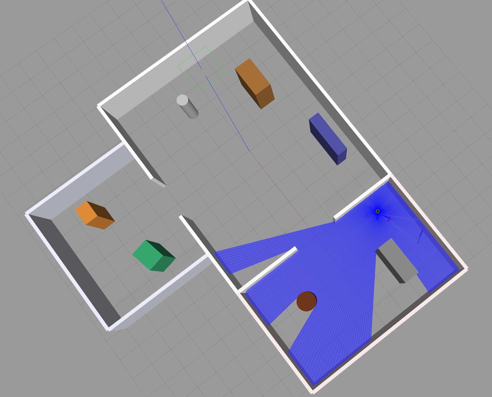

*图 1：Gazebo 中的室内场景与机器人（[README](../../README.md)）。*

| 组成 | 参数 | 来源 |
|---|---|---|
| 底盘 | 麦克纳姆轮全向底盘，控制量 (v_x, v_y, ω)；由 ros2_control 的麦克纳姆控制器驱动，仿真硬件接口对底盘施加力 / 力矩做速度闭环（早期由力控平面运动插件 `scr_planar_move` 直接驱动） | `scr_base_control`、`scr_description` |
| 机械臂 | 直角坐标解耦结构：joint1 = Z 升降（行程 0.55 m，相对 `base_link` 0.157–0.707 m），joint2 = Y 横移（14 cm），joint3 = X 伸缩（6.5 cm，刀尖 x 0.517–0.582 m），joint4 = 刀片方向（±90°，切割只取 0° / 90°）；仿真中各关节为 `position_pid` 力控 | `scr_robot_gazebo.urdf`、[slot_execution](../experiments/slot_execution/README.md) |
| 激光雷达 | 2D，360 线，10 Hz，0.1–20 m，测距噪声 σ = 1 cm | `scr_robot_gazebo.urdf` |
| 相机 | 前视，640 × 480，水平视场 80°，30 Hz；与机械臂共用升降滑台 | 同上 |
| 里程计与陀螺 | 轮式里程计 50 Hz，编码器读数含轮径误差、随机打滑与横移 / 转向打滑（3 % / 2 %）；模拟陀螺 100 Hz（零偏 5 × 10⁻⁵ rad/s）；`robot_localization` EKF 融合后供导航使用。早期配置中 `/odom` 为真值 | [system_modernization](../experiments/system_modernization/README.md) 2.4 节 |
| 定位标记 | AprilTag tag36h11（ID 0，黑框 10 cm，中心离地 0.70 m）；第一版使用其下方的 5 cm 黄色色块 | [fine_alignment](../experiments/fine_alignment/README.md) |

由机器人能力导出的任务参数（[slot_execution](../experiments/slot_execution/README.md)）：

| 量 | 数值 | 说明 |
|---|---|---|
| 可切高度 | 离地 0.27–0.80 m | 由 Z 行程与 `base_link` 离地高度 0.1025 m 扣除 1 cm 余量得到，作为**任务约束**（按机器人能力布置线盒） |
| 每站可切宽度 | 12 cm | Y 行程 14 cm 减去两侧对位余量 |
| 槽深 / 最大切深 | 35 mm / 41 mm | 槽深由 Φ20 管 + 15 mm 保护层（GB 50303-2015）确定 |
| 刀尖到底盘中心 | 约 0.69 m | 朝向误差经此力臂放大到刀尖，因此每站要做残差补偿 |

### 2.2 软件架构

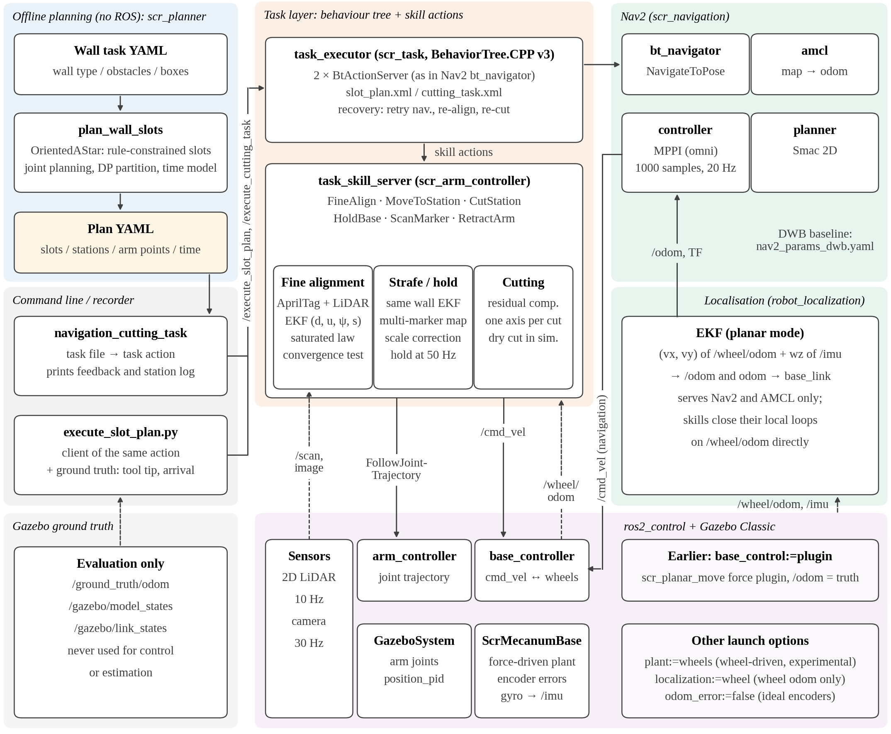

*图 2：软件架构（默认配置）。方框为节点或文件，底色区分层次；实线箭头为指令与数据流，虚线箭头为传感器与里程计反馈；真值只用于评估，不进入任何控制或估计环节。*

系统由 10 个 ROS 2 包组成：

| 包 | 内容 |
|---|---|
| `scr_description` | URDF、Gazebo 世界、控制器配置；早期配置的全向底盘运动学节点与力控平面运动插件 `scr_planar_move` |
| `scr_base_control` | 底盘 ros2_control：麦克纳姆控制器（仿真与真机共用）、Gazebo 仿真硬件接口（力驱动 / 轮子驱动被控对象、编码器误差模型、模拟陀螺） |
| `scr_navigation` | SLAM Toolbox 建图、Nav2（AMCL + Smac 2D + MPPI，NavFn + DWB 基线）与 `robot_localization` EKF 配置、地图、导航基准 |
| `scr_interfaces` | 技能 action、任务 action 与执行记录消息 |
| `scr_task` | 行为树任务执行器（BehaviorTree.CPP v3，结构同 Nav2 `bt_navigator`）与两棵任务树 |
| `scr_arm_controller` | 机械臂运动学、精对位（检测、EKF、控制律、示教零位）、定点保持、技能服务器 `task_skill_server`、命令行入口 `navigation_cutting_task`、对位实验工具 |
| `scr_planner` | C++ 开槽规划器 `OrientedAStar`（C API + Python 封装）、施工规范、停靠站划分与顺序、任务级联合规划、时间模型、执行实验记录器 |
| `scr_viz` | RViz 开槽场景、Gazebo 墙面实体、演示录制 |
| `scr_bringup` | 一键启动仿真 + Nav2 + 任务层 + RViz，底盘、定位与 Nav2 配置可切换 |
| `path_planning` | 第一版规划器（Python 原型）：标准 / 改进 / 增强 A\* 对比 |

整个作业分为**离线规划**与**在线执行**两部分（[slot_execution](../experiments/slot_execution/README.md)）：`plan_wall_slots.py` 读入墙面任务 YAML（墙体类型、障碍、已有点位、起止线盒），输出规划结果 YAML（槽线、按执行顺序排列的停靠站、每站底盘位姿与机械臂切割点、预测时间）；执行只读这个文件，执行中不重新规划。在线执行由行为树执行器编排（第 2.3 节）：命令行入口 `navigation_cutting_task` 与实验记录器 `execute_slot_plan.py` 都是任务 action 的客户端，后者另外订阅真值并输出评估数据。

### 2.3 系统层现代化

早期的系统层有四处不符合主流 ROS 2 做法：任务流程是一个约 1400 行的顺序程序，单站任务、多站执行、重试与失败处理写在同一个类里；导航使用 NavFn + DWB；`/odom` 是 Gazebo 的真值位姿，里程计没有误差；底盘绕过 ros2_control，由自写插件直接订阅 `/cmd_vel`。四项改造及其 Gazebo 验证见 [system_modernization](../experiments/system_modernization/README.md)，要点如下。

| 改动 | 做法 | 结果（Gazebo） |
|---|---|---|
| 任务层 | 原流程拆成 6 个技能 action（`FineAlign`、`MoveToStation`、`CutStation`、`HoldBase`、`ScanMarker`、`RetractArm`），放在同一进程中以共享墙面相对 EKF 与定点保持；任务由 BehaviorTree.CPP v3 [20] 执行，复用 Nav2 的 `BtActionServer`、`BtActionNode` 与 `NavigateToPose` 节点；恢复策略写在 XML 树中（到站失败回到标记前重新对位） | 11 站开槽 11 / 11 完成，到站横向误差 0.19 mm（平均绝对值），刀尖轨迹误差 0.19 / 0.23 / 1.36 mm（平均 / 95 分位 / 最大），各站耗时之和 232.5 s，原顺序程序 233.2–233.5 s；11 项行为树结构测试 |
| 导航 | 全局规划 Smac 2D（全向底盘没有最小转弯半径，不用 Hybrid-A\*），局部控制 MPPI [21]（运动模型 Omni，1000 条采样） | 固定 6 目标 × 3 圈：18 / 18 到达（NavFn + DWB 15 / 18）；最小离障间隙 183 mm（DWB 5 mm），角速度指令变化均方根 0.018 rad/s（DWB 0.072），控制器 CPU 9.7 %（DWB 45.5 %，单核） |
| 里程计与定位 | 编码器读数由底盘实际运动加误差模型生成（轮径误差、随机打滑、横移打滑 3 %、转向打滑 2 %）；硬件接口模拟陀螺；`robot_localization` [22] 的 EKF 融合轮式 (v_x, v_y) 与陀螺 ω | 129 m 巡回路线（2 个打滑种子）：里程计漂移由 1.42 / 1.59 % 降到 0.14 / 0.26 %，航向误差由 18–33° 降到 2–3° |
| 底盘控制 | Humble 没有麦克纳姆控制器，自写 `MecanumDriveController`（仿真与真机共用）与 Gazebo 仿真硬件接口 `ScrMecanumBaseSystem` | 力驱动被控对象速度跟踪比 1.000，与早期插件一致；轮子驱动被控对象（接触力在插件中计算）跟踪 0.92–0.97、0.05 m/s 慢速横移只有 0.40，保留为实验选项 |

改造中有两处排查结论影响了设计：

- **只出现在位姿里的转动**：EKF 的航向误差起初随时间线性增长（约 0.06°/s），两个打滑种子的曲线几乎重合。纯平移段中真值位姿差分得到的转速为 −0.0011 至 −0.0016 rad/s，而 Gazebo 的 IMU 与连杆角速度都测不到它；早期配置下定点保持用真值 `/odom`，位置闭环纠正了这一转动，因而一直没有暴露。硬件接口的速度闭环、编码器模型与陀螺改用相邻物理步的位姿差分速度后，平移时的寄生转速从 1.2 × 10⁻³ 降到 1 × 10⁻⁵ rad/s，60 s 特性测试后 EKF 航向误差由 4.5–7.1° 降到 0.26°（[system_modernization](../experiments/system_modernization/README.md#24-轮式里程计陀螺与-ekf) 2.4 节）。
- **EKF 在慢速运动下偏小**：以 −0.7 mm/s 恒速驱动 8 s，真值、轮式里程计与 EKF 的位移分别为 −5.5、−5.5、−0.2 mm。局部闭环使用 EKF 输出时，定点保持被它带着漂移（单站切割期间 21.9 mm），多站执行触发 3 次重新对位。因此技能的局部闭环（精对位预测、横移外推、定点保持）改用轮式里程计 `/wheel/odom`，融合结果只服务于导航与 AMCL；改后切割期间底盘漂移 0.10–0.24 mm。EKF 慢速偏小的内部原因未查明（同上 4.5 节）。

在新底盘上，单站精对位到位误差 0.7 mm、定点保持漂移 0.10 mm，与真值里程计时相当；但只有一个标记时多站执行的沿墙精度没有保住（24.8 mm，第 8.1 节），随后用标记地图与横移比例在线估计恢复到 1.5 mm（第 6.6 节）。第 4–6 章的方法不变，其 Gazebo 数据仍是早期配置（`/odom` 为真值）下的结果。行为树执行的各站耗时之和（232.5 s）与 `align_v2` 时间模型对该规划的预测（233.5 s）相差不到 1 s；此后默认路径加入了横移前的观测位姿（第 6.6 节），时间模型按新路径重标定为 `align_v3`（第 6.4 节）。

---

## 3 作业流程与坐标约定

一次作业的流程为：

1. **导航**：Nav2 把底盘送到定位标记正前方 1.2 m；
2. **精对位**：传感器闭环把 `base_link` 停到标记正前方 0.70 m、正对墙面（第 4 章）；
3. **逐站执行**：按规划文件的顺序，沿墙横移到每个停靠站 → 定点保持 → 测量残余误差并修正本站的机械臂点 → 逐点切割（第 6 章）；站间距离超过 1.5 m 时先缩回机械臂、退到离墙 1.2 m 用 Nav2 过去。

**墙面坐标** (u, v)：u 沿墙向右（面向墙面），v 为离地高度，以定位标记为 u 的原点。精对位的状态 (d, u, ψ) 中 d 为 `base_link` 原点到墙面的垂直距离，ψ 为底盘朝向相对“正对墙面”的偏角（逆时针为正）。

**空切**：Gazebo 的墙是刚体，无法模拟切削；刀尖真的压到切深时会把整台机器人顶开约 9 mm、3–4°（[slot_execution](../experiments/slot_execution/README.md)）。因此仿真中下刀位置改为刀尖停在墙前 10 mm，其余动作（退刀、转刀片、沿轴切割）与真实切割一致；评估指标是刀尖在墙面内的 (u, v) 轨迹是否与规划槽线吻合。

---

## 4 墙面相对精对位

### 4.1 第一版的问题

第一版精对位（色块 + 激光 PBVS）在 Gazebo 中能停到毫米级，但分析暴露出结构性问题（[fine_alignment](../experiments/fine_alignment/README.md) 第 1 节、[ibvs_vs_pbvs](../experiments/ibvs_vs_pbvs/README.md)）：

- **停止判据决定了精度**：比例律带 1 cm/s 最小速度与 5 mm / 0.5° 死区，滤波误差进入 1 cm / 1° 即停。|e| < 1.25 cm 内最小速度起主导，控制律退化为每周期走 1 mm 的继电器，机器人常停在接近方向一侧。Gazebo 中第一版的误差几乎全在法向且同号（+3.91 mm）。
- **色块没有身份**：任何黄色物体都会被当成标记；部分遮挡时质心静默偏移。
- **滤波没有运动模型**：指数平滑（α = 0.5）在运动中滞后，测量延迟未补偿，测量一丢失控制环即停住。
- **静态标定误差直接进入结果**：相机绕竖直轴 1° 的安装误差约等于 10 mm 的沿墙误差。
- **多站执行继承对位残差**：以“对位停车时的里程计位姿”为墙面原点，每次运行带 0.65–2.3 mm 的常值横向偏差。

第二版参照 Nav2 `opennav_docking` 把精对位拆成检测、估计、控制、到位判断四个环节，另加示教零位与多站原点修正。

### 4.2 检测：AprilTag

- 检测器使用 OpenCV ArUco 模块的 `DICT_APRILTAG_36h11` 字典（与 `apriltag_ros` 同一标记族）。
- **亚像素角点**：OpenCV 的 `cornerSubPix` 针对棋盘格鞍点，用在黑方块的 L 形外角上有系统偏差（合成图像上深度偏 4.5 mm）。改为与 AprilTag 库 `refine_edges` 同思路的边缘细化：外框每条边取 12 个采样点，沿法向求梯度加权质心，总体最小二乘拟合直线，相邻直线求交得角点。合成图像上角点误差 0.09 px、深度偏差 −0.3 mm。
- **位置与协方差**：IPPE_SQUARE [7] 解出标记中心在光学系中的位置；横向标准差 σ_px·Z/f，深度标准差 σ_px·Z²/(f·L)·√½，另设 5 mm 下限（深度依赖打印尺寸与焦距，1 % 的尺度误差在 0.55 m 处即 5.5 mm）。因此法向距离主要由激光决定，标记主要提供沿墙位置；标记的朝向不使用，因为 10 cm 标记在 0.55 m 处的朝向可观性很弱（第 8.4 节）。

Gazebo 中 27 个已知位姿、270 帧的感知精度（[alignment_robustness](../experiments/alignment_robustness/README.md#感知精度)）：标记中心横向 +0.08 ± 0.12 mm、深度 −0.31 ± 0.51 mm；激光墙面距离 +0.06 ± 1.00 mm、角度 +0.007 ± 0.18°。标记横向的单帧噪声约为色块的 1/5。

### 4.3 状态估计：墙面相对 EKF

状态 X = (d, u, ψ) 直接取墙面相对量。**过程模型**用两次里程计位姿之间的 SE(2) 相对变换 (Δx, Δy, Δψ)（表示在前一时刻的 `base_link` 中）：

```
d⁺ = d − (Δx cos ψ − Δy sin ψ)
u⁺ = u − (Δx sin ψ + Δy cos ψ)
ψ⁺ = ψ + Δψ
```

该合成对任意大小的增量都是精确的，所以机械臂动作期间回调暂停、下一次预测跨过几秒也不影响正确性。过程噪声按里程计运动模型随位移增长（平移 2 %、转角 2 %、每米 0.002 rad），另加每步 0.1 mm / 0.01° 的随机游走。

**测量模型**（c 为示教零位偏置，传感器看到的是 X + c）：

```
激光墙面   z_L = (d, −ψ) + c 的对应项                                         线性
标记中心   z_T = R(−ψ)·(d, u) = (d cos ψ + u sin ψ, −d sin ψ + u cos ψ)      非线性，在 X + c 处线性化
```

- **延迟补偿**：每个测量带采集时间戳，从里程计历史插值出该时刻的位姿，把测量变换到当前时刻再更新。
- **门限**：更新前做 χ² 检验（2 自由度 99 % 分位 9.21）；连续 15 帧拒收标记时认为 u 已失效，由标记重新初始化。
- **标记丢失**：只做里程计预测与激光更新，控制环继续运行；σ_u > 1 cm 时停车等待，连续 10 s 没有标记更新判定失败。看到标记之前不发运动指令。

多站执行中，同一个滤波器还接受墙上其他已知位置标记的更新，并可增加第四个状态估计里程计的横移比例（第 6.6 节）。

### 4.4 控制律

**反馈线性化**。全向底盘在 `base_link` 速度 (v_x, v_y, ω) 下

```
ḋ = −(v_x cos ψ − v_y sin ψ),   u̇ = −(v_x sin ψ + v_y cos ψ),   ψ̇ = ω
```

令 (v_x, v_y) = R(−ψ̂)·(v_n, v_l)，在 ψ̂ = ψ 时得到三个解耦的积分器 ḋ = −v_n、u̇ = −v_l、ψ̇ = ω，平移与转向互不影响。

**平方根整形饱和比例律**（与 ArduPilot `sqrt_controller` 同形）。平移误差 e = (d − d\*, u − u\*)，指令沿 −e 方向，大小为

```
f(|e|) = k·|e|                         |e| ≤ e₀ = a / k²
f(|e|) = √(2a(|e| − e₀/2))             |e| > e₀
v = min(f(|e|), v_max) · e / |e|
```

参数 k = 2 /s、a = 0.15 m/s²、v_max = 0.15 m/s，朝向通道同形（0.5 rad/s²、0.3 rad/s）；指令变化率另限 0.4 m/s²。线性区（|e| ≤ 3.75 cm）是时间常数 0.5 s 的指数收敛；平方根区是恒减速度 a 的制动曲线，两区在 e₀ 处值与斜率连续。变化率限幅大于制动减速度，减速段不会被限幅器截断（否则限幅器相当于额外延迟，会产生超调）。

### 4.5 稳定性与离散采样分析

**连续时间**。取 V = ½|e|²，

```
V̇ = −|e| · min(f(|e|), v_max) < 0,   e ≠ 0
```

f 是 [0, k] 扇区内的单调函数，速度饱和不改变符号，因此闭环对积分器对象全局渐近稳定 [8]，|e| 沿直线单调减小，零点附近以速率 k 指数收敛。

**离散采样与延迟**。线性区单轴模型：采样周期 T、底盘速度环一阶滞后 τ = 50 ms、指令晚一拍生效：

```
e[k+1] = e[k] + T·v[k]
v[k+1] = a·v[k] + (1 − a)·c[k−1],   a = exp(−T/τ)
c[k]   = −k·e[k]
```

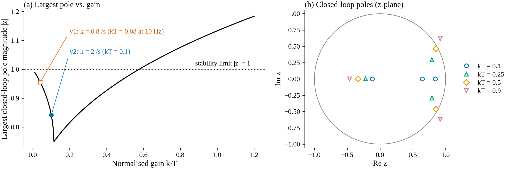

*图 3：(a) 最大闭环极点模 |z| 随归一化增益 k·T 的变化（点线 |z| = 1 为稳定边界）；(b) 闭环极点在 z 平面中的位置（[fine_alignment](../experiments/fine_alignment/README.md#24-控制分析)）。*

| T | k | k·T | 闭环极点 | 主导时间常数 |
|---|---|---|---|---|
| 50 ms（标称） | 2 /s | 0.10 | 0.841, 0.643, −0.117 | 0.29 s |
| 100 ms（`rtf` 2.5 下的实际周期） | 2 /s | 0.20 | 0.719 ± 0.232j, −0.303（ζ ≈ 0.67） | 0.36 s |
| 50 ms | 0.8 /s（第一版增益） | 0.04 | 0.955, 0.469, −0.056 | 1.08 s |

- 稳定边界约为 k·T ≈ 0.6（T = 100 ms 时 k < 6.1 /s），所选 k = 2 /s 在实际周期下仍有约 3 倍余量；连续近似下等效延迟 75 ms / 150 ms 时相位裕度 76° / 67°。
- 饱和区的等效增益 f(e)/e < k，无延迟时只要 k·T < 1 就单调收敛，线性区是最坏情形。有延迟时这只是近似论证（严格证明需圆判据一类工具），离线蒙特卡洛与 Gazebo 中均未出现振荡。
- **稳态误差**：对象为积分器，比例控制对常值目标无稳态误差；常值速度扰动 δ 留下 δ/k 的误差。Gazebo 中零速度指令下底盘有约 0.6 mm/s 的滑移（轮子摩擦为 0），对应约 0.3 mm。实测名义条件下到位沿墙误差 +0.43 mm 且 8 次同号，而估计器沿墙误差为 −0.02 ± 0.22 mm（无偏），与这一解释一致（推测，未单独改变 k 验证）。

### 4.6 到位判据与示教零位

**到位判据**：下列条件连续 10 个周期同时成立后转入定点保持：|e_d|、|e_u| < 2 mm 且 |e_ψ| < 0.3°；底盘实测速度 < 3 mm/s、0.3°/s；σ_d、σ_u < 2 mm。速度取最近 0.5 s 的里程计位移除以时间，而不是 `/odom` 的 twist：力控底盘插件的 twist 静止时也有 ±7 mm/s 的抖动，直接使用时 Gazebo 首次运行中 2 / 2 次试验超时。

**示教零位**：静态误差（相机外参、标记安装、激光测距偏差）在参考位姿处表现为估计值的常值偏差 c = X̂ − X。把机器人放到准确的参考位姿，以零偏置运行估计器 30 s，c 取估计均值与真值之差，并用批均值法给出 c 的标准误；运行时在测量模型内扣除。示教时长不能太短：EKF 朝向估计有秒级相关时间，8 s 示教时朝向偏置的噪声经标记测量耦合成约 0.4 mm 的沿墙偏置，Gazebo 中据此把默认值改为 30 s（[fine_alignment](../experiments/fine_alignment/README.md#26-零位标定示教)）。

**排查记录**：最初把 1° 相机偏角写在相机传感器的 `<pose>` 中，示教得到的沿墙偏置与名义相同。原因是 URDF → SDF 合并固定关节时，传感器位姿被关节偏移覆盖；改为修改相机关节 origin 后，示教得到 −9.56 ± 0.12 mm，与估算 0.55 m × tan 1° ≈ 9.6 mm 一致。

### 4.7 结果

离线蒙特卡洛（200 个随机起点，配对，[fine_alignment](../experiments/fine_alignment/README.md#3-离线仿真)，**离线**）：位置误差第一版 3.41 ± 0.74 mm、第二版 0.80 ± 0.26 mm；每 3 s 中遮挡 1.5 s 时第二版 0.82 ± 0.27 mm。

Gazebo 配对实验（每条件 8 次，同一组随机起点：离墙 1.0–1.5 m、沿墙 ±0.3 m、朝向 ±10°，种子 42；仿真配置 v2；误差取控制器宣布到位时刻的真值；[alignment_robustness](../experiments/alignment_robustness/README.md)）：

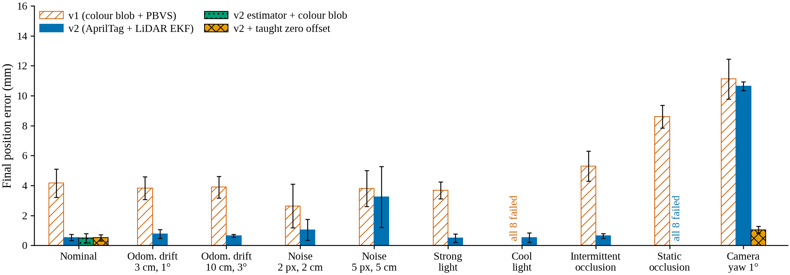

*图 4：各测试条件（横轴）下各流水线的最终位置误差（均值 ± 标准差，n = 8 / 格）；朱红斜线柱为第一版（v1），蓝色实心柱为本版（v2），竖排 “all 8 failed” 为 8 次全部失败。*

| 条件 | 第一版 | 第二版 | 说明 |
|---|---|---|---|
| 名义 | 4.16 ± 0.94 mm | **0.53 ± 0.21 mm** | 耗时 8.5 s / 9.7 s（仿真时间） |
| 里程计漂移 10 cm, 3° | 3.89 ± 0.73 mm | 0.63 ± 0.10 mm | |
| 强白光 | 3.68 ± 0.57 mm | 0.49 ± 0.28 mm | |
| 冷白光 | 0 / 8 成功（色块丢失） | 0.52 ± 0.32 mm | 色调超出 HSV 阈值 |
| 间歇遮挡 | 5.30 ± 1.00 mm | 0.63 ± 0.17 mm | 第一版沿墙偏 +4.06 mm |
| 全程遮挡 | 8.60 ± 0.77 mm（无告警） | 0 / 8，未运动，报告失败 | 安全失败 |
| 噪声 5 px / 5 cm | 3.80 ± 1.19 mm | 3.23 ± 2.03 mm | 第二版瞄准点误差 0.66 mm |
| 相机偏角 1° | 11.12 ± 1.34 mm | 10.63 ± 0.29 mm；示教零位后 **1.04 ± 0.24 mm** | |

全部 184 次试验零碰墙，最小刀尖间隙 21.2 mm。主要结论：

1. **名义条件下误差来源从“停止判据”变成“稳态扰动”**：第一版法向均值 +3.91 mm（停在接近方向一侧），第二版法向均值 0.00 mm、沿墙 +0.43 mm（与第 4.5 节的零速滑移解释一致）。“第二版检测器换回色块”的消融为 0.49 ± 0.30 mm，说明名义条件下精度提升主要来自估计、控制律与判据，检测器的差别体现在光照与遮挡下。
2. **高噪声下沿墙与朝向沿“瞄准线”耦合**：标记测量约束的是底盘正前方 d 处那一点的沿墙位置（≈ u − d·ψ），朝向估计误差被折算进沿墙估计；刀尖恰在这条瞄准线上（前伸 0.69 m），所以瞄准点误差只有 0.66 mm，对切割的影响远小于位置误差本身。
3. **示教零位对静态误差是通用的**：1° 相机偏角使两种流水线都多出约 10 mm 沿墙偏差；示教后降到 1.04 mm，消除约 91 %。名义条件下示教无可测效果（0.51 vs 0.53 mm），即名义场景本身没有静态偏差可消除。

---

## 5 开槽规划

### 5.1 施工规范的表达

| 规则 | 数值 | 依据 | 规划中的处理 |
|---|---|---|---|
| 承重墙不得开水平沟槽 | — | GB 50203-2011 第 3.0.11 条 [9] | 承重墙禁用横向，硬约束 |
| 窄承重墙体不埋管 | 截面长边 < 500 mm | 同上 | 宽度 < 50 cm 的承重墙垛不可通行 |
| 梁柱 / 门窗留距 | 500 / 200 mm | 参照 GB 50203-2011 第 3.0.9 条 | 障碍外扩 |
| 非承重墙横槽长度 | ≤ 500 mm | 行业做法 | 单段横向最大长度，硬约束 |
| 导管弯曲半径 | ≥ 6 × 管外径 | GB 50303-2015 第 12.2.1 条 [10] | Φ20 管 r = 12 cm：与弯相邻的直段 ≥ r，两弯之间 ≥ 2r，弯管圆弧不碰障碍 |
| 槽深 | ≥ 管外径 + 15 mm | GB 50303-2015 第 12.1.3、12.2.3 条 | 35 mm，作为切深 |
| 强弱电平行间距 | ≥ 300 mm | 行业做法 | 他槽外扩 |
| 竖槽优先、电上水下 | — | 行业做法（软偏好） | 横向代价 ×2；越靠下代价越高 |

每条规则在 `wall_rules.py` 中标注了“国标 / 参照 / 行业 / 假设”四级可信程度（[cpp_planner](../experiments/cpp_planner/README.md)）。

### 5.2 单槽最优搜索：分段 A\*

“横槽 ≤ 50 cm”“两弯之间 ≥ 2r”都是对**整段直线长度**的约束。逐格搜索时要把已走段长放进状态（状态数增加 50 倍以上）；`OrientedAStar` 改为每一步走一整段横 / 竖直线、下一段必须转 90°，在生成边时直接检查这些约束。转弯之后先前的段长不再影响后续，所以状态只需 (x, y, 上一段方向)，在规范约束下仍可证最优。

- **目标函数**：Σ(轴向权重 + 软代价) + 转弯惩罚 × 弯数；
- **启发函数**：加权曼哈顿距离 + 转弯惩罚 × 还需覆盖的轴数，一致；禁用方向上还有位移时直接剪枝；
- **测试**：19 个 gtest，其中在 400 张随机栅格、随机规则组合上与一个状态含已走段长的独立逐格 Dijkstra 比较最优代价；故意把“两弯之间 ≥ 2r”改成“≥ r”时该测试立即失败，说明测试本身有效。

**结果**（140 面随机墙，所有路线由一套独立于 C++ 的 Python 检查评分，[cpp_planner](../experiments/cpp_planner/README.md)，**离线**）：

| 墙体 | 方法 | 输出违规路线 | 无合规路线 | 平均弯数 | 耗时中位 |
|---|---|---|---|---|---|
| 非承重墙 × 100 | 第一版规划器（Python） | 100 | 0 | 1.35 | 100 ms |
| | C++ 只避障 | 100 | 0 | 1.19 | 0.84 ms |
| | **C++ + 规范** | **0** | 1 | 5.86 | 35 ms |
| 承重墙 × 40 | 第一版规划器 | 6 | 0 | 0.45 | 2.9 ms |
| | **C++ + 规范** | **0** | 6 | 0 | 0.04 ms |

- 承重墙上第一版规划器在 6 面墙上绕开窗户走了横槽；C++ 规划器在这 6 面上报告“无合规路线”，与独立的竖直线可行性判定一一吻合。
- 只避障的同一问题上，第一版规划器在 22 / 140（16 %）个场景中多一个弯，没有一个更好；逐场景耗时比中位数 56 倍。
- 非承重墙 100 % 违规部分由任务构造决定（两盒水平距离 ≥ 60 cm）；信息量更大的是另外两类：17 % 的路线有放不下弯管的短段，8 % 的弯管圆弧碰到障碍。

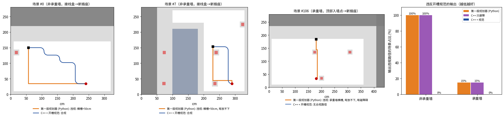

*图 5：(a)–(c) 典型场景中第一版规划器（朱红虚线）与带规范的 C++ 规划器（蓝实线）的路线，(d) 各方法输出违规路线的场景占比（[cpp_planner](../experiments/cpp_planner/README.md)）。*

### 5.3 停靠站划分与访问顺序

一面墙上通常有多条槽，每站只能切 12 cm 宽，需要决定每个停靠站负责哪段墙面窗口（多条槽可共用）以及访问顺序（[slot_execution](../experiments/slot_execution/README.md)）：

- **访问顺序**：所有停靠站在同一条墙线上，从定位标记出发访问全部站的最短开放路径是“先到较近的一端，再单向扫到另一端”（闭式解，pytest 与全排列枚举对照）。
- **窗口划分**：一维动态规划，状态为“u 以左的槽线已切完”，候选边界为 5 mm 网格加全部拐点的 u；站位可在仍能覆盖本站窗口的范围内滑动，此时扫掠距离只取决于首尾窗口，因此在 DP 终止状态加上精确横移后，DP 是时间模型下的精确划分（[task_planning](../experiments/task_planning/README.md) “排查”一节）。
- **执行时间模型**（第 6.4 节标定）：

```
T = Σ_站 (t_settle + 横移距离 / v_strafe) + t_point × 机械臂点数
```

每站内，一段被窗口截出的子折线若有 s 个直线小段，需要 4s 个机械臂点（下刀 / 退刀、每小段终点、每次转向的退刀-转刀-下刀）。

### 5.4 任务级联合规划

分步方法先按“槽长 + 弯数 + 规范偏好”选线，再划分停靠站。但同样合规、长度与弯数相同的两条走法，所需机械臂点数可能不同：

```
机械臂点数 = 4 × Σ_槽线的每个直线段 (该段跨过的窗口数)
```

横向段每跨过一条窗口边界就多一个小段（4 个点，约 8 s）；拐点正好落在窗口边界上时可省一个小段。联合规划（`task_plan.joint_routes`，[task_planning](../experiments/task_planning/README.md)）利用这一结构：

1. **站感知选线**：给定窗口格相位 φ（窗口边界落在 c ≡ φ (mod 12) 的列上），路线的预测时间几乎可沿路线累加。在 C++ `OrientedAStar` 中加入三类非负列代价（每个直线段 4 t_point；横向段从内部穿过窗口边界 4 t_point；进入尚未打开的窗口 t_settle + w / v），原规范代价 J 乘以 ε = 10⁻³ 只在预测时间相同的路线间排序。列代价按前缀和计入启发函数，保持一致性；gtest 在 300 个随机栅格上与逐格 Dijkstra 对照。
2. **联合搜索**：对 12 个相位逐条规划（已规划的槽作障碍、其打开的窗口免费），槽被堵死时调整规划顺序，再做两轮坐标下降；每个候选用精确评估（含横移的 DP 划分 + 站位摆放 + 扫掠顺序）。原规则路线也作为候选，所以结果**不劣于分步方法**。
3. **下界证书**（`task_plan.lower_bound`）：同时松弛三处——每条槽单独规划并按 ⌈L / w⌉ 计横段跨过的窗口数；停靠站数 ≥ 各槽投影区间并集的最少窗口覆盖数（贪心精确）；横移 ≥ 最短扫掠距离。任何方案 T ≥ LB，T = LB 时该方案被证明最优。离线环境中没有可用的 MILP 求解器，下界证书使每面墙都可检验最优性。

### 5.5 规划结果（离线，模型预测）

400 面随机住宅墙（种子 1000–1399；墙宽 3–6 m；30 % 承重墙；梁、柱、门窗、开关、配电箱等按常见布局随机生成；每面墙 1–4 条槽），配对样本为三种主要方法都有解的 275 面墙。以下数字是时间模型的**预测**，不是 Gazebo 实测；表中用第一版精对位下标定的时间模型 `align_v1`（第 6.4 节），重标定后的结果见第 8.3 节，示例任务的 Gazebo 执行见第 6.7 节。

| 方法（配对墙 n = 275 的均值） | 预测时间 | 停靠站 | 机械臂点 | 横移 |
|---|---|---|---|---|
| 逐槽划分（基线） | 174.3 s | 8.76 | 45.8 | 4.02 m |
| 先选线后 DP（分步） | 155.8 s | 8.42 | 44.8 | 2.62 m |
| **联合规划** | **150.6 s** | 8.40 | 42.2 | 2.62 m |
| 下界 | 149.3 s | 8.37 | 41.7 | 2.62 m |

| 对比 | 样本 | 快 / 持平 / 慢 | 平均节省 | 95 % CI | Wilcoxon p |
|---|---|---|---|---|---|
| 分步 → 联合 | 非承重墙 156 | 106 / 50 / 0 | **3.53 %** | [3.08, 3.98] % | < 1e-10 |
| 逐槽基线 → 联合 | 全部 275 | 251 / 24 / 0 | 11.93 % | [10.87, 13.01] % | < 1e-10 |

- 联合规划在 254 / 275（92.4 %）面配对墙上达到下界，即被证明最优；分步方法为 60.0 %，逐槽基线 8.7 %。
- 节省几乎全部来自机械臂点数（非承重墙平均 −4.46 个），槽长只多 7 mm、弯数 +0.03：联合规划只是把拐点挪到窗口边界上。
- 消融：四种站感知变体在非承重配对墙上逐墙结果相同，跨槽共享窗口与坐标下降在这批墙上没有额外收益。
- 可行性：联合规划在 294 / 400 面墙上有解，分步方法 275 面；106 面墙所有方法都无解（其中 63 面为 4 条槽）。
- Lee 迷宫布线在关闭两条整段约束时与分段 A\* 代价 1024 / 1024 相同，打开约束后其路线在 79.6 % 的非承重墙槽上违规。
- 代价：规划耗时中位数从 25 ms 增加到 0.40 s（最长 5.5 s）。

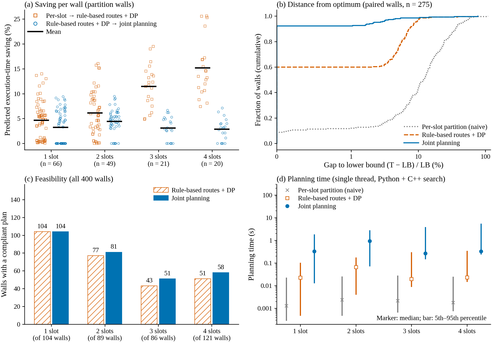

*图 6：(a) 非承重墙上每面墙的节省；(b) 各方法与下界差距的累积分布；(c) 有解的墙数；(d) 规划耗时。灰色为逐槽划分，朱红为先选线后 DP，蓝色为联合规划（[task_planning](../experiments/task_planning/README.md)，`align_v1` 时间模型）。*

---

## 6 多站执行

### 6.1 执行流程

多站流程（[slot_execution](../experiments/slot_execution/README.md)）最初由主任务 `NavigationCuttingTask.run_slot_plan` 顺序执行，现由行为树 `slot_plan.xml` 编排同样的技能（第 2.3 节）：

1. Nav2 到标记前 1.2 m，精对位到 0.70 m；
2. 逐站：沿墙横移到站（同一个墙面相对 EKF：沿墙位置由里程计外推，离墙距离与朝向由激光更新；经激光防碰撞守护限速）→ 定点保持（`base_hold.py`，按力控底盘整定的 P 5 / 6、50 Hz）→ 用估计的横向 / 离墙 / 朝向残差修正本站机械臂点 → 逐点切割（每刀只动一个轴，拐角处退刀、转刀片 90°、再下刀）。

早期多站执行写在实验脚本中，自带一套横移与定点保持（增益按仿真配置 v1 整定）；合并为主任务一条执行路径后，记录器只做真值评估，切割期间底盘漂移最大值从 2.18 mm 降到 0.32 mm。改为行为树编排后，到站失败的恢复路径（回到标记前重新对位、重新建立墙面原点）写在树中。第 6.2–6.5 节的 Gazebo 数据都在早期配置（`/odom` 为真值）下、以单个标记取得，站间不使用标记更新；当前默认配置在横移中继续使用墙上多个标记的更新并估计横移比例，见第 6.6 节。

### 6.2 定点保持与残差补偿

- **定点保持**：仿真中机械臂动作的反作用力会推动底盘。关闭保持时扫描 + 切割期间漂移 24.9 mm / 6.07°，开启后 0.2 mm / 0.09°（[EVOLUTION](../EVOLUTION.md) 第 4.3 节）；多站执行中切割期间真值漂移 ≤ 0.32 mm。
- **残差补偿**：刀尖在底盘前方约 0.69 m，到站后的横向、离墙与朝向残差按刚体变换修正本站的机械臂点；激光测得的朝向与真值相差 ≤ 0.15°，按测量值补偿有效。补偿量超过机械臂 1 cm 横向余量时会被关节限位钳制并计数（全部运行中为 0）。

### 6.3 墙面坐标原点修正

第一版以“对位停车时的里程计位姿”为墙面坐标原点，停车时的沿墙残差 e_u 被所有停靠站继承。第二版的 EKF 状态 u 本来就以标记为原点：对位结束时残差保留在估计状态中，各站目标直接取规划的 u（相对标记）；站间移动只用里程计预测与激光更新，到站残差与机械臂点补偿也改用 EKF 估计。参数 `alignment.fold_residual:=false` 恢复第一版语义，用于消融。

### 6.4 执行时间模型的标定

时间模型 T = Σ(t_settle + d / v_strafe) + t_point × 点数（第 5.3 节）在 Gazebo 中用记录器输出的逐站数据（`stations.csv`：横移距离、点数、到站耗时 move_s、切割耗时 cut_s、每站总耗时）标定，脚本 `calibrate_time_model.py`。仿真或执行代码改变后都要重标定，各版本保存为命名预设（`slot_plan.TIME_MODELS`），默认值对应当前默认执行路径：

| 预设 | 标定数据 | 方法 | t_settle | v_strafe | t_point | 每站 RMSE（样本内） |
|---|---|---|---|---|---|---|
| `align_v1` | 第一版精对位，4 次运行 54 站（`runs/dp`、`dp_repeat`、`per_slot`、`per_slot_repeat`） | 整体最小二乘 | 4.40 s | 0.0945 m/s | 2.034 s | 0.10 s（R² = 1.000） |
| `align_v2` | 第二版精对位，3 次运行 33 站（`runs/fine_align_dp`、`_repeat`、`_nofold`） | 分阶段估计 | 2.83 s | 0.0984 m/s | 2.049 s | 0.68 s（R² = 0.994） |
| `align_v3`（默认） | 当前默认路径（行为树任务层，标记地图 + 横移比例估计，横移前回观测位姿），4 次运行 44 站（[along_wall_accuracy](../experiments/along_wall_accuracy/README.md) 的默认配置运行） | 分阶段估计，切割阶段回归 | 4.70 s | 0.0971 m/s | 2.030 s | 0.22 s（留一 0.24 s） |

**为什么第二版改用分阶段估计**：第二版的执行非常确定，横移阶段 move_s 对横移距离的线性拟合残差只有 0.05 s；但切割阶段在 3 / 33 个站上出现 2.2–2.7 s 的停顿。数据中的横移距离只有 0.055、0.12、0.23 m 三档，0.23 m 只出现在每次运行的第一站，整体最小二乘把其中一次停顿归到横移上，得到 v_strafe = 0.063 m/s（留一交叉验证中在 0.052–0.097 m/s 之间摆动）。分阶段估计分别取横移阶段的回归（截距 + 1/v）、固定开销 station_s − move_s − cut_s 的均值（1.29 s）和 t_point = Σ cut_s / Σ 点数（停顿按平均摊入），留一交叉验证的每站 RMSE 为 0.68 s（整体最小二乘 0.79 s）。

在第二版的 33 个停靠站上比较两个预设（`calibrate_time_model.py --method=phases --compare=align_v1,align_v2 --loo`）：

| 预设 | 每站 RMSE | 平均偏差 | 各次运行各站耗时之和的误差 |
|---|---|---|---|
| `align_v1` | 1.65 s | +1.50 s（偏慢） | +16.3 – +16.8 s（约 +7.1 %） |
| `align_v2` | 0.68 s（去掉 3 个停顿站 0.24 s） | −0.02 s | −0.4 – +0.1 s |

即第一版模型用于当前执行路径时每站系统性地高估约 1.5 s，来自 t_settle（4.40 → 2.83 s）：第二版的横移改用 EKF 与平方根整形控制律后，每站“横移 + 到位”平均从 4.5 s 降到 2.8 s（[slot_execution](../experiments/slot_execution/README.md#精对位改进后的复测)）。`align_v2` 的数字是样本内结果；标定数据中横移距离只覆盖 0.055–0.23 m，长距离横移（例如站间相距 1 m 以上）时 v_strafe 是外推值。

**当前默认路径：`align_v3`**（[plan_validation](../experiments/plan_validation/README.md)）。沿墙精度改造后（第 6.6 节），机械臂在每次横移前回到观测位姿，`align_v2` 在新路径的 44 个停靠站上每站平均低估 1.72 s，每次运行的各站之和低估 18–20 s（7–8 %）。按 `align_v2` 的分阶段方法重标定时，t_point = Σ cut_s / Σ 点数 = 2.152 s，明显大于 `motion.duration` = 2.0 s 加通信开销，每站 RMSE 0.55 s。按点数分组的切割阶段耗时给出 cut_s = 1.02 + 2.030 × 点数：截距约 1.0 s 是“观测位姿 → 第一个切割点”的运动，与点数无关，比值估计把它摊进了每个点。联合规划的收益来自减少机械臂点数，t_point 偏大 6 % 会把这部分收益高估 6 %。因此新增 `--method=phases-reg`：切割阶段也回归，截距计入每站固定开销。得到的 `align_v3` 每站 RMSE 0.22 s，与整体最小二乘一致（参数差 < 0.05 s / 0.005 s）。

| 在 5 次未参与标定的运行上（55 站） | `align_v3` | `align_v2` |
|---|---|---|
| 各次运行各站耗时之和的误差 | −1.7 … +0.7 s（≤ 0.7 %） | −18.3 … −20.7 s |
| 每站 RMSE / 平均偏差 | 0.53 s / −0.04 s | — / 每次运行均低估 |

验证运行包括同一份 11 站规划的新运行与第 6.7 节的联合规划、规则路线各 2 次。规则路线两次运行的每站误差较大，各来自一个站上约 2.7–2.9 s 的偶发停顿，其余站在 +0.3 s 以内。

### 6.5 结果（Gazebo，仿真配置 v2）

示例任务：room3 南墙两条槽（已有插座 → 新插座，横向 1.1 m；已有插座 → 书桌插座，横向 0.7 m），共 2.76 m，两条槽在 u 方向重叠、可共用停靠站。每次运行都是完整端到端流程（启动仿真 → Nav2 → 精对位 → 全部停靠站），空切间隙 10 mm。

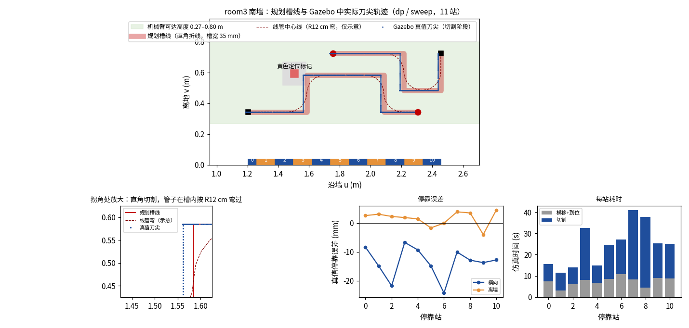

*图 7：优化方案的执行结果（第一版精对位）：规划槽线、切割阶段的真值刀尖、各站窗口、拐角放大、每站停靠误差与耗时（[slot_execution](../experiments/slot_execution/README.md)）。*

**停靠站优化**（第一版精对位，每种方案 2 次）：

| 方案 | 停靠站 | 横移 | Gazebo 实测各站耗时之和 | 刀尖轨迹误差 95 分位 / 最大 |
|---|---|---|---|---|
| 逐槽划分 + 逐条执行（基线） | 16 | 2.44 m | 283.1 / 283.7 s | 1.2–2.2 / 1.8–2.7 mm |
| DP 划分 + 扫掠顺序 | 11 | 1.37 m | 249.8 / 249.9 s（−11.8 %） | 0.4–1.0 / 1.2–1.3 mm |

4 次运行的 54 个停靠站全部到位、切完，横移全部在容差内收敛。逐站走 Nav2 的对照（10 段 Nav2）11 / 11 完成，耗时 +29 %，刀尖轨迹误差不变（0.30 / 1.1 / 1.6 mm）。

**精对位第二版与原点修正**（同一份 11 站规划 `runs/dp/slot_plan.yaml`）：

| 运行 | 精对位 | 原点 | 到站横向误差 均值 ± 站间标准差 | 到站朝向 平均 / 最大 | 刀尖轨迹误差 平均 / 95 分位 / 最大 | 覆盖率 | 各站耗时之和 |
|---|---|---|---|---|---|---|---|
| `dp` | 第一版 | 停车位姿 | +1.26 ± 0.38 mm | 0.29° / 0.57° | 0.33 / 0.98 / 1.29 mm | 99.3 % | 249.8 s |
| `dp_repeat` | 第一版 | 停车位姿 | +0.65 ± 0.41 mm | 0.36° / 0.51° | 0.24 / 0.37 / 1.18 mm | 98.2 % | 249.9 s |
| `fine_align_dp` | 第二版 | 标记 | **+0.24 ± 0.12 mm** | 0.06° / 0.11° | 0.20 / 0.22 / 0.93 mm | 99.6 % | 233.5 s |
| `fine_align_dp_repeat` | 第二版 | 标记 | **−0.18 ± 0.18 mm** | 0.06° / 0.13° | 0.24 / 0.53 / 0.77 mm | 99.8 % | 233.2 s |
| `fine_align_dp_nofold`（消融） | 第二版 | 停车位姿 | +0.86 ± 0.18 mm | 0.05° / 0.08° | 0.35 / 1.11 / 1.28 mm | 96.9 % | 233.7 s |

- 第一版下 5 次运行的常值横向偏差为 +0.65 – +2.29 mm，与各次对位停车时的沿墙真值残差相差 ≤ 0.4 mm，说明它来自起点对位。第二版的两次复测为 +0.24 / −0.18 mm；关掉原点修正后回到 +0.86 mm，与该次停车残差 +0.50 mm 同号、同量级。样本只有 2 + 1 次运行，未做显著性检验。
- 站间标准差从 0.38–0.41 mm 降到 0.12–0.18 mm、到站朝向误差从约 0.3° 降到 0.06°，这一项来自站间横移改用 EKF 与新控制律，与原点修正无关。
- 时间模型 `align_v2` 对该规划的预测为 233.5 s，三次实测 233.2–233.7 s（样本内）；`align_v1` 的预测为 250.0 s。

### 6.6 真实里程计下的沿墙精度：标记地图与横移比例估计

第 6.5 节的精度以里程计等于真值为前提。换成编码器误差模型 + EKF（第 2.3 节）后，单站精对位与定点保持不受影响，但 11 站的沿墙误差随离标记的距离线性增长到 24.8 mm（第 8.1 节）。原因在于可观性：激光拟合平直墙面，各束测距 r_i = d / cos(θ_i + ψ) 与 u 无关，沿墙位置只有看到标记时才可观测；站间由里程计外推，而编码器模型的横移打滑使里程计把横移距离高估 3 %，这是方向固定、与横移距离成正比的系统误差。[along_wall_accuracy](../experiments/along_wall_accuracy/README.md) 在 Gazebo 中比较了三类做法及其组合（同一份 11 站规划，每个配置 2 个打滑种子，指标为最大到站沿墙误差的均值）：

- **标记地图**：同一面墙上布置多个已知位置的 AprilTag，地图给出每个标记相对参考标记的沿墙位置 u_i。标记 i 的测量模型为 R(−ψ)·(d, u − u_i)，与单标记模型只差一个已知平移；地图的位置误差 σ_map 按 σ_map²·h_u h_uᵀ 计入测量噪声，否则从一个标记过渡到下一个时几毫米的不一致会被 χ² 门限拒收。相机装在升降滑台上，切割位姿下 0.70 m 高的标记落在画面上沿之外，因此横移前机械臂先回到观测位姿（每站约 2 s）。
- **按行程重新对位**：行为树在每站开始前判断“自上次接受标记更新以来的沿墙里程计行程 + 下一段横移”是否超过阈值，超过时先回参考标记前重新精对位（`RealignDue` 条件与 `ScheduledRealign` 子树）。
- **横移比例在线估计**：把横移比例修正 s（真实横移 = (1 + s)·里程计横移）作为 EKF 的第四个状态，随机游走方差 q_s²·|Δy|（q_s = 0.002 /√m），先验 N(0, 5 %²)，重新对位时保留。两次位置观测之间的净横移为 D 时，u 的新息对 s 的灵敏度为 D：同一个标记在画面内移动、或在两个已知间距的标记之间移动都能估计 s，往返同一位置则不能（单元测试验证）。

| 配置 | 最大到站沿墙误差 | 误差对离标记距离的斜率 | 总耗时 |
|---|---|---|---|
| 一个标记，站间只用里程计（基线） | 24.7 mm | −2.82 % | 272 s |
| 一个标记，横移时保留标记更新 | 14.4 mm | −1.23 % | 297 s |
| 标记间距 0.3 / 0.6 / 1.2 m | 2.3 / 2.8 / 11.9 mm | −0.14 / −0.23 / −0.66 % | 294 / 296 / 300 s |
| 标记间距 0.6 m，地图位置误差 ±3 mm | 5.2 mm | −0.58 % | 294 s |
| 一个标记 + 按行程重新对位（阈值 0.3 / 0.15 m） | 17.5 / 20.6 mm | −1.44 / −1.56 % | 344 / 374 s |
| 一个标记 + 横移比例估计 | 1.3 mm | +0.03 % | 294 s |
| **标记间距 0.6 m + 横移比例估计（默认）** | **1.5 mm**（平均 0.7 mm） | −0.04 % | 295 s |

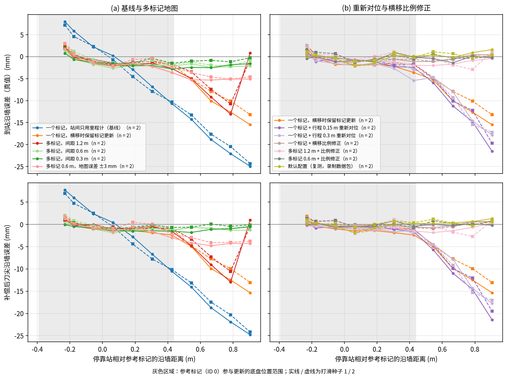

*图 8：到站沿墙误差（上排）与补偿后刀尖沿墙误差（下排）随停靠站离参考标记距离的变化，每个配置 2 次运行（实线 / 虚线为打滑种子 1 / 2）；颜色区分方法组（朱红 基线、绿 多标记、橙 重新对位、蓝 比例修正、黑 默认配置），灰色区域为参考标记参与更新的范围（[along_wall_accuracy](../experiments/along_wall_accuracy/README.md)）。*

- **多标记的效果由“每站是否有可见标记”决定**：工作距离下，标记在底盘相对它 −0.39 … +0.44 m 内可用（约 0.83 m 的窗口）。间距 0.3 / 0.6 m 时每站都有可见标记，误差不再随距离增长，0.3 m 没有可区分的改善；1.2 m 留下 0.37 m 的无标记区，区内误差回到里程计外推的水平。
- **地图位置误差几乎一比一进入结果**：±3 mm 的记录偏差使依赖该标记的站偏约 3 mm。标记应在粘贴后测量实际位置，而不是按设计位置记录。
- **按行程重新对位对固定方向的比例误差无效**：回到标记再出发，到站点离最后一次标记更新的净横移不变，误差仍按 s·(u − u_标记) 增长；重新对位只消除随行程累积的随机部分，却每次多约 23 s。行为树保留这一功能（往返式规划或比例突变时仍可能有用），默认关闭。
- **横移比例估计**在前 8 站约 0.66 m 的带标记横移内收敛到 −2.7 … −3.0 %（σ ≈ 0.3 %），与编码器模型 3 % 横移打滑对应的 1/1.03 − 1 = −2.9 % 相符；只用一个标记时，视野外 0.35–0.47 m 的外推误差也被压到 1.3 mm 以内。
- **默认配置**取 0.6 m 间距 + 比例估计：每站都有可见标记，精度不依赖“横移比例长期不变”，而比例估计在标记被遮挡或间距不均时兜底（1.2 m 间距下 11.9 → 2.5 mm）。补偿后刀尖沿墙误差最大 1.1 mm，刀尖轨迹误差 95 分位 0.23 mm；总耗时比基线多 8 %，主要是横移前的观测位姿。以默认参数复测 2 次（同时录制 rosbag2）为 2.1 / 1.1 mm。
- **剩余偏差**：不估计比例的多标记配置中仍有 1–2 mm 同号偏差，与约 0.1° 的朝向估计偏差同步（0.70 m × 0.1° ≈ 1.2 mm），推测是横移中的系统误差经互协方差泄漏到朝向估计；估计比例后降到 1 mm 以内。
- **不依赖人工标记的方案**（墙角、门框、BIM 墙面模型配准）只做了分析：平直墙面在 Fisher 信息中对 u 的行与列为 0，这些特征只能提供稀疏的沿墙参照，横移比例估计仍然需要。

### 6.7 联合规划的 Gazebo 执行与演示

第 5.4 节联合规划的收益此前只是时间模型的预测。[plan_validation](../experiments/plan_validation/README.md) 在当前默认执行路径（第 6.6 节）上执行 room3 南墙示例任务的两份规划。两份规划都用合并 DP 划分与一维扫掠顺序，只是选线不同；用同一组打滑种子 1、2 配对，空切间隙 10 mm。

| 指标 | 规则路线（种子 1 / 2） | 联合规划（种子 1 / 2） | 差 |
|---|---|---|---|
| 停靠站 / 机械臂点 / 横移 | 11 / 88 / 1.36 m | 11 / 80 / 1.36 m | −8 点 |
| 各站耗时之和，实测 | 245.7 / 246.0 s | 228.1 / 227.8 s | **−17.9 s（−7.3 %）** |
| 各站耗时之和，`align_v3` 预测 | 244.4 s | 228.1 s | −16.2 s（−6.6 %） |
| 扣除偶发停顿后的实测 | 243.1 / 243.2 s | 228.1 / 227.8 s | −15.2 s（−6.2 %） |
| 到站沿墙误差最大（真值） | 1.51 / 1.28 mm | 2.00 / 1.27 mm | 无可见差别 |
| 刀尖轨迹误差 平均 / 95 分位 | 0.18 / 0.22，0.18 / 0.24 mm | 0.19 / 0.23，0.19 / 0.29 mm | 无可见差别 |

- **节省成立，且与模型一致**：每少一个机械臂点约省 2.0 s，8 个点约 16 s。实测比预测多省 1.7 s，差额来自规则路线每次运行中各一次约 2.7 s 的偶发停顿；扣除后实测比预测少省 1.0 s。
- **精度不受选线影响**：联合规划只是把拐点挪到停靠站窗口边界上，到站误差、刀尖轨迹误差与覆盖率（99.3–99.8 %）都与规则路线处在同一范围。每组只有 2 次运行，未做显著性检验。
- 时间均为各站耗时之和，不含导航与首次精对位（约 43 s，与规划无关；一次运行因 Nav2 终点收敛慢多用约 15 s）。批量运行中有一次因 Nav2 组件加载超时没有开始执行，该次作废并整次重跑；运行脚本随后加入了启动看门狗。

**演示**（[demo](../experiments/demo/README.md)）：联合规划又执行了一次（种子 1），并在墙面生成 6 个只有外观、没有碰撞体的线盒 / 插座 / 开关 / 配电箱，开两台演示相机（`overview` 俯视导航、`oblique` 斜后方看墙面），同时录制 rosbag2。11 / 11 站完成，各站耗时之和 229.0 s（预测 228.1 s），到站沿墙误差最大 1.49 mm，刀尖轨迹误差平均 0.20 mm，与不加实体和相机的两次运行一致。4 GB 内存的机器上 RViz 不与仿真同时运行，而是事后回放数据包，`plan_viz` 从回放的 `/gazebo/link_states` 推算刀尖轨迹。

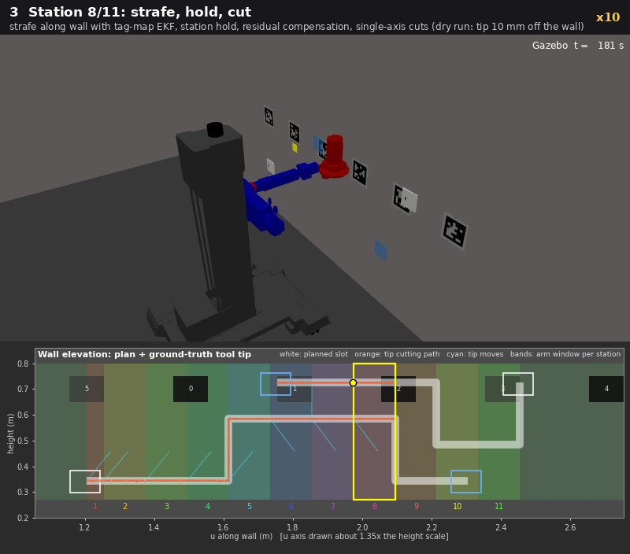

*图 9：演示运行第 8 站切割：上为 Gazebo 演示相机（`oblique`），下为墙面立面图：白色宽线为规划槽线，橙红为真值刀尖切割段（空切，刀尖停在墙前 10 mm），青色为刀尖移动，彩色竖带为每站机械臂可达窗口，黄框为当前站，黑色方块为定位标记（[demo](../experiments/demo/README.md)，动画 [`slot_demo.gif`](../experiments/demo/slot_demo.gif)）。*

---

## 7 仿真保真度与评估方法

### 7.1 真值与配对实验

- **真值**：订阅 `/gazebo/model_states`（底盘）与 `/gazebo/link_states`（机械臂末端，加刀具前伸量得到刀尖），只用于评估，不进入控制或估计。第一个真值数字（对位误差 26.8 mm / 0.57°，与当时的 3 cm 容差几乎相等）即暴露出“进入容差边缘就停下”的问题（[EVOLUTION](../EVOLUTION.md) 第 2 节）。
- **配对实验**：对位实验用 `/gazebo/set_entity_state` 把机器人传送到固定种子生成的随机起点，所有条件共用同一组起点；离线实验同样固定种子、逐墙配对。统计检验用 Wilcoxon 符号秩检验与配对 bootstrap 置信区间；未做检验时只报告样本量与范围，不写“显著”。
- **误差口径**：对位误差统一取控制器宣布到位时刻的真值。第一版的存档数据（2.0 ± 0.6 mm）是停车约 1 s 后读取的，包含零速滑移，口径不同，单独存档；新口径下第一版为 4.16 mm（[alignment_robustness](../experiments/alignment_robustness/README.md#与存档数据的比较)）。
- **安全指标**：刀尖间隙 = 真值离墙距离 − TF 给出的刀尖前伸，< 0 记为碰墙。
- **加速仿真**：控制环按仿真时钟计时；`rtf:=2.5` 下 Python 每周期的计算按仿真时间放大，实际控制周期约 100 ms，第 4.5 节的离散分析覆盖了这一周期。

### 7.2 仿真配置 v1 / v2

**现象**：空旷处的受控实验中，四种机械臂姿态下底盘实际转速只有指令的 18–37 %，平移正常（[EVOLUTION](../EVOLUTION.md) 第 4.2 节）。

**排查**：否定了地面摩擦、轮子拖拽、`hold_joints` 设置等假设；一组“机械臂伸出时转向反向”的数据经复查来自机器人接触了墙面或家具，作废。去掉 ros2_control 后转速恢复到 98–99 %，说明机械臂关节的驱动方式是主因。

**根因（两层）**：（1）gazebo_ros2_control 的位置接口每个周期把机械臂关节直接设到目标位置，丢掉了随底盘旋转应有的速度；（2）`gazebo_ros_planar_move` 给所有连杆设同一个线速度，偏心连杆在旋转时速度不一致，被关节约束抵消。两层叠加，只改其中一层不够。

**修复与验证**：机械臂关节改为 `position_pid` 力控、轮子改 `velocity_pid`，底盘换成力控插件 `scr_planar_move`。所有姿态下转速比与平移比在 0.99–1.01；机械臂跟踪误差 ≤ 0.2 mm / 0.14°；以 0.2 m/s 冲墙时在刀具接触处停住、不穿透。

| | 仿真配置 v1 | 仿真配置 v2 |
|---|---|---|
| 机械臂关节 | 位置接口（每周期直接设位置） | `position_pid` 力控 |
| 底盘 | `gazebo_ros_planar_move` | 力控插件 `scr_planar_move` |
| 底盘转速 / 指令 | 18–37 % | 0.99–1.01 |
| 多站优化方案总耗时 | 254 s | 249.8 / 249.9 s |
| 多站刀尖轨迹误差 最大 | 6.5–11.9 mm | 1.2–2.7 mm |

配置变化后的连锁处理：定点保持按力控底盘重新整定；引入空切（刚体墙会把机器人顶开）；对位、多站执行与时间模型重新测量或标定，旧数据保留并标注配置版本（多站执行 v1 → v2 的精度提高同时来自仿真修复与统一后的定点保持，两者未拆开）。

### 7.3 其他保真度修正

- **实时率**：碰撞模型直接使用约 29.7 万个三角面的 STL 网格，仿真只有 0.46 倍实时；换成拟合的长方体和圆柱体后为 1.00（[EVOLUTION](../EVOLUTION.md) 第 2 节）。
- **相机主点**：多位姿逐项比较检测像素与真值投影，发现 u、v 都恒偏 −1.0 px；原因是 `gazebo_ros_camera` 发布的主点为 (W+1)/2，而 OpenCV 约定为 (W−1)/2。修正后标记横向估计偏差从 +2.0 ± 0.9 mm 降到 −0.01 ± 0.41 mm（[EVOLUTION](../EVOLUTION.md) 第 3.4 节）。
- **刀尖安全余量**：鲁棒性实验暴露出对位目标处刀尖与墙面只有约 4 mm 余量；接近与扫描时伸缩轴完全缩回（余量 24 mm），并加入按制动距离限速的激光防碰撞守护（[EVOLUTION](../EVOLUTION.md) 第 3.3、3.5 节）。

---

## 8 实验结果汇总

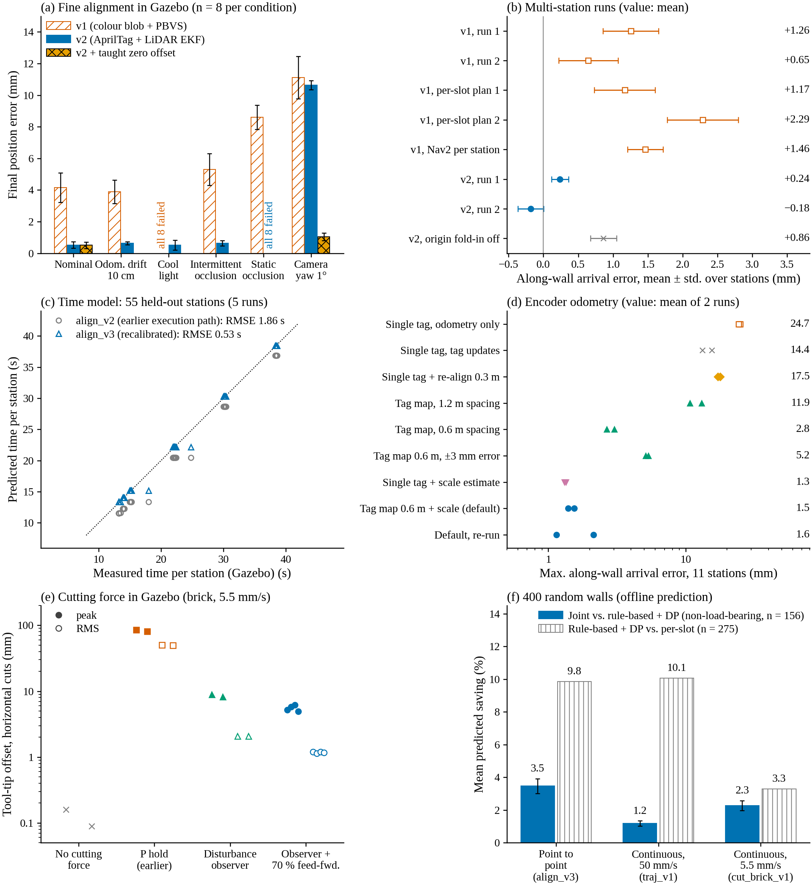

*图 10：(a) 精对位配对实验（Gazebo，n = 8 / 条件）；(b) 多站执行每次运行的到站沿墙误差（横轴，均值 ± 站间标准差，右列为均值；Gazebo，真值里程计）；(c) 当前默认路径下 5 次未参与标定的运行（55 站）上，`align_v2` 与 `align_v3` 的每站预测与实测（Gazebo，样本外）；(d) 400 面随机墙配对样本上的平均预测执行时间（离线，模型预测），三种时间模型。数据来自各实验报告的 CSV，作图脚本 [`make_figures.py`](make_figures.py)。*

### 8.1 Gazebo 实测结果

| 方向 | 指标 | 结果 | 依据 |
|---|---|---|---|
| 精对位 | 名义条件到位误差 | 4.16 ± 0.94 → 0.53 ± 0.21 mm（n = 8，配对） | [alignment_robustness](../experiments/alignment_robustness/README.md) |
| | 冷光 / 间歇遮挡 / 里程计漂移 10 cm | 第二版 0.52 / 0.63 / 0.63 mm；第一版冷光下 0 / 8 成功 | 同上 |
| | 全程遮挡 | 第一版 8.6 mm 无告警；第二版 0 / 8 不运动、报告失败 | 同上 |
| | 相机 1° 安装偏角 | 10.63 mm → 示教零位后 1.04 mm | 同上 |
| | 安全 | 184 次试验零碰墙，最小刀尖间隙 21.2 mm | 同上 |
| 多站执行 | 完成率 | 两条槽 11 站，8 次端到端运行全部完成，0 个点被限位钳制 | [slot_execution](../experiments/slot_execution/README.md) |
| | 每次运行常值横向偏差 | +0.65 – +2.29 mm → +0.24 / −0.18 mm（2 次）；消融 +0.86 mm | 同上 |
| | 刀尖轨迹误差 最大 | 1.2–1.3 mm → 0.77–0.93 mm | 同上 |
| | 停靠站优化 | 283.1 / 283.7 s → 249.8 / 249.9 s（−11.8 %，第一版精对位） | 同上 |
| | 精对位第二版的总耗时 | 249.8 → 233.2–233.7 s | 同上 |
| 系统层 | 行为树执行（早期底盘） | 11 / 11 站，刀尖轨迹误差最大 1.36 mm，232.5 s（原顺序程序 233.2–233.5 s） | [system_modernization](../experiments/system_modernization/README.md) |
| | Smac 2D + MPPI 与 NavFn + DWB | 18 / 18 与 15 / 18 到达；最小间隙 183 与 5 mm；控制器 CPU 9.7 与 45.5 %（单核） | 同上 |
| | 里程计漂移（129 m，2 个种子） | 轮式 1.42 / 1.59 % → 融合陀螺 0.14 / 0.26 % | 同上 |
| 真实里程计 | 单站精对位 / 定点保持漂移 | 0.7 mm / 0.10 mm（真值里程计时 0.5 / 0.22 mm） | 同上 |
| | 多站到站沿墙误差（11 站，平均绝对值 / 最大，单标记，1 次运行） | 0.19 / 0.53 mm（真值里程计）→ 11.5 / 24.8 mm；横移时保留标记更新 5.0 / 14.4 mm | 同上 |
| | 多站最大到站沿墙误差（11 站，各 2 次运行的均值） | 单标记 24.7 mm → 标记间距 0.6 m 2.8 mm → 再加横移比例估计 **1.5 mm**（平均 0.7 mm；默认配置复测 2.1 / 1.1 mm） | [along_wall_accuracy](../experiments/along_wall_accuracy/README.md) |
| | 刀尖（默认配置） | 补偿后沿墙误差最大 1.1 mm，轨迹误差 95 分位 0.23 mm，总耗时 295 s（单标记基线 272 s） | 同上 |
| | 单标记 + 按行程重新对位 | 阈值 0.3 / 0.15 m：17.5 / 20.6 mm，耗时 +48 / +77 s，没有改善 | 同上 |
| | 标记地图位置误差 ±3 mm | 最大沿墙误差 2.8 → 5.2 mm（不估计比例），几乎一比一进入结果 | 同上 |
| 规划验证 | 时间模型 `align_v3`，5 次样本外运行 | 各站之和误差 −1.7 … +0.7 s（≤ 0.7 %）；`align_v2` 低估 18–21 s | [plan_validation](../experiments/plan_validation/README.md) |
| | room3 示例：规则路线 → 联合规划（各 2 次） | 245.7 / 246.0 s → 228.1 / 227.8 s，**−7.3 %**（预测 −6.6 %）；到站与刀尖误差相同 | 同上 |
| 仿真保真度 | 底盘转速比 | 18–37 % → 0.99–1.01 | [EVOLUTION](../EVOLUTION.md) |
| | 切割期间底盘漂移 | 24.9 mm（无保持）→ 0.2 mm；多站执行中 ≤ 0.32 mm | 同上 |
| | 平移时只出现在位姿里的转动 | 1.2 × 10⁻³ → 1 × 10⁻⁵ rad/s（速度闭环与传感器改用位姿差分） | [system_modernization](../experiments/system_modernization/README.md) |

除“系统层”“真实里程计”“规划验证”三组与最后一行外，表中 Gazebo 结果都在早期配置（`/odom` 为真值）下取得。

**真实里程计下的多站执行**（[system_modernization](../experiments/system_modernization/README.md#45-真实里程计下的精对位与多站执行) 4.5 节，各 1 次运行）：编码器误差模型 + EKF 下，11 站全部完成、没有触发恢复，到站的离墙与朝向误差仍为 0.24 mm / 0.05°，但沿墙误差逐站增长，按站序为 +7.8 mm 至 −24.8 mm，与离标记的距离近似成正比，比例约 −2.8 %，与编码器模型的横移打滑 3 % 相符。传感器给出的到站残差始终在 ±0.2 mm 以内：激光只能观测离墙距离与朝向，站间横移关闭了标记更新，沿墙位置只有里程计外推，残差补偿无从修正这一部分。横移时保留标记更新后，标记仍在视野内的站被拉回（最大误差降到 14.4 mm），远离标记的站误差仍随距离增长。后续实验（第 6.6 节，[along_wall_accuracy](../experiments/along_wall_accuracy/README.md)，每个配置 2 次运行）以 0.6 m 间距的标记地图加横移比例在线估计把最大沿墙误差降到 1.5 mm，比例估计 −2.7 … −3.0 % 与 3 % 的横移打滑相符；这一组合已设为默认配置。

### 8.2 离线结果

| 方向 | 指标 | 结果 | 依据 |
|---|---|---|---|
| 开槽规划 | 违规路线 | C++ + 规范 0 / 140；第一版规划器 106 / 140 | [cpp_planner](../experiments/cpp_planner/README.md) |
| | 同一问题上的最优性 | 第一版规划器 16 % 场景多一个弯；C++ 快 56 倍（中位） | 同上 |
| 精对位 | 蒙特卡洛 200 起点 | 3.41 ± 0.74 → 0.80 ± 0.26 mm | [fine_alignment](../experiments/fine_alignment/README.md) |
| 视觉伺服对比 | 纯 IBVS 可观性 | 特征雅可比条件数 314；0.5 px 噪声下 25 / 100 次满足停止判据 | [ibvs_vs_pbvs](../experiments/ibvs_vs_pbvs/README.md) |
| 任务级规划 | 见第 5.5 节与下节（Gazebo 执行见第 6.7 节） | 模型预测 | [task_planning](../experiments/task_planning/README.md) |

### 8.3 时间模型重标定后的规划结果（模型预测）

用第 6.4 节重标定的 `align_v2` 与 `align_v3`（当前默认）模型，在同一组 400 面墙上重跑任务级规划实验（[task_planning](../experiments/task_planning/README.md#时间模型重标定当前默认执行路径与-gazebo-验证)，数据 `align_v2/`、`align_v3/`）。以下均为**模型预测**：

| 指标 | `align_v1` | `align_v2` | `align_v3`（默认） |
|---|---|---|---|
| 配对墙平均预测时间：逐槽基线 / 分步 / 联合 / 下界 | 174.3 / 155.8 / 150.6 / 149.3 s | 159.5 / 142.2 / 137.0 / 135.7 s | 175.6 / 157.4 / 152.2 / 150.9 s |
| 分步 → 联合，非承重墙（n = 156） | 3.53 %，95 % CI [3.08, 3.98] % | 3.84 %，95 % CI [3.34, 4.34] % | **3.46 %**，95 % CI [3.02, 3.91] % |
| 逐槽基线 → 联合，全部（n = 275） | 11.93 % | 12.41 % | 11.69 % |
| 联合规划证明最优 | 92.4 % | 92.0 % | 92.0 % |
| room3 南墙示例：分步（修正后评估）/ 联合 | 241.8 / 225.5 s | 225.3 / 208.9 s（−7.3 %） | 244.4 / 228.1 s（−6.6 %） |

- 结论不随时间模型改变。`align_v3` 的参数与 `align_v1` 接近（每站固定开销 4.70 对 4.40 s，每点 2.030 对 2.034 s），结果也接近；联合规划的绝对节省约 9.1 s 不变。`align_v2` 下 t_settle 降低后停靠站数的权重下降，而联合规划的收益来自机械臂点数，所以绝对节省基本不变（9.2 → 9.1 s），相对节省略增。原报告的敏感性分析曾据此预计节省落在 3.1–3.6 % 之间；在同一 42 面墙子集上实测为 3.46 %。
- 配对样本完全相同；273 / 275 面墙上两种模型下联合规划的站数与点数相同。有 1 面墙（种子 1220）在 `align_v2` 下“各槽独立”的站感知变体比联合规划快 8.2 s：联合规划的候选只含共享窗口变体与规则路线，“不劣于”只对后两者成立；`align_v3` 下没有出现这种墙。
- room3 示例任务的两份规划已在 Gazebo 中执行（第 6.7 节）：实测 245.7–246.0 s 与 227.8–228.1 s，节省 7.3 %，与 `align_v3` 预测的 6.6 % 一致。它比 400 面墙的平均值大，因为这面墙有两条带拐点的槽，属于节省较多的一类（`align_v3` 下 2 条槽的非承重墙平均 4.37 %）。

### 8.4 视觉伺服方法对比

在离线运动学仿真中把 PBVS 与纯 IBVS（四角点）、2.5D 混合方案（激光管朝向与距离、图像质心管横向）对比，共约 1.25 万次试验（[ibvs_vs_pbvs](../experiments/ibvs_vs_pbvs/README.md)，**离线**，5 cm 色块标记）：

- 期望位姿处 IBVS 的特征雅可比奇异值为 4.43 / 0.70 / 0.014，条件数 314；最弱方向是“绕标记竖直轴公转”，1° 偏航只带来约 0.05 px 的边长差。1 px 角点噪声对应 8.7° 的偏航标准差，而激光单次拟合墙面的偏航标准差为 0.23°。
- 0.5 px 噪声下 IBVS 100 次中只有 25 次满足停止判据，2 px 时为 0；相机俯仰 1°、主点 cy 偏 5 px 或标记高度变化 1 cm，都会让 IBVS 收敛到偏 5–9 cm、4–6° 的位姿，部分情况刀具撞墙。
- IBVS “对标定不敏感”的优点在这里完全来自示教的期望特征；给 PBVS 同样做一次示教零偏，所有静态标定误差同样被吸收。
- 这项对比得出的两个改进方向——示教零位与停止判据——成为精对位第二版的设计依据。

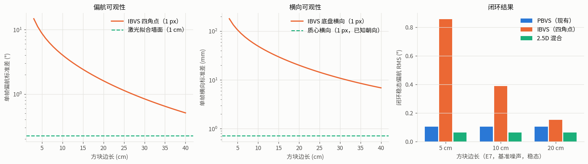

*图 11：IBVS 特征雅可比的可观性分析：(a)(b) 单帧测量标准差随标记边长的变化，(c) 闭环稳态偏航 RMS（[ibvs_vs_pbvs](../experiments/ibvs_vs_pbvs/README.md)）。*

---

## 9 讨论与局限

### 9.1 已证实与推测

**已证实**（有对照实验或独立检查）：

- 精对位第二版在名义条件下的误差主要由稳态扰动而非停止判据决定；检测器在光照与遮挡下起决定作用（检测器消融）。
- 多站执行的常值横向偏差来自以停车位姿为原点（原点修正的消融）。
- 规范约束的分段 A\* 在随机栅格上与独立 Dijkstra 的最优代价一致；联合规划不劣于分步方法（规则路线也是候选），且 0 违规（独立检查）。
- 底盘旋转失真的两层根因（逐层替换的对照实验）。
- 行为树编排没有改变执行精度与耗时；Smac 2D + MPPI 在本场景中的到达率、离障间隙与 CPU 优于 NavFn + DWB；融合陀螺把里程计漂移降低一个数量级，前提是陀螺能测到底盘的全部转动（第 2.3 节）。
- 局部闭环需要的里程计与导航需要的不同：用 EKF 输出做定点保持时底盘随之漂移，改用轮式里程计后恢复到 0.1–0.2 mm（对照运行）。
- 真实里程计下多站沿墙误差来自里程计的横移比例误差：基线 4 次运行的斜率 −2.7 … −3.3 %，在线估计的比例修正 −2.7 … −3.0 % 与编码器模型的 3 % 横移打滑相符，补偿后斜率在 ±0.2 % 以内（第 6.6 节）。
- 沿墙位置只在看到标记时可观测：多标记的效果完全由每站是否有可见标记决定；单标记下按行程重新对位不能消除比例误差（标记间距与重新对位的对照运行）。
- 联合规划的节省在 Gazebo 中成立：room3 示例任务上同种子配对的两次比较都快 17.6–18.2 s，来源（机械臂点数）与离线分析一致，执行精度不变；当前路径重标定的时间模型对未参与标定的规划预测各站之和误差 ≤ 0.7 %。执行路径改变后旧预设会系统性失准（`align_v2` 低估约 7.5 %）（第 6.4、6.7 节）。

**推测**（与数据一致，但未单独验证）：

- 名义条件下 +0.43 mm 的沿墙偏差来自仿真中零速滑移造成的比例控制稳态误差（未改变 k 验证）。
- 跨槽共享窗口与坐标下降没有额外收益，是因为本生成器的墙面上同一高度带内两条槽横向重叠的情形较少。
- 联合规划未闭合下界的 21 面墙上，下界因忽略槽间约束而偏松；这些墙上联合规划是否最优未知。
- 约 2–3 s 的偶发停顿出现在哪一站是随机的；2 + 2 次运行不足以判断它是否与规划有关（例如与点数成正比）。
- 不估计横移比例的多标记配置中剩余的 1–2 mm 偏差来自横移中的系统误差经互协方差泄漏到朝向估计（与约 0.1° 的朝向偏差同步；估计比例后消失），没有做“关闭横向打滑、其他不变”的对照运行。

### 9.2 局限

- **只在仿真中验证**：Gazebo 渲染没有运动模糊、卷帘快门、镜头畸变与自动曝光；第 4–6 章的数据在 `/odom` 为真值的早期配置下取得，墙面 EKF 的过程噪声未经真实里程计检验；编码器误差模型的各项数值按麦克纳姆底盘的常见情况假设，不是标定结果；底盘由力直接驱动、轮子不参与，打滑只体现在测量上而不影响运动；陀螺模型不含刻度因子误差、温漂与振动；空切不受切削反力。真机上需要相机内参标定、里程计标定、重新评估测量噪声协方差、评估切削反力对定点保持的影响，并重新标定时间模型。
- **样本量**：对位实验每条件 8 次，多站执行第二版只有 2 + 1 次运行；亚毫米级的差异不应过度解读。
- **时间模型**：每个机械臂点固定约 2 s，与切割长度无关（Gazebo 中 `motion.duration = 2.0 s`）；真实切割受进给速度限制。`align_v3` 的标定数据都是 11 站、0.05–0.23 m 三档横移距离的规划，更长的横移或站内点数超过 16 的情形是外推；时间模型不含导航与首次精对位，多面墙任务需要单独建模。400 面墙的收益都是模型预测，Gazebo 中只执行了一面墙的一组任务（联合规划与规则路线各 2 次）；偶发停顿的原因没有定位。
- **规范**：横槽 ≤ 50 cm、强弱电间距等属于行业做法，门窗与梁的留距借用了脚手眼条款，线盒与墙边净距是假设；宽墙上会产生多弯的台阶形路线，施工中通常改走吊顶或地面，单面墙的规划无法做这种决策。
- **多槽可行性**：仍是逐条规划加顺序重排，400 面墙中 106 面所有方法都无解。
- **多站执行的沿墙精度依赖墙上的标记**：激光只能观测离墙距离与朝向，沿墙位置只有标记能观测。默认配置的 1.5 mm（第 6.6 节）需要每 0.6 m 一个标记且地图记录的是实测粘贴位置（±3 mm 的记录误差使结果变为 5.2 mm）；横移比例按恒定的 3 % 假设，随地面、负载与速度的变化没有建模，比例随机游走 0.2 %/√m 未经真机数据标定，比例突变后需要几十厘米的带标记横移才能重新收敛。每个配置只有 2 次运行，同一种子的两次运行也有约 1 mm 的差异，配置间 1 mm 左右的差别不能区分。规划在 11 站中单调向右，往返式规划未测。不依赖人工标记的方案只做了分析。标记被完全遮挡时无法对位（安全失败）。
- **系统层的其他遗留**：`robot_localization` 的 EKF 在 mm/s 级慢速运动下偏小，原因未查明；Gazebo 中只出现在位姿里的转动推测来自 ODE 的约束误差修正，未证实；轮子驱动的被控对象跟踪与里程计明显变差，未与真机数据对照；导航对比在早期底盘上进行，DWB 未在新底盘上重复；系统层实验多为每种配置 1–3 次运行。
- **离散时间分析是线性区的**：饱和与延迟同时存在时的稳定性只给出近似论证。

---

## 10 结论与展望

本项目在仿真中实现并评估了一台墙面开槽机器人从导航、精对位、规划到多站执行的完整链路，主要结论如下：

1. 把精对位拆成检测、估计、控制与判据四个独立环节后，到位误差从由停止判据决定的约 4 mm 降到由稳态扰动决定的约 0.5 mm；有身份的标记把“遮挡下的静默偏差”变成“安全失败”；示教零位以一次真值摆位吸收静态标定误差。
2. 以整段直线为搜索边，施工规范可以作为硬约束进入搜索而不牺牲最优性；只避障的规划会系统性地违反规范。
3. 停靠站的划分、顺序与槽线走向共同决定执行时间；在时间模型下，联合规划从不劣于分步方法，并能用下界证书在多数墙上证明最优。在 Gazebo 中，示例任务的联合规划比规则路线快 7.3 %（预测 6.6 %），执行精度不变；时间模型需要随执行路径重标定，切割阶段的固定开销要单独估计，否则会高估减少机械臂点数的收益。
4. 多站执行中的主要误差曾是继承自起点对位的常值偏差；以估计的标记位置为墙面原点后，它降到与站间重复性相当的 ±0.2 mm 量级。引入编码器误差后，沿墙误差的来源变为里程计方向固定的横移比例误差：沿墙位置只在看到标记时可观测，按行程重新对位无效，而间距不超过相机可见窗口的标记地图加横移比例在线估计把 11 站的最大沿墙误差从 24.7 mm 降到 1.5 mm。
5. 仿真器本身可能是误差来源。指标异常时先在受控条件下检验仿真是否按指令运动，并为仿真配置标注版本，是本项目多次得到可信结论的前提；系统层改造中“只出现在位姿里的转动”同样是在引入真实里程计后才暴露的。

**下一步**：

- 沿墙精度的后续工作（第 6.6、9.2 节）：标记粘贴后实测位置，或用相邻标记的已知间距在线修正地图；以对照实验确认剩余 1–2 mm 偏差的来源；把墙角、门框或 BIM 墙面配准作为标记的补充；查明 EKF 慢速响应偏小的原因；
- 在更多墙面与多面墙任务上执行联合规划，检验时间模型在长距离横移、站内点数更多时的外推，并把导航与首次精对位纳入多面墙的时间模型；定位约 2–3 s 的偶发停顿；
- 多槽可行性：借鉴 VLSI 布线中的协商式拥塞消解，并在路线不合理或无解时给出改走吊顶 / 地面等替代方案；
- 停靠站位姿与占用地图的碰撞检查；
- 真机验证：相机标定、真实里程计下的 EKF 噪声参数、切削反力与定点保持。

---

## 11 参考文献

1. Macenski, S., Foote, T., Gerkey, B., Lalancette, C., Woodall, W. Robot Operating System 2: Design, architecture, and uses in the wild. *Science Robotics*, 7(66), 2022.
2. Macenski, S., Martín, F., White, R., Ginés Clavero, J. The Marathon 2: A navigation system. *IEEE/RSJ IROS*, 2020.
3. Olson, E. AprilTag: A robust and flexible visual fiducial system. *IEEE ICRA*, 2011.
4. Wang, J., Olson, E. AprilTag 2: Efficient and robust fiducial detection. *IEEE/RSJ IROS*, 2016.
5. Chaumette, F., Hutchinson, S. Visual servo control, Part I: Basic approaches. *IEEE Robotics & Automation Magazine*, 13(4): 82–90, 2006.
6. Malis, E., Chaumette, F., Boudet, S. 2½D visual servoing. *IEEE Transactions on Robotics and Automation*, 15(2): 238–250, 1999.
7. Collins, T., Bartoli, A. Infinitesimal plane-based pose estimation. *International Journal of Computer Vision*, 109(3): 252–286, 2014.
8. Khalil, H. K. *Nonlinear Systems*, 3rd ed. Prentice Hall, 2002.
9. GB 50203-2011 砌体结构工程施工质量验收规范.
10. GB 50303-2015 建筑电气工程施工质量验收规范.
11. Hart, P. E., Nilsson, N. J., Raphael, B. A formal basis for the heuristic determination of minimum cost paths. *IEEE Transactions on Systems Science and Cybernetics*, 4(2): 100–107, 1968.
12. Thrun, S., Burgard, W., Fox, D. *Probabilistic Robotics*. MIT Press, 2005.
13. Zacharias, F., Borst, C., Hirzinger, G. Capturing robot workspace structure: representing robot capabilities. *IEEE/RSJ IROS*, 2007.
14. Vahrenkamp, N., Asfour, T., Dillmann, R. Robot placement based on reachability inversion. *IEEE ICRA*, 2013.
15. Adrian, N., Pham, Q.-C. MoboTSP: Solving the task sequencing problem for mobile manipulators. arXiv:2011.04461, 2020.
16. Giftthaler, M., Sandy, T., Dörfler, K., et al. Mobile robotic fabrication at 1:1 scale: the In situ Fabricator. *Construction Robotics*, 1: 3–14, 2017.
17. Lee, C. Y. An algorithm for path connections and its applications. *IRE Transactions on Electronic Computers*, EC-10(3): 346–365, 1961.
18. Macenski, S., Jambrecic, I. SLAM Toolbox: SLAM for the dynamic world. *Journal of Open Source Software*, 6(61): 2783, 2021.
19. Koenig, N., Howard, A. Design and use paradigms for Gazebo, an open-source multi-robot simulator. *IEEE/RSJ IROS*, 2004.
20. Colledanchise, M., Ögren, P. *Behavior Trees in Robotics and AI: An Introduction*. CRC Press, 2018.
21. Williams, G., Wagener, N., Goldfain, B., et al. Information theoretic MPC for model-based reinforcement learning. *IEEE ICRA*, 2017.
22. Moore, T., Stouch, D. A generalized extended Kalman filter implementation for the Robot Operating System. *Intelligent Autonomous Systems 13*, Springer, 2016.

各部分的实现细节、完整数据与复现命令见对应实验报告；项目的迭代过程见 [项目演进](../EVOLUTION.md)。
