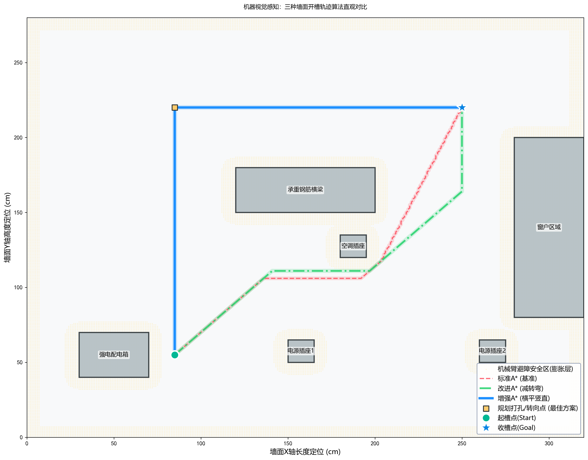

# path_planning：第一版规划器（Python 原型）

本项目的第一版路径规划器，用纯 Python 实现标准 / 改进 / 增强三种 A\*，并在 SLAM 地图和墙面开槽两个场景上对比。它不是 ROS 包，不参与 `colcon build`。

后续的 C++ 开槽规划器 [`scr_planner`](../scr_planner/README.md) 在此基础上重写：修正了转弯数不保证最优的问题，并把施工规范作为硬约束（对比见 [开槽规划报告](../../docs/experiments/cpp_planner/README.md)）。本目录保留作为对照基线。

## 算法

| 类 | 内容 |
|---|---|
| `StandardAStar` | 8 邻域 A\*，作为基准 |
| `ImprovedAStar` | 加入转向惩罚 |
| `EnhancedAStar` | 转向惩罚 + 横平竖直方向约束 + 曼哈顿启发 + 自适应代价 + 路径平滑 |

增强 A\* 按格搜索，状态为 `(x, y)`，同一格只保留第一次出栈的方向，因此转弯数不保证最优；规范只能通过膨胀障碍间接体现。

## 用法

```bash
pip install numpy matplotlib pillow
cd src/path_planning
python3 improved_astar.py         # 基于 SLAM 地图的三算法对比 → path_comparison.png、metrics_comparison.png
python3 wall_cutting_planner.py   # 墙面开槽轨迹的三算法对比 → wall_cutting_comparison.png、wall_cutting_metrics.png
```

## 结果



*图 1：3.2 × 2.8 m 墙面上三种 A\* 的开槽轨迹（横轴为墙面水平位置，纵轴为离地高度，单位 cm）：灰色点线为标准 A\*，橙色点线为带转向惩罚的改进 A\*，蓝实线为横平竖直约束的增强 A\*（白方块为其转弯点）；深灰框为障碍，浅灰为 8 cm 安全边距。*

| 指标（3.2 × 2.8 m 墙面） | 标准 A\* | 改进 A\* | 增强 A\* |
|---|---|---|---|
| 转向次数 | 95 | 3 | 1 |
| 横平竖直比例 | 50.7 % | 50.7 % | 100 % |

目录中的 `pid_control_diagram.png` 是早期对位控制的框图（由 `draw_pid_diagram.py` 绘制）。
